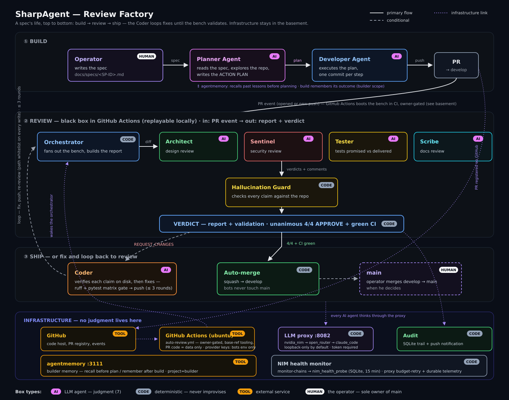
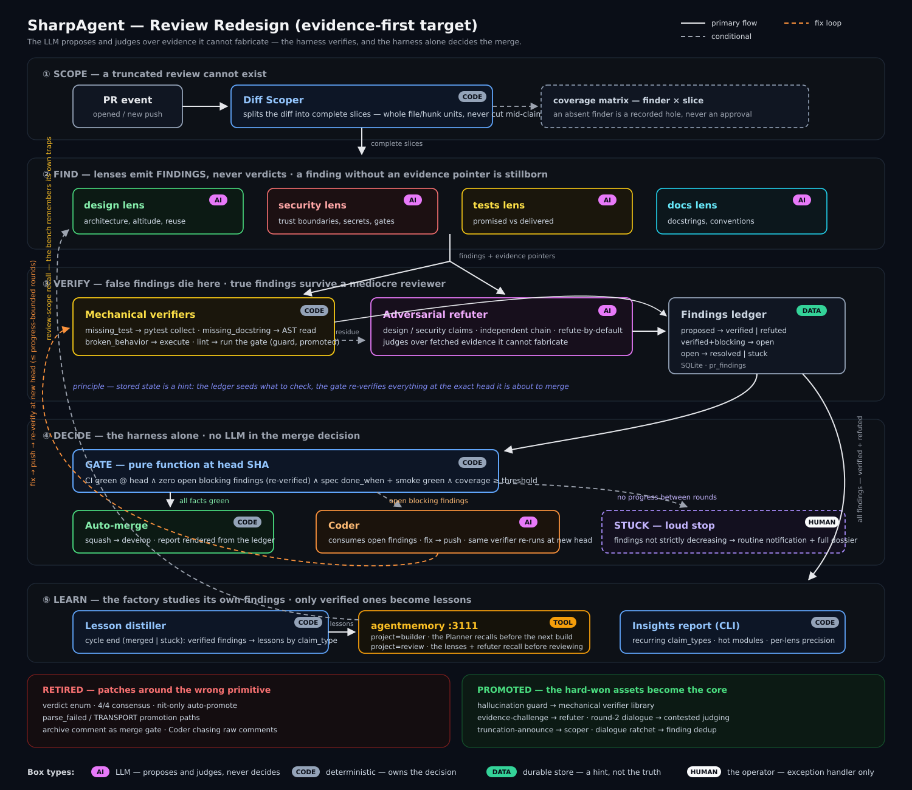
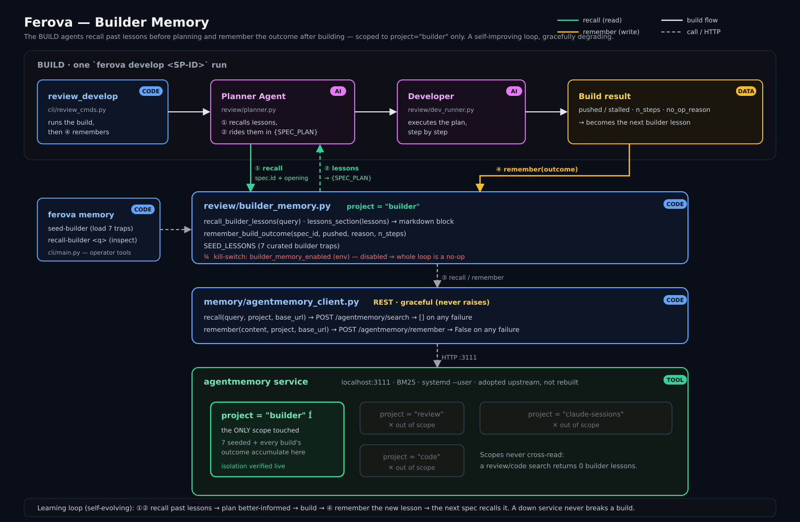
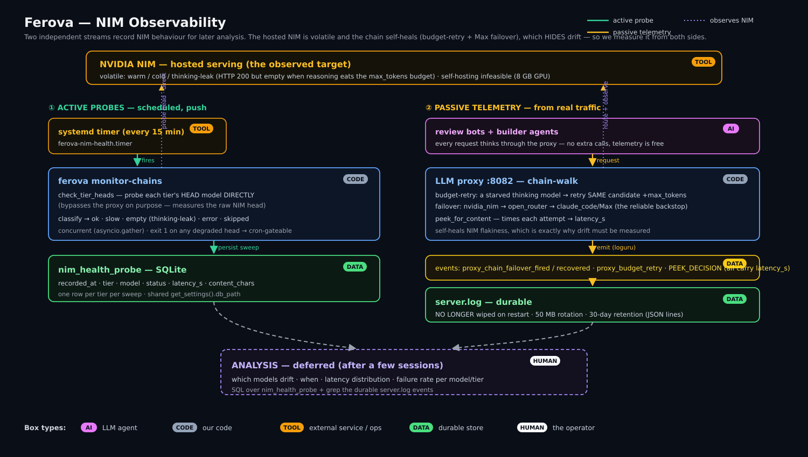

<div align="center">

<picture>
  <source media="(prefers-color-scheme: dark)" srcset="assets/logo-dark.svg">
  
</picture>

# Repoach

### The self-forging software factory.

*A governed spec, an autonomous developer that must satisfy it, four reviewers refuted before they are believed, and a merge gate that trusts evidence — running on its own repository first.*

[](https://github.com/repoachhq/repoach/actions/workflows/ci.yml) [](LICENSE) [](https://github.com/repoachhq/repoach)

</div>

---

**Repoach** is an autonomous software factory. It ships changes through a multi-agent review pipeline that re-verifies its own findings before anything merges, and its agents reach their models through one local LLM gateway with chain failover across providers. Today it runs on one repository — this one, on GitHub, in Python. Running it on *your* repository, on GitLab as well as GitHub, in any language, is the direction (see [Status](#status)), not what the code does yet.

## Why Repoach is different

Most "AI writes your code" tools trust the model. **Repoach trusts evidence.**

### 1. Evidence-first merge gate
Agents can't approve their own work. Every finding a reviewer raises is **re-verified against the current HEAD** before a merge is allowed. There is no forgeable "LGTM" — the gate re-checks the facts (CI green, zero surviving blockers, complete review, spec covered) at merge time, every time.

### 2. Governed specs
Every change is anchored to a spec whose frontmatter declares **what it owns** and **what it depends on**. From that, Repoach *derives* the system's dependency graph — and *enforces* it: an import that crosses a boundary the spec never declared fails CI (`repoach arch check`). The architecture can't silently drift from the docs.

### 3. Failover routing, with a shadow autopilot
Repoach runs its agents through one gateway with ten provider slots — NVIDIA NIM, OpenRouter, Kimi, Groq, Cerebras, DeepSeek, OpenAI, Anthropic, any OpenAI-compatible endpoint, and the local `claude` CLI — and walks a failover chain per capability tier (`chains.env`). A chain autopilot watches each head's live health and plans rewrites of the chains, bounded by a hard cap of two mutations per cycle. It runs in **shadow mode** unless writing is enabled with `--apply` or `REPOACH_CHAINPILOT_APPLY_ENABLED=true`: it journals what it would change and writes nothing. The deployed timer runs it in shadow.

### 🔁 It builds itself
Repoach is built by Repoach. Every substantive change starts as a spec in `docs/specs/`, is planned and implemented by the factory's own Developer, and is opened as a PR against `develop` that the four-reviewer bench reviews. Of the 200 PRs merged so far, 65 were merged by the bot lane and 135 by the maintainer through `scripts/safe_merge.sh`, which runs the same review and gate before `gh pr merge` (measured 2026-10-18 on the GitHub PR list). **The factory is its own first customer.**

## How it works

A spec's life, top to bottom: build → review → ship. Four reviewers and a claim-verification layer feed a findings ledger; a pure evidence-first gate re-verifies everything at the exact head it is about to merge.



### Deeper dives

<details>
<summary><b>The review pipeline</b> — findings, mechanical verifiers, adversarial refuter, and the merge gate</summary>


</details>

<details>
<summary><b>Builder memory</b> — the factory recalls past lessons before planning and remembers each build's outcome</summary>


</details>

<details>
<summary><b>Provider observability</b> — active probes + passive telemetry around the LLM gateway</summary>


</details>

## Watch it work

Here's a spec going from *written* to *shipped* — the same loop every change in this repo travels. The values are illustrative and each JSON is abridged to the fields that matter; the real payloads carry more keys, and `repoach <command> --help` lists the exit codes.

**1 · You write a spec, the factory builds it.** The Planner drafts a plan (`docs/plans/<SP-ID>.md`), then the Developer executes it one commit per step and opens a PR against `develop`:

```console
$ repoach develop SP-BUDGET-RETRY-BACKOFF
{
  "spec_id": "SP-BUDGET-RETRY-BACKOFF",
  "branch": "feat/sp-budget-retry-backoff-impl",
  "steps_total": 4,
  "steps_completed": 4,
  "ruff_passed": true,
  "pytest_passed": true,
  "self_verified": true,
  "pushed": true
}
```

**2 · Four reviewers judge it — independently.** Architect, Sentinel, Tester, and Scribe each return a verdict. A single `REQUEST_CHANGES` wins:

```console
$ repoach review pr 42
{
  "pr_number": 42,
  "final_verdict": "REQUEST_CHANGES",
  "n_blockers": 1,
  "posted_comments": 1,
  "reviews": [
    { "role": "architect", "verdict": "APPROVE",         "summary": "Boundary clean; policy owned by the spec." },
    { "role": "sentinel",  "verdict": "REQUEST_CHANGES", "summary": "Backoff has no jitter cap — a retry storm is reachable." },
    { "role": "tester",    "verdict": "APPROVE",         "summary": "Integration test exercises breaker recovery." },
    { "role": "scribe",    "verdict": "APPROVE",         "summary": "Docstrings Google-style; spec cross-referenced." }
  ]
}
```

Add `--dry-run` to run the same bench and persist its findings without posting to the PR (two known gaps in that mode are listed under [Status](#status)).

**3 · The Coder fixes what they found — then they re-verify.** One findings-driven iteration; each resolved finding is re-checked at the new head:

```console
$ repoach review fix 42
{ "n_open_findings": 1, "fixes_applied": 1, "pytest_passed": true, "pushed": true, "resolved": 1, "still_open": 0 }
```

**4 · The gate re-checks the facts at HEAD — and only then merges.** No "LGTM" is trusted: the gate re-verifies the findings ledger against the exact commit it is about to merge:

```console
$ repoach review gate 42
{
  "pr_number": 42,
  "head_sha": "9f6cd85",
  "merge": true,
  "reasons": [],
  "facts": { "ci_green": true, "open_blocking_findings": 0,
             "spec_covered": true, "review_complete": true }
}
```

`merge: true` → `repoach review merge 42` squash-merges the PR into `develop`. `merge: false` prints its reasons and blocks. That decision is byte-identical to the one `repoach review merge` acts on — the read-only gate and the merge share a single code path, so what you inspect is exactly what ships.

## Quickstart

There is no wheel to install yet (the `repoach` name on PyPI is a reservation — see [Status](#status)); install from a clone:

```bash
git clone https://github.com/repoachhq/repoach && cd repoach
python -m venv .venv && source .venv/bin/activate   # Python 3.11+
pip install -e ".[dev]"
cp .env.example .env      # required: without it only the top-level `repoach --help` works;
                          # `review pr --help`, `develop --help`, `arch check --help` and `version` exit 1

repoach --help            # the CLI
```

To run anything that calls a model, set two values in `.env` — `REPOACH_ANTHROPIC_AUTH_TOKEN` (the gateway's shared secret, any long random string) and one provider key — then start the gateway in a second terminal with `python -m repoach.llm_proxy`. With the gateway up and `gh auth login` done:

```bash
repoach review pr <N> --dry-run   # run the review bench on a PR, post nothing
repoach review gate <N>           # evidence-first merge gate, read-only
repoach develop <SP-ID> --no-push # plan-driven build from a spec, no push, no PR
```

The **[getting-started guide](docs/getting_started.md)** walks
you from clone to a live, authenticated call through the LLM gateway —
provider keys, `chains.env` routing, the CLI tour — and then through the
GitHub review factory on this repository.

## Run repoach in CI

`repoach ci review` reviews the pull / merge request of the CI job it runs in — no shell driver per project. It reads the forge and the PR number from the CI (`CI_MERGE_REQUEST_IID` on GitLab CI, `GITHUB_EVENT_PATH` on GitHub Actions; `--pr N` and `--forge` override), prints one JSON document on stdout and one human line on stderr, and is **advisory**: it always exits 0 unless `--strict`. A missing input is a named skip (`skipped, GITLAB_TOKEN / REPOACH_GITLAB_TOKEN is not set`), and nothing is posted unless `REPOACH_ADVISORY_POST` is exactly `1`. `repoach doctor --ci` lists, by name only, the variables it reads and which are present.

Write the job, then commit it:

```bash
repoach init --ci gitlab   # writes .repoach/ci/gitlab-review.yml, prints the pin and the include
repoach init --ci github   # writes .github/workflows/repoach-review.yml, prints the pin
repoach init --ci gitlab --print   # print only, write nothing
```

The job pins the repoach that ran `init`, never a branch: the commit pip installed it from, the `HEAD` of a repoach checkout (push it before the job runs), or `repoach==<version>` from PyPI; `--ref <tag-or-sha>` or `--pypi-version X.Y.Z` override it.

On GitLab, add the printed include to `.gitlab-ci.yml` (repoach never edits it); override any key of the `review:advisory` job beside it, for example the runner tag:

```yaml
include:
  - local: .repoach/ci/gitlab-review.yml
review:advisory:
  tags: [my-runner]
```

The job installs the pinned repoach with every secret unset for the install step, then runs `repoach ci review`. Set, as masked CI/CD variables (GitLab) or secrets (GitHub):

| | GitLab | GitHub |
|---|---|---|
| Forge token | `REPOACH_GITLAB_TOKEN` (project access token, `api`) | `GITHUB_TOKEN` (provided) |
| Direct-provider mode | `REPOACH_ANTHROPIC_API_KEY` | secret `REPOACH_ANTHROPIC_API_KEY` |
| Gateway mode | `REPOACH_LLM_PROXY_BASE_URL` + `REPOACH_ANTHROPIC_AUTH_TOKEN` | variable `REPOACH_LLM_PROXY_BASE_URL` + secret `REPOACH_ANTHROPIC_AUTH_TOKEN` |
| Posting | `REPOACH_ADVISORY_POST=1` | variable `REPOACH_ADVISORY_POST=1` |

In **gateway mode** the review calls a repoach gateway you already run. In **direct-provider mode** the job starts a gateway on `127.0.0.1` for its own duration, with the Anthropic key as its only upstream (`REPOACH_MODEL_OPUS` / `_SONNET` / `_HAIKU` override the models) and a per-job shared secret; the key reaches that gateway and never the review, and the forge token reaches the review and never the gateway. Posting on GitLab also needs the bot's username (`[review].bot_username` in `repoach.toml`, or `REPOACH_REVIEW_BOT_LOGIN`).

Exit codes with `--strict`: `0` reviewed (APPROVE/COMMENT) or the PR already merged/closed, `1` internal error, `2` a missing input, bad flag or config, forge or provider unavailable, `3` a reviewer reached no model or the review outran `--timeout` (minutes, default 25; the child is killed with its process group), `4` changes requested. Any exception is one `internal_error` JSON, never a traceback.

## Safety

Letting agents write and merge code is only acceptable if the blast radius is bounded. In Repoach:

- Agents **never merge to the release branch** (`main`): the release gate is read-only and the operator merges. Into the integration branch (`develop`) they merge only through the evidence-first gate, and only when CI is green at the exact head.
- Every agent fix is **path-whitelisted** — no touching `.github/`, `.githooks/`, `prompts/review/`, `.git/` or any `.env*` file.
- Secrets are **scrubbed** from every subprocess that executes agent-authored code (test reruns, the Developer's tools, the read-only `claude -p` exploration): any variable named like a token, key, secret, password or credential is dropped.
- The chain autopilot is **shadow by default**, capped at two chain mutations per cycle, and writes `chains.env` atomically with a `.bak` only when writing is enabled with `--apply` or `REPOACH_CHAINPILOT_APPLY_ENABLED=true`.

## Contributing

Issues, docs, spec proposals, and code PRs are all welcome — but this
repo works a little differently: the factory is its own primary
developer, and every PR by an allow-listed actor goes through the same
bot-review team and evidence-first merge gate. The workflows run on a
self-hosted runner behind an actor allowlist, so a PR from outside is
picked up by the maintainer and run through the same pipeline by hand.
Start with **[CONTRIBUTING.md](CONTRIBUTING.md)** — it explains the
spec-driven workflow, the quality gates, and what to expect from the
review bots.

## Status

Early, and built in the open. What the code does on 2026-10-19 (`develop` 20dbb45), measured, not promised:

| Area | Today | Direction |
|---|---|---|
| Forge | GitHub only, through the `gh` CLI on your PATH (19 methods in `src/repoach/review/gh_client.py`). | A `Forge` protocol with GitHub and GitLab implementations — spec `SP-UNIVERSAL-FORGE`. |
| Languages and gates | Python: `ruff` + `pytest`, AST-based finding verifiers, `src/` + `tests/unit` layout assumed. | Per-project lint/test/gate commands, Python verifiers that step aside on other languages — `SP-UNIVERSAL-GATES`. |
| Install | From a clone with `pip install -e`; config, `chains.env`, `.env` and the SQLite ledger are anchored to the repoach checkout; `repoach init` scaffolds repoach itself, not your repository. The `repoach 0.0.1` on PyPI is a name reservation. | A wheel that boots without a gateway or a checkout (`pipx install repoach`) — `SP-UNIVERSAL-INSTALL`, milestone M1, pending. |
| Gateway | Required: the agents speak only HTTP to the local `llm_proxy`; a bring-your-own key still needs the gateway process running. | Direct providers in-process, gateway optional — `SP-UNIVERSAL-PROVIDERS`. |
| Models | The committed free chains are dead: every NVIDIA NIM head has answered HTTP 410 on 13 089 of the 13 203 probes since 2026-09-01 (read 2026-10-19); the remainder is 99 connection errors, 13 `ok` rows written by test fixtures, and 2 other; the last real `ok` was 2026-08-21. The OpenRouter credit is negative. The only hop that answers a review today is the `claude_code/<tier>` tail — your local `claude` login. | A key, not a chain (`SP-UNIVERSAL-PROVIDERS`). |
| Cost | Measured on one review of a 36-file / 196 k-character diff (2026-10-18): 225 582 tokens over 7 gateway calls, 83 s, four reviews, 0 tool calls. No precision or false-positive rate has been measured yet. | A ledger that reads each finding's fate from the forge and reports cost and precision — `SP-UNIVERSAL-LEDGER`. |
| Known review defects | (1) `review pr --dry-run` is not write-free: the refuted-finding sentinels are posted outside the `post` guard (`orchestrator.py:661` vs `:768`), so on a PR that already carries repoach threads a dry run posts replies. (2) A dry run has no head SHA: the head guard starts only when posting (`orchestrator.py:410-414`), so its ledger rows carry `head_sha = NULL` and the verdict is derived at an empty head. Both measured 2026-10-18. | (1) is closed by `SP-UNIVERSAL-CI-ENTRY` (G2: `--dry-run` never posts). (2) has no closing spec yet. |
| Activity | Last merge 2026-08-01 (#200). The CI lane's follow-up jobs race the maintainer's local merge: of the last 60 `auto-review` runs (read 2026-10-19), 52 failed, 2 were cancelled and 6 succeeded — the failures mostly at the `auto_fix` checkout or `auto_merge` step, after the head branch was already gone; the review job itself was green. | `SP-UNIVERSAL-CI-ENTRY` (the merge race). |

The umbrella spec `SP-UNIVERSAL-REPO` (on branch `feat/sp-universal-repo-spec`) orders this work M0–M8. A "five minutes on your repo" promise is milestone M7 of that spec; it is not true today and this README will carry it only once the clock has been measured.

If the idea resonates — an autonomous factory that's *transparent, self-evolving, and safe to be wrong* — ⭐ the repo and follow along.

---

<div align="center"><sub>MIT · <a href="https://github.com/repoachhq/repoach">github.com/repoachhq/repoach</a></sub></div>
