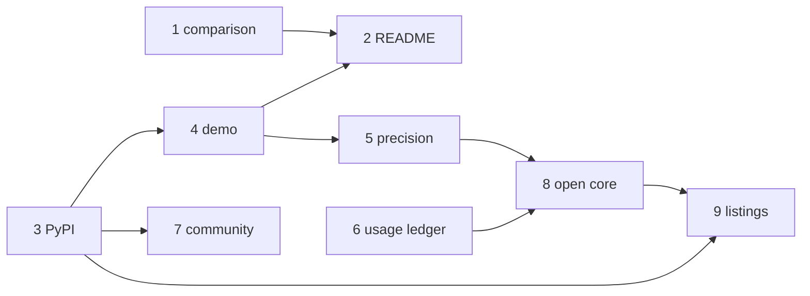

# Go-to-market order — nine specs, three launches

Written 2026-10-20 from the owner's accepted strategy of the same day.
Each step is a spec in `docs/specs/` dated 2026-10-20; this plan orders
them, sizes them (S ≤ 1 day, M 2–4 days, L ≥ 1 week of focused work)
and ties each launch to the measured facts it must carry. A launch is
not scheduled by date: it happens when its facts exist.

## Order

| # | Spec | Effort | Needs | Unblocks | Owner tasks inside |
|---|---|---|---|---|---|
| 1 | `SP-COMPARISON-PAGE` | S | — | 2 | re-read each vendor page (URLs) |
| 2 | `SP-README-PRODUCT-STATEMENT` | S | 1 | launch 1 | D1 "5-minute" wording, D2 "self-forging" |
| 3 | `SP-PYPI-RELEASE` | M | `SP-UNIVERSAL-INSTALL` | 4, 7, 9 | PyPI account, trusted publisher, `pypi` environment |
| 4 | `SP-PUBLIC-DEMO-REPO` | M | 3, `SP-UNIVERSAL-CI-ENTRY` | 2 (G4 excerpt), 5, launch 1 | first live recording |
| 5 | `SP-PRECISION-MEASUREMENT` | L | 4, `SP-UNIVERSAL-LEDGER` | 8, launch 2 | label the Yoob findings |
| 6 | `SP-USAGE-LEDGER` | M | `SP-UNIVERSAL-PROVIDERS` slice 1 | 8, launch 2 | — |
| 7 | `SP-COMMUNITY-ONBOARDING` | S | 3 | launch 1 | CoC contact, Discussions, the weekly hour |
| 8 | `SP-OPEN-CORE-BOUNDARY` | M | 5, 6 | 9 (paid path), launch 3 | licence, company entity, Stripe, seat price |
| 9 | `SP-MARKETPLACE-LISTINGS` | M | 3, 8, `SP-UNIVERSAL-CI-ENTRY` | launch 3 | Marketplace agreement, gitlab.com group |

The spec numbering requested (1 README … 9 marketplace) differs from the
execution order above in one place: the comparison page is executed
before the README because the README's table is a projection of it.
Steps 6 and 7 can run in parallel with 4–5.

## Three launches

Each launch is one post on the channels named, with the facts listed as
its body. A fact that is not measured on the launch day is cut from the
post, never estimated.

### Launch 1 — "install it" (after 1–4 and 7)

- Channel: Show HN, r/programming, GitLab forum, LinkedIn.
- Title (Show HN): **"Show HN: Repoach – the merge gate that re-verifies the reviewer's claims at the exact head"**. Never "self-forging software factory".
- Facts it carries: `pipx install repoach` works on 3.11 and 3.13 (`SP-PYPI-RELEASE` AC2–AC3); measured install-to-first-review time (`SP-PUBLIC-DEMO-REPO` AC2); the 90-second replay and the playground (AC1, AC4); tokens and wall time per review on Yoob (about 70 k tokens, 0.5–1.7 $ on an API key, 69–103 s on a Claude Code login, measured 2026-10-20).
- Comparisons named: CodeRabbit, Cursor Bugbot, Copilot code review. Never Devin, OpenHands or other autonomous developers — they are PR sources.

### Launch 2 — "how often is it right" (after 5 and 6)

- Channel: a written article (blog + dev.to), Show HN follow-up only if the number is new.
- Facts it carries: the dated precision/recall line with corpus size (`SP-PRECISION-MEASUREMENT` AC3); one `digest` week of refused LGTMs with PR links (AC4); cost per review from `repoach usage` with the price date (`SP-USAGE-LEDGER` AC2).
- r/LocalLLaMA only once an Ollama direct provider exists (`SP-UNIVERSAL-PROVIDERS` slice 2, `OpenAICompatibleProvider`) and one review has been measured through it.

### Launch 3 — "use it as a team" (after 8 and 9)

- Channel: GitHub Marketplace, GitLab CI/CD Catalog, Claude Code plugin marketplace, MCP registry, Product Hunt.
- Facts it carries: the four listings live (`SP-MARKETPLACE-LISTINGS` AC1–AC5); the pricing page with the free tier (`SP-OPEN-CORE-BOUNDARY` AC5); the number of users with a review on their own repository from the weekly ritual (`SP-COMMUNITY-ONBOARDING` G5).

## Owner decisions, all specs

Collected from the "Owner decisions needed" section of each spec; the
spec holds the detail.

| Spec | Decision |
|---|---|
| README | D1 "5-minute install" before or after the clock is measured; D2 retire "self-forging" or keep it below the fold |
| PyPI | D1 PyPI account and 2FA; D2 trusted publisher + `pypi` environment; D3 `setuptools-scm` or `hatch-vcs`; D4 GitHub-hosted or self-hosted runner for publishing |
| Demo | D1 organisation; D2 model access for the live CI run; D3 Gitpod as well as Codespaces |
| Precision | D1 label the Yoob findings; D2 two public repositories for planted defects; D3 publish per-reviewer table or aggregate only |
| Usage | D1 dollar estimate on gateway runs; D2 summary on by default in `ci review` |
| Comparison | D1 who re-reads vendor pages every 90 days; D2 include Claude Code review and Codex review rows |
| Community | D1 CoC contact; D2 enable Discussions; D3 weekly ritual time |
| Open core | D1 Apache-2.0 or MIT, CLA/DCO; D2 company entity; D3 Stripe; D4 seat price and per-review coexistence; D5 hosted ledger region and retention |
| Listings | D1 Marketplace agreement, later publisher verification; D2 gitlab.com group; D3 plugin directory; D4 `mcp serve` timing |
