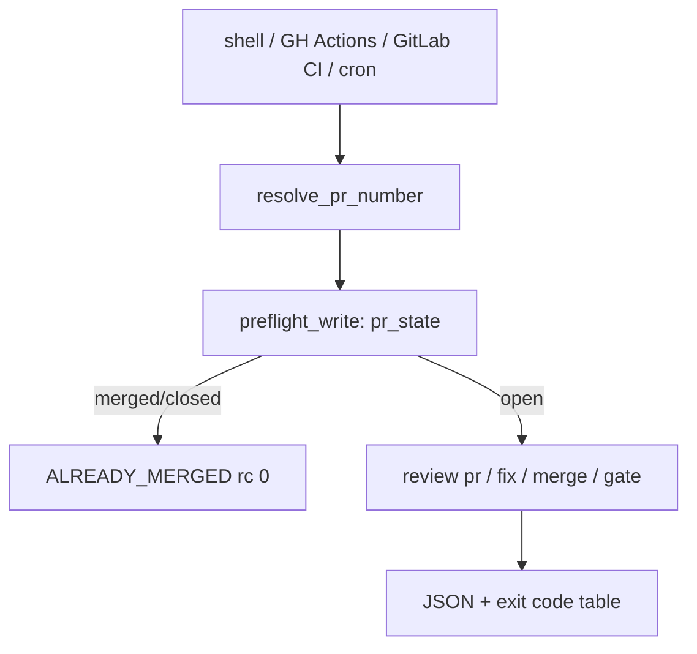

# review pr and review gate from any CI with one semantics

## Intent

`repoach review pr` and `repoach review gate` behave identically from a
shell, GitHub Actions, GitLab CI or cron: the PR number is resolved
from the environment when omitted, posting is explicit, the bot
identity is per forge, the exit contract is one table, and a PR merged
by a human while the bot runs ends in `ALREADY_MERGED` instead of a red
job.

## Context

- Measured 2026-10-18 on repoach's last 60 `auto-review` runs
  (2026-07-24 → 08-01): 7 success, 53 failure; in every sampled failure
  the `review` job succeeded and the red step is `auto_fix` → "Checkout
  PR head (writable)" (`.github/workflows/auto-review.yml:341`) or
  `auto_merge` → "Run auto-merge" (`:685`). Cause: the owner's local
  `scripts/safe_merge.sh` merged first and deleted the head branch
  (`safe_merge.sh:255-256`); PR #200 merged 01:09:18Z, the job started
  01:22:33Z and failed in 11 s. `merge-on-ci.yml`: 39/15, all failures
  at "Materialize the PR head tree" for the same reason.
- `auto_merge.py` already has `OUTCOME_ALREADY_MERGED` and
  `NON_FATAL_SKIP_OUTCOMES` (`:80-95`), but the checkout happens in
  YAML before any Python runs.
- The workflows inject everything per job: `GH_TOKEN`,
  `REPOACH_LLM_PROXY_BASE_URL`, `REPOACH_DB_PATH`,
  `REPOACH_CODER_PYTHONS` (`auto-review.yml:440-450`); a GitLab job has
  none of these and provides `CI_MERGE_REQUEST_IID`, `CI_PROJECT_ID`,
  `CI_JOB_TOKEN`, `GITLAB_TOKEN` as a masked variable.
- `review pr` posts unless `--dry-run` (`cli/review_cmds.py:66-125`);
  there is no `--post` flag, so a CI job that wants advisory output
  must remember the flag.
- `review_bot_login` is global (`core/config.py:223`); a GitLab bot is a
  project access token user, Yoob's would be `josephwfaye` or a token
  user.

## Goals

- G1: `src/repoach/ci_entry/context.py` (named `resolve.py` until 0.1; it also detects the CI forge): `resolve_pr_number(explicit: int | None, env: Mapping[str, str]) -> tuple[int, str]` returns `(number, source)` in order: explicit argument; `REPOACH_PR_NUMBER`; GitLab `CI_MERGE_REQUEST_IID`; GitHub `GITHUB_EVENT_PATH` (`pull_request.number`, `issue.number` when `issue.pull_request` is set, `inputs.pr_number`) then `GITHUB_REF` `refs/pull/<n>/merge`; else `NoPullRequestError`, rc 2. The PR argument of `review pr`, `report`, `fix`, `merge`, `gate`, `insights` becomes optional.
- G2: posting is explicit: `--post` posts, `--dry-run` never posts, neither flag → `[review].post_by_default` (default `false` on a foreign repo, `true` in repoach's own `repoach.toml`); the JSON always carries `posted_comments`, `posted_reviews`, `mode`.
- G3: bot identity per forge: `[review].bot_username` (`SP-UNIVERSAL-FORGE`); `review pr --post` refuses with rc 2 when it is empty on GitLab (`bot username required to trust the archive marker`).
- G4: the race: before any write or writable checkout, `forge.pr_state(n)` is read; `merged`/`closed` → the command ends with outcome `ALREADY_MERGED`/`CLOSED`, rc 0, one line, no checkout. `review fix` performs its own writable checkout by `head_sha` (`git fetch origin <sha>`), never by branch name, and re-checks `pr_state` after the fix before pushing; a push rejected because the branch is gone ends `ALREADY_MERGED`. `review merge` on a merged PR ends `ALREADY_MERGED` rc 0 (today's outcome, kept).
- G5: one exit-code table for the six commands, printed by `repoach review exit-codes` and pinned by a test: 0 success/non-fatal skip, 1 internal error, 2 configuration/provider/forge unavailable, 3 no fixes possible, 4 nothing to fix, 5 gate refused, 6 no PR resolvable, 9 placeholders rejected.
- G6 (amended 0.2): `repoach init --ci gitlab|github` writes the review job as its **own new file** — `.repoach/ci/gitlab-review.yml` (a GitLab job named `review:advisory`: `merge_request_event`, `allow_failure: true`, `interruptible`, no `tags`, pulled in with `include:`) or `.github/workflows/repoach-review.yml` (`pull_request` opened/synchronize/reopened/ready_for_review, `continue-on-error`, SHA-pinned actions). It never edits `.gitlab-ci.yml` nor an existing workflow: the two-line `include` is printed for the operator. A file already holding the rendered content is `unchanged`; one holding something else is left alone (`differs`) unless `--force`. `--print` writes to stdout only, `--dry-run` says what it would write. Amended from "never writes under `.github/`": the maintainer asked for a committed workflow file (2026-10-20); the guarantee kept is that no pre-existing pipeline file is touched.
- G7 (amended 0.2): all inputs are environment or config; a job runs exactly two repoach steps: an install of a pinned repoach (`REPOACH_INSTALL`: `repoach @ git+…@<ref>` from `--ref`, or `repoach==<version>` from `--pypi-version`) under `env -u` of every forge token and provider secret, then `repoach ci review`. GitLab adds `apt-get install git glab`; GitHub uses `actions/checkout` and `actions/setup-python`.
- G8 (added 0.2): `repoach ci review` absorbs Yoob's `ci/review-advisory.sh` (2026-10-18): forge from `--forge`, else `GITLAB_CI` / `GITHUB_ACTIONS`, else the project config; PR from G1's resolver (`--pr` as the explicit argument); a missing input is a named skip, checked in the order PR → forge token (`GITLAB_TOKEN`/`REPOACH_GITLAB_TOKEN`, `GH_TOKEN`/`GITHUB_TOKEN`) → provider; posting only on `--post` or `REPOACH_ADVISORY_POST` exactly `1` (G2 for CI; `--post --dry-run` → `config_error`); G3's GitLab bot refusal; G4's preflight (`pr_state` merged/closed → `already_merged`/`closed`, nothing reviewed). The review runs as a child `repoach review pr <n> --forge <f> [--dry-run]`; its exit 2 is split by the JSON it prints (`final_verdict == REQUEST_CHANGES` → reviewed; no verdict → `unavailable`), exit 3 → `reviewer_error`, anything else → `internal_error`. Stdout carries one JSON document (`outcome`, `reason`, `forge`, `forge_source`, `pr_number`, `pr_source`, `mode`, `provider_mode`, `final_verdict`, `posted_comments`, `posted_reviews`, `review_exit_code`, `review`, `strict`, `exit_code`); stderr one human line. Exit codes: always 0 (advisory) unless `--strict`, then 0 reviewed APPROVE/COMMENT or merged/closed, 1 internal, 2 skip/config/unavailable, 3 reviewer error, 4 changes requested. The command is settings-free: an invalid `repoach.toml` is a `config_error` outcome, not a bootstrap rc 2.
- G9 (added 0.2): two provider modes. **Gateway**: `REPOACH_LLM_PROXY_BASE_URL` + `REPOACH_ANTHROPIC_AUTH_TOKEN` are passed through. **Direct**: with `REPOACH_ANTHROPIC_API_KEY` (or `ANTHROPIC_API_KEY`) the command starts `python -m repoach.llm_proxy` on `127.0.0.1` (free port or `REPOACH_GATEWAY_PORT`), in a temporary working directory, with a per-job secret and `MODEL_{OPUS,SONNET,HAIKU}=anthropic/<REPOACH_MODEL_* or claude-opus-5 / claude-sonnet-5 / claude-haiku-4-5>`; the gateway's environment holds the key and no forge credential, the review's holds the forge credential and the per-job secret and no key. A gateway that never answers `/health` is `unavailable` with its log tail. Direct mode becomes a pass-through once SP-PROVIDER-DIRECT-ANTHROPIC routes the provider in-process.
- G10 (added 0.2): `repoach doctor --ci` prints one `NAME=present|absent  (group: purpose)` line per variable `ci review` reads (one table, `ci_entry/variables.py`, drives both), then `ci=`, `pr_source=`, `mode=`, `provider_mode=`; never a value, never the PR number; exit 0, no git tree needed.

## Slices

- Slice 1 (0.2, this branch): G1's resolver (`ci_entry/context.py`), G6–G10, and G2/G3/G4 as applied inside `repoach ci review`.
- Slice 2 (open, `docs/tech_debt.md` row 39): the PR argument becoming optional on the six `review` commands, `review pr --post`, `[review].post_by_default`, `review fix`'s head-SHA checkout and push race, `repoach review exit-codes`, and the `auto-review.yml` migration (AC2, AC5, AC7).

## Non-Goals

- NG1: no change to repoach's own `auto_fix`/`auto_merge` job topology beyond making their steps call the CLI with no PR argument and dropping the YAML writable checkout (umbrella migration step 2).
- NG2: no new event lane; `merge-on-ci.yml` stays and keeps running `main`'s code (umbrella NG2).
- NG3: no secret management; tokens are the CI's masked variables.
- NG4: no retry of a red provider from CI; a provider error is rc 2 and the job's own `allow_failure` decides.

## Assumptions

- A1: inside GitLab CI, `CI_JOB_TOKEN` can read the MR and its pipeline; posting needs `GITLAB_TOKEN` (project access token with `api`).
- A2: inside GitHub Actions, `GITHUB_TOKEN` reads and writes PR comments; the fork case stays the maintainer's hop (CONTRIBUTING).

## Interface

```python
def resolve_pr_number(explicit: int | None, env: Mapping[str, str]) -> tuple[int, str]: ...
def posting_mode(post: bool, dry_run: bool, config: ProjectConfig) -> Literal["post", "dry-run"]: ...
def preflight_write(forge: Forge, number: int) -> PreflightResult: ...
```

Inputs:
- `REPOACH_PR_NUMBER`, `CI_MERGE_REQUEST_IID`, `GITHUB_EVENT_PATH`, `GITHUB_REF`: str — resolution sources.
- `--post` / `--dry-run`: flags, mutually exclusive.

Outputs:
- JSON on stdout for `review pr`/`gate`/`merge`: adds `pr_source`, `mode`, `outcome`; unchanged keys keep their names (the `tests/unit/test_review_ci_mode.py` pin).
- `repoach review exit-codes`: the table above.

Errors:
- `NoPullRequestError`: rc 6, names the variables it looked at.
- `PostingRefusedError`: rc 2, reason (`bot username required`, `token lacks api scope`).

## Behavior

### Nominal
GitLab job: `pipx install repoach==0.2.0 && repoach review pr --post`
→ `CI_MERGE_REQUEST_IID` resolves the MR, `GITLAB_TOKEN` posts one
discussion per inline comment and one archive note, JSON on stdout,
rc 0 or 5. GitHub job: identical command, `GITHUB_EVENT_PATH` resolves
the PR. Shell: `repoach review pr 283 --dry-run`.

### Edge cases
- `issue_comment` event on a plain issue → rc 6 `not a pull request`, no provider call (today's YAML `if:` guard, now in code).
- `--post` and `--dry-run` together → rc 2 before anything.
- head branch deleted but PR still `open` (force-deleted) → `preflight_write` ends `SKIP_HEAD_MISSING`, rc 0.
- cron with `REPOACH_PR_NUMBER` unset → `review pr` iterates `forge.open_pull_requests(integration_branch)` only with `--all-open`; otherwise rc 6.

### Failure scenarios
- `pr_state` call itself fails (network) → rc 2, nothing posted, nothing checked out; the ledger records `preflight_failed`.
- the PR merges between `preflight_write` and the push of a fix → the push fails on the missing ref; the command ends `ALREADY_MERGED`, rc 0, the local fix commit is left in the job's workspace and logged.

## Architecture Impact
- Adds dependency: SP-UNIVERSAL-CI-ENTRY -> SP-UNIVERSAL-FORGE (`pr_state`, `open_pull_requests`, posting)
- Adds dependency: SP-UNIVERSAL-CI-ENTRY -> SP-UNIVERSAL-PROVIDERS (provider resolved per run, rc 2 contract)
- Adds dependency: SP-UNIVERSAL-CI-ENTRY -> SP-UNIVERSAL-PROJECT-CONFIG (`[review].post_by_default`, `bot_username`)
- Adds dependency: SP-UNIVERSAL-CI-ENTRY -> SP-MERGE-EXIT-CONTRACT (the exit table extends it, no code changes meaning)
- Adds dependency: SP-UNIVERSAL-CI-ENTRY -> SP-AUTOMERGE-EVENT-DRIVEN (`merge-on-ci` keeps its lane; its "Materialize" step becomes `repoach review gate` with the preflight)
- Adds dependency: SP-UNIVERSAL-CI-ENTRY -> SP-CI-SECRETS-ISOLATION (the snippets keep secrets on the posting job only)
- Adds dependency: SP-UNIVERSAL-CI-ENTRY -> SP-VERIFIER-PR-TREE (its `gh pr view --json headRefName` resolution is replaced by `pull_request().head_sha` inside the CLI)
- Removes coupling: the writable checkout leaves YAML; `.github/workflows/auto-review.yml` shrinks to env + one CLI call per job.

## Diagram


## Acceptance Criteria
- [ ] AC1 (amended 0.2): `pytest -q tests/unit/test_ci_entry.py` → green: resolution order pinned for the five sources (flag and four variables); `ci review --post --dry-run` → `config_error`, rc 2 under `--strict`; GitLab with an empty bot username and posting → `config_error`, rc 2, no forge or review call. (The same refusals on `review pr` itself: slice 2.)
- [ ] AC2 (slice 2): `pytest -q tests/unit/test_merge_race.py` → green with a fake forge whose `pr_state` flips to `merged` between preflight and push: `review fix` ends `ALREADY_MERGED`, rc 0, no `ForgeError` escapes; `review merge` on `merged` → `ALREADY_MERGED`, rc 0.
- [ ] AC3 (amended 0.2): from `yoob_2` with no secret set: `GITLAB_CI=true CI_MERGE_REQUEST_IID=283 repoach ci review` → rc 0, JSON `pr_source == "CI_MERGE_REQUEST_IID"`, `mode == "dry-run"`, `posted_comments == 0`, `outcome == "skipped"` naming `GITLAB_TOKEN / REPOACH_GITLAB_TOKEN`.
- [ ] AC4 (slice 2): `GITHUB_EVENT_PATH=tests/fixtures/ci_entry/pull_request.json repoach review gate` in repoach's checkout → JSON `pr_source == "GITHUB_EVENT_PATH"` and the same `facts` as `repoach review gate <n>`.
- [ ] AC5 (slice 2): `repoach review exit-codes` → eight lines; `grep -c "exit" .github/workflows/auto-review.yml` after the migration ≤ 6 (the YAML no longer re-maps exit codes beyond `allow`/`fail`).
- [ ] AC6 (amended 0.2): `repoach init --ci gitlab --print`, parsed as YAML → `["review:advisory"].rules[0].if` contains `merge_request_event`; `repoach init --ci github --print` → `on.pull_request.types` lists `opened`; `git status --short` empty after both.
- [ ] AC7 (slice 2): on repoach's own repository after the migration, 20 consecutive `auto-review` runs where the owner merges locally during the run show zero red `auto_fix`/`auto_merge` jobs (`gh run list --workflow auto-review.yml --limit 20 --json conclusion`).
- [ ] AC8 (added 0.2): `pytest -q tests/unit/test_ci_review.py` → green: GitLab and GitHub, gateway and direct mode, each named skip (no PR, no GitLab token, no GitHub token, no provider, gateway URL without secret), posting only on `REPOACH_ADVISORY_POST=1`, `REQUEST_CHANGES` vs outage split by JSON, `already_merged`/`closed` review nothing, provider key absent from the review env and forge token absent from the gateway env (both through a fake interpreter on the process seam).
- [ ] AC9 (added 0.2): `pytest -q tests/unit/test_ci_init.py` → green: `init --ci github` on a gum-shaped scratch repo and `init --ci gitlab` on a Yoob-shaped one (existing `.gitlab-ci.yml` byte-identical after), second run `unchanged`, a hand-edited file kept unless `--force`, every secret unset in the install step; and `repoach init --ci github` on the gum scratch clone prints `created .github/workflows/repoach-review.yml` then `unchanged …`.
- [ ] AC10 (added 0.2): `GITLAB_CI=true CI_MERGE_REQUEST_IID=283 REPOACH_GITLAB_TOKEN=x repoach doctor --ci` → rc 0, `REPOACH_GITLAB_TOKEN=present`, `pr_source=CI_MERGE_REQUEST_IID`, and neither `x`-valued secret nor `283` in the output.

## Open Questions
- Q1: should the GitHub reusable workflow live in this repository (`.github/workflows/review.yml` with `workflow_call`) or in a separate `repoachhq/review-action` repository? Recommend here, versioned by tag, until a second consumer exists.
- Q1 answer (0.2): neither for now; `init --ci github` writes a standalone workflow into the consuming repository. A reusable `workflow_call` workflow is deferred until a second GitHub consumer exists (tracked with slice 2, `docs/tech_debt.md` row 39).
