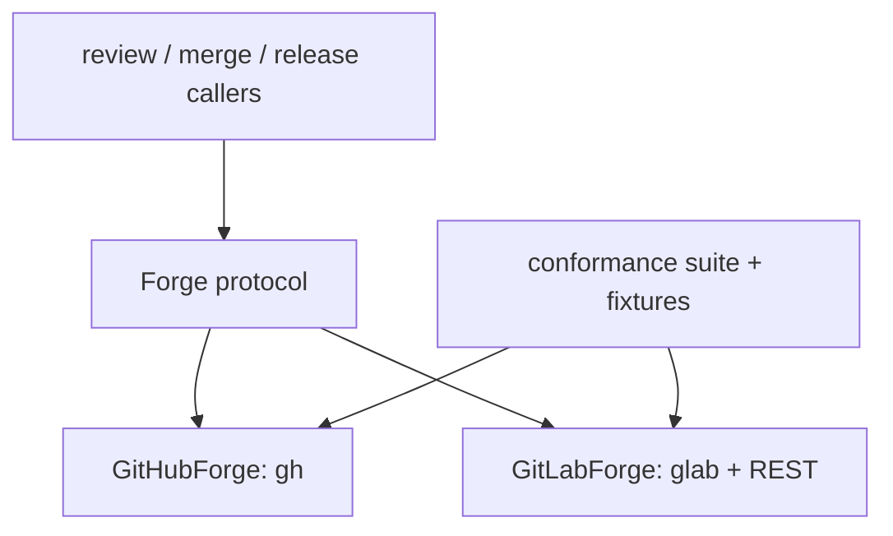

# Forge protocol with GitHub and GitLab implementations

## Intent

Every forge operation repoach performs — read a PR, its diff, its
comments and reviews, its CI status, post comments and reviews, merge
with the project's method, read branch protection — goes through one
typed `Forge` protocol. GitHub (`gh`) and GitLab (`glab`, REST where
`glab` has no verb) ship; one conformance suite with recorded fixtures
runs against both.

## Context

- `src/repoach/review/gh_client.py:133-157`: `GhCli` resolves `gh` by
  `shutil.which` and runs it in the cwd; nineteen public methods
  (`pr_diff`, `pr_view`, `pr_create`, `pr_review_comment`,
  `pr_review_submit`, `pr_review_submit_batch`,
  `list_review_id_comments`, `list_review_comments`,
  `reply_to_review_comment`, `pr_head_sha`, `find_archive_comment`,
  `upsert_archive_comment`, `fetch_archive_comment`,
  `fetch_archive_comment_with_status`, `list_open_prs`,
  `merged_pr_merge_shas`, plus `available`, `bot_login`, `ok`).
- Nine in-tree callers (grep 2026-10-18): `review/orchestrator.py`,
  `review/auto_merge.py`, `review/coder_findings.py`,
  `review/coder_loop.py`, `review/dev_runner.py`,
  `review/thread_context.py`, `review/release_gate.py`,
  `cli/review_cmds.py`, `cli/release_cmds.py`. Two bypass the methods
  and call `gh._run([...])` directly: `auto_merge.py:165-187`
  (`statusCheckRollup`) and `auto_merge.py:450-456`
  (`gh pr merge --squash`).
- CI truth is a check-name match against
  `DEFAULT_REQUIRED_CHECK_NAMES` (`auto_merge.py:87-90`), a GitHub
  concept; GitLab has one `head_pipeline.status`.
- Trust: `review_bot_login` defaults to `github-actions[bot]`
  (`core/config.py:223-236`); markers are honoured only when
  `comment.user.login` matches (`gh_client.py:169-176`,
  `thread_context.py:193-203`).
- Inline comments: GitHub review comments carry `path`/`line`/`side`;
  GitLab discussions carry a `position` object with
  `base_sha`/`start_sha`/`head_sha`/`new_path`/`new_line`.
- Yoob: project id `67827362`, `merge_method: merge`, MR iid `283`
  merged, author `josephwfaye`. Yoob's own `python-gitlab` client
  (`ci/autofix/autofix/gitlab_client.py`) is a reference, not a
  dependency.
- The test fakes in `tests/unit/test_gh_client.py`,
  `test_review_team.py`, `test_thread_context.py` already define the
  surface the callers need.

## Goals

- G1: `src/repoach/forge/protocol.py` declares `Forge` (a `typing.Protocol`) and the Pydantic models `PullRequest` (number, title, body, author, state `open|merged|closed`, head_sha, head_ref, base_ref, url, draft), `Diff`, `Comment` (id, author, body, path, line, created_at, in_reply_to), `Review` (id, author, state, body, comments), `CheckStatus` (`success|failure|pending|missing`, per-check detail), `MergeResult` (merged, sha, message), `BranchProtection` (required_checks, allow_force_push, readable: bool).
- G2: `GitHubForge` (`forge/github.py`) is today's `GhCli` behind the protocol, behaviour byte-identical for repoach's own repository; the two `_run` bypasses become `ci_status()` and `merge()`.
- G3: `GitLabForge` (`forge/gitlab.py`) over `glab` and `glab api`: MR by iid, `glab mr diff`, discussions as inline comments, a note carrying the archive marker, `head_pipeline.status` as `CheckStatus`, `glab mr merge` honouring `merge_method` and `remove_source_branch` from config, `approvals` as reviews, `merge_requests/<iid>` `detailed_merge_status` and project `merge_method`/`only_allow_merge_if_pipeline_succeeds` as `BranchProtection`.
- G4: selection: `--forge` flag > `REPOACH_FORGE` > `[repoach].forge` > origin URL inference; `select_forge(config) -> Forge` is the only constructor callers use. `review_bot_login` becomes `[review].bot_username`; the default is `github-actions[bot]` for github and empty for gitlab (a GitLab run must set it, or trust no marker).
- G5: `ci_status()` is the one CI fact: on GitHub the rollup matched against `required_checks` from `BranchProtection` when readable, else the configured list (the `SP-CI-CHECKNAME-SYNC` tuple stays the GitHub fallback); on GitLab `head_pipeline.status`.
- G6: a conformance suite `tests/unit/test_forge_conformance.py` parametrised over both forges with recorded fixtures under `tests/fixtures/forge/<forge>/` (one JSON per call: argv in, stdout/rc out), covering every protocol method including error shapes (404, 403, deleted head branch, merged PR).
- G7: `pr_state(n)` is cheap and consulted before any write (`SP-UNIVERSAL-CI-ENTRY` uses it to end the race).

## Non-Goals

- NG1: no third forge, no Gitea/Bitbucket.
- NG2: no replacement of `gh`/`glab` by raw HTTP for GitHub; REST is permitted inside `GitLabForge` only where `glab` has no verb (discussion position, approvals).
- NG3: no change to findings, verdicts or the merge gate's facts beyond their source call.
- NG4: no live-network test in `tests/unit`; the recorded fixtures are the suite, a `tests/integration/test_forge_live.py` runs only with `REPOACH_FORGE_LIVE=1`.

## Assumptions

- A1: `gh` ≥ 2.40 and `glab` ≥ 1.40 semantics as recorded in the fixtures; the fixture recorder script `scripts/record_forge_fixture.py` re-records against a real PR/MR when either CLI changes.
- A2: a GitLab token with `api` scope for posting; `read_api` suffices for `--dry-run`.

## Interface

```python
class Forge(Protocol):
    name: str
    def available(self) -> bool: ...
    def pull_request(self, number: int) -> PullRequest: ...
    def pr_state(self, number: int) -> Literal["open", "merged", "closed"]: ...
    def diff(self, number: int) -> Diff: ...
    def comments(self, number: int) -> list[Comment]: ...
    def reviews(self, number: int) -> list[Review]: ...
    def post_comment(self, number: int, body: str, *, path: str | None = None, line: int | None = None) -> Comment: ...
    def post_review(self, number: int, review: ReviewDraft) -> Review: ...
    def reply(self, number: int, comment_id: str, body: str) -> Comment: ...
    def upsert_marked_comment(self, number: int, marker: str, body: str) -> Comment: ...
    def find_marked_comment(self, number: int, marker: str) -> Comment | None: ...
    def ci_status(self, number: int) -> CheckStatus: ...
    def merge(self, number: int, *, method: MergeMethod, delete_branch: bool) -> MergeResult: ...
    def branch_protection(self, branch: str) -> BranchProtection: ...
    def open_pull_requests(self, base: str) -> list[PullRequest]: ...
    def merged_shas(self, base: str) -> set[str]: ...
    def create_pull_request(self, *, head: str, base: str, title: str, body: str) -> PullRequest: ...
    def is_trusted_author(self, comment: Comment) -> bool: ...

def select_forge(config: ProjectConfig, *, override: str | None = None, cwd: Path | None = None) -> Forge: ...
```

Inputs:
- `GH_TOKEN` / `GITHUB_TOKEN`: str — GitHub auth, as today.
- `GITLAB_TOKEN`: str — GitLab auth (`glab` reads it); `CI_JOB_TOKEN` accepted for read calls inside GitLab CI.
- `[review].bot_username`: str — the login whose markers are trusted.

Outputs:
- every method returns a model or raises; no `GhResult`-style silent non-zero.

Errors:
- `ForgeUnavailableError`: binary or token missing.
- `ForgeNotFoundError`: PR/MR does not exist — carries `number`.
- `ForgeForbiddenError`: scope insufficient — carries the forge message.
- `ForgeMergeRefusedError`: merge refused by the forge (pipeline, conflicts, protection) — carries the forge reason.

## Behavior

### Nominal
`select_forge(config)` builds `GitLabForge` for Yoob; `orchestrator`
reads `diff(283)`, `comments(283)`, posts through `post_review`
(GitLab: one discussion per inline comment, one note for the verdict
body), `upsert_marked_comment` keeps the archive in one note found by
the HTML marker; `auto_merge` reads `ci_status` and calls
`merge(method=MergeMethod.MERGE, delete_branch=False)`.

### Edge cases
- GitHub review with zero inline comments → one review submission, as `SP-REVIEW-POST-BATCH` does today.
- GitLab discussion on a line the diff no longer has → `post_comment` falls back to an unpositioned note with the path and line in the body, logged `forge.position_fallback`.
- `branch_protection` unreadable (GitHub free private → 403) → `readable=False`, `required_checks` empty, callers use the configured list; never an exception.
- `merged_shas` on GitLab → `merge_commit_sha` of merged MRs into `base`, or `squash_commit_sha` when the project squashes.

### Failure scenarios
- `pull_request(n)` on a deleted head branch → `PullRequest.state == "merged"|"closed"`, `head_ref` kept from the API; `diff()` still works on GitLab and GitHub (API diff, no local branch).
- `merge()` while the forge is mid-pipeline → `ForgeMergeRefusedError("pipeline pending")`, mapped by `auto_merge` to `SKIP_CI_PENDING`, never `FAILED`.

## Architecture Impact
- Adds dependency: SP-UNIVERSAL-FORGE -> SP-UNIVERSAL-PROJECT-CONFIG (forge, merge method, bot username come from config)
- Adds dependency: SP-UNIVERSAL-FORGE -> SP-REVIEW-POST-BATCH (its batched submission is `post_review` on GitHub)
- Adds dependency: SP-UNIVERSAL-FORGE -> SP-EVIDENCE-SENTINEL-AUTHOR (`is_trusted_author` keeps its fail-closed rule, keyed on the configured username)
- Adds dependency: SP-UNIVERSAL-FORGE -> SP-AUTOMERGE-FRESH-HEAD (fresh-head guard compares `pull_request().head_sha` with `git ls-remote`, unchanged)
- Adds dependency: SP-UNIVERSAL-FORGE -> SP-CI-CHECKNAME-SYNC (its tuple is the GitHub fallback of `ci_status`)
- Adds dependency: SP-UNIVERSAL-FORGE -> SP-RELEASE-PROVENANCE-GH-FALLBACK (`merged_shas` is its data source on both forges)
- Adds dependency: SP-UNIVERSAL-FORGE -> SP-CONVENTIONS-GATE (`GitHubForge.merge` composes the squash body with `repoach.conventions.attribution.squash_body`, attribution removed; G9(b))
- Removes coupling: nine modules stop importing `gh_client`; `gh_client.py` becomes `forge/github.py` with a one-release re-export shim.

## Diagram


## Acceptance Criteria
- [ ] AC1: `pytest -q tests/unit/test_forge_conformance.py` → green; `pytest --collect-only -q tests/unit/test_forge_conformance.py | grep -c "\[github\]"` equals the `[gitlab]` count, and both are ≥ 18 (one per protocol method).
- [ ] AC2: `grep -rln "gh_client\|GhCli" src/repoach --include=*.py | grep -v "^src/repoach/forge/"` → empty.
- [ ] AC3: from a Yoob clone with `forge = "gitlab"`, no shim on PATH: `repoach review pr 283 --dry-run` → rc 0 or 2, JSON with `len(reviews)==4`, `posted_comments==0`; `glab api projects/67827362/merge_requests/283/notes | jq length` unchanged.
- [ ] AC4: on a throwaway Yoob MR: `repoach review pr <iid>` (posting, `[review].bot_username` set) → `glab api …/merge_requests/<iid>/discussions | jq length` ≥ 1 and exactly one note body containing the archive marker after two consecutive runs.
- [ ] AC5: `repoach review gate <iid>` → JSON `facts.ci_green` equals `glab api …/merge_requests/<iid> | jq '.head_pipeline.status == "success"'`.
- [ ] AC6: in repoach's own checkout: `pytest -q tests/unit` green with `test_gh_client.py`, `test_review_team.py`, `test_thread_context.py` fakes migrated to the protocol; `repoach review gate <open-pr>` prints the same `facts` object as a fixture recorded before this change.
- [ ] AC7: `pytest -q tests/unit/test_forge_select.py` → `select_forge` picks gitlab for `git@gitlab.com:…`, github for `https://github.com/…`, raises `ForgeUnavailableError` naming the binary when it is absent, and honours `--forge` over the URL.

## Open Questions
- Q1: GitLab verdict mapping — approve the MR (needs Maintainer and `approvals` enabled) or only post the verdict note? Recommend note only until the advisory period ends (umbrella Q4).
