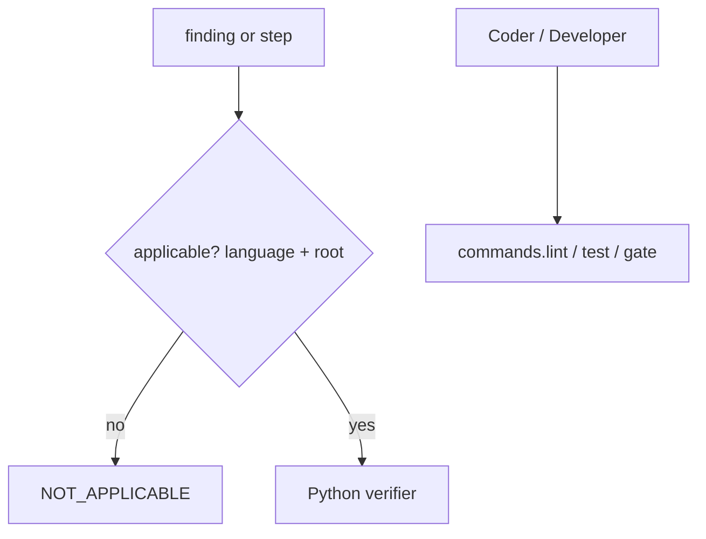

# Lint, test and gate commands per project; Python-only verifiers skip by declared language

## Intent

The Coder and Developer gates run the project's own commands; the
mechanical verifiers that parse Python run only when the project
declares Python and only on `.py` files under its source roots, and
say `not_applicable` otherwise. Spec frontmatter `owns`/`depends_on`
is optional on a host that has not adopted architecture governance.

## Context

- `src/repoach/review/coder_loop.py:663-677`: `run_ruff_gate` runs
  literal `ruff check/format` on `src tests`; `:573-577` runs
  `pytest -q tests/unit`; `devagent_tools.py:198-227` exposes both to
  the Developer as `run_tests`/`run_ruff`.
- `src/repoach/review/finding_verifiers.py:87-115`:
  `_verify_missing_docstring` parses the file with `ast` and
  `_DOCSTRING_EXEMPT_PREFIXES` (`:35`) hardcodes `tests/`, `scripts/`,
  `src/repoach/llm_proxy/`; `_verify_lint` (`:118-126`) runs repoach's
  two Python scanners.
- `src/repoach/review/import_gate.py:1-11,29-50`: resolves only
  `repoach.*` imports under a `src_root`.
- `src/repoach/lint/edge_honesty.py:36,93-96`: `_REPO_TOP =
  "repoach"`, candidates `src/{rel}.py`; `:67-77` a new spec without
  frontmatter is a blocking `SpecPresenceViolation`;
  `arch/registry.py:23` requires `id,title,version,status,owns,depends_on`.
- `src/repoach/review/coder_loop.py:54-79`: jail prefixes `.github/`,
  `.githooks/`, `prompts/review/`, `.git/`; Yoob's protected paths
  (`.gitlab-ci.yml`, `ci/`, `scripts/hooks/`, `.claude/`, `.gemini/`,
  `.agents/`) are writable.
- Yoob's gates: `./scripts/lint.sh` (ruff, mypy, pylint, verilator,
  eslint, tsc), `pytest`, `YOOB_CI_WAIT=1 ./ci/run-local-ci.sh
  --affected` behind a three-lock barrier (`yoob_2/CLAUDE.md`).

## Goals

- G1: `src/repoach/gates/commands.py`: `run_lint_gate(root, config)`, `run_test_gate(root, config, target=None)`, `run_project_gate(root, config)` execute `[commands].lint/test/gate` through `shlex` + `subprocess` in `project_root()` with `scrubbed_env()`, timeouts from `[commands].timeout_s` (default 900), and return `(passed, tail)`; an empty command returns `(True, "skipped: no [commands].<name> configured")` and the skip is printed by the caller.
- G2: `run_ruff_gate` and the pytest runner become thin callers of G1; `REPOACH_CODER_PYTHONS` keeps working by expanding `{python}` in the test command when present.
- G3: a `Language` enum and `languages_of(path, config) -> frozenset[Language]` by extension; every Python-only verifier (`missing_docstring`, `lint_convention`, the import gate, edge honesty's import and `Table` scan) first checks `Language.PYTHON in config.languages and path.suffix == ".py" and path under src_roots`, else returns `FindingStatus.NOT_APPLICABLE` with method `language` and result `not python: <suffix>`.
- G4: `FindingStatus.NOT_APPLICABLE` is terminal and non-blocking in `merge_gate.verdict_from_facts`; it is reported in the archive under its own count.
- G5: `_DOCSTRING_EXEMPT_PREFIXES` becomes `[gates].docstring_exempt` (default: the three current prefixes when the project is repoach, else `test_roots`).
- G6: `arch check` on a project whose `specs_dir` has zero governed specs → `edge-honesty: ok (0 governed specs)`, rc 0; `SpecPresenceViolation` fires only when `[arch].require_frontmatter = true` (default false for foreign repos, true in repoach's own `repoach.toml`); `_REPO_TOP` and `src/{rel}.py` derive from `src_roots` and the top-level packages found there.
- G7: the Coder jail default prefix list grows to `.git/`, `.github/`, `.gitlab/`, `.gitlab-ci.yml`, `.githooks/`, `.claude/`, `.gemini/`, `.agents/`, `repoach.toml`, `.repoach.env`, plus the configured `prompts_dir` and `[coder].forbidden_prefixes/forbidden_paths`; `chains.env` and `.env*` stay forbidden everywhere.
- G8: promised-test selectors accept pytest (`tests/x.py::test_y`), Vitest (`src/x.test.ts > name`), Go (`./pkg -run TestY`) and a generic `cmd:<command>` form; a selector of unknown form is `not_applicable`, never `verified`.

## Non-Goals

- NG1: no language-specific verifier beyond Python; TypeScript or Go claims stay `proposed` → judged by the refuter.
- NG2: no sandbox for the commands beyond `scrubbed_env()`; the project's own commands run with the project's own trust.
- NG3: no change to the reviewer prompts.

## Assumptions

- A1: `[commands].gate` is long-running and may queue (Yoob's barrier); `repoach develop` runs it once per step only when configured and never in `review pr`.
- A2: the Developer's `run_tests(target)` passes `target` to `[commands].test` by appending it when the command contains no `{target}` placeholder.

## Interface

```python
class Language(StrEnum): PYTHON, TYPESCRIPT, JAVASCRIPT, GO, RUST, VERILOG, SHELL, OTHER
def languages_of(path: PurePosixPath, config: ProjectConfig) -> frozenset[Language]: ...
def applicable(path: str, config: ProjectConfig) -> tuple[bool, str]: ...
def run_lint_gate(root: Path, config: ProjectConfig) -> tuple[bool, str]: ...
def run_test_gate(root: Path, config: ProjectConfig, *, target: str | None = None, python: str | None = None) -> tuple[bool, str]: ...
def run_project_gate(root: Path, config: ProjectConfig) -> tuple[bool, str]: ...
def parse_selector(text: str) -> TestSelector | None: ...
```

Inputs:
- `[commands].lint`, `.test`, `.gate`, `.timeout_s`; `[project].languages`, `.src_roots`, `.test_roots`; `[gates].docstring_exempt`; `[arch].require_frontmatter`; `[coder].forbidden_prefixes`, `.forbidden_paths`.

Outputs:
- `(passed, tail)` per gate; `tail` is the last 4000 characters of combined output, prefixed by the command line.

Errors:
- `GateCommandError`: the command binary is missing (`FileNotFoundError`) — reported as a red gate with `command not found: <argv[0]>`, never as a Python traceback.

## Behavior

### Nominal
Yoob: `lint = "./scripts/lint.sh"`, `test = "pytest -q"`, `gate =
"YOOB_CI_WAIT=1 ./ci/run-local-ci.sh --affected"`, `languages =
["python","typescript","verilog"]`, `src_roots = ["src","frontend/src",
"api"]`. A reviewer's `missing_docstring` finding on
`frontend/src/pages/X.tsx` ends `not_applicable: not python: .tsx`;
the same on `src/yoob/hw/soc/x.py` runs the `ast` verifier as today.

### Edge cases
- a `.py` file outside every `src_root` (Yoob's `ci/autofix/...`) → `not_applicable: outside src_roots`.
- `languages` omits python on a repo that has `.py` files → Python verifiers skip; `init` warned at measurement time.
- `[commands].test` exits 5 (pytest: no tests collected) → red with the tail; the project decides.

### Failure scenarios
- the gate command hangs → killed at `timeout_s`, red with `timeout after <n>s`; the Coder reverts as today.
- `arch check` with `require_frontmatter = false` and a malformed frontmatter → still `MalformedFrontmatterError` (a fence that opens must parse).

## Architecture Impact
- Adds dependency: SP-UNIVERSAL-GATES -> SP-UNIVERSAL-PROJECT-CONFIG (every knob)
- Adds dependency: SP-UNIVERSAL-GATES -> SP-VERIFIER-LIB (verifiers gain the language pre-check and `NOT_APPLICABLE`)
- Adds dependency: SP-UNIVERSAL-GATES -> SP-DEV-STEP-CONTEXT (import gate scoped to declared Python roots)
- Adds dependency: SP-UNIVERSAL-GATES -> SP-ARCH-EDGE-GATE (`_REPO_TOP`/`src/` derived from config; zero-spec repos pass)
- Adds dependency: SP-UNIVERSAL-GATES -> SP-ARCH-SPEC-PRESENCE (presence violation becomes opt-in)
- Adds dependency: SP-UNIVERSAL-GATES -> SP-CODER-WHITELIST-HARDEN and SP-CODER-CHAINS-GUARD (jail list extended, their absolute rules kept)
- New / changed coupling: `FindingStatus` gains one member read by `merge_gate` and `report`.

## Diagram


## Acceptance Criteria
- [ ] AC1: `pytest -q tests/unit/test_gates_language.py` → green: a `missing_docstring` finding on `frontend/src/x.ts` in a config with `languages=["typescript"]` ends `NOT_APPLICABLE`, method `language`; the same path with `languages=["python","typescript"]` is still `NOT_APPLICABLE` (`.ts`); `src/x.py` with python declared runs `ast`.
- [ ] AC2: `pytest -q tests/unit/test_gate_commands.py` → green: a fake `lint` script exiting 1 makes `run_lint_gate` return `(False, tail)` with the script's last line; an empty `lint` returns `(True, "skipped: …")`; a missing binary returns red with `command not found`.
- [ ] AC3: in a clone of `charmbracelet/gum` after `init`: `repoach arch check --base origin/main` → `edge-honesty: ok (0 governed specs)`, rc 0.
- [ ] AC4: in repoach's own checkout with `require_frontmatter = true`: `repoach arch check --base origin/develop` on a branch adding a frontmatter-less spec → rc 1 with the presence violation, unchanged.
- [ ] AC5: `python -c "from repoach.review.coder_loop import is_path_allowed as a; print(a('.gitlab-ci.yml'), a('ci/x.sh'), a('.claude/settings.json'), a('src/ok.py'))"` with Yoob's `repoach.toml` (`forbidden_prefixes=["ci/","scripts/hooks/"]`) → `False False False True`.
- [ ] AC6: `pytest -q tests/unit` in repoach's checkout green; a recorded `repoach review gate <pr>` fixture is unchanged for a Python-only PR.

## Open Questions
- Q1: should `not_applicable` findings be posted to the PR at all, or only counted in the archive? Recommend archive only.
