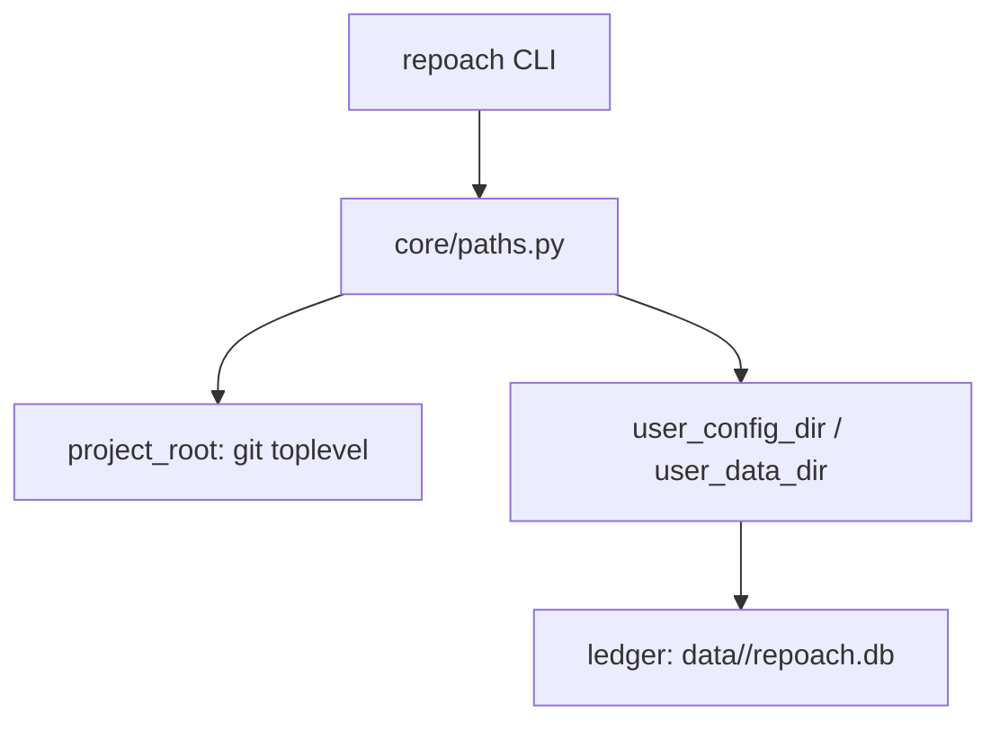

# Wheel install that boots without a gateway and keeps state off the checkout

## Intent

`pipx install repoach` or `uv tool install repoach` from a wheel must
give a working `repoach --version` on a machine that has never cloned
repoach and runs no gateway. Today the first CLI call builds `Settings`,
and `Settings` refuses to exist without a gateway URL; on a tool install
the configuration and the ledger anchor inside `site-packages`.

## Context

Measured 2026-10-18 on a wheel built from `develop` `20dbb45`, installed
with `uv` into a venv outside any project, run from an empty directory
with `env -i HOME=… PATH=…`:

- `repoach version` → pydantic `value_error`: `llm_proxy_base_url
  unresolved -- no anchored env file and no REPOACH_LLM_PROXY_BASE_URL`,
  rc 1. Path: `src/repoach/cli/main.py:62-65` (`_bootstrap` →
  `configure_logging`) → `src/repoach/core/logging.py:26`
  (`get_settings()`) → `src/repoach/core/config.py:320-340`
  (`require_llm_proxy_base_url`).
- `repoach --version` → `No such option: --version`.
- `_repo_root()` (`config.py:30-52`) → `…/site-packages/repoach`;
  `_anchored_env_files()` → `site-packages/repoach/chains.env` and
  `site-packages/repoach/.env`; `get_settings().db_path` →
  `site-packages/repoach/data/repoach.db` (`config.py:300-318`).
- The same venv created inside the repoach worktree resolved the
  worktree's `pyproject.toml` and loaded its `chains.env`: the anchor
  walks up to *any* ancestor `pyproject.toml`, so a venv inside a
  foreign Python project reads that project's `.env` as repoach's.
- `SP-DB-PATH-XDG` (commit `412ae4b`) anchored `db_path` to the repo
  root rather than an XDG directory; tech debt #18 is therefore still
  open for a tool install.
- `src/repoach/cli/init_cmds.py:18-25` anchors `init` to
  `Path(__file__).parents[3]`, and `cli/main.py:44` does the same for
  `arch check` (tech debt #14).

## Goals

- G1: `repoach --version` and `repoach version` print `repoach <version>` and exit 0 with no environment, no `.env`, no `chains.env`, no gateway.
- G2: `Settings` is built lazily by the commands that need it; `require_llm_proxy_base_url` runs only when `provider == "gateway"` is resolved (see `SP-UNIVERSAL-PROVIDERS`).
- G3: a single module `src/repoach/core/paths.py` answers the three anchors every other module needs: `project_root()` (git toplevel of the cwd, or cwd), `user_config_dir()` (`$XDG_CONFIG_HOME/repoach`, default `~/.config/repoach`), `user_data_dir()` (`$XDG_DATA_HOME/repoach`, default `~/.local/share/repoach`). Nothing resolves from `__file__` except package resources (prompts).
- G4: the default ledger path is `user_data_dir()/<project-slug>/repoach.db`, where `<project-slug>` is derived from the origin remote (`host/owner/repo`) or, without a remote, from the absolute path hash; `REPOACH_DB_PATH` and `[state].db_path` in `repoach.toml` override it.
- G5: environment files are read in this order and nowhere else: `user_config_dir()/env`, then `project_root()/.repoach.env` (gitignored by `init`), then the process environment — never the host repository's `.env`, never a file under the package.
- G6: `repoach doctor` prints the resolved anchors, the selected forge, provider and ledger path, and whether each binary (`git`, `gh`, `glab`, `claude`) is on PATH; exit 0 when the selected forge and provider are usable, 2 otherwise.

## Non-Goals

- NG1: no change to how repoach's own repository loads `chains.env` for the gateway process: the gateway keeps its own `llm_proxy/config/settings.py` anchors; only the CLI/agent side moves.
- NG2: no Windows path support beyond what `pathlib` gives; Linux and macOS only, as the classifiers say.
- NG3: no packaging split of the gateway in this child (umbrella Q5).

## Assumptions

- A1: `git rev-parse --show-toplevel` is available wherever repoach runs; a non-git directory falls back to cwd and `init` refuses there.
- A2: `hatchling` keeps building the wheel from `src/repoach`; `prompts/review/*` are shipped as package data (they already resolve from the installed package, `devagent_selfverify.py:52`).

## Interface

```python
def project_root(start: Path | None = None) -> Path: ...
def user_config_dir() -> Path: ...
def user_data_dir() -> Path: ...
def project_slug(root: Path) -> str: ...
def default_db_path(root: Path) -> Path: ...
```

Inputs:
- `REPOACH_DB_PATH`: str — absolute path, wins over everything.
- `XDG_CONFIG_HOME`, `XDG_DATA_HOME`: str — honoured when set.

Outputs:
- `repoach --version`: `repoach <semver>` on stdout, rc 0.
- `repoach doctor`: one key-value line per anchor and binary, rc 0 or 2.

Errors:
- `NotARepositoryError`: a project-scoped command (`init`, `review *`, `develop`, `plan`, `arch check`) run outside a git working tree — rc 2, message names the cwd.

## Behavior

### Nominal
`uv tool install repoach-*.whl` → `repoach --version` → `repoach 0.2.0`.
`cd <repo>` → `repoach doctor` → `project_root=/…/repo`,
`db_path=~/.local/share/repoach/github.com/owner/repo/repoach.db`,
`forge=github (gh 2.x found)`, `provider=none`, rc 2 with the hint
`set REPOACH_PROVIDER or [provider] in repoach.toml`.

### Edge cases
- a venv inside a foreign Python project → `project_root()` is the git toplevel of the *cwd*, never the venv's ancestors; the foreign `pyproject.toml` is irrelevant.
- `REPOACH_DB_PATH` relative → resolved against `project_root()`, not the package.
- two worktrees of one repository share a slug and therefore a ledger; `[state].db_path = ".repoach/repoach.db"` separates them when wanted.

### Failure scenarios
- `user_data_dir()` not writable → `ensure_dirs()` raises `PermissionError` with the path; the CLI exits 2 before any forge or provider call.
- `git` missing → `project_root()` raises `NotARepositoryError`; `--version` still works.

## Architecture Impact
- Adds dependency: SP-UNIVERSAL-INSTALL -> SP-CONFIG-ENV-ANCHOR (replaces its `_repo_root()` anchor for the CLI side with `core/paths.py`)
- Adds dependency: SP-UNIVERSAL-INSTALL -> SP-DB-PATH-XDG (supersedes its repo-root anchor with the per-project data dir)
- Adds dependency: SP-UNIVERSAL-INSTALL -> SP-REPOACH-INIT-SCAFFOLD (its `_repo_root()` becomes `project_root()`; the repoach-only steps move behind `--repoach-dev`)
- Removes coupling: `cli/main.py:_bootstrap` no longer forces `Settings` for every command.

## Diagram


## Acceptance Criteria
- [ ] AC1: `uv build --wheel && uv venv /tmp/rv && uv pip install --python /tmp/rv/bin/python dist/repoach-*.whl && cd /tmp && env -i HOME=$HOME PATH=/tmp/rv/bin:/usr/bin:/bin repoach --version` → `repoach 0.2.0`, rc 0.
- [ ] AC2: same shell: `repoach version` → identical output; `repoach doctor` → rc 2, stderr contains `not a git repository` and no Python traceback.
- [ ] AC3: `cd <any git clone> && repoach doctor` → stdout line `db_path=` under `$HOME/.local/share/repoach/`, and `find /tmp/rv -name repoach.db` prints nothing.
- [ ] AC4: `pytest -q tests/unit/test_universal_install.py` → green; it pins `project_root()` for a cwd inside a nested worktree, `default_db_path()` for a remote-less repo, and that `Settings()` is never constructed by `repoach --version` (a sentinel in `get_settings` raises if called).
- [ ] AC5: `cd <repoach checkout> && pytest -q tests/unit` → green; `scripts/ci_local.sh --fast` → green.

## Open Questions
- Q1: should `repoach version` stay as an alias of `--version`? Recommend yes, one release, then remove.
