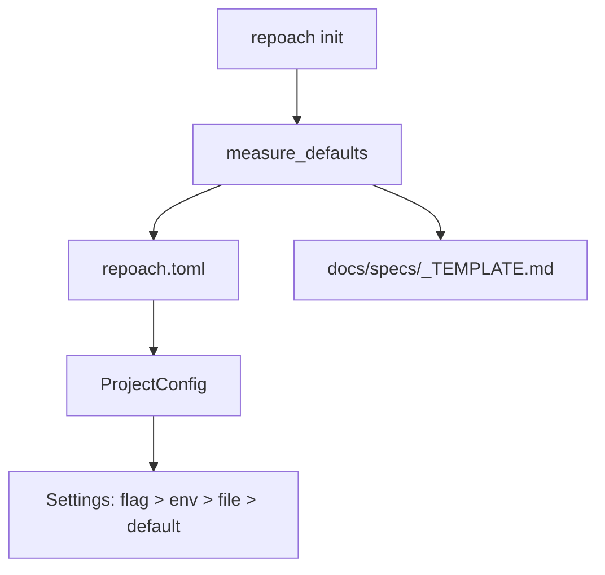

# repoach.toml and repoach init on a foreign repository

## Intent

One committed, secret-free file at the host repository root tells
repoach everything project-specific: forge, branches, merge method,
languages, commands, spec and plan directories, bot identity, state
path. `repoach init` writes it from measured defaults and never touches
the host's hooks, CI or agent configuration.

## Context

- `src/repoach/cli/init_cmds.py:68-85`: `init` copies repoach's own
  `.env.example` to `.env` and runs `git config core.hooksPath
  .githooks` in the directory the *package* lives in. On a foreign
  repository with an editable install this rewrites repoach's checkout;
  on a tool install it fails (`FileNotFoundError` on `.env.example`).
  Yoob's `core.hooksPath` is `scripts/hooks`, set by
  `scripts/install-hooks.sh`; overwriting it would disable Yoob's
  commit-msg and pre-push gates.
- `SP-BRANCH-CONFIG` already moved `integration_branch` and
  `release_branch` to `Settings` (`core/config.py:261-287`); the
  remaining project facts are literals: `SPECS_DIR = Path("docs/specs")`
  (`review/spec.py:42`), `docs/plans/<id>.md` (`planner.py:565`,
  `spec_gate.py:302,351`, `dev_runner.py:577,632`), squash
  (`auto_merge.py:450`), the Coder jail (`coder_loop.py:54-79`), the
  gate commands (`coder_loop.py:573-577,663-677`).
- Spec detection: `detect_spec_from_branch` (`spec.py:46,118-160`)
  parses `^[a-z]+/sp-<id>…`; Yoob branches are `<kind>/<theme>` and
  carry no id. `review_cmds.py` has no `--spec` option on `review pr`
  or `review gate`.
- `pyproject.toml` already declares `[tool.repoach.arch]
  frontier_suppress = []`, read by `edge_honesty.load_frontier_suppress`
  (`edge_honesty.py:171-190`); a non-Python host has no `pyproject.toml`.

## Goals

- G1: a `ProjectConfig` Pydantic model (`src/repoach/project/config.py`) loaded from `<project_root>/repoach.toml`, with every key optional and the defaults equal to repoach's behaviour on 2026-10-18.
- G2: `repoach init` writes `repoach.toml` (measured defaults, see Behavior) and `<specs_dir>/_TEMPLATE.md` (the shipped template), appends `.repoach.env` to `.gitignore` if the file exists, and nothing else. It is idempotent: a second run changes no byte and prints `unchanged`. `--dry-run` prints the plan and writes nothing. `--force` rewrites `repoach.toml` from fresh measurements.
- G3: `init` never runs `git config`, never writes under `.git/`, `.github/`, `.gitlab-ci.yml`, `.githooks/`, `.claude/`, `.gemini/`, `.agents/`, and never copies any `.env*`. The repoach-contributor steps (copy `.env.example`, set `core.hooksPath .githooks`) move behind `repoach init --repoach-dev`, which refuses unless `project_root()` contains `src/repoach/`.
- G4: spec resolution order for `review pr`, `review gate`, `review fix`: `--spec <id>` flag; a `Spec: <id>` line in the PR/MR description; the branch name (today's regex); none → the review runs without a spec and the JSON carries `"spec": null` and the spec-coverage fact is `not_applicable`, never a refusal.
- G5: `specs_dir` and `plans_dir` from config replace `SPECS_DIR` and the `docs/plans` literals; `arch check --specs-dir` defaults to the configured value.
- G6: `[tool.repoach.arch] frontier_suppress` moves to `repoach.toml` `[arch].frontier_suppress`; the `pyproject.toml` loader is kept as a fallback for one release.

## Non-Goals

- NG1: no secrets in `repoach.toml`, ever — the loader rejects any key whose name ends in `_key`, `_token` or `_secret` with a clear error.
- NG2: no multi-project monorepo support (one `repoach.toml` per git toplevel).
- NG3: no interactive wizard; `init` is a one-shot measurement with flags.

## Assumptions

- A1: Python 3.11+ gives `tomllib`; writing uses a small serialiser in `project/toml_write.py` (no new dependency) emitting the documented key order with comments from the shipped template `src/repoach/project/repoach.toml.template`.
- A2: language detection on `init` is a file census over `git ls-files` by extension (`.py`, `.ts`/`.tsx`, `.js`, `.go`, `.rs`, `.v`/`.sv`, `.sh`); a language with ≥ 1 file is declared.

## Interface

`repoach.toml` (every key optional; defaults in parentheses):

```toml
[repoach]
schema = 1
forge = "github"                 # github | gitlab   (inferred from origin URL)
integration_branch = "develop"   # (SP-BRANCH-CONFIG default)
release_branch = "main"
merge_method = "squash"          # squash | merge | rebase
specs_dir = "docs/specs"
plans_dir = "docs/plans"

[project]
languages = ["python"]           # measured by init
src_roots = ["src"]
test_roots = ["tests"]

[commands]
lint = "ruff check src tests && ruff format --check src tests"
test = "pytest -q tests/unit"
gate = ""                        # the project's own pre-push barrier, optional

[coder]
forbidden_prefixes = []          # added to the built-in list
forbidden_paths = []

[provider]
kind = ""                        # anthropic | claude_code | openai | openai_compatible | gateway
opus = ""                        # model id per tier (SP-UNIVERSAL-PROVIDERS)
sonnet = ""
haiku = ""

[review]
bot_username = ""                # forge login the bot posts as (SP-UNIVERSAL-FORGE)
spec_sources = ["flag", "description", "branch"]

[arch]
frontier_suppress = []

[state]
db_path = ""                     # default: user data dir / <slug> / repoach.db
```

```python
class ProjectConfig(BaseModel): ...
def load_project_config(root: Path) -> ProjectConfig: ...
def measure_defaults(root: Path) -> ProjectConfig: ...
def resolve_spec_id(*, flag: str | None, description: str, branch: str, sources: tuple[str, ...]) -> str | None: ...
```

Inputs:
- `--spec <id>`: str — on `review pr`, `review gate`, `review fix`.
- `Spec: SP-XXX` line: first line of the PR/MR description matching `^Spec:\s*(SP-[A-Z0-9-]+)\s*$`.

Outputs:
- `repoach init`: one line per file (`created` / `unchanged` / `would create`), rc 0.
- `repoach config show`: the effective configuration as TOML with a `# source: default|file|env|flag` trailer per key.

Errors:
- `ConfigError`: unknown key, wrong type, secret-looking key, or `schema` newer than the installed repoach — rc 2, names the key and line.
- `NotARepositoryError`: from `SP-UNIVERSAL-INSTALL`.

## Behavior

### Nominal
`cd <repo> && repoach init` → measures: forge from `git remote get-url
origin` (`github.com` → github; `gitlab.com` or a host answering
`glab api version` → gitlab), default branch from `origin/HEAD`,
languages from the census, `src_roots`/`test_roots` from the census'
top-level directories, `lint`/`test` left empty unless a known marker is
found (`pyproject.toml` → ruff/pytest, `package.json` with `lint`/`test`
scripts → `npm run lint`/`npm test`, `go.mod` → `go vet ./...`/`go test
./...`), `merge_method` from the forge API when readable, else
`squash`. Writes the two files, appends `.repoach.env` to an existing
`.gitignore`, prints one line per path, rc 0.

### Edge cases
- no origin remote → `forge` left empty with a comment; `review *` then requires `--forge` or `REPOACH_FORGE`.
- `docs/specs/_TEMPLATE.md` already exists → `unchanged`, never overwritten, even with `--force`.
- `--spec` names an id with no file under `specs_dir` → rc 2, `spec SP-X not found under docs/specs`.
- both `Spec:` line and branch id present and different → the description wins and the JSON carries `spec_source: "description"`.

### Failure scenarios
- `repoach.toml` unparsable → every project-scoped command exits 2 before any network call, with the TOML error position.
- `init` in a directory with uncommitted `repoach.toml` changes and `--force` → refuses unless `--force --yes`.

## Architecture Impact
- Adds dependency: SP-UNIVERSAL-PROJECT-CONFIG -> SP-UNIVERSAL-INSTALL (`project_root()` is the anchor for the file)
- Adds dependency: SP-UNIVERSAL-PROJECT-CONFIG -> SP-REPOACH-INIT-SCAFFOLD (its `init` becomes `init --repoach-dev`)
- Adds dependency: SP-UNIVERSAL-PROJECT-CONFIG -> SP-BRANCH-CONFIG (`integration_branch`/`release_branch` gain a file source below the env source)
- Adds dependency: SP-UNIVERSAL-PROJECT-CONFIG -> SP-SPEC-TEMPLATE (ships the template file into foreign repos)
- Adds dependency: SP-UNIVERSAL-PROJECT-CONFIG -> SP-SPEC-GATE (spec-coverage fact learns `not_applicable` when no spec resolves)
- Adds dependency: SP-UNIVERSAL-PROJECT-CONFIG -> SP-DB-PATH-XDG (`Settings` reads `repoach.toml` below the environment; the golden test pins its branch defaults)
- Adds dependency: SP-UNIVERSAL-PROJECT-CONFIG -> SP-PLAN-CONTRACT-LINTS (`plan_relpath` reads `[repoach].plans_dir`; the golden test pins `docs/plans`)
- New shared state: `repoach.toml` (format owned by `SP-UNIVERSAL-REPO`); the `Settings` singleton reads `ProjectConfig` as a settings source placed below the environment.

## Diagram


## Acceptance Criteria
- [ ] AC1: in a fresh clone of `charmbracelet/gum` (which has a `.gitignore`): `repoach init --dry-run` → `would create repoach.toml`, `would create docs/specs/_TEMPLATE.md`, `would update .gitignore (+ .repoach.env)`, `git status --short` empty; `repoach init` → `created repoach.toml`, `created docs/specs/_TEMPLATE.md`, `updated .gitignore (+ .repoach.env)`; `repoach init` → one `unchanged` line per path; `git status --short` → exactly ` M .gitignore`, `?? docs/` and `?? repoach.toml` (the `.gitignore` line of AC5). Variants: a repository with no `.gitignore` shows only the two `??` entries; a repository whose `<specs_dir>/_TEMPLATE.md` is already tracked (repoach itself) shows only `?? repoach.toml` and prints `docs/specs/_TEMPLATE.md unchanged`; a clone of Yoob, which has `docs/` but no `docs/specs/`, shows ` M .gitignore`, `?? docs/specs/` and `?? repoach.toml`.
- [ ] AC2: same clone: `git config core.hooksPath` before and after → identical (empty); `test ! -e .env`; `grep -c languages repoach.toml` → 1 and the value contains `"go"`; `grep merge_method repoach.toml` → `"squash"` or the API-read value.
- [ ] AC3: in a clone of Yoob: `repoach init` → `forge = "gitlab"`, `merge_method = "merge"`, `languages` contains `"python"`, `"typescript"` and `"verilog"`; `git config core.hooksPath` → `scripts/hooks` unchanged.
- [ ] AC4: `pytest -q tests/unit/test_project_config.py` → green, including the golden test: `load_project_config(tmp_path_without_file)` equals `ProjectConfig()` and every default matches the literal it replaces (`docs/specs`, `docs/plans`, `squash`, `develop`, `main`, the ruff/pytest commands, the four jail prefixes).
- [ ] AC5: `pytest -q tests/unit/test_init_foreign_repo.py` → green: a fixture repo with `core.hooksPath=scripts/hooks`, a `.githooks/` dir and a `.env` file is byte-identical after `init` except the two created files and the `.gitignore` line.
- [ ] AC6: `repoach review pr 283 --dry-run --spec SP-YOOB-MR-CREATE` from a Yoob clone whose `docs/specs/` holds that spec → JSON `spec == "SP-YOOB-MR-CREATE"`, `spec_source == "flag"`; without the flag and with `Spec: SP-YOOB-MR-CREATE` as the first description line → `spec_source == "description"`; with neither → `spec == null`, rc 0 or 2 (never a spec error).
- [ ] AC7: `repoach config show` in repoach's own checkout with its committed `repoach.toml` → every key tagged `file` or `default`; `scripts/ci_local.sh` green.

## Open Questions
- Q1: `repoach.toml` at the root versus `.repoach/config.toml` (umbrella Q2).
