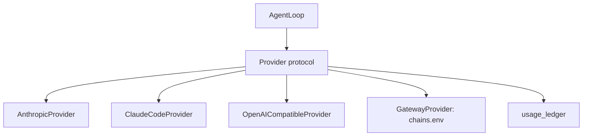

# Bring-your-own key by default, the gateway optional

## Intent

A user with an Anthropic API key, a Claude Code OAuth token or an
OpenAI-compatible endpoint runs the review team with no gateway
process. The chain-failover gateway stays available as
`provider = "gateway"` for whoever wants failover across free
providers. Every call is recorded in a per-project usage ledger, and a
missing provider fails with one clear message.

## Delivered — slice 1 (0.2, 2026-10-20)

Owner intent (2026-10-20): "repoach must be usable by anyone; the idea
is also to use Claude Code". A user with Claude Code installed and
logged in writes `[provider] kind = "claude_code"` and `repoach review
pr N` works with no gateway, no key, no `.env`.

- `Provider` protocol (`providers/protocol.py`): `name`, `models` (tier →
  model id) and `call(capability, system, messages, tools, max_tokens,
  temperature, skip_models, thinking) -> AgentResponse` — the exact
  method the loop called on the gateway client, so `ProxyGatewayClient`
  satisfies it unchanged and keeps its name (G1 as built: the method is
  `call`, not `complete`, to keep every existing caller and test).
- Route (`providers/select.py`): `[provider].kind` resolved env >
  `repoach.toml`; `claude_code` and `anthropic` are in-process, every
  other value (unset, `gateway`, the not-yet-routed `openai*`) is the
  gateway exactly as before. The gateway route sends the same bytes as
  `develop` d6335de (URL, headers, body: `test_provider_select.py::
  test_gateway_route_request_is_byte_identical`).
- `DirectProvider` (`providers/direct.py`) runs the gateway's own
  transports in-process — `ClaudeCodeProvider` (`claude --print
  --output-format json --model <alias>`, prompt on stdin, empty temp
  cwd) and `AnthropicMessagesTransport` — with the dispatcher's
  translation helpers made public; no second implementation of either
  upstream. All direct calls share one event loop on one daemon thread
  (the transports' rate limiter and HTTP client are loop-bound).
- `claude_code`: CLI from `[provider].cli_path` /
  `REPOACH_CLAUDE_CODE_CLI_PATH` / `claude` on PATH; tiers map to
  `opus` / `sonnet` / `haiku`; per-call timeout is the loop's; each
  call is spawned as a session leader and its whole process group is
  killed on timeout or interruption (`own_process_group`, off for the
  gateway). A login rejected mid-run (`/login`, `invalid api key`…) is a
  `ProviderAuthError` (`retryable = False`: the reviewer backoff stops at the first attempt, the hint goes to the summary and the `review.bot.attempt_fatal` log); any other CLI failure or timeout a
  `GatewayTransportError`.
- `anthropic`: key from `REPOACH_ANTHROPIC_API_KEY`, else
  `ANTHROPIC_API_KEY` (SP-PROVIDER-DIRECT-ANTHROPIC Q1); optional
  `REPOACH_ANTHROPIC_BASE_URL`; 401/403 → `ProviderAuthError` (one request, never retried) naming the
  variable, 5xx/408/429/529/unreachable → `GatewayTransportError`.
- Preflight `require_provider_ready()` (called by `review pr` before
  any forge call): missing CLI, logged-out CLI (`claude auth status
  --json`, reading only `loggedIn` / `authMethod`) or missing key →
  `ProviderConfigError` (a `GatewayConfigError`), one stderr line, rc 2.
- `doctor`: `provider_route=direct (claude_code|anthropic)|gateway
  (<url>)|none` and `provider_credential=` (a credential's name, or
  `claude login (<authMethod>; <cli>)`, never a value).
- `review pr`, `review gate`, `review fix`, the coder loop, the planner
  and the refuter all build `AgentLoop`, which now takes its provider
  from the route. `ci review`: an explicit `claude_code` / `anthropic`
  kind starts no loopback gateway (SP-UNIVERSAL-CI-ENTRY G9b).

Measured 2026-10-20 on Yoob (GitLab, no gateway, no `.env`, no
`REPOACH_LLM_PROXY_BASE_URL`): `REPOACH_PROVIDER=claude_code repoach
review pr 296 --dry-run --forge gitlab` → rc 0 in 103 s, 8 CLI calls
(4 reviewers, Sentinel's round two, 3 refuter calls), final verdict
APPROVE (Architect, Tester, Scribe APPROVE; Sentinel COMMENT on opus),
11 findings recorded (3 refuted, 6 deferred, 2 not applicable), 0
blockers, 1 major, posted 0 comments / 0 reviews; `git status` of the
Yoob checkout empty before and after.

Not in slice 1 (`docs/tech_debt.md`): the usage ledger (G5, AC6, AC7),
the `openai_compatible` direct provider, a `--provider` flag, G4's
single `NoProviderConfiguredError`, exact model ids on `claude_code`,
and a live `anthropic` run (no key on the measuring machine).

## Context

- `src/repoach/agent_engine/agent_loop.py:422-430` builds a
  `ProxyGatewayClient` from `settings.llm_proxy_base_url`; the loop
  speaks `repoach/v1` (`AgentRequest` → `AgentResponse`,
  `adapters.py:1-16,56-80`). There is no in-process alternative.
- `SP-BYO-PROVIDERS` added `openai`, `anthropic`, `openai_compatible`
  descriptors *inside the gateway* (`llm_proxy/config/settings.py:252-259`,
  `providers/catalog.py`): a key still needs the gateway running.
- `claude_code` shells out to `claude --print --output-format json
  --model <tier>` (`llm_proxy/providers/claude_code/client.py:183-191`)
  and bills the Max plan; the Yoob precedent for a headless token is
  `CLAUDE_CODE_OAUTH_TOKEN` from `claude setup-token`
  (`yoob_2/ci/autofix/autofix/agent.py:105-114`).
- Measured 2026-10-18: every free chain head answers HTTP 410, OpenRouter
  credit is negative; the only hop that answers is `claude_code/<tier>`.
- Tokens are recorded per review in `pr_reviews.tokens_used`
  (`review/persistence.py:64,80,247`); there is no per-call, per-project
  usage table and no cost column.
- The `anthropic` and `openai` SDKs are already dependencies
  (`pyproject.toml`).

## Goals

- G1: a `Provider` protocol (`src/repoach/providers/protocol.py`) with one method, `complete(request: AgentRequest) -> AgentResponse`, the exact seam `ProxyGatewayClient.call` fills today; the agent loop takes a `Provider`, not a base URL.
- G2: four shipped providers: `AnthropicProvider` (`REPOACH_ANTHROPIC_API_KEY`, else `ANTHROPIC_API_KEY`; built as the gateway's `AnthropicMessagesTransport` in-process, not the SDK), `ClaudeCodeProvider` (in-process reuse of the gateway's subprocess client, `CLAUDE_CODE_OAUTH_TOKEN` or the interactive login), `OpenAICompatibleProvider` (SDK, `REPOACH_OPENAI_API_KEY` + `REPOACH_OPENAI_BASE_URL`, covers OpenAI, Ollama, vLLM), `GatewayProvider` (today's `ProxyGatewayClient`, `REPOACH_LLM_PROXY_BASE_URL` + token).
- G3: selection: `--provider` > `REPOACH_PROVIDER` > `[provider].kind`; tier model ids from `[provider].opus/sonnet/haiku` or `REPOACH_MODEL_{OPUS,SONNET,HAIKU}`, with per-provider defaults (`anthropic`: `claude-opus-4-7`/`claude-sonnet-4-6`/`claude-haiku-4-5`; `claude_code`: `opus`/`sonnet`/`haiku`; `openai_compatible`: none — required; `gateway`: the alias the chain router classifies, unchanged).
- G4: no provider resolvable → `NoProviderConfiguredError`, rc 2, stderr: `no provider configured — set REPOACH_PROVIDER=anthropic|claude_code|openai_compatible|gateway, or [provider].kind in repoach.toml; run 'repoach doctor'`. Only `provider = "gateway"` triggers `require_llm_proxy_base_url`.
- G5: a `usage_ledger` table (project_slug, ts, command, pr_number, role, provider, model, input_tokens, output_tokens, cached_tokens, elapsed_s, cost_usd nullable, error nullable) written by every `complete()`; `repoach usage [--since] [--json]` prints per-command and per-model totals; `cost_usd` is null when the provider reports no price, never estimated silently.
- G6: `claude_code` is never auto-selected: a user who only has the `claude` binary gets the no-provider message with the hint, not a silent Max-plan charge.

## Non-Goals

- NG1: no failover across providers outside the gateway; a direct provider's error is the review's error.
- NG2: no change to `chains.env`, the chain router, breaker, effort map, chainpilot (umbrella NG3).
- NG3: no streaming; the loop consumes whole responses as today.
- NG4: no price table shipped; cost is recorded only when the provider's response carries it.

## Assumptions

- A1: `AgentRequest`/`AgentResponse` (`llm_proxy/api/models/agent_v1.py`) stay the loop's wire models; the direct providers translate to SDK calls in-process, including tool specs and `ThinkingConfig`.
- A2: the Anthropic SDK's `messages.create` returns `usage` with input/output/cache tokens; OpenAI-compatible endpoints may omit `usage` (recorded as null).

## Interface

```python
class Provider(Protocol):
    name: str
    def complete(self, request: AgentRequest, *, tier: CapabilityTier) -> AgentResponse: ...
    def describe(self) -> ProviderInfo: ...

def select_provider(config: ProjectConfig, *, override: str | None = None) -> Provider: ...
def record_usage(db: Engine, row: UsageRow) -> None: ...
```

Inputs:
- `REPOACH_PROVIDER`: str — one of the four names.
- `REPOACH_ANTHROPIC_API_KEY`, `CLAUDE_CODE_OAUTH_TOKEN`, `REPOACH_OPENAI_API_KEY`, `REPOACH_OPENAI_BASE_URL`, `REPOACH_LLM_PROXY_BASE_URL`, `REPOACH_ANTHROPIC_AUTH_TOKEN`: str — per provider, from the environment or `user_config_dir()/env`.

Outputs:
- `repoach usage`: a table `command | provider | model | calls | in_tokens | out_tokens | cost_usd` with `cannot say` where cost is null.
- `repoach doctor`: the `provider=` line names the selected provider and whether its credential is present (never its value).

Errors:
- `NoProviderConfiguredError`: rc 2.
- `ProviderAuthError`: credential rejected — rc 2, provider message, no retry.
- `ProviderTransportError`: 5xx/429/timeout — retried per the loop's existing backoff, then rc 2.

## Behavior

### Nominal
`REPOACH_PROVIDER=anthropic REPOACH_ANTHROPIC_API_KEY=… repoach review pr
1171 --dry-run` → four reviewers, refuter and verifiers run against the
API; four `usage_ledger` rows per reviewer round plus one per refuter
call; no process listens on any port.

### Edge cases
- `provider = "gateway"` with no URL → today's `llm_proxy_base_url unresolved` message, rc 2, unchanged wording.
- `claude_code` selected and `claude` not on PATH → rc 2, `claude binary not found; install Claude Code or choose another provider`.
- `openai_compatible` with no base URL → rc 2 before any call.
- a key present in both env and `user_config_dir()/env` → env wins; `doctor` says which source.

### Failure scenarios
- the provider answers 401 mid-review → the review stops, `errors[]` carries the provider message, the ledger row has `error`, partial reviews are persisted with their status.
- the ledger is unwritable → the call still returns; `usage_ledger.write_failed` is logged once per process, never swallowed silently.

## Architecture Impact
- Adds dependency: SP-UNIVERSAL-PROVIDERS -> SP-UNIVERSAL-INSTALL (credential file under `user_config_dir()`; ledger under the project data dir)
- Adds dependency: SP-UNIVERSAL-PROVIDERS -> SP-UNIVERSAL-PROJECT-CONFIG (`[provider]` table)
- Adds dependency: SP-UNIVERSAL-PROVIDERS -> SP-BYO-PROVIDERS (the gateway-side descriptors stay the `gateway` provider's path; model-id defaults are shared)
- Adds dependency: SP-UNIVERSAL-PROVIDERS -> SP-CHAINS-SINGLE-SOURCE (`gateway` keeps reading `chains.env`; the direct providers never do)
- Adds dependency: SP-UNIVERSAL-PROVIDERS -> SP-DB-PATH-XDG (`core.config`: `GatewayConfigError`, `configured_env_value`, the settings singleton the gateway route reads; added 0.2)
- New shared state: `db:table:usage_ledger`, owned here, read by `repoach usage` and by the Yoob W1 report (`select sum(input_tokens+output_tokens)`).
- The agent loop's constructor changes from `base_url`/`api_key` to a `Provider`; the gateway client becomes one implementation.

## Diagram


## Acceptance Criteria
- [ ] AC1: `env -i HOME=$HOME PATH=$PATH repoach review pr 1 --dry-run` in any clone → rc 2, stderr contains `no provider configured` and the four names; `ss -ltnp | grep -c 8084` unchanged.
- [ ] AC2: `REPOACH_PROVIDER=anthropic REPOACH_ANTHROPIC_API_KEY=$KEY repoach review pr <n> --dry-run` with the gateway unit stopped → rc 0 or 2 (never 1), JSON `len(reviews)==4`; `sqlite3 <db> "select count(*) from usage_ledger where provider='anthropic'"` ≥ 5.
- [ ] AC3: `REPOACH_PROVIDER=claude_code` with `CLAUDE_CODE_OAUTH_TOKEN` set and no interactive login → same shape; `REPOACH_PROVIDER=claude_code` with no `claude` on PATH → rc 2, `claude CLI not found` (wording as built). The second half is green (`test_provider_direct_claude_code.py::test_unusable_cli_fails_before_any_forge_call`); the token half is unmeasured (`claude auth status` reports `loggedIn: true`, `authMethod: oauth_token` for a set token, measured 2026-10-20, but no review ran on a token-only login).
- [x] AC3b (added 0.2): with an interactive login, `REPOACH_PROVIDER=claude_code repoach review pr 296 --dry-run --forge gitlab` on Yoob, no gateway → rc 0, four reviews, posted 0/0 (Delivered, measured).
- [x] AC4 (as built 0.2: the pre-change request bytes are pinned instead of a JSON fixture — `test_provider_select.py::test_gateway_route_request_is_byte_identical`, body captured from `develop` d6335de; `pytest -q tests/unit` green): `REPOACH_PROVIDER=gateway REPOACH_LLM_PROXY_BASE_URL=http://127.0.0.1:8084 repoach review pr <n> --dry-run` in repoach's own checkout → identical JSON shape to the pre-change run (fixture), and `pytest -q tests/unit` green.
- [ ] AC5: `pytest -q tests/unit/test_provider_select.py` → green: precedence flag > env > file (green for env > file; no flag yet); `claude_code` never selected by default; each provider's missing credential names the variable.
- [ ] AC6: `pytest -q tests/unit/test_usage_ledger.py` → green with a truthful `httpx.MockTransport` fake for the Anthropic SDK: one row per call, `cost_usd` null, `error` set on a 401.
- [ ] AC7: `repoach usage --json | jq '.totals.calls'` after AC2 ≥ 5; `repoach usage` prints `cannot say` in the cost column when every row has null cost.

- [x] AC8 (added 0.2): `pytest -q tests/unit/test_provider_direct_claude_code.py` → green: a fake `claude` on PATH answers the real transport; tier → `--model` alias; session leader killed on timeout; a `/login` failure is not retried; `review pr 42 --dry-run` end to end with `kind = "claude_code"` in `repoach.toml` → four APPROVE reviews, posted 0/0; absent or logged-out CLI → rc 2, one stderr line, no forge transport call.
- [x] AC9 (added 0.2): `pytest -q tests/unit/test_provider_direct_anthropic.py` → green (SP-PROVIDER-DIRECT-ANTHROPIC AC5).

## Open Questions
- Q1: gateway as an optional extra (`repoach[gateway]`) — umbrella Q5.
