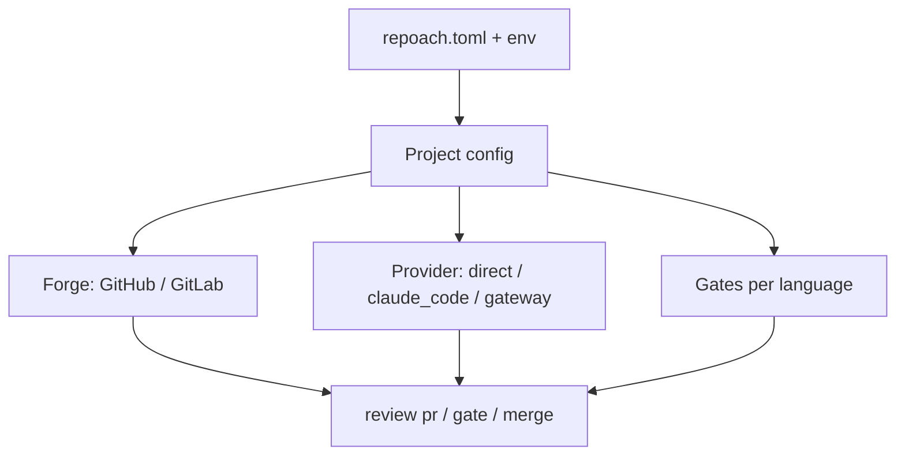

# Repoach runs on any repository

## Intent

Make repoach a tool a stranger installs in one command and points at
their own repository — any forge, any language, any CI, their own model
key — without cloning repoach, running its gateway, or adopting its
hooks. Owner decision 2026-10-18: « il faut avoir une vue holistique de
repoach, tout le monde doit pouvoir l'utiliser dans son repo ». Yoob
(GitLab, Python + TypeScript + Verilog, merge commits, its own CI
barrier) is the first external user and the proof, never the spec.

## Context

Measured on `develop` `20dbb45` (2026-10-18). Every claim below was
re-run against the code, not taken from a document.

| # | Assumption baked in today | Where | Measured consequence |
|---|---|---|---|
| A1 | Settings refuse to boot without a gateway URL, and every CLI call boots Settings | `src/repoach/core/config.py:334-339` via `src/repoach/core/logging.py:26` from `src/repoach/cli/main.py:62-65` | wheel install, foreign cwd, no env: `repoach version` → pydantic `value_error: llm_proxy_base_url unresolved`, rc 1. `--version` is not an option. |
| A2 | Config, `chains.env`, `.env` and the ledger anchor to the nearest ancestor `pyproject.toml` of the *package file*, else the package directory | `config.py:30-52,55-72,300-318` | on a tool install the anchor is `site-packages/repoach/`; `db_path` resolves to `site-packages/repoach/data/repoach.db`. A venv created inside any other Python project takes that project's `.env`/`chains.env` as repoach's. |
| A3 | The forge is GitHub through a `gh` binary on PATH; nineteen public methods; nine in-tree caller modules | `src/repoach/review/gh_client.py:133-157`; callers `orchestrator.py`, `auto_merge.py`, `coder_findings.py`, `coder_loop.py`, `dev_runner.py`, `thread_context.py`, `release_gate.py`, `cli/review_cmds.py`, `cli/release_cmds.py` | no GitLab path at all; the merge is `gh pr merge --squash` (`auto_merge.py:450`); CI truth is `statusCheckRollup` matched against two hand-synced check names (`auto_merge.py:87-90`) |
| A4 | Trust markers are honoured only from `github-actions[bot]` | `config.py:223-236`, `gh_client.py:157,169-176` | a GitLab note author can never be trusted |
| A5 | `repoach init` scaffolds repoach itself and rewrites `core.hooksPath` of the checkout the package lives in | `src/repoach/cli/init_cmds.py:18-25,51-65,68-79` | on a foreign repo it would copy repoach's `.env.example` and overwrite the host's hook path |
| A6 | Spec id comes from the branch name `^[a-z]+/sp-<id>…`; specs live at `docs/specs` relative to cwd; plans at `docs/plans` | `src/repoach/review/spec.py:42,46,107`; `planner.py:565`; `spec_gate.py:302,351` | Yoob branches are `<kind>/<theme>`; no `--spec`, no `Spec:` line |
| A7 | Spec frontmatter must carry `id,title,version,status,owns,depends_on`; a new spec without frontmatter is a blocking violation | `src/repoach/arch/registry.py:23`; `src/repoach/lint/edge_honesty.py:67-77` | a host with lightweight specs fails `arch check` |
| A8 | The code is Python under `src/`, tests under `tests/unit`, gates are literal `ruff` and `pytest` | `edge_honesty.py:36,93-96`; `import_gate.py:1-11`; `finding_verifiers.py:35,87-115`; `coder_loop.py:573-577,663-677`; `devagent_tools.py:198-227` | a `missing_docstring` finding on a `.ts` file is parsed with `ast` |
| A9 | The Coder jail knows GitHub and repoach paths only | `coder_loop.py:54-79` | `.gitlab-ci.yml`, `ci/`, `scripts/hooks/`, `.claude/` are writable |
| A10 | Only `review merge` populates `pr_merges`; the CI lane's `auto_fix`/`auto_merge` jobs race the owner's local merge | `.github/workflows/auto-review.yml:282-341,620-685`; `scripts/safe_merge.sh:255-256` | 53 of the last 60 `auto-review` runs red at "Checkout PR head (writable)" or "Run auto-merge" after the head branch was deleted by a human merge |
| A11 | The agent loop speaks only to the HTTP gateway | `src/repoach/agent_engine/agent_loop.py:422-430`, `adapters.py:56-80` | a bring-your-own key (`SP-BYO-PROVIDERS`) still requires running the gateway process |
| A12 | The free chains are dead | `chains.env:71,78,86`; `nim_health_probe` | every tier head HTTP 410 since August; the only answering hop is `claude_code/<tier>` on this PC's Max login |
| A13 | `merge-on-ci.yml` runs `main`'s code; the ledger CI jobs write is shipped as an artifact, the local ledger has 0 `pr_merges` rows | `merge-on-ci.yml:11-16,60-63`; `auto-review.yml:210,252-256` | a gate fix on `develop` is inert until a release |

The programme is decomposed into six children, one per seam. Each is
a governed spec with its own acceptance commands; this umbrella holds
the non-goals, the migration for repoach's own repository, the
milestone order, the risk list and the universality gauge.

| Child | Seam | Plan worksite it absorbs |
|---|---|---|
| `SP-UNIVERSAL-INSTALL` | wheel install, boot without gateway, state paths off the checkout | tech debt #18 |
| `SP-UNIVERSAL-PROJECT-CONFIG` | `repoach.toml`, `repoach init` on a foreign repo, spec source and spec dir | W3, G5, G6, G10, G11 |
| `SP-UNIVERSAL-FORGE` | `Forge` protocol, GitHub and GitLab implementations, conformance suite | W2, G1, G3, G4, G13 |
| `SP-UNIVERSAL-PROVIDERS` | direct providers, gateway optional, usage ledger, clear no-provider error | Q1, G14 |
| `SP-UNIVERSAL-GATES` | per-language lint/test/gate, Python verifiers skip by declared language, `owns` optional | W4, G7, G8, G9, G12 |
| `SP-UNIVERSAL-CI-ENTRY` | `review pr` / `review gate` from any CI, posting vs dry-run, bot identity, the merge race | W5 (repoach side), G2, A10 |

## Goals

- G1: `pipx install repoach` or `uv tool install repoach` from a wheel, then `repoach --version`, succeeds on a machine that has never cloned repoach and runs no gateway.
- G2: `repoach init` in any git repository writes `repoach.toml` and `docs/specs/_TEMPLATE.md`, touches nothing else, and is idempotent; `--dry-run` writes nothing.
- G3: every forge operation goes through one `Forge` protocol with shipped GitHub and GitLab implementations and one conformance suite run against both.
- G4: a provider is chosen by configuration; a direct Anthropic key, a Claude Code OAuth token or an OpenAI-compatible endpoint works with no gateway process; `provider = "gateway"` keeps today's chain failover.
- G5: lint, test and gate commands come from `repoach.toml`; Python-only verifiers skip with a named reason on any other language.
- G6: `repoach review pr <n>` and `repoach review gate <n>` have the same semantics from a shell, GitHub Actions, GitLab CI or cron; a PR merged by a human while the bot runs ends in `ALREADY_MERGED`, never a red job.
- G7: all state lives per project under a path the user controls; nothing is written inside the installed package or the repoach checkout.
- G8: README carries a "five minutes on your repo" section whose commands are the acceptance criteria of this spec.
- G9 (the universality gauge): a public repository the owner has never seen passes `repoach init` and `repoach review pr <n> --dry-run` in at most five minutes with zero code change.

## Non-Goals

- NG1: no rewrite of the review pipeline (reviewers, refuter, verifiers, findings ledger, merge gate) — the universality work only moves its inputs behind configuration and protocols.
- NG2: no change to how repoach's own repository is governed: it keeps GitHub Actions, the two self-hosted runners, `chains.env`, the gateway on `:8084` and squash merges. It consumes the new configuration surface like any other project.
- NG3: the gateway (`src/repoach/llm_proxy`) is not redesigned; breaker and effort-map restart amnesia (tech debt #20) stays as it is — with a direct provider there is no breaker state to lose, and with `provider = "gateway"` the amnesia is the gateway operator's documented behaviour. Explicitly out of scope.
- NG4: no server-side branch protection (tech debt #21), no fork-PR support in repoach's own CI.
- NG5: no Yoob-side worksites in this family: Yoob's `review:advisory` job, `scripts/mr-create` and `repoach develop` on a Yoob spec (plan W5 Yoob side, W6, W7) are Yoob specs, consumers of this programme.
- NG6: no new forge beyond GitHub and GitLab; the protocol admits more, none is shipped.
- NG7: no hosted service, no multi-tenant gateway, no billing.

## Assumptions

- A1: `gh` and `glab` stay the transport for forge calls; a REST fallback is permitted inside `GitLabForge` where `glab` has no subcommand, but neither binary is vendored.
- A2: the `anthropic` and `openai` Python SDKs already in `pyproject.toml` are the direct transports; no new HTTP client.
- A3: the first proof (plan W1: GitLab dry-run on Yoob MR !283 through a read-only `gh` shim, `REPOACH_DB_PATH` in scratch, a second gateway instance on `:8085`) is run before any child lands and stays scratch; a shim never posts or merges.
- A4: Yoob's merge method is `merge` (measured `glab api projects/67827362` → `merge_method: merge`); squash stays repoach's own default.

## Interface

The umbrella owns one format, `format:repoach-toml`, the committed
project configuration every child reads. Keys are introduced by the
child that consumes them; the full table lives in
`SP-UNIVERSAL-PROJECT-CONFIG`. Resolution order, everywhere:
CLI flag > `REPOACH_*` environment variable > `repoach.toml` > built-in
default. Secrets are never read from `repoach.toml` nor from the host
repository's `.env`.

Inputs:
- `repoach.toml`: file at the host repository root — committed, secret-free.
- `REPOACH_*`: process environment — secrets and per-run overrides.

Outputs:
- `repoach --version`: str — the installed version, one line.
- `repoach review pr <n> [--dry-run]`: JSON on stdout, exit code per the contract in `SP-UNIVERSAL-CI-ENTRY`.

Errors:
- `NoProviderConfiguredError`: no provider resolvable — exit 2, message names the three ways to configure one.
- `ForgeUnavailableError`: the selected forge binary or token is absent — exit 2, names the binary and the token variable.

## Behavior

### Nominal
`pipx install repoach` → `cd <any repo>` → `repoach init` → set one
provider variable → `repoach review pr <n> --dry-run` prints JSON with
four reviews, zero posts. Adding `--post` (or omitting `--dry-run` in
CI) posts through the configured forge under the configured bot
identity.

### Edge cases
- a repository with no `repoach.toml` → every command behaves as repoach's own defaults did on 2026-10-18 (GitHub, `develop`/`main`, squash, Python gates) — the golden test in `SP-UNIVERSAL-PROJECT-CONFIG` pins it.
- no Python on the host → `init` and `review pr --dry-run` run; Python verifiers report `not_applicable`.
- `repoach.toml` present but `forge` absent → inferred from `git remote get-url origin`; both `github.com` and a self-hosted GitLab host are recognised by the `--forge` override, never by guessing on an unknown host.

### Failure scenarios
- the provider answers 4xx/5xx → the review ends with exit 2 and the provider error in `errors[]`; the ledger records the attempt.
- the forge token lacks a scope → the write fails with the forge's message verbatim; dry-run never needs a write scope.

## Architecture Impact
- Adds dependency: SP-UNIVERSAL-REPO -> SP-UNIVERSAL-INSTALL (boot and state are the precondition of every other child)
- Adds dependency: SP-UNIVERSAL-REPO -> SP-UNIVERSAL-PROJECT-CONFIG (every child reads `repoach.toml`)
- Adds dependency: SP-UNIVERSAL-REPO -> SP-UNIVERSAL-FORGE (the nine `GhCli` callers move behind `Forge`)
- Adds dependency: SP-UNIVERSAL-REPO -> SP-UNIVERSAL-PROVIDERS (the agent loop gains an in-process provider seam)
- Adds dependency: SP-UNIVERSAL-REPO -> SP-UNIVERSAL-GATES (verifiers and Coder gates become language-aware)
- Adds dependency: SP-UNIVERSAL-REPO -> SP-UNIVERSAL-CI-ENTRY (the CI workflows become thin callers)
- New shared state: `format:repoach-toml`, owned here, consumed by all six children; no cycle (children never depend on the umbrella).

## Diagram

## Migration for repoach's own repository

What stays: `.github/workflows/*.yml`, the two self-hosted runners,
`chains.env`, the gateway unit on `:8084`, squash merges, the
`develop`/`main` model, `.githooks/`, `scripts/safe_merge.sh`.

What changes, in order:
1. a `repoach.toml` is committed at the root: `forge = "github"`, `merge_method = "squash"`, `languages = ["python"]`, `[commands]` holding today's `ruff` + the two lint scripts + `pytest -q tests/unit`, `provider = "gateway"`.
2. `.github/workflows/auto-review.yml` steps call `repoach review pr` / `fix` / `merge` with no PR number argument (resolved from the event, `SP-UNIVERSAL-CI-ENTRY`), and the writable checkout moves inside `repoach review fix`.
3. `scripts/safe_merge.sh` step 7 calls `repoach review merge` instead of `gh pr merge --squash` so `pr_merges` is populated locally and the release gate's `--provenance ledger` works again.
4. `repoach init` on repoach's own checkout becomes the foreign-repo behaviour; the `.env.example` copy and `core.hooksPath` step become `repoach init --repoach-dev`, kept for contributors.

## Milestones

| Id | Scope | Size | Depends on | Acceptance command (expected) |
|---|---|---|---|---|
| M0 | Plan W1: GitLab dry-run on Yoob MR !283 through a read-only `gh` shim and a `:8085` gateway instance, scratch only, zero repoach refactor | 1 d | — | from `yoob_2`: `REPOACH_DB_PATH=<w1>/yoob-review.db REPOACH_LLM_PROXY_BASE_URL=http://127.0.0.1:8085 repoach review pr 283 --dry-run` → rc 0 or 2, JSON with `len(reviews)==4`, `posted_comments==0`; `glab api projects/67827362/merge_requests/283/notes \| jq length` unchanged |
| M1 | `SP-UNIVERSAL-INSTALL` | 1–2 d | M0 | in a fresh venv outside any project: `uv tool install ./dist/repoach-*.whl && repoach --version` → `repoach 0.2.0`, rc 0, no env set |
| M2 | `SP-UNIVERSAL-PROJECT-CONFIG` | 2–3 d | M1 | in a throwaway clone of `charmbracelet/gum`: `repoach init && repoach init` → second run prints `init: repoach.toml unchanged`; `git status --short` lists exactly `repoach.toml` and `docs/specs/_TEMPLATE.md`; `git config core.hooksPath` byte-identical before/after |
| M3 | `SP-UNIVERSAL-FORGE` | 3–4 d | M2 | `pytest -q tests/unit/test_forge_conformance.py` → both parametrised forges green; from `yoob_2`: `repoach review pr 283 --dry-run` with no shim on PATH → same JSON shape as M0 |
| M4 | `SP-UNIVERSAL-PROVIDERS` | 2 d | M1 | `REPOACH_PROVIDER=anthropic REPOACH_ANTHROPIC_API_KEY=… repoach review pr <n> --dry-run` with no gateway process → rc 0; `unset`-everything → rc 2 and `no provider configured` on stderr; `repoach usage` prints one row per review |
| M5 | `SP-UNIVERSAL-GATES` | 2 d | M2 | `pytest -q tests/unit/test_gates_language.py` → a `missing_docstring` finding on `src/x.ts` ends `not_applicable`; a `lint` command exiting 1 makes the Coder gate red with the command's tail |
| M6 | `SP-UNIVERSAL-CI-ENTRY` | 2 d | M3, M4 | `pytest -q tests/unit/test_ci_entry.py`; `CI_MERGE_REQUEST_IID=283 repoach review pr --dry-run` from `yoob_2` resolves the MR; `repoach review merge <merged-pr>` → `ALREADY_MERGED`, rc 0 |
| M7 | README "five minutes on your repo" + universality gauge | 1 d | M2–M6 | clock from `pipx install` to the end of `repoach review pr 1171 --dry-run` in `charmbracelet/gum` ≤ 5 min, `git diff --stat` empty except the two `init` files; repeat on `junegunn/fzf` (default branch `master`) |
| M8 | Yoob consumer side (plan W5 Yoob job, W6 `scripts/mr-create`, W7 `repoach develop` on Yoob) | 6–7 d | M3–M6 | owned by Yoob specs, listed for ordering only |

Total for repoach: 14–17 working days, M0 first and alone. M3 is above
the autonomous Developer's capacity (≈500 LOC across ≥3 new files):
hand-implement or decompose with `SP-DEVAGENT-DECOMPOSE` before
`repoach develop`.

## Risks

| Risk | Evidence | Mitigation in this programme |
|---|---|---|
| Dead free chains: every NIM head 410 since August, OpenRouter credit negative | `nim_health_probe`, `logs/nim_health.log` | direct providers (M4) make the gateway optional; a key, not a chain, is the default path |
| Max-plan dependency: the only answering hop today shells out to `claude --print` on an interactive login shared with the owner's sessions | `src/repoach/llm_proxy/providers/claude_code/client.py:1-17,183-191` | `claude_code` stays one provider among four; the gauge runs on an API key |
| Home-network SPOF: gateway, both runners, `.env`, the Max login sit on one PC behind a line that dropped twice at ~00:40 | `deploy/systemd/README.md:3-8`; Yoob memory on nightly breaks | nothing in this family requires that PC; CI entry runs wherever the host's CI runs |
| hel1 as host: one paid box, no `gh`/`glab`/`claude` installed, Yoob's light runner already there | measured by SSH 2026-10-18 | the install child makes a bare venv enough; the token is a CI variable, not a login |
| `_repo_root()` walks up to any ancestor `pyproject.toml` | `config.py:48-52` | M1 drops package-relative anchors |
| `merge-on-ci` runs `main`'s code; a gate fix is inert until release | `merge-on-ci.yml:11-16` | out of scope (NG2); documented in the migration |
| A shim that writes | plan W1 | M0 answers every write subcommand with exit 70; M3 replaces it |

## Acceptance Criteria
- [ ] AC1: `python -m build --wheel && uv tool install dist/repoach-*.whl && cd /tmp && repoach --version` → `repoach <version>`, rc 0, with `env -i HOME=$HOME PATH=$PATH`.
- [ ] AC2: in a fresh clone of `charmbracelet/gum`: `repoach init --dry-run` → lists the two files it would write, `git status --short` empty; `repoach init` → the two files exist; `repoach init` again → `init: repoach.toml unchanged`, rc 0.
- [ ] AC3: same clone: `REPOACH_PROVIDER=anthropic REPOACH_ANTHROPIC_API_KEY=$KEY repoach review pr 1171 --dry-run` → rc 0 or 2, JSON with `len(reviews)==4`, `posted_comments==0`, `posted_reviews==0`, and every Python verifier row carries `method == "not_applicable"`; wall clock from AC1 to here ≤ 5 min; `git status --short` shows only the two `init` files.
- [ ] AC4: from `yoob_2`: `repoach review pr 283 --dry-run` with `forge = "gitlab"` in `repoach.toml` → same JSON shape as AC3; `glab api projects/67827362/merge_requests/283/notes | jq length` unchanged before and after.
- [ ] AC5: in repoach's own checkout with its committed `repoach.toml`: `pytest -q tests/unit` green and `scripts/ci_local.sh` green; `repoach review gate <open-pr>` prints the same `facts` as before the migration (recorded fixture).
- [ ] AC6: `grep -n "five minutes" README.md` → one heading; every command under it appears verbatim in AC1–AC3.
- [ ] AC7: `repoach arch check --base origin/develop` → `edge-honesty: ok` with the seven specs of this family present.

## Open Questions
- Q1: model budget for Yoob reviews — direct Anthropic API key (≈11 M tokens/month at 3.3 MR/day measured) or the Max OAuth token on hel1 (shared quota, Yoob autofix precedent)? Recommendation: key for CI, `claude_code` for M0 only.
- Q2: `repoach.toml` at the host root (proposed, visible, one file) or `.repoach/config.toml` (hidden, groups the ledger)? Recommendation: root file, ledger under the XDG data dir by default.
- Q3: gauge repository — `charmbracelet/gum` (Go, open PR #1171) is proposed; confirm, or name another the owner has never seen.
- Q4: advisory for how many MRs before the gate blocks on Yoob (plan Q3)? The decision is a false-positive rate read from the ledger, not a date; recommend 20 MRs.
- Q5: should the gateway become an optional extra (`pip install repoach[gateway]`) so the core wheel drops `fastapi`, `uvicorn`, `tiktoken`? Recommend yes in M4, but it changes the package layout.
