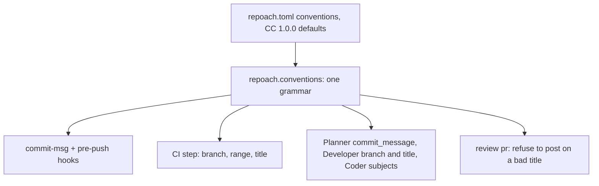

# Conventions gate: branch, commit header, PR title

## Intent

Repoach's history is written by bots and humans alike, and merged by
squash so a PR title becomes a commit on `develop`. Today nothing
judges a branch name, a commit header or a PR title: `CONTRIBUTING.md`
asks for Conventional Commits and no hook, no CI step and no bot
checks it. This component states the grammar once, as a per-project
setting with Conventional Commits 1.0.0 defaults, and enforces it in
the commit hook, the pre-push hook, CI, the Planner's commit messages,
the Developer's branch and PR title, and the posting path of
`review pr`.

## Context

Measured on `develop` `20dbb45` (2026-10-19). Owner decisions of the
same day: branch names use the full type list, the same as commits;
the grammar is a per-project `[conventions]` section with the
Conventional Commits defaults; a `fix` lane never rewrites history.

| # | Fact | Where |
|---|---|---|
| F1 | No branch, commit or title check exists: `.githooks/` holds `pre-commit` and `pre-push` only; `ci.yml` runs ruff, the two lint scripts, edge honesty and pytest; no file in `src/`, `scripts/` or `.github/` mentions "conventional" | `.githooks/`; `.github/workflows/ci.yml:59-81`; `grep -rli conventional` → none |
| F2 | The spec-from-branch parser accepts any lowercase word as the type: `^[a-z]+/sp-<id>…`, so `feature/sp-x-impl` and `wip/sp-x-impl` resolve a spec | `src/repoach/review/spec.py:46` (`_BRANCH_RE`); `subspec_anchor.py:32` |
| F3 | The Developer always generates `feat/sp-<slug>-impl` and a PR title `feat(<id>): <title>` whatever the spec's nature | `src/repoach/review/dev_runner.py:119` (`DEFAULT_BRANCH_TEMPLATE`), `:1945` |
| F4 | A plan step's `commit_message` is documented as a conventional subject and validated only for non-emptiness; the Developer commits it verbatim | `src/repoach/review/plan.py:211-231`; `dev_runner.py:377,552` |
| F5 | The Coder's wrap-up commits are generated as `fix(wrapup): …` with no check on the rest of the header | `dev_runner.py:1213` |
| F6 | Merges are `gh pr merge --squash`: the PR title is the subject of the commit that lands on `develop` | `src/repoach/review/auto_merge.py:450` |
| F7 | Yoob's reference: a `commit-msg` hook with the closed type list `feat fix perf refactor docs test build ci chore style revert`, header regex `^(types)(\([a-z0-9._/-]+\))?!?: .+`, 72-character limit, lowercase subject, no trailing period, AI-attribution trailers stripped; and a CI job judging the branch name, every new commit and the MR title | `/home/jofaye/Documents/work/yoob_2/scripts/hooks/commit-msg:89-127`; `ci/lib/conventions.py:91-118` (French-word, sprint-code, AI-attribution patterns); `ci/lint-conventions.sh:110-113` |
| F8 | No history is rewritten by any lane today: no `rebase`, `--amend` or `--force` push in `coder_loop.py`, `coder_findings.py`, `dev_runner.py`, `auto_merge.py`; the one `--force` is `git worktree remove` | measured by grep, `dev_runner.py:1018` |
| F9 | `repoach init` scaffolds `.env` and `core.hooksPath` and writes no project configuration yet | `src/repoach/cli/init_cmds.py:28-79`; `SP-UNIVERSAL-REPO` G2 |
| F10 | Measured 2026-10-22: commits on `develop`/`main` carry `Co-Authored-By: Claude Sonnet 5 <noreply@anthropic.com>` trailers (`b18425e`), and the squash commits `aafd879` (#232) and `1946dda` (#235) concatenate every branch commit's trailers in their bodies: `gh pr merge --squash` without a body lets GitHub build it from the commits | `git log --format=%B origin/develop`; `src/repoach/forge/github.py` `GitHubForge.merge` |

## Goals

- G1: one module, `repoach.conventions`, holds the grammar: `DEFAULT_TYPES` (the eleven), `Conventions` (the per-project model), `check_branch`, `check_commit_message`, `check_pr_title`, `is_exempt_branch`; `spec._BRANCH_RE`, `subspec_anchor._PARENT_BRANCH_RE`, `dev_runner.DEFAULT_BRANCH_TEMPLATE` and the PR title builder derive from it — the type list is written once.
- G2: `repoach.toml` `[conventions]` — `types` (default the eleven), `scopes` (default any `[a-z0-9._/-]+` word), `branch_pattern` (default `<type>/<slug>`; spec-bearing `<type>/sp-<id>-<slug>`), `exempt_branches` (default `["main", "develop"]`, glob), `pr_title` (default `true`), `breaking` (default `true`: `!` after the type or scope and a `BREAKING CHANGE:` footer are recognised and surfaced to the release gate) — Conventional Commits 1.0.0 defaults apply when the section is absent; `repoach init` writes the section commented out.
- G3: a commit header is judged as: `type(scope)!: subject`, `type` in `types`, `scope` matching `scopes` when present, subject non-empty, header at most `header_max_chars` characters, subject starting lowercase, no trailing period, imperative (first word not ending in `-ed`/`-ing`, not `adds`/`fixes`/`added`/`fixed`), English (no accented character, no French stop-word from the reference list), no AI-attribution trailer anywhere in the body (the Yoob pattern set); `Merge`, `Revert "…"`, `fixup!`, `squash!` headers are exempt.
- G4: `repoach conventions check` judges, in one call and one report, the branch (`--branch`), the commits of a range (`--range base..head`), one message file (`--commit-msg-file`, for the hook) and a title (`--title`); rc 1 on any violation, each printed as `<subject>: [commit|branch|title] <rule>`; `--json` for CI.
- G5: enforcement at every layer: `.githooks/commit-msg` (new) judges the message; `.githooks/pre-push` judges the branch name and `origin/<integration>..HEAD`; `ci.yml` gains a `Lint — conventions` step judging branch, range and PR title on `pull_request`; `ActionPlan` validation judges every `commit_message`; the Developer builds its branch and PR title from the spec's `kind`; the Coder's generated subjects pass `check_commit_message` before `git commit`.
- G6: `repoach review pr` in posting mode refuses to post on a PR whose title fails `check_pr_title` when `pr_title` is on: no forge write, payload `conventions: {title_ok: false, violations: [...]}`, rc 9; dry-run reports the same object and proceeds.
- G7: the spec frontmatter gains an optional `kind` (one of `types`, default `feat`); the Developer's branch is `<kind>/sp-<id>-impl` and its PR title `<kind>(<id-lowercase>): <title>`; `detect_spec_from_branch` accepts exactly the configured types.
- G9: no AI attribution reaches history or a PR (owner rule: zero AI attribution, in both repositories). Three layers, delivered ahead of G1–G8: (a) `.githooks/commit-msg` strips every attribution line — `Co-Authored-By:` naming Claude or Anthropic, `Generated with/by … Claude/Anthropic` with or without the robot emoji, `Claude-Session:` — silently but for one stderr line, so an agent's commit still lands clean, then refuses a header that is not `type(scope): subject` with a type from `DEFAULT_TYPES`, or is longer than 72 characters; (b) `GitHubForge.merge` with `squash` reads the PR's `commits` with its merge facts and passes `--body-file -`, the concatenated commit messages minus every attribution line, so a squash never inherits a branch commit's trailer; (c) the CI step `Lint — no AI attribution` runs `scripts/lint_no_ai_attribution.py` on `base_sha..head_sha` and on the PR title and body, rc 1 on any attribution line. Matching is per line and anchored at the line start: a human `Co-Authored-By` and a sentence naming the `claude_code` chain survive. Recognition and stripping are written once, in `repoach.conventions.attribution`.
- G8: no lane rewrites history: the `fix` lane, the Developer and the auto-merge never run `rebase`, `commit --amend`, `push --force` or `--force-with-lease`; a violation found on an existing commit is reported, never rewritten; the range judged in CI is only the commits the PR adds.

## Non-Goals

- NG1: no rewording of existing commits, no history migration; `develop`'s past is not judged.
- NG2: no server-side branch protection (`docs/tech_debt.md` row 21 stays open).
- NG3: no commit body linting beyond the attribution trailer; bodies are free text.
- NG4: no semantic-release automation; `breaking` only surfaces the footers, the release gate decides what to do with them in its own spec.
- NG5: no language detection beyond the French heuristic Yoob uses; the rule is disclosed as a heuristic and `english = false` in `[conventions]` turns it off.
- NG6: G9(b) is GitHub-only: `glab mr merge --squash` keeps the project's squash template (GitLab's default `%{title}` carries no commit body); a project whose template uses `%{all_commits}` is still stopped by G9(c) on the MR range before merge.

## Assumptions

- A1: `git` is available where the hooks and CI run; the range for a PR is `base_sha..head_sha` from the event, and `origin/<integration_branch>..HEAD` locally (`SP-BRANCH-CONFIG`).
- A2: `repoach.toml` resolution comes from `SP-UNIVERSAL-PROJECT-CONFIG`; until it lands, `Conventions.load(root)` reads the file directly when present.
- A3: a squash merge keeps the PR title as the commit subject, so a conventional title is a conventional `develop` history.

## Interface

```python
DEFAULT_TYPES: tuple[str, ...] = ("feat", "fix", "perf", "refactor", "docs", "test", "build", "ci", "chore", "style", "revert")

class Conventions(BaseModel):
    types: list[str] = list(DEFAULT_TYPES)
    scopes: str = r"[a-z0-9._/-]+"
    branch_pattern: str = "<type>/<slug>"
    exempt_branches: list[str] = ["main", "develop"]
    pr_title: bool = True
    breaking: bool = True
    english: bool = True
    header_max_chars: int = 72

    @classmethod
    def load(cls, root: Path) -> Conventions: ...

class Violation(BaseModel):
    subject: str
    surface: Literal["branch", "commit", "title"]
    rule: str

def check_branch(name: str, conv: Conventions) -> list[Violation]: ...
def check_commit_message(text: str, conv: Conventions) -> list[Violation]: ...
def check_pr_title(title: str, conv: Conventions) -> list[Violation]: ...
def is_exempt_branch(name: str, conv: Conventions) -> bool: ...
def breaking_change(text: str) -> bool: ...
```

CLI: `repoach conventions check [--branch NAME] [--range A..B] [--commit-msg-file PATH] [--title TEXT] [--json]`; with no option it judges the current branch and `origin/<integration>..HEAD`.

Inputs:
- `repoach.toml` `[conventions]`; the git refs; the PR title from the forge (`pr_view`) in `review pr`.

Outputs:
- `conventions check`: `ok` on success; otherwise one line per violation, rc 1; `--json` an array of `Violation`.
- `review pr` payload: `conventions: {title_ok: bool, violations: list[str]}`.

Errors:
- `ConventionsConfigError`: a `types` entry is not `[a-z]+`, or `branch_pattern` lacks `<type>` — rc 2, names the key.

## Behavior

### Nominal
A human commits on `fix/review-dry-run-posts`: the `commit-msg` hook
runs `repoach conventions check --commit-msg-file "$1"`, which strips
nothing and refuses `Fix dry run.` with three lines (type, capital,
period). On push, `pre-push` judges the branch and the new commits.
In CI the step judges branch, range and title. The Developer, given a
spec with `kind: fix`, pushes `fix/sp-dry-run-never-posts-impl` with
the title `fix(sp-dry-run-never-posts): A dry run performs no forge
write`; the auto-merge squashes under that subject. `review pr` on a
PR titled `Update stuff` runs the bench, posts nothing, prints the
violation and exits 9.

### Edge cases
- a project with no `[conventions]` section → the eleven types, any scope, `<type>/<slug>`, `main` and `develop` exempt.
- `types = ["feat", "fix"]` → `docs/x` is refused: `docs/x: [branch] type "docs" not in {feat, fix}`.
- `exempt_branches = ["main", "develop", "tp/*"]` → `tp/lab-3` passes the branch check and its commits are still judged unless `exempt_commits_on = ["tp/*"]` is set.
- a `Merge branch 'develop' into …` or `Revert "feat(x): …"` header → exempt.
- a header with `!` (`feat(api)!: drop v1`) or a `BREAKING CHANGE:` footer → valid, `breaking_change` true, surfaced in `conventions check --json` as `breaking: true`.
- a Coder subject exceeding 72 characters → truncated at a word boundary before the check, never refused at commit time.
- `pr_title = false` → `review pr` posts regardless and the payload still reports `title_ok`.
- a project whose commit history is not in English → the heuristic is on from the first PR, like every other default (owner decision 2026-10-19); `init` performs no language detection, and the commented `[conventions]` section it writes carries `# english = true` with one line naming `english = false` as the opt-out.

### Failure scenarios
- the hook is installed but `repoach` is not on PATH → the hook prints `repoach not found; install it or set core.hooksPath away` and exits 1 (a missing gate is a refusal, not a pass).
- the forge returns no title (`pr_view` failed) → `review pr` treats it as `title_ok: false` with the rule `title unavailable`, posts nothing, rc 9.
- a `[conventions]` key is malformed → `ConventionsConfigError`, rc 2, before any judgement.

## Architecture Impact
- Adds dependency: SP-CONVENTIONS-GATE -> SP-ARCH-REVIEW-WIRE (`spec.py`'s `_BRANCH_RE` is derived from `conventions.DEFAULT_TYPES`; `detect_spec_from_branch` takes the configured types)
- Adds dependency: SP-CONVENTIONS-GATE -> SP-DEV-STEP-PREFLIGHT (`dev_runner.py` builds branch and title from `kind`; the wrap-up subject is checked)
- Adds dependency: SP-CONVENTIONS-GATE -> SP-PLAN-CONTRACT-LINTS (`plan.py` validates `commit_message` through `check_commit_message`)
- Adds dependency: SP-CONVENTIONS-GATE -> SP-ORCH-DOCSTRING (`orchestrator.py` reads the PR title and refuses to post on a violation)
- Adds dependency: SP-CONVENTIONS-GATE -> SP-SPEC-TEMPLATE (`kind` is a new optional key of `format:spec-frontmatter`)
- Adds dependency: SP-CONVENTIONS-GATE -> SP-UNIVERSAL-REPO (`[conventions]` is a section of `format:repoach-toml`; its keys are introduced here as `format:conventions-toml-section`)
- New shared state: none. No cycle: `repoach.conventions` imports nothing from `review/`.

## Diagram


## Acceptance Criteria
- [ ] AC1: `repoach conventions check --branch feat/sp-conventions-gate-impl` → `ok`, rc 0; `repoach conventions check --branch feature/x` → `feature/x: [branch] type "feature" not in {build, chore, ci, docs, feat, fix, perf, refactor, revert, style, test}`, rc 1. Today: `No such command 'conventions'`.
- [ ] AC2: `printf 'Fix the thing.\n' > m && repoach conventions check --commit-msg-file m; echo rc=$?` → three violation lines (`type`, `subject starts with a capital`, `trailing period`) and `rc=1`; `printf 'fix(review): drop the sentinel from dry runs\n\nCo-Authored-By: Claude <noreply@anthropic.com>\n' > m && repoach conventions check --commit-msg-file m` → one line ending `ai attribution trailer`, rc 1. Today: no command.
- [ ] AC3: `pytest -q tests/unit/test_conventions_config.py` → green: no section → `Conventions().types == list(DEFAULT_TYPES)` with eleven entries; `types = ["feat", "fix"]` → `check_branch("docs/x")` yields one violation; `exempt_branches = ["main", "develop", "tp/*"]` → `is_exempt_branch("tp/lab-3")` is true and `check_branch("tp/lab-3")` is empty. Today: `ModuleNotFoundError: repoach.conventions`.
- [ ] AC4: `pytest -q tests/unit/test_conventions.py::test_type_list_is_declared_once` → green: `spec._BRANCH_RE.pattern`, `subspec_anchor._PARENT_BRANCH_RE.pattern` and `dev_runner.DEFAULT_BRANCH_TEMPLATE` are built from `DEFAULT_TYPES`, and `detect_spec_from_branch("feature/sp-x-impl") is None`. Today: it returns `"X"`.
- [ ] AC5: `pytest -q tests/unit/test_conventions.py::test_review_refuses_to_post_on_bad_title` → green: stub forge `pr_view` title `Update stuff`, `ReviewTeamOrchestrator(post_to_github=True).review_pr(7)` → `posted_reviews == 0`, `posted_comments == 0`, the stub's write log empty, `team.conventions.title_ok is False`; `repoach review pr 7` exits 9. Today: the review posts and exits 0.
- [ ] AC6: `pytest -q tests/unit/test_conventions.py::test_developer_branch_and_title_follow_spec_kind` → green: a spec with `kind: docs` → branch `docs/sp-<id>-impl`, title `docs(sp-<id>): <title>`; without `kind` → `feat/…`. Today: `feat/…` for both.
- [ ] AC7: `python -c "from repoach.review.plan import PlanStep as S; S(index=1,title='t',files=['docs/x.md'],action='a',commit_message='Add docs.',done_when='d')"` → `ValidationError` naming `commit_message`. Today: the step validates.
- [ ] AC8: `ls .githooks` → `commit-msg pre-commit pre-push`; `grep -c 'repoach conventions check' .githooks/commit-msg .githooks/pre-push .github/workflows/ci.yml` → `1`, `1`, `1`. Today: `commit-msg` absent, counts `0`.
- [ ] AC9: `grep -rnE '"rebase"|"--amend"|"--force"|--force-with-lease' src/repoach/review/coder_loop.py src/repoach/review/coder_findings.py src/repoach/review/dev_runner.py src/repoach/review/auto_merge.py | grep -v 'worktree'` → no output, pinned by `test_conventions.py::test_no_lane_rewrites_history`. Today: already empty; the test does not exist.
- [ ] AC10: `repoach init --dry-run` in a throwaway repository lists `repoach.toml` with a commented `[conventions]` section carrying the six keys and their defaults. Today: `init` writes no toml.
- [ ] AC11: `repoach arch check --base develop` → `edge-honesty: ok`.
- [ ] AC12: `pytest -q tests/unit/test_conventions_config.py::test_english_on_by_default_and_documented_opt_out` → green: `Conventions().english is True`; `check_commit_message("fix(api): corrige l'état\n", Conventions())` yields one `english` violation; the same with `Conventions(english=False)` yields none; and the toml text `repoach init --dry-run` prints contains both `# english = true` and `english = false`. Today: no module, no section.
- [ ] AC13: `pytest -q tests/unit/test_conventions_attribution.py` → green: a `git commit` in a fixture repository whose message carries the trailer and the footer lands with neither in `git log -1 --format=%B`; `Update stuff` and an 81-character conventional header are refused. Today: no `commit-msg` hook, both land.
- [ ] AC14: `pytest -q tests/unit/test_forge_merge_refusals.py::test_squash_body_strips_ai_attribution` → green: a PR whose two commits carry `Co-Authored-By: Claude …` trailers is merged with `--body-file -` and a stdin body holding both commit headlines and no attribution line. Today: `gh pr merge --squash` with no body; GitHub concatenates the trailers.
- [ ] AC15: `pytest -q tests/unit/test_lint_no_ai_attribution.py` → green: a range holding one commit with the trailer → rc 1 naming its short SHA; a PR body containing `Generated with [Claude Code]` → rc 1; a clean range and body → rc 0. `grep -c lint_no_ai_attribution .github/workflows/ci.yml` → `1`. Today: no script, no step.

## Open Questions
- Q1: when a Coder-generated subject fails the check (for instance a `fix(wrapup): <selector>` with a 90-character selector), truncate as specified or refuse the Coder's commit and let the Developer session fail at that step? Recommendation: truncate; a long selector is not a convention breach by the author.
- Q2: should `review pr` leave one conversation comment telling the author why nothing was posted, or stay strictly write-free as G6 says? Recommendation: write-free; the CI step already fails the PR with the same line, so the author sees it.
