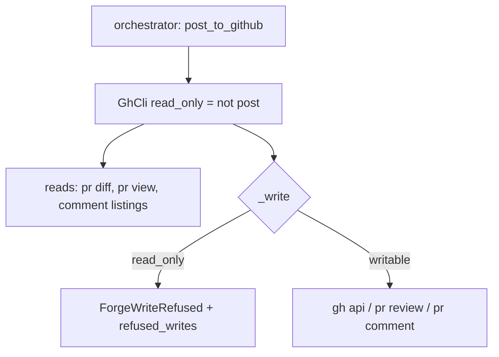

# A dry run performs no forge write

## Intent

`repoach review pr --dry-run` promises "never publish anything". The
promise is kept by one `if self._post:` block and broken by one step
that runs outside it. This component replaces the convention with a
mechanism: every forge write goes through a single method that
refuses when the run is read-only, and a test proves a full dry run
with refuted findings on a PR carrying threads touches the forge
with no write.

## Context

Measured on `develop` `20dbb45` (2026-10-19); reproduction W1 on Yoob
MR !283 (`docs/tech_debt.md` row 22 as of PR #203).

| # | Fact | Where |
|---|---|---|
| F1 | Publishing is guarded: `if self._post:` wraps `_publish_outcome`, the auto-challenge pass and the archive upsert | `src/repoach/review/orchestrator.py:768-790` |
| F2 | `post_refuted_finding_sentinels` runs before that guard, unconditionally, inside a `try/except Exception` that logs and continues | `orchestrator.py:659-673` |
| F3 | The sentinel step issues `POST .../pulls/N/comments/<id>/replies` for every refuted reviewer finding matched to an existing inline root | `src/repoach/review/thread_context.py:529-590`; `gh_client.py:653-684` (`reply_to_review_comment`) |
| F4 | On !283 two findings were refuted; the step made the fifth `pulls/283/comments` read and posted nothing only because the MR has no inline thread, and the shim refused writes with exit 70 | W1 note, "A dry run is not write-free" |
| F5 | Six public `GhCli` methods write: `pr_create`, `pr_review_comment`, `pr_review_submit`, `pr_review_submit_batch`, `reply_to_review_comment`, `upsert_archive_comment`; each builds its own `gh` argv and calls `_run` | `gh_client.py:379,420,468,502,653,749` |
| F6 | The orchestrator reaches the forge through seven call sites that write, all but one inside the guard | `orchestrator.py:1051,1065,1158,1181,1197,1361,1421` (guarded); `:661` through `thread_context` (unguarded) |
| F7 | A fake `GhCli` that raises on a write is swallowed by the `except Exception` of F2, so a test asserting "no exception" cannot detect the defect; only a call log can | `orchestrator.py:666-672` |
| F8 | `GhCli` has no notion of read-only; `post_to_github` lives on the orchestrator only | `gh_client.py:133-160`; `orchestrator.py:323` |

## Goals

- G1: `GhCli` (and, once `SP-UNIVERSAL-FORGE` lands, every `Forge`) takes `read_only: bool`; the six write methods route their argv through one `_write(argv, *, input_data=None)` that, when `read_only`, records the refusal and raises `ForgeWriteRefused` without spawning anything.
- G2: the orchestrator constructs its forge with `read_only=not post_to_github` and never again decides per step whether to write; the sentinel step moves inside the posting block so a dry run does not reach the barrier either.
- G3: a dry run's payload carries `refused_writes: 0`; a non-zero value is a defect, visible, and the CLI exits 8.
- G4: `tests/unit/test_dry_run_never_posts.py` runs a full dry-run review on a PR whose comment listing carries an inline root at a refuted finding's `(file, line)`, with a forge fake whose every write method appends to a log; the log stays empty and the barrier's refusal count is zero.
- G5: `tests/unit/test_forge_write_barrier.py` calls each of the six write methods on `GhCli(read_only=True)` with a fake spawner and asserts no `gh` process was spawned with `--method POST|PATCH|DELETE`, `pr comment`, `pr review`, `pr create`; it also asserts `_write` is the only path that builds such an argv.

## Non-Goals

- NG1: no change to what is posted or how; the batched review, the archive comment and the sentinel keep their bodies and endpoints.
- NG2: no read-only `git push` guard here; pushes belong to the Coder and Developer lanes, not to `review pr`.
- NG3: no GitLab implementation; the barrier is defined on the protocol so `SP-UNIVERSAL-FORGE` inherits it.

## Assumptions

- A1: `GhCli._run` and `_spawn` stay the single process boundary, so a fake spawner observes every argv.
- A2: the W1 shim's "exit 70 on any write" stays scratch and is not the barrier.

## Interface

```python
class ForgeWriteRefused(RuntimeError):
    """A write was attempted on a read-only forge handle."""

class GhCli:
    def __init__(self, *, read_only: bool = False, ...) -> None: ...
    @property
    def read_only(self) -> bool: ...
    @property
    def refused_writes(self) -> list[list[str]]: ...
    def _write(self, argv: list[str], *, input_data: str | None = None) -> GhResult: ...
```

Inputs:
- `post_to_github` on `ReviewTeamOrchestrator` — unchanged name, now also the forge's `read_only`.

Outputs:
- `review pr` payload: `refused_writes: int`.
- log event `forge.write_refused` with the argv head (`api --method POST repos/...`), once per refusal.

Errors:
- `ForgeWriteRefused`: raised by `_write` on a read-only handle; the orchestrator does not catch it inside the posting block (it cannot occur there) and the sentinel step no longer runs outside it.

## Behavior

### Nominal
`review_pr` in dry-run: diff, reviewers, ledger, verification,
refutation, then the posting block is skipped entirely — including
the sentinel step and the escalation dossier's forge part. The forge
handle has seen only `pr diff`, `pr view`, and comment listings. The
payload ends with `"posted_comments": 0, "posted_reviews": 0,
"refused_writes": 0`.

### Edge cases
- a future step added outside the posting block that writes → the barrier refuses, `refused_writes` becomes non-zero, the CLI exits 8, and `test_dry_run_never_posts.py` goes red the moment the step is wired into the dry-run path.
- posting mode with a forge error on a write → unchanged: `GhResult.ok` false, logged, counted in `posted_*` as today.
- `pr_review_comment` without `file`/`line` (conversation comment) → still a write, still through `_write`.
- the escalation dossier (`_fire_proposed_escalation_dossier`, `orchestrator.py:676`) in dry-run → not fired at all: no routine call, no forge write, no file written outside the ledger; the payload is the only product of a dry run (owner decision 2026-10-19).

### Failure scenarios
- `ForgeWriteRefused` escapes to the CLI (a write reached the barrier in dry-run) → exit 8, stderr `dry run attempted a forge write: <argv head>`; nothing was sent.

## Architecture Impact
- Adds dependency: SP-DRY-RUN-NEVER-POSTS -> SP-REVIEW-POST-BATCH (`gh_client.py` gains `read_only`, `_write`, `refused_writes`; its six write methods are edited in place)
- Adds dependency: SP-DRY-RUN-NEVER-POSTS -> SP-FINDINGS-SENTINEL-REHOME (the sentinel call site moves inside the posting block of `orchestrator.py`; `thread_context.py` is unchanged)
- New coupling, cycles, shared state: none. The tests own no production module; the two edited modules keep their owners.

## Diagram


## Acceptance Criteria
- [ ] AC1: `pytest -q tests/unit/test_dry_run_never_posts.py` → green: a refuted `design` finding at `src/x.py:3`, a fake `list_review_comments` returning a root at `src/x.py:3` authored by the bot, `ReviewTeamOrchestrator(gh=fake, post_to_github=False).review_pr(7)` → the fake's write log is `[]` and `fake.refused_writes == []`. Today: the file does not exist, and the same scenario against the current tree leaves one `reply_to_review_comment` call in the log.
- [ ] AC2: `pytest -q tests/unit/test_forge_write_barrier.py` → green: `GhCli(read_only=True)` with a fake spawner; each of the six write methods raises `ForgeWriteRefused` and the spawner saw zero argv. Today: `TypeError: __init__() got an unexpected keyword argument 'read_only'`.
- [ ] AC3: `grep -cE '"(POST|PATCH|DELETE)"' src/repoach/review/gh_client.py` → the count equals the number of such literals inside `_write`'s callers, pinned by `test_forge_write_barrier.py::test_every_write_argv_is_built_for_the_barrier`, which fails if a public method passes a mutating argv to `_run` directly. Today: six methods call `_run` directly.
- [ ] AC4: `repoach review pr <N> --dry-run | jq .refused_writes` → `0`. Today: `null`.
- [ ] AC5: `pytest -q tests/unit/test_review_ci_mode.py` → green with `refused_writes` in `_REQUIRED_TOP_LEVEL`.
- [ ] AC6: `repoach arch check --base develop` → `edge-honesty: ok`.
- [ ] AC7: `pytest -q tests/unit/test_dry_run_never_posts.py::test_dry_run_fires_no_escalation_dossier` → green: a ledger with a `proposed` finding over the escalation cap, `_fire_proposed_escalation_dossier` replaced by a recording fake, `review_pr(7)` in dry-run → the fake was called zero times; in posting mode, once. Today: called in both modes.

## Open Questions
- None. (Resolved by the owner 2026-10-19: the escalation dossier is skipped in dry-run; a dry run produces and posts nothing beyond its own JSON and summary — see the edge case and AC7.)
