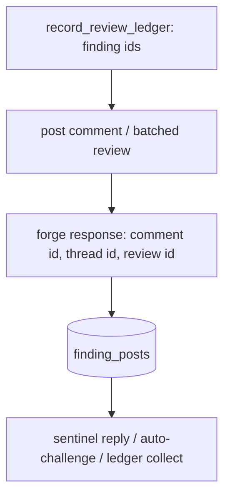

# Persist the forge comment and thread ids of every posted finding

## Intent

A finding posted on the forge must stay joinable to the thread it
opened. Today the forge ids are known for the length of one function
call and then dropped, so no later step — the sentinel reply, the
auto-challenge pass of the next round, the fate collector of
`SP-UNIVERSAL-LEDGER` — can find a finding's thread except by guessing
on `(file, line)`. This component records them.

## Context

Measured on `develop` `20dbb45` (2026-10-19).

| # | Fact | Where |
|---|---|---|
| F1 | `pr_findings` has no forge column: `id, pr_number, head_sha, round, finder, claim_type, severity, file, line_start, line_end, claim, evidence_pointer, status, verification_method, verification_result, checked_at_sha, verify_attempts` | `src/repoach/review/findings.py:168-188` |
| F2 | The posting path builds `posted_ids: dict[tuple[str, int], int]` — `(path, line) -> comment id` — for the auto-challenge pass and lets it die with the call | `src/repoach/review/orchestrator.py:769-781` (built), `:1095-1127` (`_recover_batched_posted_ids` fills it from `list_review_id_comments`), `:1158-1181` (per-comment path) |
| F3 | The sentinel step re-discovers the thread by matching `(file, line)` against every inline comment on the PR | `src/repoach/review/thread_context.py:566` (`_match_finding_thread`), called from `:529-590` |
| F4 | Findings are recorded before anything is posted, so the finding id exists when the comment id is returned | `orchestrator.py:617` (`record_review_ledger`) precedes `:768` (`if self._post:`) |
| F5 | GitHub returns the comment id in the `POST .../pulls/N/comments` body and, for a batched review, the review id in the `POST .../reviews` body; replies carry `in_reply_to_id` | `src/repoach/review/gh_client.py:420-466`, `:502-571`, `:653-684` |
| F6 | GitLab has no review object: an inline note belongs to a discussion whose id is a 40-hex string; the note id is an integer | W1 measurement note, assumptions A6–A8 (`docs/plans/2026-10-18_W1-gitlab-dry-run-measurement.md`) |
| F7 | Schema changes on the review ledger are additive `ALTER TABLE` entries checked with `has_column` | `src/repoach/review/persistence.py:160-181` |
| F8 | `SP-UNIVERSAL-LEDGER` (row L6, assumption A2) names `finding_posts` as the row its fate collector joins on and defers the write to "the posting path" | `tmp` copy of the umbrella family, 2026-10-19 |

This spec is the prerequisite of `SP-UNIVERSAL-LEDGER`: its fate
collector reads `finding_posts`; it never writes it.

## Goals

- G1: every inline comment the review posts for a finding yields exactly one `finding_posts` row carrying the forge's own identifiers, written in the same step that receives them.
- G2: the row is forge-agnostic in shape and forge-specific in content: GitHub fills `comment_id`, `thread_id` (the root comment id), `review_id`; GitLab fills `comment_id` (note id) and `thread_id` (discussion id); the column types admit both.
- G3: the sentinel step and the auto-challenge pass resolve a finding's thread through `finding_posts` first and fall back to `(file, line)` only for rows that predate this spec.
- G4: an existing ledger is migrated in place: the table is created on `init_findings_schema`, and `repoach review backfill-threads <N>` links pre-existing findings to the threads the bot authored, marking those rows `provenance = "backfill"`.
- G5: a dry run writes no `finding_posts` row, because it posts nothing.

## Non-Goals

- NG1: no fate, no human-decision reading — that is `SP-UNIVERSAL-LEDGER`.
- NG2: no change to the finding lifecycle or to `pr_findings` columns; the join lives in its own table.
- NG3: no GitLab transport: the GitLab column semantics are pinned by a fake until `SP-UNIVERSAL-FORGE` ships the implementation.
- NG4: no retroactive re-posting; a finding posted before this spec and never matched by the backfill stays thread-less.

## Assumptions

- A1: `record_review_ledger` can return the ids it inserted, keyed by `(finder, file, line_start, claim_type)`; the posting path receives that map.
- A2: the forge's response to a comment or review creation is parseable JSON with `id`; `_parse_comment_id` (`orchestrator.py`) already does this for the batched path.
- A3: the bot's own comments are recognisable by author login (`review_bot_login`, `core/config.py:224`) for the backfill.

## Interface

```python
class FindingPost(BaseModel):
    id: int | None = None
    finding_id: int
    pr_number: int
    forge: Literal["github", "gitlab"]
    head_sha: str
    comment_id: str
    thread_id: str | None
    review_id: str | None
    in_reply_to: str | None
    provenance: Literal["posted", "backfill"]
    posted_at: datetime

def record_finding_post(db_path: Path, post: FindingPost) -> int: ...
def fetch_finding_posts(db_path: Path, pr_number: int, *, finding_id: int | None = None) -> list[FindingPost]: ...
def resolve_thread(db_path: Path, finding: Finding) -> FindingPost | None: ...
def backfill_finding_posts(db_path: Path, gh: GhCli, pr_number: int, *, bot_login: str) -> BackfillReport: ...
```

Table `finding_posts` (SQLite, created by `init_findings_schema`):

| Column | Type | Notes |
|---|---|---|
| `id` | INTEGER PK | |
| `finding_id` | INTEGER NOT NULL | references `pr_findings.id`; unique together with `comment_id` |
| `pr_number` | INTEGER NOT NULL | |
| `forge` | TEXT NOT NULL | `github` or `gitlab` |
| `head_sha` | TEXT NOT NULL | the head the comment was anchored on at post time |
| `comment_id` | TEXT NOT NULL | GitHub review comment id, GitLab note id |
| `thread_id` | TEXT | GitHub root comment id, GitLab discussion id |
| `review_id` | TEXT | GitHub review id for a batched post; NULL on GitLab |
| `in_reply_to` | TEXT | GitHub `in_reply_to_id` when the post is itself a reply |
| `provenance` | TEXT NOT NULL | `posted` or `backfill` |
| `posted_at` | TIMESTAMP NOT NULL | |

Inputs:
- the ids map returned by `record_review_ledger`, the forge response of each post.

Outputs:
- `repoach review backfill-threads <N> [--dry-run]`: one line `pr N: F findings, L linked, U unmatched, S already linked`, rc 0; `--dry-run` writes nothing.
- `review pr` payload gains `finding_posts: int` (rows written this run).

Errors:
- `FindingPostIntegrityError`: a row would reference a finding id absent from `pr_findings` — refused, logged, never inserted.

## Behavior

### Nominal
`record_review_ledger` inserts the findings and returns their ids. The
posting path posts the review; for each inline comment it reads the
forge id out of the response (per-comment path) or out of the
review's comment listing scoped to the review id (batched path, as
`_recover_batched_posted_ids` does today) and writes one
`finding_posts` row with `provenance = "posted"`. The sentinel step
calls `resolve_thread(finding)`; on a hit it replies to `thread_id`
without listing the PR's comments; on a miss it falls back to the
current `(file, line)` match and, on a match, writes a `backfill` row
so the next run hits.

### Edge cases
- two findings on the same `(file, line)` by two reviewers → two posts, two rows, two distinct `comment_id`; the `(file, line)` fallback would have returned the first root for both.
- the forge response lacks `id` (malformed JSON) → no row, one `finding_posts.id_unparseable` log line, the review continues; the backfill links it later.
- the comment was posted and the row write failed (ledger read-only) → `finding_posts.write_failed` logged once; the post is not retried.
- a finding re-raised in round 2 at the same place → the round-2 finding gets its own row only if it was posted; threads are reused by the forge, so `thread_id` may equal the round-1 row's.
- backfill on a PR whose bot comments carry no `path`/`line` (conversation comments) → counted as `unmatched`, never linked.

### Failure scenarios
- `init_findings_schema` on a database that already holds an older `finding_posts` with fewer columns → the missing columns are added through the `_migrate_missing_columns` mechanism; no data loss.
- backfill with the forge unreachable → rc 2, nothing written.

## Architecture Impact
- Adds dependency: SP-FINDING-THREAD-IDS -> SP-FINDINGS-INIT-RACE (`finding_posts.py` imports `findings` for `Finding`, `fetch_findings` and the schema-init idiom)
- Adds dependency: SP-FINDING-THREAD-IDS -> SP-REVIEW-POST-BATCH (`backfill_finding_posts` and the posting hook read `gh_client` ids; the batched review id comes from that path)
- Adds dependency: SP-FINDING-THREAD-IDS -> SP-FINDINGS-SENTINEL-REHOME (the sentinel in `thread_context.py` resolves through `finding_posts` before matching by line)
- New shared state: `db:table:finding_posts`, owned here. `SP-UNIVERSAL-LEDGER` must drop it from its `owns.resources` and add this spec to its `depends_on` when it lands (ownership is disjoint).
- No cycle: `finding_posts.py` imports nothing from `orchestrator.py`.

## Diagram


## Acceptance Criteria
- [ ] AC1: `pytest -q tests/unit/test_finding_posts.py` → green. Today: `ERROR: file or directory not found`. The file pins: one row per posted inline comment with the stub forge's returned ids; `finding_id` resolves to the `pr_findings` row of the same finder, file and line; `provenance == "posted"`; a dry run (`post_to_github=False`) leaves the table empty.
- [ ] AC2: `pytest -q tests/unit/test_finding_posts.py -k gitlab` → green with a fake GitLab forge: `thread_id` is the discussion id (40 hex characters), `comment_id` the note id, `review_id` is `NULL`. Today: no such test.
- [ ] AC3: `pytest -q tests/unit/test_findings_sentinel_rehome.py -k recorded_thread` → green: a refuted finding whose recorded `thread_id` is `77` while the PR's inline comments list the root at a shifted line still receives its sentinel on comment `77`. Today: the `(file, line)` match finds no root and posts nothing.
- [ ] AC4: `REPOACH_DB_PATH=$(mktemp -d)/l.db repoach review pr <N> --dry-run >/dev/null; sqlite3 $REPOACH_DB_PATH ".tables" | tr ' ' '\n' | grep -c '^finding_posts$'` → `1`. Today: `0`.
- [ ] AC5: `repoach review backfill-threads <N> --dry-run` → `pr <N>: F findings, L linked, U unmatched, S already linked`, rc 0, and `select count(*) from finding_posts` unchanged; without `--dry-run` the count grows by `L`. Today: `No such command 'backfill-threads'`.
- [ ] AC6: `repoach review pr <N> --dry-run | jq .finding_posts` → `0`. Today: `null`.
- [ ] AC7: `repoach arch check --base develop` → `edge-honesty: ok` with this spec's three `depends_on` edges and `db:table:finding_posts` owned once.

## Open Questions
- Q1: should the batched path (`pr_review_submit_batch`) keep its extra `list_review_id_comments` call to learn the ids, or should posting switch to one call per comment so each response carries its id? Recommendation: keep the batch and the one scoped listing; one extra read per review is cheaper than N posts.
- Q2: the backfill matches on exact `(file, line)` (`backfill_line_tolerance = 0`); the W1 measurement shows reviewers citing lines that shift after a push. Allow a tolerance of 3 as `SP-UNIVERSAL-LEDGER` does for fates, or keep the backfill strict and leave fuzzy matching to the collector? Recommendation: strict here; a wrong link is worse than no link.
