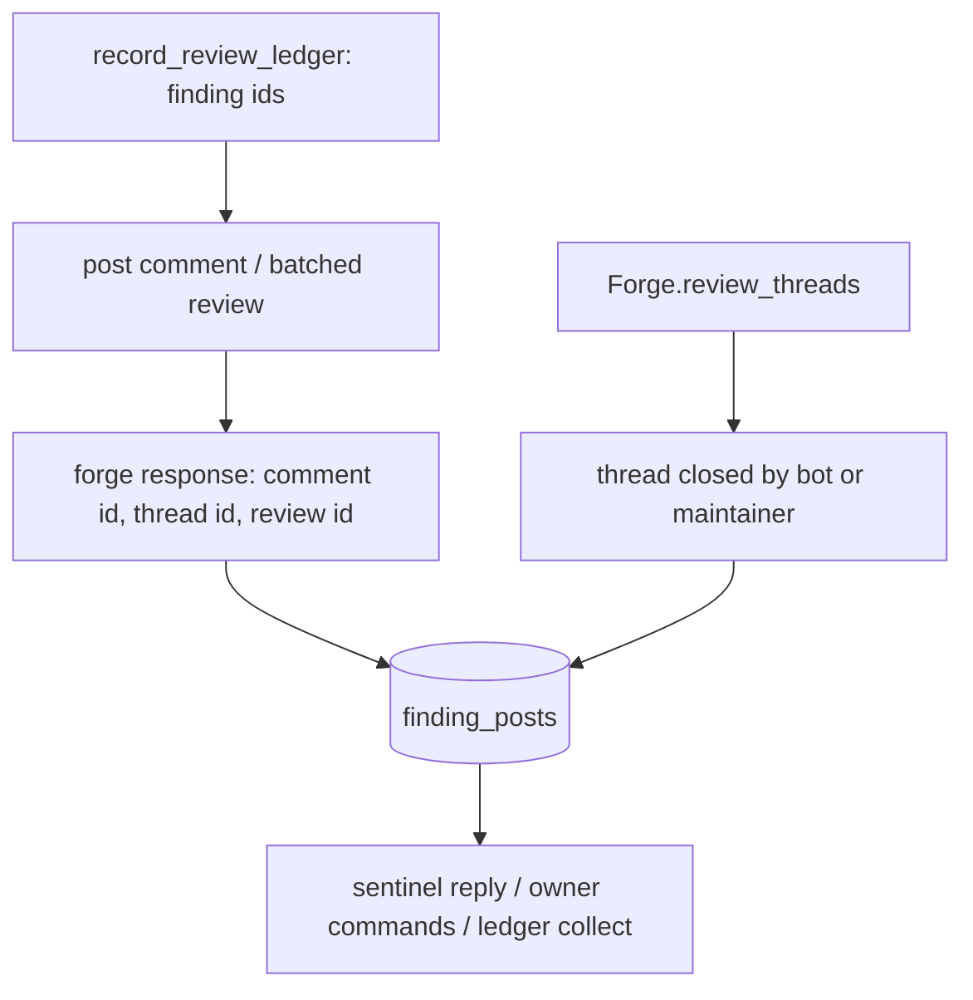

# Persist the forge comment and thread ids of every posted finding

## Intent

A finding posted on the forge must stay joinable to the thread it
opened. Today the forge ids are known for the length of one function
call and then dropped, so no later step — the sentinel reply, the owner
commands of `SP-OWNER-SETTLES-A-FINDING`, the fate collector of
`SP-UNIVERSAL-LEDGER` — can find a finding's thread except by guessing
on `(file, line)`. This component records them, and records when a
recorded thread is closed on the forge.

## Context

Re-measured on `develop` `fb241b8` (2026-11-02); 0.1 measured `20dbb45`.

| # | Fact | Where |
|---|---|---|
| F1 | `pr_findings` has no forge column: `id, pr_number, head_sha, round, finder, claim_type, severity, file, line_start, line_end, claim, evidence_pointer, status, verification_method, verification_result, checked_at_sha, verify_attempts, last_seen_at, last_run_id, budget_used` | `src/repoach/review/findings.py:243-265` |
| F2 | The posting path builds `posted_ids: dict[tuple[str, int], int]` — `(path, line) -> comment id` — for the auto-challenge pass of the same run and lets it die with the call | `src/repoach/review/orchestrator.py:1624` (built), `:1951` (batched review), `:2003` (per comment) |
| F3 | The sentinel step re-discovers the thread by matching `(file, line)` against every inline comment on the PR | `src/repoach/review/thread_context.py:475` (`_match_finding_thread`), called at `:550` |
| F4 | Findings are recorded before anything is posted, so the finding id exists when the comment id is returned | `orchestrator.py:913` (`record_review_ledger`) precedes `:1106` (`if publish and state_refused is None:`) |
| F5 | GitHub returns the comment id in the `POST pulls/N/comments` answer; a batched review answers with its review id and the created comments are read back from `GET pulls/N/reviews/<id>/comments`; replies carry `in_reply_to_id`. No REST answer carries the GraphQL thread node id (`PRRT_…`) | `src/repoach/forge/github.py:1299` (`post_comment`), `:1324` (`post_review`), `:885` (`_list_review_id_comments`), `:1371` (`reply`) |
| F6 | GitLab has no review object: an inline note opens a discussion whose id is a 40-hex string; the note id is an integer, and `reply` takes the note id. Measured live on Yoob !339: 100 discussions, 70 opened by a `DiffNote`, ids such as `cfa80cf1b186752ca99062c4ce605194e050a6c2` | `src/repoach/forge/gitlab.py:702` (`post_review`), `:748` (`reply`) |
| F7 | Schema changes on the review ledger are additive `ALTER TABLE` entries checked against the existing columns | `src/repoach/review/findings.py:421` (`_migrate_missing_findings_columns`) |
| F8 | `SP-UNIVERSAL-LEDGER` (row L6, assumption A2) names `finding_posts` as the row its fate collector joins on and defers the write to "the posting path" | `docs/specs/2026-10-19_SP-UNIVERSAL-LEDGER_learns-from-use-without-being-intrusive.md:88,123` |
| F9 | The owner commands join a thread reply to its finding by the root's file and line, because no finding stores its thread id | `src/repoach/review/owner_commands.py:247` (`_anchored`), used at `:302` |
| F10 | GitHub reports a thread's resolution only through GraphQL: `reviewThreads { isResolved resolvedBy { login } comments(first:1) { nodes { databaseId } } }`. Measured on repoachhq/repoach #278: 5 threads, each `isResolved: true`, `resolvedBy.login: jwfaye`, keyed by the root's `databaseId` | `gh api graphql`, 2026-11-02 |
| F11 | GitLab marks every note of a resolved discussion `resolved: true` with `resolved_by.username`. Measured on Yoob !339: the 70 diff discussions are resolved by `josephwfaye` | `glab api projects/:id/merge_requests/339/discussions`, 2026-11-02 |
| F12 | `gh api graphql` is a `POST` with fields, so the write barrier classed every GraphQL query as a write and refused it on the read path | `src/repoach/forge/protocol.py` (`is_write_argv`) |

This spec is the prerequisite of `SP-UNIVERSAL-LEDGER` (its fate
collector reads `finding_posts`; it never writes it) and of
`SP-PR-THREADS-REMEMBER-AND-CLOSE` (one finding, one thread, closed only
by its role or the owner: D1, D3, D5). That spec's three-voice context
(D6) is not implemented here.

**Reference.** The DeepSeek repository-agent prototype
[dsh-superagent-prototype](https://github.com/deepseek-ai/dsh-superagent-prototype)
(MIT, TypeScript research prototype of a proactive repository agent),
`docs/007-architecture.md` (read 2026-11-02), has three ideas this spec
cites. It does no review and no verification; nothing is taken on that
side.

- An **outbox with receipts** (`src/app/outbox.ts`): a message's receipt
  and its send are queued in one transaction; a message waits while its
  channel is off and is dropped when its conversation is gone, so it is
  never sent twice. Recorded as the planned successor of the marker scan
  (`docs/tech_debt.md` row 105), not implemented here.
- A **single-writer engine** over SQLite: `Engine` is the only writer of
  Triggers, Threads, Decisions, Tickets and Assignments, one transaction
  per command. Here `finding_posts` has three writers, all in this
  component's functions: the posting path, the sentinel's legacy match,
  and `backfill-threads`.
- **Ticket↔Thread binding with closure detection** (`bindThread`,
  `threadClosed`): a Ticket follows a thread, records its close and ends
  `merged` or `closed`; a closed thread bound again is open again. G6
  takes the binding and the close record, not the lifecycle.

## Decisions (2026-11-02)

- D1. GitHub's `thread_id` is the root comment id, not the GraphQL node
  id: no REST answer carries the node id (F5), and the root id is what
  `Forge.reply` takes and what GraphQL keys each thread by (F10).
- D2. A thread resolved on the forge is not a settled finding. The
  closure is recorded and reported; only a maintainer's `/resolve`, a fix
  at a later head or the refuter settle a finding.
- D3. Who may close a thread is measured from the forge, with the owner
  rule of `owner_commands.py`: the bot's login (the opening role posts as
  the bot) or a maintainer (`Forge.is_maintainer`). Anyone else's
  resolution is reported and not recorded.
- D4 (was Q1). The batched path keeps its one scoped listing
  (`GET pulls/N/reviews/<id>/comments`) to learn the comment ids; a
  created comment is paired with its draft on path, line and body.

## Goals

- G1: every inline comment the review posts for a recorded finding yields exactly one `finding_posts` row carrying the forge's own identifiers, written in the same step that receives them.
- G2: the row is forge-agnostic in shape and forge-specific in content: GitHub fills `comment_id`, `thread_id` (the root comment id, D1), `review_id`; GitLab fills `comment_id` (note id) and `thread_id` (discussion id); the column types admit both.
- G3: the sentinel step and the owner commands resolve a finding's thread through `finding_posts` first and fall back to `(file, line)` only for findings that have no row. The auto-challenge pass answers comments of the same run from the ids that run received (F2) and is unchanged.
- G4: an existing ledger is migrated in place: every review run creates the table when absent (`init_finding_posts_schema`), and `repoach review backfill-threads <N>` links pre-existing findings to the threads the bot authored, marking those rows `provenance = "backfill"`.
- G5: a dry run writes no `finding_posts` row, because it posts nothing.
- G6: when a review runs, a recorded thread the forge reports resolved by the bot or a maintainer (D3) gets `thread_closed_at_head` and `thread_closed_by`, and the report prints `thread closed by <login> for #<id>`. No finding status changes (D2).

## Non-Goals

- NG1: no fate, no human-decision reading — that is `SP-UNIVERSAL-LEDGER`.
- NG2: no change to the finding lifecycle or to `pr_findings` columns; the join lives in its own table.
- NG3: no GitLab transport change: the GitLab column semantics are pinned by a fake GitLab answering the documented payloads and by a fixture recorded on Yoob !339.
- NG4: no retroactive re-posting; a finding posted before this spec and never matched by the backfill stays thread-less.
- NG5: no outbox and no posting dedupe (`SP-POSTING-REPLAY-DEDUPES`); a posting replay that posts again writes a second row for the new comment.
- NG6: no thread lifecycle, no agent reply in threads (`SP-PR-THREADS-REMEMBER-AND-CLOSE` D2, D4, D6).

## Assumptions

- A1: the finding a posted comment states is the `pr_findings` row of the same PR and head with the comment's fingerprint (`findings_bridge.finding_fingerprint`), the reviewer's own row first; a comment off the diff has none.
- A2: the forge's response to a comment or review creation is parseable JSON with `id` (F5, F6).
- A3: the bot's own comments are recognisable by author login (`Forge.bot_username`) for the backfill.

## Interface

```python
class FindingPost(BaseModel):
    id: int | None = None
    finding_id: int
    pr_number: int
    forge: Literal["github", "gitlab"]
    head_sha: str
    comment_id: str
    thread_id: str | None = None
    review_id: str | None = None
    in_reply_to: str | None = None
    provenance: Literal["posted", "backfill"] = "posted"
    posted_at: str = ""
    thread_closed_at_head: str | None = None
    thread_closed_by: str | None = None

def init_finding_posts_schema(db_path: Path) -> None: ...
def record_finding_post(db_path: Path, post: FindingPost) -> int: ...
def fetch_finding_posts(db_path: Path, pr_number: int, *, finding_id: int | None = None) -> list[FindingPost]: ...
def resolve_thread(db_path: Path, finding: Finding) -> FindingPost | None: ...
def thread_index(db_path: Path, pr_number: int) -> ThreadIndex: ...
def backfill_finding_posts(db_path: Path, forge: Forge, pr_number: int, *, bot_login: str, dry_run: bool = False) -> BackfillReport: ...
def detect_closed_threads(forge: Forge, db_path: Path, *, pr_number: int, head_sha: str) -> ClosureRun: ...

class ReviewThread(BaseModel):          # repoach.forge.protocol
    root_id: int
    thread_id: str | None = None
    resolved: bool = False
    resolved_by: str = ""

class Forge(Protocol):
    def review_threads(self, number: int) -> list[ReviewThread]: ...
```

Table `finding_posts` (SQLite, created by `init_finding_posts_schema`, which every review run calls):

| Column | Type | Notes |
|---|---|---|
| `id` | INTEGER PK | |
| `finding_id` | INTEGER NOT NULL | references `pr_findings.id`; unique together with `comment_id` |
| `pr_number` | INTEGER NOT NULL | |
| `forge` | TEXT NOT NULL | `github` or `gitlab` |
| `head_sha` | TEXT NOT NULL | the head the comment was anchored on at post time |
| `comment_id` | TEXT NOT NULL | GitHub review comment id, GitLab note id |
| `thread_id` | TEXT | GitHub root comment id, GitLab discussion id |
| `review_id` | TEXT | GitHub review id for a batched post; NULL on GitLab |
| `in_reply_to` | TEXT | the root comment id when the post is itself a reply |
| `provenance` | TEXT NOT NULL | `posted` or `backfill` |
| `posted_at` | TEXT NOT NULL | UTC ISO-8601 |
| `thread_closed_at_head` | TEXT | G6: the head at which the thread was first seen closed |
| `thread_closed_by` | TEXT | G6: who closed it |

Inputs:
- the forge response of each post; the findings recorded at that head.

Outputs:
- `repoach review backfill-threads <N> [--dry-run]`: one line `pr N: F findings, L linked, U unmatched, S already linked`, rc 0; `--dry-run` writes nothing; rc 2 when the forge cannot be selected or read.
- `review pr` payload gains `finding_posts: int` (rows written this run) and `threads_closed: [{finding_id, login, head_sha, comment_id, counted}]`; stderr and the archive report (`## Closed threads`) carry `thread closed by <login> for #<id>`.

Errors:
- `FindingPostIntegrityError`: a row would reference a finding id absent from `pr_findings` for that PR — refused, logged, never inserted.

## Behavior

### Nominal
`record_review_ledger` inserts the findings. The posting path posts the
review; for each inline comment it reads the forge id out of the
response (per-comment path) or out of the review's comment listing
scoped to the review id (batched path), finds the finding the comment
states (A1) and writes one `finding_posts` row with
`provenance = "posted"`. The sentinel step calls
`resolve_thread(finding)`; on a hit it replies to the recorded root; on
a miss it falls back to the `(file, line)` match and, on a match with
exactly one root, writes a `backfill` row so the next run hits. The PR's
inline comments are still listed, to see an existing sentinel reply.
An owner command in an inline thread addresses the findings whose
recorded post opened that thread; a thread no post names falls back to
the anchor, over findings with no post. On every run, once the owner
commands are applied, recorded root posts with no closure are matched
against `Forge.review_threads`; a thread resolved by the bot or a
maintainer is recorded (G6).

### Edge cases
- two findings on the same `(file, line)` by two reviewers → two posts, two rows, two distinct `comment_id`; the `(file, line)` fallback would have returned the first root for both.
- the forge response lacks `id` → no row, one `finding_posts.id_unparseable` log line, the review continues; the backfill links it later.
- the comment was posted and the row write failed (ledger read-only) → `finding_posts.write_failed` logged; the post is not retried.
- a comment off the diff states no recorded finding → no row.
- a GitLab note the forge refuses to position is posted as a plain note → a row with `thread_id` NULL.
- backfill on a PR whose bot comments carry no `path`/`line` (conversation comments) → counted as `unmatched`, never linked.
- backfill matching is strict: a bot root at the finding's exact `(file, line)` and no other, claimed by no other finding, `backfill_line_tolerance = 0` (owner decision 2026-10-19). A legacy finding with no exact root — the line shifted after a push, or two roots at the same place — is reported `unmatched` and gets no row; it stays `unknown` to every consumer, never an approximated link.
- a thread resolved by someone who is neither the bot nor a maintainer → reported `not counted`, not recorded; a maintainer permission the forge cannot read → logged, nothing recorded, asked again next run.
- no recorded post without a closure → the forge's threads are not read.

### Failure scenarios
- `init_finding_posts_schema` on a database that already holds an older `finding_posts` with fewer columns → the missing columns are added (`ALTER TABLE … ADD COLUMN`); no data loss.
- backfill with the forge unreachable → rc 2, nothing written.
- the forge's threads unreadable → `thread closures unread: <reason>` reported, nothing recorded.

## Architecture Impact
- Adds dependency: SP-FINDING-THREAD-IDS -> SP-FINDINGS-INIT-RACE (`finding_posts.py` imports `findings` for `Finding`, `fetch_findings`, `pr_findings` and `init_findings_schema`)
- Adds dependency: SP-FINDING-THREAD-IDS -> SP-REVIEW-POST-BATCH (the batched review id and its comment listing are where the ids come from)
- Adds dependency: SP-FINDING-THREAD-IDS -> SP-FINDINGS-SENTINEL-REHOME (the sentinel in `thread_context.py` resolves through `finding_posts` before matching by line)
- Adds dependency: SP-FINDING-THREAD-IDS -> SP-UNIVERSAL-FORGE (`Forge.review_threads`, `ReviewThread`; the tests drive the GitHub and GitLab forges)
- Adds dependency: SP-FINDING-THREAD-IDS -> SP-ORCH-DOCSTRING, SP-FINDINGS-BRIDGE-DOCFIX, SP-RETRY-BACKOFF-DEDUP (the tests post through the orchestrator, record findings through the bridge and build reviewer outcomes)
- Adds dependency: SP-OWNER-SETTLES-A-FINDING -> SP-FINDING-THREAD-IDS (`owner_commands.py` reads the thread index)
- Forge protocol: `ReviewThread` and `Forge.review_threads` on GitHub, GitLab and the bench `LocalDiffForge`; `is_write_argv` lets a `gh api graphql` query (never a mutation, never a document read from a file) through the read path (F12).
- New shared state: `db:table:finding_posts`, owned here. `SP-UNIVERSAL-LEDGER` reads it and already declares this spec in its `depends_on`.
- `finding_posts.py` imports nothing from `orchestrator.py`, `owner_commands.py` or `thread_context.py`; they import it. `repoach arch graph --check` lists 25 cycles on `develop` `fb241b8` and 27 with this spec: the two added close through `SP-UNIVERSAL-LEDGER -> SP-FINDING-THREAD-IDS` (the ledger reads this table) and `SP-UNIVERSAL-FORGE`'s existing path to `SP-UNIVERSAL-LEDGER` (`SP-UNIVERSAL-FORGE -> … -> SP-CONVENTIONS-GATE -> SP-UNIVERSAL-REPO -> SP-UNIVERSAL-LEDGER`). Cutting them belongs to `SP-UNIVERSAL-LEDGER`, which is still a draft.

## Diagram


## Acceptance Criteria
- [ ] AC1: `pytest -q tests/unit/test_finding_posts.py` → green. Today (`fb241b8`): `ERROR: file or directory not found: tests/unit/test_finding_posts.py`. The file pins: one row per posted inline comment with the forge's returned ids; `finding_id` resolves to the `pr_findings` row of the same finder, file and line; `provenance == "posted"`; a dry run leaves the table empty.
- [ ] AC2: `pytest -q tests/unit/test_finding_posts.py -k gitlab` → green with a fake GitLab forge: `thread_id` is the discussion id (40 hex characters), `comment_id` the note id, `review_id` is `NULL`. Today: the file does not exist.
- [ ] AC3: `pytest -q tests/unit/test_findings_sentinel_rehome.py -k recorded_thread` → green: a refuted finding whose recorded `thread_id` is `77` while the PR's inline comments list the root at a shifted line still receives its sentinel on comment `77`. Today (`fb241b8`): `13 deselected`.
- [ ] AC4: `REPOACH_DB_PATH=$(mktemp -d)/l.db repoach review pr <N> --dry-run >/dev/null; sqlite3 $REPOACH_DB_PATH ".tables" | tr ' ' '\n' | grep -c '^finding_posts$'` → `1`. Today (`fb241b8`, PR 280): `0`.
- [ ] AC5: `repoach review backfill-threads <N> --dry-run` → `pr <N>: F findings, L linked, U unmatched, S already linked`, rc 0, and `select count(*) from finding_posts` unchanged; without `--dry-run` the count grows by `L` (`pytest -q tests/unit/test_finding_posts_backfill.py::test_backfill_threads_cli_dry_run_writes_nothing`). Today (`fb241b8`): `No such command 'backfill-threads'.`
- [ ] AC6: `repoach review pr <N> --dry-run | jq .finding_posts` → `0`. Today (`fb241b8`, PR 280): `null`.
- [ ] AC7: `repoach arch check --base develop` → `edge-honesty: ok` with this spec's `depends_on` edges and `db:table:finding_posts` owned once.
- [ ] AC8: `pytest -q tests/unit/test_finding_posts_backfill.py::test_backfill_is_strict_and_leaves_unmatched_unknown` → green: a legacy finding at `src/x.py:10` and a bot root at `src/x.py:12` → `BackfillReport.unmatched == 1`, `linked == 0`, no `finding_posts` row, and `resolve_thread(finding) is None`; a second case with two bot roots at `src/x.py:10` → also `unmatched == 1`, no row. Today (`fb241b8`): `ERROR: file or directory not found`.
- [ ] AC9 (G6): `pytest -q tests/unit/test_finding_posts.py -k thread_resolved` → green: a thread resolved by a maintainer or the bot is recorded with the head and login and prints `thread closed by <login> for #<id>`, the finding keeps its status, a second run reads no thread; a thread resolved by anyone else is reported `not counted` and not recorded. Today: the file does not exist.
- [ ] AC10 (G3, owner commands): `pytest -q tests/unit/test_owner_commands.py::test_resolve_reply_settles_the_recorded_finding_after_its_line_moved` → green: a `/resolve` reply in the recorded thread whose root now sits on another finding's line settles the recorded finding and not the other. Today: no such test.
- [ ] AC11 (end to end): `pytest -q tests/integration/test_finding_thread_ids_end_to_end.py` → green: a posting `review pr` records the Sentinel's comment, its thread and review ids; with the root moved to another line, a maintainer's `/resolve` reply settles that finding by its thread id at the next run, which ends APPROVE. Today: the file does not exist.
- [ ] AC12 (forge): `pytest -q tests/unit/test_forge_conformance.py -k review_threads` and `pytest -q tests/unit/test_forge_write_barrier.py -k is_write_argv` → green: both forges replay a recorded thread listing (GitHub #278, GitLab !339), an open thread reports no resolver, and a GraphQL query is a read while a mutation is a write. Today: `review_threads` is not a forge method.

## Open Questions
- none.
