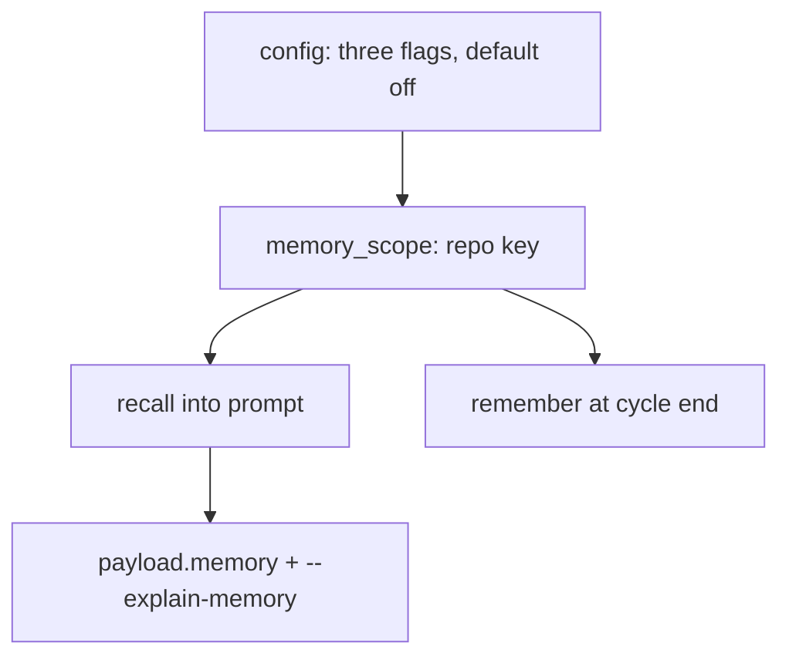

# The three agentmemory loops are opt-in, visible, and scoped to one repository

## Intent

Repoach must never change what a reviewer or a planner reads without
the user knowing it, and never carry what it learned on one
repository into another. Today three learning loops are on by default,
inject text into prompts that no output shows, and write to a single
global scope. This component turns them off unless the project asks,
prints what was injected on every run, and keys the scope on the
repository.

## Context

Measured on `develop` `20dbb45` (2026-10-19).

| # | Fact | Where |
|---|---|---|
| F1 | `builder_memory_enabled`, `review_memory_enabled`, `review_lessons_enabled` all `default=True` | `src/repoach/core/config.py:191-221` |
| F2 | The review bench recalls lessons into the reviewer prompt before every run; the recalled text appears in no CLI output, no JSON payload, no archive comment | `src/repoach/review/orchestrator.py:504` (`_build_review_lessons_block`), `:1677-1690`; `review_memory.py:33-50` |
| F3 | The write side distils verified findings into builder-scoped lessons at cycle end, gated only by the same invisible flag | `src/repoach/review/review_lessons.py:120-140` |
| F4 | The scope is a constant per loop — `"repoach-review"` and `"repoach-builder"` — so a review run from any checkout reads and writes the same memory | `review_memory.py:18`; `builder_memory.py:13`; `memory/agentmemory_client.py:21,68` (`project` parameter) |
| F5 | The only inspection surface is `repoach memory recall-review <query>`, a separate command whose query is not the one the review used | `src/repoach/cli/main.py` (`memory` sub-app) |
| F6 | The W1 dry run on Yoob !283 ran with these defaults from the `yoob_2` checkout; nothing in its output says whether lessons were recalled | `docs/plans/2026-10-18_W1-gitlab-dry-run-measurement.md`, Run table |
| F7 | `SP-UNIVERSAL-LEDGER` G9 reserves `[learning].memory` in `repoach.toml` for the opt-in; the file does not exist on `develop` yet | umbrella family, `tmp` copy |

## Goals

- G1: the three flags default to `false`; a project enables them with `[learning].memory = true` in `repoach.toml` once `SP-UNIVERSAL-PROJECT-CONFIG` lands, and with the three `REPOACH_*_ENABLED` variables before that; repoach's own repository opts in explicitly.
- G2: every `review pr` payload carries a `memory` object: `enabled`, `scope`, `recalled` (the lesson strings injected, capped at `recalled_lessons_shown_max`), `remembered` (count written at cycle end); the archive comment carries the same counts in one line.
- G3: `review pr --explain-memory` prints, before the payload, one block with the exact text injected into the reviewer prompt, or `memory: off — set [learning].memory = true in repoach.toml to enable`.
- G4: the agentmemory `project` is `repoach-review/<repo-key>` and `repoach-builder/<repo-key>`, where `<repo-key>` is derived from `git remote get-url origin` (host, owner, name, lower-cased, `.git` stripped) or, with no remote, from the absolute path's hash; two repositories never share a scope.
- G5: `repoach memory seed-review` and `seed-builder` seed into the scope of the repository they run in, and `recall-review` / `recall-builder` print the scope they read.

## Non-Goals

- NG1: no change to what a lesson contains, how it is distilled or ranked.
- NG2: no new memory backend; the agentmemory HTTP service stays the only one.
- NG3: no migration of memories already stored under the global constants; they stay readable under the old scope through `repoach memory recall-review --scope repoach-review`.
- NG4: no prompt redesign; the `## Review lessons` section keeps its shape, it simply becomes visible.

## Assumptions

- A1: the `Settings` object remains the single reader of the three flags; `repoach.toml` resolution joins it through `SP-UNIVERSAL-PROJECT-CONFIG` (CLI flag > env > toml > default).
- A2: `tests/unit/test_review_ci_mode.py` is the schema pin of the payload; adding `memory` to `_REQUIRED_TOP_LEVEL` is part of this spec.

## Interface

```python
class MemoryScope(BaseModel):
    repo_key: str
    review_project: str
    builder_project: str

def memory_scope(repo_root: Path) -> MemoryScope: ...

class MemoryReport(BaseModel):
    enabled: bool
    scope: str
    recalled: list[str]
    remembered: int
```

Inputs:
- `REPOACH_BUILDER_MEMORY_ENABLED`, `REPOACH_REVIEW_MEMORY_ENABLED`, `REPOACH_REVIEW_LESSONS_ENABLED`: bool — default `false`.
- `[learning].memory`: bool in `repoach.toml` — sets all three unless an env var overrides one.
- `--explain-memory` on `repoach review pr`, `repoach plan`, `repoach develop`.

Outputs:
- `review pr` JSON: `memory: {enabled, scope, recalled, remembered}`.
- `--explain-memory`: a block on stderr headed `memory: on, scope <project>, N lessons recalled` followed by the numbered lessons, or the one-line off message.

Errors:
- none new; an unreachable agentmemory keeps degrading to `recalled: []` with the existing warning log.

## Behavior

### Nominal
On a foreign repository with no configuration: all three flags are
off, `_build_review_lessons_block` returns the empty string, the
payload says `"memory": {"enabled": false, "scope":
"repoach-review/github.com/owner/name", "recalled": [],
"remembered": 0}`. With `[learning].memory = true`: the recall runs
against that scope, the injected lessons appear verbatim in
`recalled`, and the cycle-end distillation writes to
`repoach-builder/<repo-key>` and reports the count.

### Edge cases
- `REPOACH_REVIEW_MEMORY_ENABLED=true` alone → recall on, distillation off; `memory.enabled` is `true` and a `loops` sub-object names which of the three is on.
- no `origin` remote → `repo_key` is `local/<sha1 of the absolute root>[:12]`; the scope is still per checkout, never global.
- `--explain-memory` with memory off → the off line, rc unchanged.
- more than `recalled_lessons_shown_max` lessons recalled → the payload lists the first 20 and `recalled_total`.

### Failure scenarios
- agentmemory returns 5xx → as today: `[]`, warning log, the payload says `enabled: true, recalled: []` so the operator can see that memory was on and empty.

## Architecture Impact
- Adds dependency: SP-MEMORY-LOOPS-EXPLICIT -> SP-BRANCH-CONFIG (the three `Settings` fields live in `core/config.py`, owned there; their defaults change in place)
- Adds dependency: SP-MEMORY-LOOPS-EXPLICIT -> SP-REVIEW-MEMORY (`recall_review_lessons` gains a `project` argument fed by `memory_scope`)
- Adds dependency: SP-MEMORY-LOOPS-EXPLICIT -> SP-REVIEW-LESSONS (`remember_verified_findings` writes to the scoped builder project and returns the count)
- Adds dependency: SP-MEMORY-LOOPS-EXPLICIT -> SP-BUILDER-MEMORY (`BUILDER_PROJECT` becomes a prefix; the Planner and Developer recall through the scope)
- New shared state: none; the scope is derived, not stored. No cycle: `memory_scope.py` imports only `core`.

## Diagram


## Acceptance Criteria
- [ ] AC1: `env -i HOME=$HOME PATH=$PATH REPOACH_LLM_PROXY_BASE_URL=http://127.0.0.1:1 python -c "from repoach.core.config import get_settings as g; s=g(); print(s.builder_memory_enabled, s.review_memory_enabled, s.review_lessons_enabled)"` → `False False False`. Today: `True True True`.
- [ ] AC2: `repoach review pr <N> --dry-run | jq -c .memory` → `{"enabled":false,"scope":"repoach-review/<repo-key>","recalled":[],"remembered":0}`. Today: `null`.
- [ ] AC3: `repoach review pr <N> --dry-run --explain-memory 2>&1 >/dev/null | head -1` → `memory: off — set [learning].memory = true in repoach.toml to enable`. Today: `No such option: --explain-memory`.
- [ ] AC4: `pytest -q tests/unit/test_memory_scope.py` → green: with a fake transport, `recall_review_lessons` from a checkout whose `origin` is `git@github.com:Acme/Widget.git` sends `project == "repoach-review/github.com/acme/widget"`; from a second checkout with another remote the project differs; with no remote it starts with `repoach-review/local/`. Today: the file does not exist and the constant `"repoach-review"` is sent.
- [ ] AC5: `pytest -q tests/unit/test_memory_explain.py tests/unit/test_review_ci_mode.py` → green, `memory` in `_REQUIRED_TOP_LEVEL`, and with `REPOACH_REVIEW_MEMORY_ENABLED=true` and a fake transport returning two lessons the payload's `recalled` holds both strings verbatim.
- [ ] AC6: `repoach memory recall-review "docstring" 2>&1 | head -1` → `scope: repoach-review/<repo-key>`. Today: no scope line.
- [ ] AC7: `repoach arch check --base develop` → `edge-honesty: ok`.

## Open Questions
- Q1: should repoach's own CI set the three variables in `auto-review.yml` now, or wait for `repoach.toml` and `[learning].memory = true` to land with `SP-UNIVERSAL-PROJECT-CONFIG`? Recommendation: set them in the workflow now so repoach's own loops stay on through the transition, and delete the lines when the file lands.
- Q2: the W1 memories, if any were written from the Yoob checkout under the global scope, are indistinguishable from repoach's own. Purge the global scope once the per-repository scope ships, or leave it read-only? Recommendation: leave it, read-only, and seed the two new scopes fresh.
