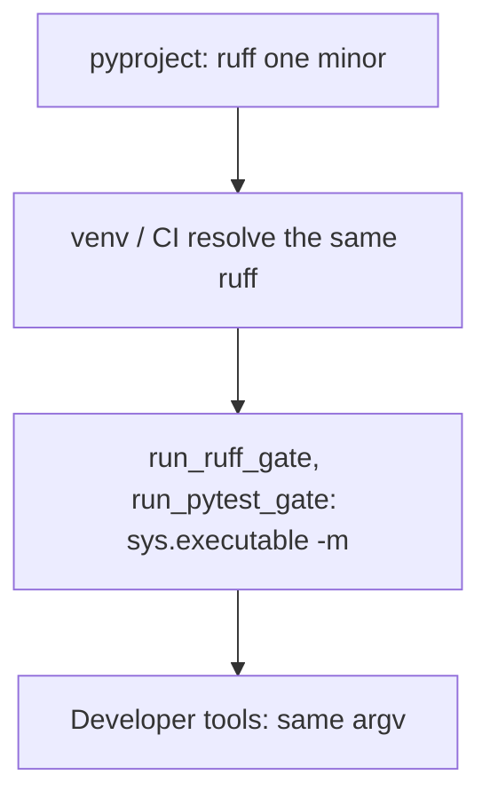

# Pin ruff to one minor and spawn tools through `sys.executable`

## Intent

The Developer gate must mean the same thing on the operator's machine,
in CI and inside a Developer session. Today the ruff it runs is
whichever version `pip` resolved that day, and the `pytest` and
`python` it spawns are whichever binaries sit first on `PATH`. This
component pins ruff to one minor and spawns both tools from the
interpreter that is running repoach.

## Context

Measured on `develop` `20dbb45` (2026-10-19).

| # | Fact | Where |
|---|---|---|
| F1 | The dev extra declares `ruff>=0.5` with no upper bound; CI runs `pip install -e ".[dev]"`, so every CI run resolves the newest ruff | `pyproject.toml:63`; `.github/workflows/ci.yml:54-57` |
| F2 | The operator's venv holds `ruff 0.15.20`; PyPI's newest is `0.17.1` (2026-10-19) | `ruff --version` in `/home/jofaye/Documents/work/repoach/.venv`; `pip index versions ruff` |
| F3 | With `0.17.1` first on `PATH`, `ruff check src tests` reports one new violation — `tests/integration/test_chain_regen_freshness.py:104:9 SIM117` — so `scripts/ci_local.sh --fast` (`:115`) and the CI `Ruff check` step (`ci.yml:59-60`) go red on an unchanged tree; `ruff format --check` stays clean (466 files) | measured in a scratch install of `ruff==0.17.1` |
| F4 | The eight gate test files (`test_ruff_gate_unsafe_fixes`, `test_devagent_tools`, `test_devagent_selfverify`, `test_dev_runner`, `test_coder_findings`, `test_selfverify_refutation`, `test_devagent_loop`, `test_review_planner`) pass 110/110 under both `0.15.20` and `0.17.1` on this tree; the "nine Developer-gate tests red" report attached to the unpinned range was not reproduced at `20dbb45` and is kept as a report, not a fact | same measurement, 238 s and 163 s |
| F5 | `run_ruff_gate` spawns `shutil.which("ruff") or "ruff"` — the first `ruff` on `PATH`, not the one installed beside repoach | `src/repoach/review/coder_loop.py:651-677` |
| F6 | `run_pytest_gate` spawns `[python, "-m", "pytest"]` when a `python` is given and `shutil.which("pytest") or "pytest"` otherwise | `coder_loop.py:565-577` |
| F7 | The Developer's `run_tests` tool spawns the literal `["python", "-m", "pytest", …]` — whatever `python` is first on `PATH`, which in a Conda-less shell may be the system interpreter with no repoach installed | `src/repoach/review/devagent_tools.py:202-212` |
| F8 | `ruff` ships `ruff.__main__`, so `python -m ruff` runs the version installed in that interpreter | ruff package layout |

## Goals

- G1: `pyproject.toml` declares `ruff>=0.15,<0.16` (one minor, `ruff_minor`); a test reads the declaration and the installed version and fails when the installed ruff is outside the declared range or the range spans more than one minor.
- G2: every spawn of ruff goes through `[sys.executable, "-m", "ruff", …]` and every spawn of pytest through `[sys.executable, "-m", "pytest", …]`; `run_pytest_gate(python=…)` keeps accepting an explicit interpreter for the CI matrix and defaults to `sys.executable` instead of a `PATH` lookup.
- G3: with `PATH` empty, the ruff gate, the pytest gate and the Developer's `run_tests` and `run_ruff` tools still run.
- G4: the `scripts/ci_local.sh` and `.githooks/pre-commit` ruff calls use `python -m ruff` so the hook and the gate agree on the binary.

## Non-Goals

- NG1: no bump to `0.16` or `0.17` here; the SIM117 of F3 is fixed when the minor is bumped, by its own commit.
- NG2: no pin of pytest, pydantic or any other dependency; the ruff pin is the one with a measured consequence.
- NG3: no lockfile.

## Assumptions

- A1: `ruff` stays importable as a module in every supported minor.
- A2: CI's `pip install -e ".[dev]"` honours the upper bound, so CI and the operator's venv resolve the same minor.

## Interface

```toml
[project.optional-dependencies]
dev = [
    "ruff>=0.15,<0.16",
]
```

```python
def ruff_argv(*args: str) -> list[str]: ...       # [sys.executable, "-m", "ruff", *args]
def pytest_argv(*args: str, python: str | None = None) -> list[str]: ...
```

Inputs:
- `sys.executable`; the optional `python` of `run_pytest_gate`.

Outputs:
- the gates' return values are unchanged; the argv they spawn changes.

Errors:
- `ModuleNotFoundError: No module named ruff` from the child → the gate returns `False` with the tail `ruff is not installed in <sys.executable>`, never `ruff: command not found`.

## Behavior

### Nominal
`run_ruff_gate(root)` runs `<venv python> -m ruff check --fix src
tests`, `… -m ruff format src tests`, `… -m ruff check src tests`,
`… -m ruff format --check src tests`. `run_pytest_gate(root)` runs
`<venv python> -m pytest -q tests/unit`. The Developer's `run_tests`
tool runs `<venv python> -m pytest -q -- <target>`.

### Edge cases
- `run_pytest_gate(root, python="python3.13")` → that interpreter, as today.
- the operator upgrades ruff past the bound by hand → `test_toolchain_pin.py` goes red with `installed ruff 0.17.1 outside declared range >=0.15,<0.16`.
- a project reviewed by repoach that pins its own ruff (through `SP-UNIVERSAL-GATES` `[commands]`) → unaffected; this spec covers repoach's own gates only.

### Failure scenarios
- `sys.executable` has no pytest (a tool install without the dev extra) → the gate's tail says `pytest is not installed in <sys.executable>` and returns `False`.

## Architecture Impact
- Adds dependency: SP-PIN-TOOLCHAIN -> SP-DEVAGENT-TOOLS (`devagent_tools.run_tests` and `run_ruff` build their argv from the helpers)
- Adds dependency: SP-PIN-TOOLCHAIN -> SP-DEV-RUFF-UNSAFE-FIXES (`coder_loop.run_ruff_gate` and `run_pytest_gate` build their argv from the helpers)
- New shared state: none; no cycle.

## Diagram


## Acceptance Criteria
- [ ] AC1: `grep -nE '^\s*"ruff' pyproject.toml` → `63:    "ruff>=0.15,<0.16",`. Today: `63:    "ruff>=0.5",`.
- [ ] AC2: `pytest -q tests/unit/test_toolchain_pin.py` → green: the declared range spans one minor and `importlib.metadata.version("ruff")` is inside it. Today: the file does not exist, and the assertion on the range would fail on `>=0.5`.
- [ ] AC3: `pytest -q tests/unit/test_toolchain_spawn.py` → green: with `monkeypatch.setenv("PATH", "")` and a recording `_run`, `run_ruff_gate(root)` spawns four argv each starting `[sys.executable, "-m", "ruff"]`, `run_pytest_gate(root)` spawns `[sys.executable, "-m", "pytest", "-q", "tests/unit"]`, and the Developer `run_tests` tool spawns `[sys.executable, "-m", "pytest", "-q", "--", "tests/unit"]`. Today: `shutil.which("ruff")` is `None` so the argv starts with the bare string `"ruff"`, and `run_tests` starts with `"python"`.
- [ ] AC4: `env PATH=/nonexistent $(python -c 'import sys; print(sys.executable)') -c "from pathlib import Path; from repoach.review.coder_loop import run_ruff_gate; print(run_ruff_gate(Path('.'))[0])"` → `True`. Today: `False` with `ruff: No such file or directory` in the tail.
- [ ] AC5: `grep -c 'python -m ruff' scripts/ci_local.sh .githooks/pre-commit` → `2` and `2`. Today: `0` and `0`.
- [ ] AC6: `pytest -q tests/unit/test_ruff_gate_unsafe_fixes.py tests/unit/test_devagent_tools.py tests/unit/test_devagent_selfverify.py tests/unit/test_dev_runner.py tests/unit/test_coder_findings.py tests/unit/test_selfverify_refutation.py tests/unit/test_devagent_loop.py tests/unit/test_review_planner.py` → `110 passed` with the pinned ruff; `scripts/ci_local.sh --fast` → green.
- [ ] AC7: `repoach arch check --base develop` → `edge-honesty: ok`.

## Open Questions
- Q1: `0.15` is the minor the operator's venv holds today; CI resolves `0.17.1` and would fail on F3's SIM117. Pin to `0.15` now and bump by a dedicated commit that also fixes the SIM117, or fix the SIM117 first and pin to `0.17`? Recommendation: pin `0.15` now, since it is the measured green state; bump in its own PR.
- Q2: who re-measures the "nine red tests" report? It was not reproduced at `20dbb45` under `0.17.1`; if it came from another tree or an older ruff, the row in `docs/tech_debt.md` that cites it should carry the SHA it was measured on.
