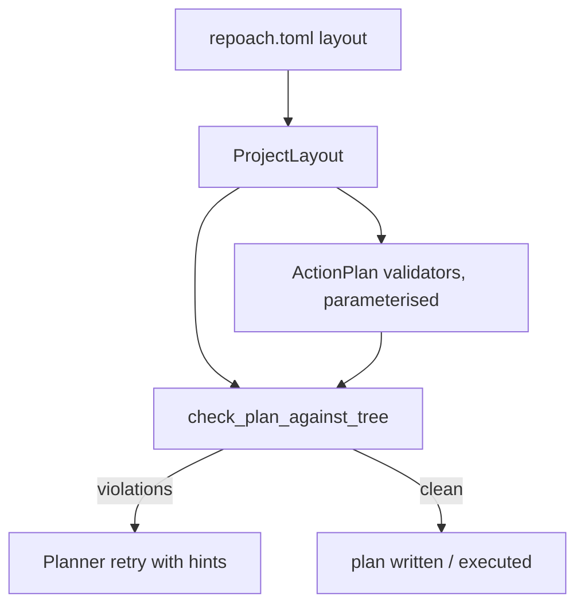

# The planner is layout-agnostic and validates paths against the tree

## Intent

`ActionPlan` validation encodes repoach's own layout — code under
`src/`, integration tests under `tests/integration/`, pytest
selectors — and checks the shape of what the Planner promises, never
whether the files it names exist. On any other repository the first
rule rejects every plan and the second lets phantom modules through.
This component reads the layout from the project's configuration and
checks every path in a plan against the tree.

## Context

Measured on `develop` `20dbb45` (2026-10-19); reproduction W1,
`repoach plan SP-YOOB-TEMPLATE-HONESTY --explore-via claude_cli` on a
Yoob worktree (`docs/tech_debt.md` row 24 as of PR #203).

| # | Fact | Where |
|---|---|---|
| F1 | A plan touching any `src/` path must promise at least one integration test | `src/repoach/review/plan.py:353-358` (`_src_plans_promise_integration_tests`) |
| F2 | Integration selectors must start with `tests/integration/` | `plan.py:406-418` (`_integration_tests_under_integration_tree`) |
| F3 | The other two selector validators check creation order and the union of `files`; none checks the tree | `plan.py:361-403`, `:421-445` |
| F4 | `PlanStep` has `files` but no way to say which of them are new | `plan.py:203-225` |
| F5 | The only `is_file()` in the planning path checks the plan document itself | `plan.py:543` |
| F6 | The Planner prompts repeat the `src/` → `tests/integration/` rule in prose | `prompts/review/planner_0.2.1.md:68,106`; `planner_cc_0.1.1.md:54,95` |
| F7 | W1: Yoob has no `tests/integration/`; the first run failed 5/5 attempts on F1; once the spec named such a file, the validated plan named `src/yoob/codegen/amp_bare_metal.py` (real `src/yoob/hw/soc/firmware_amp.py`), `src/yoob/config/arch_config.py` (real `src/yoob/hw/soc/schema.py`), `api/routes/schedule.py` (real `schedules.py`), and pytest-style `file::name` selectors for Vitest tests | W1 note B1, B6 |
| F8 | `repoach.toml` (`format:repoach-toml`) is the committed, secret-free project configuration; keys are introduced by the child that consumes them | `SP-UNIVERSAL-REPO` Interface |

## Goals

- G1: a `ProjectLayout` model — `src_dirs`, `unit_test_dirs`, `integration_test_dirs`, `docs_dirs`, `test_runner` (`pytest`, `vitest`, `go`, `cargo`, `custom`), `selector_grammar` — loaded from `repoach.toml` `[layout]`, defaulting to repoach's own layout so every existing plan validates unchanged.
- G2: the integration-test interlock reads the layout: it applies to paths under `src_dirs` and demands a selector under `integration_test_dirs`; when the project declares no integration directory the interlock is off and the plan's rejection text never asks for one.
- G3: `PlanStep` gains `creates: list[str]` (a subset of `files`); `check_plan_against_tree(plan, root, layout)` returns one `PlanTreeViolation` per path in `files` that neither exists in the tree nor is listed in `creates` (its own step or an earlier one), per `creates` entry that already exists, and per selector whose file part fails the same rule or whose form does not match `selector_grammar`.
- G4: a `missing_path` violation names up to `close_matches_shown` existing paths with the same basename, or the closest basenames by `difflib`, so the Planner's retry can correct the name instead of inventing a sibling.
- G5: `repoach plan` and `repoach develop` run the tree check after model validation and before writing or executing the plan; the Planner's retry loop feeds the violations back as it feeds validation errors today.
- G6: the Planner prompts describe the layout from the loaded `ProjectLayout` (one rendered block), never from prose constants.

## Non-Goals

- NG1: no change to the step executor, the per-step jail or the gate; they consume the same `ActionPlan`.
- NG2: no language detection; the layout is declared, and the default is repoach's.
- NG3: no semantic "same role as an existing module" detection; existence plus close-match hints is the rule.
- NG4: no multi-runner plans; one `test_runner` per project.

## Assumptions

- A1: `repoach.toml` resolution lands with `SP-UNIVERSAL-PROJECT-CONFIG`; until then `ProjectLayout.load(root)` reads the file directly if present and returns the default otherwise.
- A2: the tree checked is the checkout the Planner explored (`repo_root`), at the commit the plan is written for.

## Interface

```python
class ProjectLayout(BaseModel):
    src_dirs: list[str] = ["src/"]
    unit_test_dirs: list[str] = ["tests/unit/"]
    integration_test_dirs: list[str] = ["tests/integration/"]
    docs_dirs: list[str] = ["docs/"]
    test_runner: Literal["pytest", "vitest", "go", "cargo", "custom"] = "pytest"
    selector_grammar: str = "pytest"

    @classmethod
    def load(cls, root: Path) -> ProjectLayout: ...
    def render_for_prompt(self) -> str: ...

class PlanStep(BaseModel):
    ...
    creates: list[str] = []

class PlanTreeViolation(BaseModel):
    step: int
    path: str
    kind: Literal["missing_path", "creates_existing", "selector_file", "selector_form", "outside_test_dirs"]
    hint: list[str]

def check_plan_against_tree(plan: ActionPlan, *, root: Path, layout: ProjectLayout) -> list[PlanTreeViolation]: ...
```

`repoach.toml` keys, all optional (defaults above):

```toml
[layout]
src_dirs = ["src/yoob/", "api/", "frontend/src/"]
unit_test_dirs = ["tests/", "api/tests/", "frontend/src/"]
integration_test_dirs = []
test_runner = "pytest"
```

Selector grammar per runner: `pytest` → `path::name` or `path`; `vitest` → `path` or `path -t "name"`; `go` → `./pkg -run Name`; `cargo` → `crate::module::name`; `custom` → `path` only.

Inputs:
- `repoach.toml` `[layout]`; `repo_root`.

Outputs:
- `repoach plan`: on violations, rc 3 and one line per violation `step 4: src/yoob/codegen/amp_bare_metal.py does not exist and is not in creates — close: src/yoob/hw/soc/firmware_amp.py`; the plan is not written.
- the plan document's JSON fence carries `creates` per step and `layout` as rendered.

Errors:
- `LayoutConfigError`: a `[layout]` directory does not exist in the tree, or `test_runner` is unknown — rc 2, names the key.

## Behavior

### Nominal
The Planner loads the layout, renders it into its brief, emits a plan
whose steps list `files` and `creates`; `ActionPlan` validates the
shape with the interlock parameterised by the layout; the tree check
confirms each existing path exists and each created path does not;
the plan is written. On a Yoob checkout with the `[layout]` above
and no integration directory, the W1 plan would have been rejected
three times by name with the real modules as hints, and never for
the missing `tests/integration/`.

### Edge cases
- `files` lists a directory → `missing_path` unless it exists; `creates` may name a directory to be created.
- a path under `docs_dirs` → exempt from the test-promise rules (as today for `docs/`) but still subject to existence or `creates`.
- a renamed file → the old path in `files` must exist, the new one in `creates`; the executor is unchanged.
- a selector naming a file created by a later step → still rejected by the existing ordering validator (`plan.py:361-403`); the tree check adds nothing.
- `integration_test_dirs = []` and the spec's acceptance criteria name an integration test → the plan may still promise it as a unit selector under `unit_test_dirs`; the interlock does not fire.

### Failure scenarios
- `[layout].src_dirs` names a directory absent from the tree → `LayoutConfigError`, rc 2, before any model call.
- the Planner exhausts its retries on tree violations → rc 3, the last violation list on stderr, `planner_attempts` rows record `violated_rule = "tree:<kind>"`.

## Architecture Impact
- Adds dependency: SP-PLANNER-LAYOUT-AGNOSTIC -> SP-PLAN-CONTRACT-LINTS (`plan.py`'s two layout validators take the layout as a parameter; `PlanStep` gains `creates`)
- Adds dependency: SP-PLANNER-LAYOUT-AGNOSTIC -> SP-UNIVERSAL-REPO (`[layout]` is a section of `format:repoach-toml`; this spec introduces its keys)
- New coupling: `planner.py` and `dev_runner.py` call `check_plan_against_tree` before writing or executing; no new table, no cycle (`plan_tree_check.py` imports `plan` and `project_layout` only).

## Diagram


## Acceptance Criteria
- [ ] AC1: `pytest -q tests/unit/test_project_layout.py` → green: `ProjectLayout.load(tmp)` with no file returns the defaults; with `[layout] integration_test_dirs = []` a plan touching `src/` and promising no integration test validates. Today: `ValueError: plan touches src/ and must promise at least one integration test`.
- [ ] AC2: `pytest -q tests/unit/test_plan_tree_check.py::test_phantom_path_is_named_with_close_match` → green: a tree holding `api/routes/schedules.py`, a step listing `api/routes/schedule.py` without `creates` → one `missing_path` violation whose `hint` starts with `api/routes/schedules.py`. Today: the module does not exist (`ModuleNotFoundError: repoach.review.plan_tree_check`).
- [ ] AC3: `pytest -q tests/unit/test_plan_tree_check.py::test_vitest_selector_form` → green: `test_runner = "vitest"` and a selector `frontend/src/x.test.ts::name` → `selector_form` violation with the expected form in `hint`. Today: accepted.
- [ ] AC4: in a throwaway clone of Yoob at `7d93499a` with the `[layout]` above committed: `repoach plan SP-YOOB-TEMPLATE-HONESTY --explore-via claude_cli` → never prints `must promise at least one integration test`, and no path in the written plan is absent from `git ls-files` unless listed under `creates`. Today: 5/5 attempts fail on the interlock.
- [ ] AC5: `pytest -q tests/unit/test_review_plan*.py tests/unit/test_review_planner.py` → green unchanged (golden: repoach's own layout).
- [ ] AC6: `grep -c 'tests/integration/' prompts/review/planner_0.2.1.md prompts/review/planner_cc_0.1.1.md` → `0` each; the rendered layout block replaces the prose. Today: `2` and `2`.
- [ ] AC7: `repoach arch check --base develop` → `edge-honesty: ok`.

## Open Questions
- Q1: should the Planner be allowed to list a `creates` path whose directory does not exist (a new package), or must the directory be created by an explicit entry? Recommendation: allowed; the executor creates parents, and a violation here would only produce busywork steps.
- Q2: prompt files are outside the bots' path whitelist; the prompt change of G6 is hand-shipped. Should it be a separate spec so `repoach develop` can take the rest? Recommendation: keep it here and hand-ship the prompt edit in the same PR.
