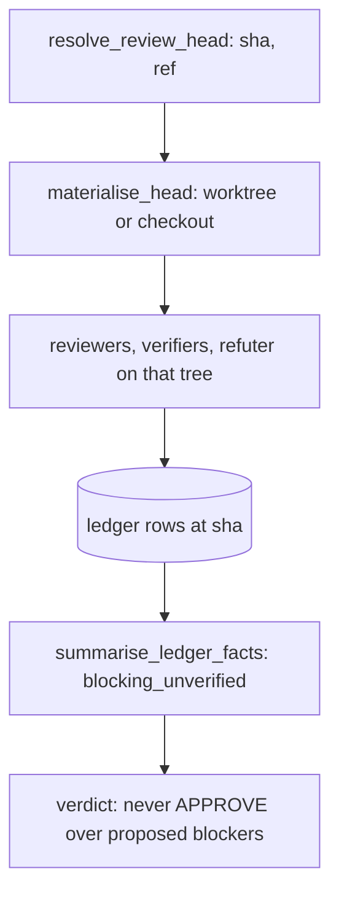

# Every review pins the PR head

## Intent

A review is a statement about one commit. Today a dry run has no
commit: it records `head_sha = ""`, reads whatever branch the current
directory happens to be on, and derives its verdict from facts at an
empty head. This component resolves the head SHA before anything
else in every mode, reviews exactly that tree, stamps every ledger
row with it, and makes `APPROVE` unreachable while a blocking finding
is still `proposed`.

## Context

Measured on `develop` `20dbb45` (2026-10-19); reproduction W1 on Yoob
MR !283 (`docs/tech_debt.md` row 23 as of PR #203).

| # | Fact | Where |
|---|---|---|
| F1 | The head guard thread starts only `if self._post:`; a dry run joins `None` | `src/repoach/review/orchestrator.py:410-416`, `:615`, `:799-826` |
| F2 | Every ledger writer coerces the missing head to the empty string: findings, integrity, verifier and refuter stamps | `findings.py:358` (`head_sha or ""`); `finding_verifiers.py:189,201`; `refuter.py:220` (`checked_at_sha=head_sha or ""`); `orchestrator.py:747` |
| F3 | The reviewers' file reader, the verifiers and the refuter resolve paths against `repo_root = Path.cwd()` — the checkout's current branch, not the PR head | `orchestrator.py:326`; `reviewer.py:355-382`; `orchestrator.py:962` |
| F4 | Reading the head SHA is a read: `gh pr view --json headRefOid` | `gh_client.py:686-702` (`pr_head_sha`) |
| F5 | The PR head is fetchable as `refs/pull/<N>/head` on GitHub and `refs/merge-requests/<iid>/head` on GitLab | `gh_client.py:324`; W1 note A10 |
| F6 | The review-time verdict comes from `summarise_ledger_facts`, which does not count a blocking judged finding still `proposed`; the authoritative gate lists the same finding under `blocking_unverified` and refuses | `merge_gate.py:300-310` versus `:224-241`; `verdict_from_facts` at `:163-189` |
| F7 | W1 on !283: twelve `pr_findings` rows with `head_sha = ""`, final verdict `APPROVE` with two blocking scribe findings left `proposed`, tree read from Yoob `chantier/phase-0-consolidation` rather than the MR head `a9f7001c` | W1 note, "A dry run has no head SHA" |
| F8 | The payload of `review pr` carries no `head_sha` although `TeamOutcome` does | `cli/review_cmds.py:93-115`; `orchestrator.py:752` |

## Goals

- G1: `resolve_review_head(gh, pr_number, repo_root)` runs first in every mode and returns a 40-hex SHA or raises; the propagation-lag poll of `resolve_fresh_head` is kept inside it.
- G2: the tree under review is the head tree: a detached worktree at that SHA under the state directory (`<db_path parent>/worktrees/pr-<N>-<sha12>`) fetched from `refs/pull/<N>/head` (GitHub) or `refs/merge-requests/<N>/head` (GitLab); when the current checkout is already at that SHA and clean, it is used in place.
- G3: every ledger row written by a review carries that SHA: `record_review_ledger`, `record_review_integrity`, the verifier and refuter stamps refuse an empty `head_sha` with `ValueError`.
- G4: `summarise_ledger_facts` reports `blocking_unverified` exactly as `gather_merge_facts` does, and `verdict_from_facts` never returns `APPROVE` while that list is non-empty.
- G5: the `review pr` payload carries `head_sha`, `tree` (`worktree` or `checkout`) and `unverified_blocking` (the list of `finding <id>: <claim_type> is PROPOSED at head` lines).

## Non-Goals

- NG1: no change to the authoritative merge gate's rule; this spec aligns the review-time summary with it.
- NG2: no GitLab transport; the ref name is a parameter of the forge and the GitLab value is pinned by a fake until `SP-UNIVERSAL-FORGE`.
- NG3: no re-review on head change mid-run; the SHA resolved at start is the one recorded, and `reviewing_stale_head` keeps its warning.
- NG4: no worktree reuse across runs; each run gets its own and removes it unless `--keep-worktree`.

## Assumptions

- A1: `git worktree add --detach` is available and the state directory is writable; CI checkouts that are already at head skip it.
- A2: a `proposed` blocking finding after the verifier and refuter passes means those passes could not settle it; counting it as unverified is the same fail-closed reading the gate applies (`SP-GATE-JUDGED-FAIL-CLOSED`).

## Interface

```python
class ReviewHead(BaseModel):
    sha: str
    ref: str
    tree: Literal["worktree", "checkout"]
    root: Path

def resolve_review_head(gh: GhCli, pr_number: int, *, repo_root: Path) -> ReviewHead: ...
def materialise_head(gh: GhCli, head: ReviewHead, *, state_dir: Path, keep: bool = False) -> ContextManager[Path]: ...
```

`MergeFacts` gains nothing: `blocking_unverified` already exists; `summarise_ledger_facts` fills it.

Inputs:
- `--keep-worktree` on `repoach review pr` — keep the materialised tree for inspection.
- `--allow-checkout-tree` — review the current checkout even when its HEAD differs from the PR head; refused by default.

Outputs:
- payload: `head_sha: str`, `tree: "worktree" | "checkout"`, `unverified_blocking: list[str]`.
- verdict: `COMMENT` when `unverified_blocking` is non-empty and nothing else blocks; `REQUEST_CHANGES` and `APPROVE` as today otherwise.

Errors:
- `HeadUnresolvedError`: the forge returned no SHA, or one that is not 40 hex characters — rc 2, `cannot resolve head of PR <N>`; nothing is recorded.
- `HeadUnavailableError`: the ref cannot be fetched and the checkout is not at the SHA — rc 2, names the ref and the remote; `--allow-checkout-tree` turns it into a warning and `tree: "checkout"`.

## Behavior

### Nominal
`review_pr` resolves the head (one read), fetches the PR ref into a
detached worktree, points `repo_root` at it for the reviewers' tools,
the verifiers, the refuter and spec coverage, records every row with
the SHA, summarises the ledger at that SHA, and removes the worktree.
The payload reads `"head_sha": "a9f7001c…", "tree": "worktree",
"unverified_blocking": []`.

### Edge cases
- the checkout is on the PR branch at the same SHA with a clean tree → `tree: "checkout"`, no fetch.
- the checkout is on the PR branch but dirty → a worktree is still used; the review never reads uncommitted edits.
- a blocking `missing_docstring` finding the verifier could not resolve (file absent from the head tree) → stays `proposed`, listed in `unverified_blocking`, verdict `COMMENT`, exit 0, and the archive comment names it.
- `--keep-worktree` → the path is printed on stderr and listed in the payload under `worktree`.

### Failure scenarios
- `gh pr view` fails → `HeadUnresolvedError`, rc 2, no ledger row.
- the fetch fails (no network) and the checkout differs → `HeadUnavailableError`, rc 2, no ledger row; with `--allow-checkout-tree` the review proceeds and the payload says `tree: "checkout"` with `head_sha` as served by the forge.
- the worktree cannot be removed → warning `review.worktree_remove_failed` with the path; the exit code is unaffected.

## Architecture Impact
- Adds dependency: SP-REVIEW-PINS-HEAD -> SP-ORCH-DOCSTRING (`orchestrator.py` is edited in place: the head resolution moves before the diff, `repo_root` becomes the head tree)
- Adds dependency: SP-REVIEW-PINS-HEAD -> SP-REVIEW-POST-BATCH (`review_head.py` imports `GhCli` for `pr_head_sha`, `pr_view` and the fetch)
- Adds dependency: SP-REVIEW-PINS-HEAD -> SP-FINDINGS-INIT-RACE (`findings.py` writers refuse an empty `head_sha`)
- Adds dependency: SP-REVIEW-PINS-HEAD -> SP-PURE-MERGE-GATE (`merge_gate.summarise_ledger_facts` fills `blocking_unverified`; `verdict_from_facts` reads it)
- New shared state: a per-run worktree directory under the state dir; removed at exit. No cycle: `review_head.py` imports `gh_client` only.

## Diagram


## Acceptance Criteria
- [ ] AC1: `pytest -q tests/unit/test_review_pins_head.py::test_dry_run_records_head_sha` → green: stub forge `pr_head_sha → "deadbeef" * 5`, `ReviewTeamOrchestrator(post_to_github=False).review_pr(7)`, then `select distinct head_sha from pr_findings where pr_number = 7` → the stub's SHA. Today: `""`.
- [ ] AC2: `pytest -q tests/unit/test_review_pins_head.py::test_dry_run_reads_head_tree_not_checkout` → green: a temp repository whose `refs/pull/7/head` carries `src/x.py` with a docstring while the checked-out branch lacks it; a stub reviewer raises blocking `missing_docstring` on `src/x.py:1`; after the review the finding is `refuted`. Today: `verified`, because the verifier read the checkout.
- [ ] AC3: `pytest -q tests/unit/test_review_pins_head.py::test_no_approve_over_proposed_blocking` → green: a ledger with four complete reviews and one blocking `design` finding at `proposed`; `summarise_ledger_facts(...).blocking_unverified == ["finding 1: design is PROPOSED at head"]` and `verdict_from_facts(facts) is not ReviewVerdict.APPROVE`. Today: `blocking_unverified == []` and `APPROVE`.
- [ ] AC4: `python -c "from repoach.review.findings import record_review_ledger as r; r(':memory:', pr_number=1, head_sha='', outcomes=[], round_n=1, diff='')"` → `ValueError: head_sha required`. Today: returns without error and writes `""`.
- [ ] AC5: `repoach review pr <N> --dry-run | jq -r '.head_sha, .tree, (.unverified_blocking | length)'` → a 40-hex SHA, `worktree` or `checkout`, an integer. Today: `null`, `null`, `0` from a missing key.
- [ ] AC6: `cd <checkout on another branch> && repoach review pr <N> --dry-run >/dev/null; git branch --show-current` → unchanged, and `git worktree list | grep -c pr-<N>-` → `0` after the run. Today: trivially unchanged, but AC5 fails.
- [ ] AC7: `repoach arch check --base develop` → `edge-honesty: ok`.

## Open Questions
- Q1: `COMMENT` (exit 0, nothing posted as a request for changes) or `REQUEST_CHANGES` (exit 2, which triggers the Coder on findings nobody verified) when only unverified blockers remain? Recommendation: `COMMENT`; the Coder should act on verified findings only.
- Q2: the worktree lives under the ledger's directory so it follows `REPOACH_DB_PATH`; once `SP-UNIVERSAL-INSTALL` moves state under XDG, should it move to `$XDG_CACHE_HOME/repoach/worktrees` instead? Recommendation: yes, cache not data.
