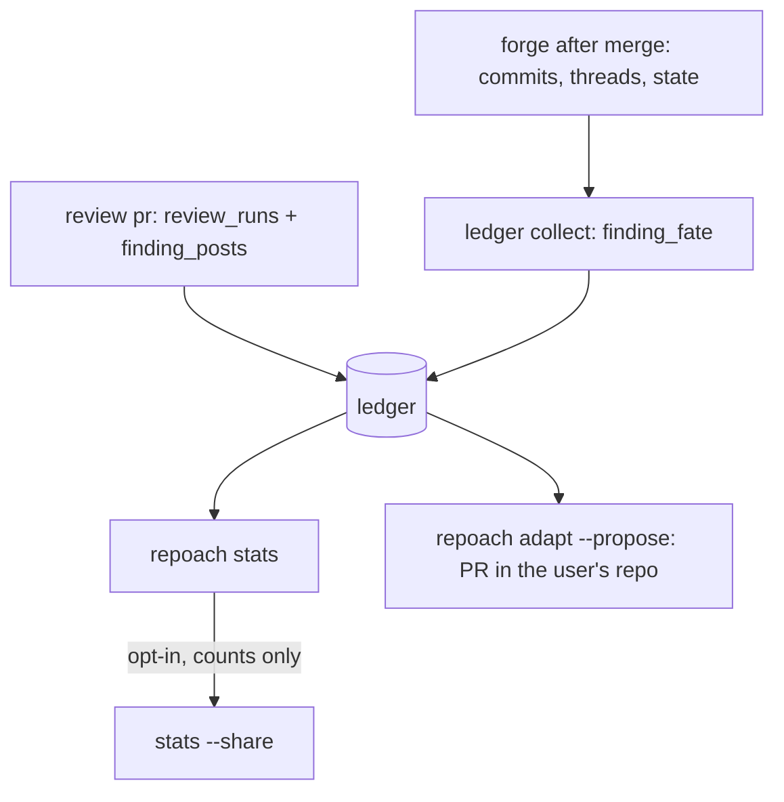

# Repoach learns from use without being intrusive

## Intent

Repoach already records what its reviewers claimed and what the refuter
decided; it never learns what the humans did next. This component reads
the fate of every finding from the forge after the fact, keeps cost and
wall time per review, and turns the three signals into numbers the
project can read locally (`repoach stats`), into readable changes
proposed as pull requests (`repoach adapt --propose`), and — only when
the user asks — into an aggregated, code-free contribution to the
repoach project. Nothing leaves the user's infrastructure by default,
and nothing changes repoach's behaviour silently.

## Context

Measured on `develop` `20dbb45` and on the W1 run of 2026-10-18
(`docs/plans/2026-10-18_W1-gitlab-dry-run-measurement.md` on branch
`feat/sp-gh-glab-shim-dry-run`).

| # | What the ledger holds today | Where | What is missing |
|---|---|---|---|
| L1 | `pr_findings`: pr_number, head_sha, round, finder, claim_type, severity, file, line_start/line_end, claim, evidence_pointer, status, verification_method/result, checked_at_sha, verify_attempts | `src/repoach/review/findings.py:168-188` | no forge comment id, no fate: the row stops at `verified`/`refuted`/`open`/`resolved`/`stuck`, decided by repoach alone |
| L2 | `pr_reviews`: role, verdict, n_comments/n_blockers/n_majors, model_used, elapsed_s, tokens_used, comments_json, decision_pivot | `src/repoach/review/persistence.py:51-67` | no diff size, no provider, no mode (`post`/`dry-run`), so cost cannot be read by diff size |
| L3 | `planner_attempts`: spec_id, attempt, violated_rule, recorded_at | `src/repoach/review/planner_telemetry.py:52-60` | nothing to add; read by `stats` as the plan-rejection rate per rule |
| L4 | `pr_merges`: outcome, base_ref, head_ref, merged_sha | `persistence.py:112-122` | written only by `review merge`; 0 rows on the local ledger (umbrella A13) — a human merge leaves no row |
| L5 | `usage_ledger` (planned): per call tokens, cost_usd nullable | `SP-UNIVERSAL-PROVIDERS` G5 | per call, not per review; this spec joins it to `review_runs` |
| L6 | the forge comment id of each posted inline comment is held in memory for the auto-challenge pass and dropped | `src/repoach/review/orchestrator.py:1115-1127` (`posted_ids[(path, line)]`) | never persisted, so a finding cannot be matched to its thread later |
| L7 | the refuter writes `refuted`/`verified` and the merge gate counts open blocking findings | `src/repoach/review/refuter.py:160-200`; `merge_gate.py` | the human decision — merged with the change, merged without it — is never compared with the verdict |
| L8 | refuted findings get a sentinel reply on their thread (today even in `--dry-run`, W1 finding) | `src/repoach/review/thread_context.py:529-590`; `orchestrator.py:659-671` | a reply is a write; the fate collector must be read-only |
| L9 | review lessons are distilled from verified findings into an agentmemory service (`http://localhost:3111`) and recalled into the reviewer prompt; the three loops default to `True` | `src/repoach/review/review_lessons.py:1-18`; `review_memory.py:1-11`; `core/config.py:184-212` | learning that changes prompts invisibly, on a service a foreign repository does not run |
| L10 | `review insights` prints status/claim-type mix and per-lens precision, where precision = verified ÷ (verified + refuted) — repoach grading itself | `src/repoach/cli/review_cmds.py:277-310`; `review_lessons.py` `gather_insights` | no human ground truth in the denominator |
| L11 | W1 on Yoob !283: 4 `pr_reviews`, 12 `pr_findings` (9 proposed, 2 refuted, 1 verified), 225 582 tokens, 83 s, 0 tool calls, verdict `APPROVE` with 2 blocking findings left `proposed` | W1 report, Run table | the only cost sample; the dry run had `head_sha` empty |

The market map (`docs/plans/2026-10-19_positioning-and-market-map.md`)
names a published precision number as the missing table stake:
225 k tokens per review with an unmeasured false-positive rate cannot
be sold against vendors who publish one. The fate signal is the only
way to measure it against what humans did rather than against the
refuter.

## Goals

- G1 (fate): every finding on a merged or closed PR receives exactly one `finding_fate` row with a fate from the enum below, read from the forge after the fact, never from repoach's own verdicts; the collector performs no write on the forge.
- G2 (calibration): `stats` prints, per finder and per claim type, the four cells `refuter said × human did` (refuted-fixed, refuted-ignored, verified-fixed, verified-ignored) and derives the false-refutation and false-verification rates; the blocking threshold proposal of G6 reads these cells.
- G3 (cost): every `review pr` run writes one `review_runs` row (diff files, diff characters, diff hash, reviewers, tokens, elapsed, provider kind, model tiers, mode); `stats` prints tokens and cost per review bucketed by diff size and the time from first review to merge.
- G4 (local by default): the ledger is the user's file at `[state].db_path`; `stats`, `collect` and `adapt` read and write only that file and the user's forge; no network call to any host but the configured forge and the configured provider.
- G5 (readable learning): every adaptation repoach derives from the ledger is a diff in the user's repository, opened as a pull request by `adapt --propose` with the evidence in the description; repoach never changes a prompt, a threshold or a severity from ledger data at run time.
- G6 (three adaptations): a `finder/claim_type` rule demoted to `advisory` after `demote_after_ignored` ignored findings across at least three PRs; a refuter blocking-threshold change when a calibration cell crosses the configured bound; a `## Lessons` entry appended to the governed spec whose files carry three or more fixed findings of the same claim type.
- G7 (opt-in sharing): `stats --share` prints the exact payload, asks for confirmation, and sends it only to `[telemetry].endpoint` when that key is set; the payload holds counts and buckets only, as listed in Privacy, and a count under `share_count_bucket` is rendered as `<5`.
- G8 (honest empties): every command on an empty ledger says so in one line and exits 0; a rate whose denominator is zero prints `cannot say`, never `0%`.
- G9 (foreign-repo defaults): on a repository other than repoach's own, `review_memory_enabled`, `review_lessons_enabled` and `builder_memory_enabled` default to `false`; `[learning].memory = true` restores them. Repoach's own `repoach.toml` sets it.

## Non-Goals

- NG1: no change to the finding lifecycle (`findings.py` `ALLOWED_TRANSITIONS`); fate is a separate table, never a seventh status.
- NG2: no automatic application of any adaptation: `adapt` without `--propose` prints what it would propose; with `--propose` it opens a PR; it never merges and never edits `develop`.
- NG3: no hosted dashboard, no account, no identity beyond a random install id the user can rotate; `serve` and a ledger UI are the market map's later stages, not this spec.
- NG4: no fate for findings on a PR still open; the collector records nothing and reports `pending` in its own output.
- NG5: no replacement of `review insights`; it keeps its self-graded precision and gains one line pointing at `stats`.
- NG6: no cost estimation when the provider reports no price (`SP-UNIVERSAL-PROVIDERS` G5): the cost column prints `cannot say`.

## Assumptions

- A1: `SP-UNIVERSAL-FORGE` exposes, in addition to its protocol, two read calls this collector needs: `commits(number) -> list[Commit]` (sha, files touched with line ranges, authored_at) and `threads(number) -> list[Thread]` (root comment, replies, `resolved: bool`, path, line); both forges implement them from existing endpoints (`pulls/N/commits` + `commits/<sha>` on GitHub; `merge_requests/<iid>/commits` + `/diffs` and `discussions` with `resolved` on GitLab).
- A2: `SP-REVIEW-POST-BATCH`'s posting path is where the forge comment id is known; `SP-FINDING-THREAD-IDS` adds the `finding_posts` write there and nowhere else.
- A3: a human fix is recognised on lines, not on text: a commit after the finding's `head_sha` that touches `file` within `[line_start - fate_line_tolerance, line_end + fate_line_tolerance]` is the evidence; line shifts from earlier hunks in the same commit are followed through the diff, not guessed.
- A4: the W1 fixture ledger (`tests/fixtures/ledger/w1_yoob_283.sql`) reproduces the W1 shape — 4 `pr_reviews`, 12 `pr_findings` (9 proposed, 2 refuted, 1 verified), files and line ranges as recorded — with every `claim` and `evidence_pointer` replaced by a placeholder; the forge answers come from recorded `glab api` fixtures under `tests/fixtures/forge/gitlab/`.

## Interface

```python
class Fate(StrEnum):
    FIXED = "fixed"
    REPLIED_IGNORED = "replied_ignored"
    RESOLVED_NO_CHANGE = "resolved_no_change"
    REOPENED = "reopened"
    IGNORED = "ignored"
    UNKNOWABLE = "unknowable"

class FateRow(BaseModel):
    finding_id: int
    pr_number: int
    fate: Fate
    evidence_kind: Literal["commit", "comment", "thread", "none"]
    evidence_ref: str
    collected_at: datetime
    pr_state: Literal["merged", "closed"]

def collect_fates(forge: Forge, db: Engine, *, pr_number: int) -> list[FateRow]: ...
def compute_stats(db: Engine, *, since: datetime | None, by: Literal["rule", "reviewer", "language"]) -> Stats: ...
def share_payload(stats: Stats, *, install_id: str) -> SharePayload: ...
def propose_adaptations(db: Engine, config: ProjectConfig, root: Path) -> list[Proposal]: ...
```

Schema additions (SQLite, created idempotently through
`core/sqlite_schema_init.py`):

| Table | Columns | Written by |
|---|---|---|
| `finding_posts` | id, finding_id, pr_number, forge, comment_id, thread_id nullable, posted_at | the posting path, once per posted inline comment |
| `finding_fate` | id, finding_id (unique), pr_number, fate, evidence_kind, evidence_ref, pr_state, collected_at | `ledger collect` |
| `review_runs` | id, pr_number, head_sha, diff_hash, diff_files, diff_chars, n_reviewers, tokens_in, tokens_out, elapsed_s, provider_kind, model_tiers, mode, started_at, merged_at nullable | `review pr` at the end of a run; `merged_at` filled by `ledger collect` |

Commands:

| Command | Reads | Writes | Output |
|---|---|---|---|
| `repoach ledger collect [--pr N \| --since DATE \| --all]` | ledger, forge read calls | `finding_fate`, `review_runs.merged_at` | one line per PR: `pr 283: 12 findings, 12 fates (fixed 3, ignored 7, replied_ignored 2)`; `--json` for the rows |
| `repoach stats [--since DATE] [--by rule\|reviewer\|language] [--json]` | ledger | nothing | four Markdown tables: false positives per rule, calibration cells, cost per review by diff-size bucket, time to merge |
| `repoach stats --share [--yes] [--dry-run] [--rotate-id]` | ledger, `[telemetry].endpoint` | `install_id` under the user data dir | the payload, a confirmation prompt, then `shared` or `not sent: <reason>` |
| `repoach adapt [--propose] [--min-ignored N]` | ledger, `repoach.toml`, `specs_dir` | with `--propose`: a branch `chore/repoach-adapt-<date>`, the diff, one PR | the proposals as a table; with `--propose` the PR URL |

`repoach.toml` keys (all optional, defaults in parentheses):

```toml
[learning]
memory = false                   # agentmemory loops (true in repoach's own file)
demote_after_ignored = 5
false_refutation_bound = 0.25    # adapt proposes a lower refuter weight above this
collect_in_ci = false            # SP-UNIVERSAL-CI-ENTRY snippet adds the post-merge job when true

[telemetry]
endpoint = ""                    # empty: --share prints and never sends
```

Inputs:
- `[state].db_path`: Path — the ledger (`SP-UNIVERSAL-PROJECT-CONFIG`).
- `[learning].*`, `[telemetry].endpoint`: as above.
- `REPOACH_PR_NUMBER` / CI variables: `ledger collect` without `--pr` resolves the PR through `resolve_pr_number` (`SP-UNIVERSAL-CI-ENTRY`).

Outputs:
- `stats`: Markdown on stdout; `--json` a single object with the same four sections.
- `stats --share`: the payload as JSON on stdout before the prompt, then one line.
- `adapt --propose`: the PR URL on stdout, rc 0; rc 4 when nothing to propose.

Errors:
- `FateCollectionError`: a forge read failed — rc 2, the PR number and the forge message; rows already collected stay.
- `ShareRefusedError`: `--share` with `--yes` but no endpoint, or a payload that fails the Privacy check — rc 2, the offending key.
- `AdaptConflictError`: the adapt branch already exists with uncommitted differences — rc 2.

## Behavior

### Nominal
After a PR merges, `repoach ledger collect --pr 283` (from the CI
post-merge job or a cron) reads the PR state, its commits after each
finding's `head_sha`, and its threads. For each finding: a later commit
touching the cited lines → `fixed` with the commit sha; a thread with
a human reply, no touching commit → `replied_ignored` with the reply
id; a thread marked resolved on the forge, no touching commit, no
human reply → `resolved_no_change` with the thread id; a thread
reopened or a finding re-raised in a later round (`refuted → proposed`
transition present) → `reopened`; no thread, no reply, no touching
commit on a merged PR → `ignored`, `evidence_kind = none`; a closed
unmerged PR → `unknowable`. One row per finding, replaced on re-run
only while `pr_state` was `open` at the previous attempt.

`repoach stats` then prints, for instance:

```
| rule                    | findings | fixed | ignored | replied | fp rate |
| scribe/missing_docstring|       14 |     2 |      11 |       1 |     79% |
| sentinel/security       |        3 |     3 |       0 |       0 |      0% |
```

followed by the calibration cells, the cost table (`≤10 files`,
`11–40`, `>40`: p50/p90 tokens, p50 wall, cost or `cannot say`) and the
median hours from first review to merge.

### Edge cases
- a finding posted but never linked (`finding_posts` row absent, pre-migration ledger) → matched to its thread by `(file, line)` as the auto-challenge pass does today; no match → thread-less, fate decided on commits alone.
- the same lines fixed by the human and also replied to → `fixed` wins; a reply never outranks a commit.
- a `--dry-run` review (no post) → findings have no thread; fates are `fixed` or `ignored` only, and `stats` labels the row `(dry-run)` so posted and unposted reviews are never summed into one false-positive rate.
- `stats --by language` → the language is the extension of `pr_findings.file` mapped by the `[project].languages` census; an unmapped extension prints as `other`.
- `adapt` on a rule already demoted in `repoach.toml` → not proposed again; the table says `already advisory`.
- `adapt` proposing a `## Lessons` entry on a spec that has no such section → the section is appended before `## Open Questions`; on a frontier spec without frontmatter → the proposal is skipped with the reason `spec not governed`.
- `--share` twice on the same ledger state → the second payload is byte-identical and the endpoint receives the same `period` and `install_id`; the server-side dedup is the endpoint's business.

### Failure scenarios
- forge rate-limited mid-collection → rc 2, `collected N of M`, rerun resumes from the uncollected findings.
- `[telemetry].endpoint` set but unreachable → `not sent: <error>`, rc 2, nothing retried in the background, nothing queued.
- the ledger is on a read-only path → `collect` and `review pr` log `ledger.write_failed` once and continue; `stats` still reads.
- a `finding_fate` row would reference a finding id absent from `pr_findings` → refused by the collector, logged, never inserted.

## Privacy

Every field that can leave the user's infrastructure, and only through
`stats --share` after confirmation:

| Field | Shape | Why it is needed | What it can never contain |
|---|---|---|---|
| `install_id` | random UUID, rotatable | deduplicate repeated shares | a hostname, user, repo slug or email |
| `repoach_version` | `0.2.0` | attribute rates to a release | — |
| `period` | `2026-10` | aggregate by month | a timestamp |
| `forge_kind` | `github` \| `gitlab` | per-forge rates | the host, the project id, the URL |
| `provider_kind`, `model_tiers` | `anthropic`, `["sonnet","opus"]` | cost per model class | a model id string chosen by the user, a key |
| `languages` | `["python","typescript"]` | per-language rates | a path, an extension list that could fingerprint |
| `n_reviews`, `n_prs` | counts, bucketed `<5` | denominators | — |
| `findings[claim_type][fate]` | counts, bucketed `<5` | false-positive rate per rule category | a finder name tied to a prompt version, a claim text |
| `calibration[cell]` | four counts, bucketed `<5` | refuter calibration across projects | — |
| `tokens_per_review` | p50, p90 | fan-out tuning | a per-PR value |
| `diff_size_bucket` | counts per bucket | cost by size | file counts of a given PR |

Never present, enforced by `tests/unit/test_share_payload.py` over a
ledger seeded with real-looking paths, shas and claims: a path, a file
name, a commit sha, a PR number, a branch name, a comment or claim
text, an author, a URL, a spec id, a timestamp finer than the month.
The test greps the serialised payload for `/`, `.py`, `.ts`, forty
hex characters, `#[0-9]`, `@` and `http`, and fails on any hit.

## Architecture Impact
- Adds dependency: SP-UNIVERSAL-LEDGER -> SP-UNIVERSAL-PROJECT-CONFIG (`[state].db_path`, `[learning]`, `[telemetry]`, `specs_dir`)
- Adds dependency: SP-UNIVERSAL-LEDGER -> SP-UNIVERSAL-FORGE (`pr_state`, `commits`, `threads` on both forges; the collector is forge-agnostic)
- Adds dependency: SP-UNIVERSAL-LEDGER -> SP-UNIVERSAL-PROVIDERS (`usage_ledger` joined to `review_runs` for cost per review)
- Adds dependency: SP-UNIVERSAL-LEDGER -> SP-UNIVERSAL-CI-ENTRY (`ledger collect` resolves the PR from CI variables; the GitLab/GitHub snippets gain an optional post-merge job)
- Adds dependency: SP-UNIVERSAL-LEDGER -> SP-REVIEW-POST-BATCH (the batch posting path is where the forge ids are known)
- Adds dependency: SP-UNIVERSAL-LEDGER -> SP-FINDING-THREAD-IDS (`finding_posts` is owned and written there; the fate collector reads it, never writes it)
- New shared state: `db:table:finding_fate`, `db:table:review_runs`, owned here; `db:table:finding_posts` is read from `SP-FINDING-THREAD-IDS`; `pr_findings` and `pr_reviews` are read, never written, by this component. No cycle: nothing in the review pipeline imports `ledger/`.

## Diagram


## Acceptance Criteria
- [ ] AC1: `sqlite3 $DB < tests/fixtures/ledger/w1_yoob_283.sql && REPOACH_FORGE=gitlab REPOACH_FORGE_FIXTURES=tests/fixtures/forge/gitlab repoach ledger collect --pr 283` → `pr 283: 12 findings, 12 fates (...)`, rc 0; `sqlite3 $DB "select count(*) from finding_fate where pr_number=283"` → `12`; `select count(*) from finding_fate where fate='unknowable'` → `0` (the MR is merged); the recorded forge fixture log shows zero `POST`/`PUT` calls.
- [ ] AC2: `repoach ledger collect --pr 283` a second time → `pr 283: 12 findings, 0 new fates`, row count unchanged; `pytest -q tests/unit/test_finding_fate.py` → green, including the case where a commit shifts lines above the cited range and the fate is still `fixed`.
- [ ] AC3: `sqlite3 $DB < tests/fixtures/ledger/five_ignored.sql && repoach adapt` → one row `scribe/missing_docstring  ignored 5/5 on 3 PRs  propose: severity advisory`; `repoach adapt --propose` on a throwaway clone → rc 0, a PR whose diff adds `"scribe/missing_docstring" = "advisory"` under `[review.rules]` in `repoach.toml` and whose description lists the five PR numbers and nothing else from the ledger; `git log -1 --format=%s` on the branch → `chore(repoach): demote scribe/missing_docstring to advisory after 5 ignored findings`.
- [ ] AC4: same fixture with four ignored findings → `repoach adapt` → `nothing to propose`, rc 4.
- [ ] AC5: `repoach stats --share --dry-run --json > payload.json` on the seeded ledger → rc 0; `grep -cE '/|\.py|\.ts|[0-9a-f]{40}|#[0-9]|@|http' payload.json` → `0`; `jq '.findings | .. | numbers? | select(. < 5 and . > 0)' payload.json` → empty (buckets under 5 are the string `<5`); `pytest -q tests/unit/test_share_payload.py` → green.
- [ ] AC6: `repoach stats --share --yes` with `[telemetry].endpoint` unset → `not sent: no endpoint configured`, rc 2, and a fake HTTP transport in the test records zero requests.
- [ ] AC7: `REPOACH_DB_PATH=$(mktemp -d)/empty.db repoach stats` → `no reviews recorded`, rc 0; `repoach stats --json` → `{"reviews": 0}`; `repoach ledger collect --all` on the same file → `no reviews recorded`, rc 0.
- [ ] AC8: on the W1 fixture, `repoach stats` → the cost table carries one row in the `11–40 files` bucket with `tokens p50 = 225582`, `wall p50 = 83 s`, `cost = cannot say` (the W1 run went through `claude_code`, no price), and the calibration table prints `cannot say` for every rate whose denominator is zero.
- [ ] AC9: in a clone with no `repoach.toml` `[learning]` section: `repoach config show | grep -E 'memory|lessons'` → every line ends `= false  # source: default`; in repoach's own checkout → `= true  # source: file`.
- [ ] AC10: `repoach arch check --base origin/develop` → `edge-honesty: ok` with this spec present; `pytest -q tests/unit/test_stats.py tests/unit/test_adapt_propose.py` → green.

## Open Questions
- Q1: the adapt PR's author: the configured `[review].bot_username` (so a human owns the merge) or the user running the command? Recommend the bot identity in CI and the user's own identity from a shell, decided by where the command runs.
- Q2: should `stats` also read `pr_merges` written by humans through `scripts/safe_merge.sh` (umbrella migration step 3) or treat the forge's `merged_at` as the only merge time? Recommend forge only; `pr_merges` stays repoach's bookkeeping.
- Q3: the fate collector needs a token with read scope on commits and discussions after merge; in GitLab CI the post-merge job runs on the target branch pipeline, where `CI_MERGE_REQUEST_IID` is absent — does `collect --since` on a schedule replace the per-merge job for GitLab? Recommend the scheduled form as the shipped snippet for GitLab.
- Q4: which endpoint receives `--share`, and under what published data policy? Nothing in this spec ships a server; until one exists `[telemetry].endpoint` stays empty and `--share` is a preview only.
