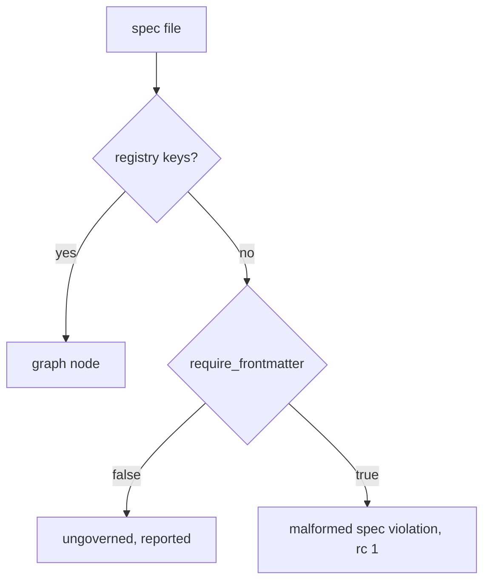

# arch check on a foreign repository's human specs

## Intent

`[arch].require_frontmatter` decides what a spec without the registry
keys is. False (a foreign repository): it is counted and listed as
`ungoverned`, never an error. True (repoach itself): it is a named
violation, rc 1. Never a traceback.

## Context

Measured 2026-10-20 on Yoob, whose `repoach.toml` sets
`[arch].require_frontmatter = false` and whose `docs/specs/` hold human
specs with a frontmatter of their own (`title`, `status`, …):

| # | Fact | Where |
|---|---|---|
| F1 | `repoach arch check --base origin/develop` → `MalformedFrontmatterError: 2026-10-18_editor-templates-show-declared-durations.md: missing frontmatter keys: […]` as a traceback, rc 1 | `arch/registry.py` `_parse_node` raises; `lint/edge_honesty.run` → `load_registry`; `cli/main.py` `arch_check` catches nothing |
| F2 | `[arch].require_frontmatter` is parsed and defaulted per host but read by nothing | `project/config.py` `ArchSection`, `with_host_defaults` |
| F3 | Reproduced on a scratch repository with one such spec: identical traceback whether the flag is true or false | `tests/unit/test_arch_foreign_frontmatter.py` fixture |

## Goals

- G1: `load_registry(…, tolerate_malformed=True)` collects malformed specs (and duplicate ids) in `Registry.malformed` and leaves them out of the graph; the default still raises, so `arch graph` and the spec loaders keep their contract.
- G2: `edge_honesty.run` reads `config.require_frontmatter` (the gates' `GatesConfig`, SP-UNIVERSAL-GATES): false → `Report.ungoverned_specs`, reported (`ungoverned: N spec(s) …` plus one line per file), the added-spec presence check off; true → `Report.malformed_specs`, each a `malformed spec: <file>: <reason>` violation, rc 1.
- G3: the effective `[arch].require_frontmatter` (host default included) comes from `load_gates_config`, which SP-UNIVERSAL-GATES added; `arch check` passes nothing of its own.

- G4: a spec with no frontmatter at all takes the same path: listed as ungoverned when the flag is false; when true, an added one reads `malformed spec: <path>: no frontmatter` (it read `ungoverned new spec: … has no frontmatter`; specs older than the template stay grandfathered).

## Non-Goals

- NG1: no parsing of foreign frontmatter shapes into the graph.
- NG2: `arch graph` / `arch show` keep raising on a malformed spec.

## Assumptions

- A1: a foreign repository's human specs own no code in repoach's sense; leaving them out of the graph loses no edge.

## Interface

- `MalformedSpec(path, reason)`; `Registry.malformed`; `Report.malformed_specs`, `Report.ungoverned_specs`.

## Behavior

### Nominal
Foreign repository, flag false → stderr `ungoverned: 1 spec(s) without registry frontmatter — not graphed ([arch].require_frontmatter = false)`, stdout `edge-honesty: ok`, rc 0.

### Edge cases
- Flag true → `malformed spec: <file>: missing frontmatter keys: [...] — complete the governed template block, or set [arch].require_frontmatter = false`, rc 1.

### Failure scenarios
- An invalid `repoach.toml` still ends rc 2 at bootstrap, before the check.

## Architecture Impact
- No new edge; the flag reaches `edge_honesty` through SP-UNIVERSAL-GATES's `load_gates_config` (SP-UNIVERSAL-PROJECT-CONFIG underneath).

## Diagram

## Acceptance Criteria
- [x] AC1: `pytest -q tests/unit/test_arch_foreign_frontmatter.py::test_registry_raises_by_default_and_collects_when_tolerant` → green.
- [x] AC2: `pytest -q tests/unit/test_arch_foreign_frontmatter.py::test_not_required_lists_the_spec_as_ungoverned` → green.
- [x] AC3: `pytest -q tests/unit/test_arch_foreign_frontmatter.py::test_required_names_the_violation` → green.
- [x] AC4: `pytest -q tests/unit/test_arch_foreign_frontmatter.py::test_arch_check_cli` → green: scratch repository, flag false → rc 0 with the `ungoverned:` line; flag true → rc 1 with the `malformed spec:` line; no traceback either way.
- [x] AC6: `pytest -q tests/unit/test_arch_foreign_frontmatter.py::test_not_required_lists_a_fenceless_spec_as_ungoverned tests/unit/test_arch_foreign_frontmatter.py::test_arch_check_cli_fenceless_spec` → green: a frontmatter-less spec is listed `ungoverned` (flag false, rc 0) and reads `malformed spec: docs/specs/<file>: no frontmatter` (flag true, rc 1). Found by independent verification 2026-10-20.
- [x] AC5: `repoach arch check --base origin/develop` in repoach's own checkout → `edge-honesty: ok`.
