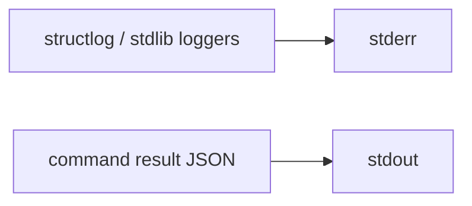

# A command's stdout is exactly one JSON document

## Intent

`repoach review pr … --dry-run | jq` must parse. Every log line goes
to stderr; stdout carries the command's result and nothing else.

## Context

Measured 2026-10-20 on Yoob: `review pr <N> --dry-run` printed a log
line on stdout before the JSON, and `jq` failed.

| # | Fact | Where |
|---|---|---|
| F1 | `configure_logging` calls `logging.basicConfig(stream=sys.stdout)`; structlog renders through the stdlib root handler | `src/repoach/core/logging.py` |
| F2 | structlog's unconfigured default (`PrintLoggerFactory()`) prints to stdout; a settings-free command, or a subcommand app invoked directly, never reaches `configure_logging` | structlog default; `cli/main.py` `SETTINGS_FREE_COMMANDS` |
| F3 | The CLI JSON tests patched `run_review` to a canned team, so no log was ever emitted and the defect stayed invisible | `tests/unit/test_review_ci_mode.py` |

## Goals

- G1: `configure_logging` binds the root handler to stderr.
- G2: importing `repoach.cli` sets structlog's logger factory to a print logger on stderr (resolved per logger), changing nothing else in the configuration.

## Non-Goals

- NG1: no change to log content, level or renderer; the gateway's loguru sinks are untouched.

## Assumptions

- A1: no consumer reads repoach logs from stdout (the systemd units capture both streams).

## Interface

- `repoach.core.logging.route_default_logs_to_stderr() -> None`.

## Behavior

### Nominal
`repoach review pr 42 --dry-run > out.json` → `python -m json.tool out.json` rc 0; the log lines are on stderr.

### Edge cases
- A settings-free command (`doctor`, `init`) logging before any configuration → stderr.

### Failure scenarios
- None.

## Architecture Impact
- No new edge. The end-to-end test reuses the unreachable-reviewer fixture of SP-REVIEW-TRANSPORT-ERROR-VERDICT and the orchestrator (SP-ORCH-DOCSTRING).

## Diagram

## Acceptance Criteria
- [x] AC1: `pytest -q tests/unit/test_cli_stdout_one_json.py::test_unconfigured_cli_logger_writes_stderr` → green: a fresh interpreter importing `repoach.cli`, logging, then printing JSON → `python -m json.tool` on stdout rc 0, the event on stderr. Before: `Extra data: line 1 column 5`.
- [x] AC2: `pytest -q tests/unit/test_cli_stdout_one_json.py::test_configured_logging_writes_stderr` → green, same check after `configure_logging()`.
- [x] AC3: `pytest -q tests/unit/test_cli_stdout_one_json.py::test_review_pr_dry_run_stdout_is_one_json` → green: the real orchestrator with four unreachable reviewers under `review pr 42 --dry-run` → stdout passes `python -m json.tool`. Before: thirteen log lines preceded the JSON.
