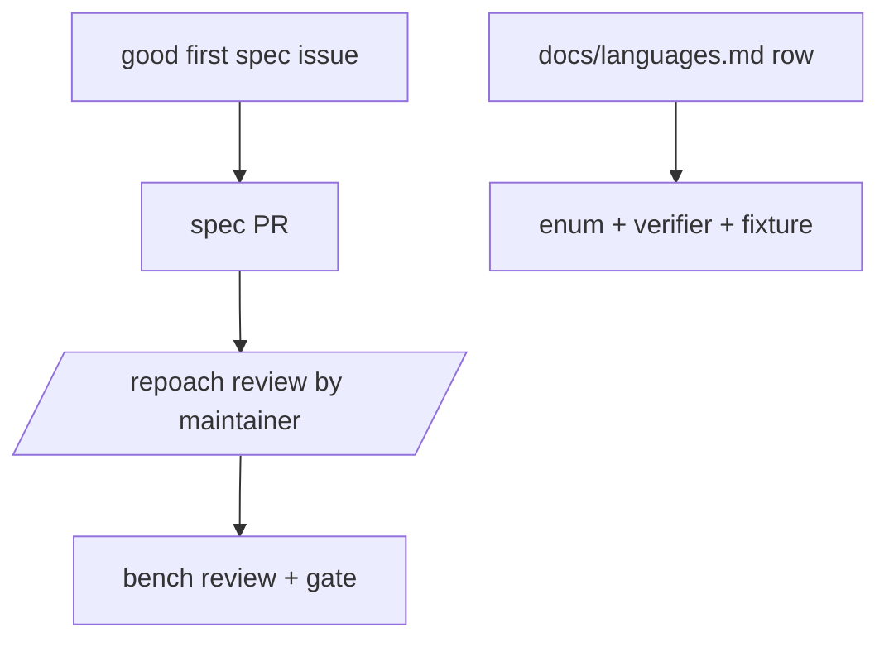

# CONTRIBUTING governed as a spec, and good first specs

## Intent

A newcomer contributes the way repoach itself is built: by writing or
taking a spec. The contributing guide is itself a governed spec, the
first issues are specs sized for one evening, and adding a language is
one table row and one verifier.

## Context

| # | Fact | Where |
|---|---|---|
| F1 | `CONTRIBUTING.md` (107 lines) explains the factory and asks outsiders to open issues first; a PR from outside the actor allowlist is run by hand by the maintainer | `CONTRIBUTING.md:1-30`; `README.md` Contributing |
| F2 | No `.github/ISSUE_TEMPLATE/` and no code of conduct exist | `ls .github`, `ls CODE_OF_CONDUCT*` on d6335de |
| F3 | Languages are an enum (`PYTHON`, `TYPESCRIPT`) with per-language verifiers | `src/repoach/gates/languages.py:24-25`, `src/repoach/gates/verifiers.py`, `src/repoach/gates/typescript.py` |
| F4 | 205 of 205 commits are by the owner | `git log --format=%an \| sort \| uniq -c` |

## Goals

- G1: `CONTRIBUTING.md` starts with the spec frontmatter (`id: SP-CONTRIBUTING`, `owns.code: [CONTRIBUTING.md, .github/ISSUE_TEMPLATE/, CODE_OF_CONDUCT.md]`), is listed by `repoach arch graph`, and every rule in it is either checked by a named gate (`lint_no_inline_comments.py`, `arch check`, the conventions gate) or marked `advisory`. A change to it goes through review like code.
- G2: the guide's first screen is a five-step path: install (`pipx install repoach`), run the tests (`pytest -q tests/unit`), pick a `good first spec` issue, write or update the spec, open the PR; with the measured time of the test run.
- G3: `.github/ISSUE_TEMPLATE/good-first-spec.yml`: fields `Intent`, `Goals`, `Acceptance criteria (commands)`, `Files likely touched`, `Estimated lines`; label `good first spec`; a maintainer keeps at least five open, each ≤ 150 lines of change and with a command-form AC.
- G4: language support: `docs/languages.md` is one table (`language | detected by | lint | test | verifier | status | maintainer`); adding a language is (a) one row, (b) one entry in the `Language` enum and its detector, (c) one verifier module with tests on a fixture repository. Go and Rust are the first two `good first spec` issues, each with its fixture repository named.
- G5: the weekly "first 10 users" ritual, in `docs/community.md`: every Monday the owner lists, in a pinned discussion, who installed or tried repoach that week (stars, issues, discussions, PyPI downloads, the demo's Codespaces opens), contacts each new user once, records what blocked them as an issue, and updates a counter `users with ≥ 1 review on their own repository: N / 10`. The ritual stops when the counter reaches 10.
- G6: `CODE_OF_CONDUCT.md`: Contributor Covenant 2.1 verbatim, with the enforcement contact address chosen in D1.
- G7: outside contributors' PRs: the README's "the maintainer runs it by hand" becomes a documented `/repoach review` comment the maintainer posts, which triggers the review from `main`'s workflow on the fork's head with no secret exposed to the fork's code (the `SP-CI-SECRETS-ISOLATION` rule).

## Non-Goals

- NG1: no Discord or Slack server in this spec; GitHub Discussions only.
- NG2: no contributor licence agreement unless `SP-OPEN-CORE-BOUNDARY` D1 requires one.

## Assumptions

- A1: `SP-PYPI-RELEASE` has shipped, so G2's first step works.
- A2: GitHub Discussions can be enabled on `repoachhq/repoach`.

## Interface

- `CONTRIBUTING.md` with spec frontmatter; `docs/languages.md`; `docs/community.md`; `.github/ISSUE_TEMPLATE/good-first-spec.yml`; `CODE_OF_CONDUCT.md`.

## Behavior

### Nominal
A newcomer reads the five steps, takes a `good first spec` issue, opens
a PR; the maintainer comments `/repoach review`; the bench reviews it.

### Edge cases
- A contributor proposes a language with no available linter → the row ships with `lint: none` and `status: experimental`.

### Failure scenarios
- `arch check` cannot parse the frontmatter at the top of `CONTRIBUTING.md` (it lives outside `docs/specs/`) → the spec is registered through a stub under `docs/specs/` that points to it, decided in Q1.

## Architecture Impact
- Adds dependency: SP-COMMUNITY-ONBOARDING -> SP-SPEC-TEMPLATE (the guide carries the frontmatter contract)
- Adds dependency: SP-COMMUNITY-ONBOARDING -> SP-UNIVERSAL-GATES (the language row maps to the gates' language enum and verifiers)
- New / changed coupling, cycles, or shared state: none.

## Diagram

## Acceptance Criteria
- [ ] AC1: `repoach arch graph | grep -c SP-CONTRIBUTING` → ≥ 1, and `repoach arch check --base origin/develop` → `edge-honesty: ok`.
- [ ] AC2: `head -30 CONTRIBUTING.md | grep -c '^[1-5]\. '` → 5 (the five steps), and the test step names a measured duration.
- [ ] AC3: `python -c "import yaml; d=yaml.safe_load(open('.github/ISSUE_TEMPLATE/good-first-spec.yml')); assert 'good first spec' in d['labels']"` → exit 0.
- [ ] AC4: `gh issue list --label 'good first spec' --state open --json number | python -c "import json,sys; assert len(json.load(sys.stdin)) >= 5"` → exit 0; two of them are titled `Language support: Go` and `Language support: Rust`.
- [ ] AC5: `grep -c 'Contributor Covenant' CODE_OF_CONDUCT.md` → ≥ 1 and the file names an enforcement contact.
- [ ] AC6: `grep -c '^| ' docs/languages.md` → 4 (header, separator, Python, TypeScript) before Go and Rust land.

## Owner decisions needed
- D1: the code-of-conduct enforcement contact (an address that is not the owner's personal one).
- D2: enable GitHub Discussions.
- D3: the time the owner commits to the weekly ritual (proposed: 1 hour every Monday).

## Gaps
- No user other than the owner and Yoob exists to measure G5 against.

## Open Questions
- Q1: can the arch registry read a spec outside `docs/specs/`? If not, `SP-CONTRIBUTING` lives as `docs/specs/<date>_SP-CONTRIBUTING_*.md` and `CONTRIBUTING.md` is rendered from it.
