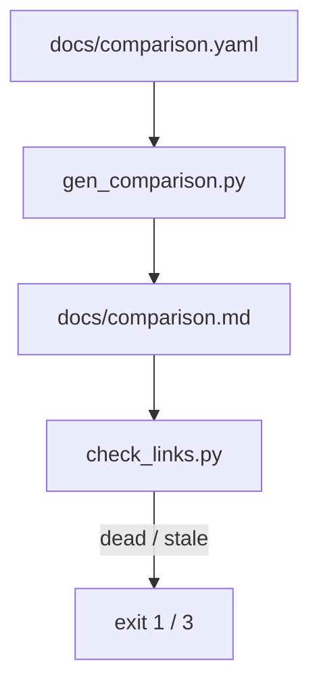

# A sourced comparison page with a link check

## Intent

The comparison a buyer makes is against code-review tools. repoach
publishes that comparison with every cell traceable to a page and a
date, so a reader can check it and a stale cell is visible instead of
silently wrong.

## Context

| # | Fact | Where |
|---|---|---|
| F1 | A market map of 18 players with loop, runs, forges, model policy, price and "does not" columns, read 2026-10-19; sources are named by domain and page, not by URL | `docs/plans/2026-10-19_positioning-and-market-map.md` §1, §9 |
| F2 | Some cells are `n/m` (not measured) and the category size is marked **unverified** | same, §1 |
| F3 | No link checker exists in `scripts/` | `ls scripts` on d6335de |

## Goals

- G1: `docs/comparison.yaml` is the source: one entry per product with `name`, `vendor_url`, and the cells `loop`, `forges`, `blocks_merge_on_evidence`, `reverifies_at_merge_head`, `spec_gates_plan`, `model_choice`, `price`, `self_host`; each cell is `{value, source_url, checked_on}` or `{value: "n/m"}`.
- G2: the rows: repoach, GitHub Copilot code review, Cursor Bugbot, CodeRabbit, Qodo PR-Agent, Greptile, Ellipsis, Sourcery, GitLab Duo Code Review. Autonomous developers (OpenHands, Devin, SWE-agent, Aider) are listed under "PR sources, not competitors" with one line each and no cells.
- G3: `scripts/gen_comparison.py` renders `docs/comparison.md` from the YAML: one table, a footnote per cell number linking its `source_url`, the oldest `checked_on` in the page title line, and a "How to dispute a cell" paragraph (open an issue with the URL). It exits 1 if any `source_url` answers ≥ 400 or does not resolve, 3 if any `checked_on` is older than `constraints.source_max_age_days`, 0 otherwise; `--offline` renders without checking.
- G4: `scripts/check_links.py <files>` (shared with `SP-README-PRODUCT-STATEMENT`) checks every Markdown link in the given files; `gen_comparison.py` calls it on its own output.
- G5: repoach's own row is sourced from this repository (a file path at a commit SHA), never from marketing text.
- G6: a weekly scheduled workflow runs `gen_comparison.py --check-only` and opens one issue listing the dead or stale cells; it never edits the page.

## Non-Goals

- NG1: no scraping of vendor pages: a human reads the page and types the value; the script only checks that the URL lives and the date is fresh.
- NG2: no score, ranking or "winner" column.

## Assumptions

- A1: vendor pricing pages answer a plain `GET` (some return 403 to non-browser agents: G3 retries once with a browser `User-Agent`, then reports `blocked`, exit 1, naming the URL).

## Interface

- `python scripts/gen_comparison.py [--offline] [--check-only]` → writes `docs/comparison.md`; exit 0 / 1 dead link / 3 stale / 2 YAML invalid.
- `python scripts/check_links.py FILE...` → exit 0, 1 dead links, 2 network unavailable (`cannot say`).

## Behavior

### Nominal
Edit the YAML after reading a page → run the script → commit the YAML
and the rendered page together.

### Edge cases
- A cell with `n/m` → rendered `n/m`, no footnote, not counted as stale.
- A product discontinued → moved to a "Retired" list with its last `checked_on`.

### Failure scenarios
- No network → exit 2, the page is not rewritten.

## Architecture Impact
- No edge: a docs page and two scripts; nothing in `src/repoach` imports them.
- New / changed coupling, cycles, or shared state: `SP-README-PRODUCT-STATEMENT` projects a subset of rows from this page.

## Diagram

## Acceptance Criteria
- [ ] AC1: `python scripts/gen_comparison.py && git diff --exit-code docs/comparison.md` → exit 0 (the committed page is the rendered page).
- [ ] AC2: `python scripts/gen_comparison.py --offline` with one `source_url` replaced by `https://example.invalid/x` → still renders; without `--offline` → exit 1 and the line `dead: https://example.invalid/x (comparison.yaml: CodeRabbit.price)`.
- [ ] AC3: a fixture YAML with `checked_on: 2020-01-01` → exit 3, `stale: 1 cell older than 90 days`.
- [ ] AC4: `grep -c '^| ' docs/comparison.md` → 11 (header, separator, nine rows), and `grep -ci 'openhands' docs/comparison.md` → ≥ 1 only under the "PR sources" heading.
- [ ] AC5: `pytest -q tests/unit/test_gen_comparison.py` → green, network mocked.

## Owner decisions needed
- D1: who re-reads the vendor pages every 90 days (owner, or a "good first spec" contributor task).
- D2: include Claude Code's own review feature and OpenAI Codex review as rows, or keep the list to tools sold primarily as reviewers.

## Gaps
- F1 records sources by domain only; every cell needs its exact URL re-read before the first render.

## Open Questions
- Q1: does a vendor's "contact sales" price render as `contact sales` (sourced) or `n/m`? Proposed: `contact sales`, sourced.
