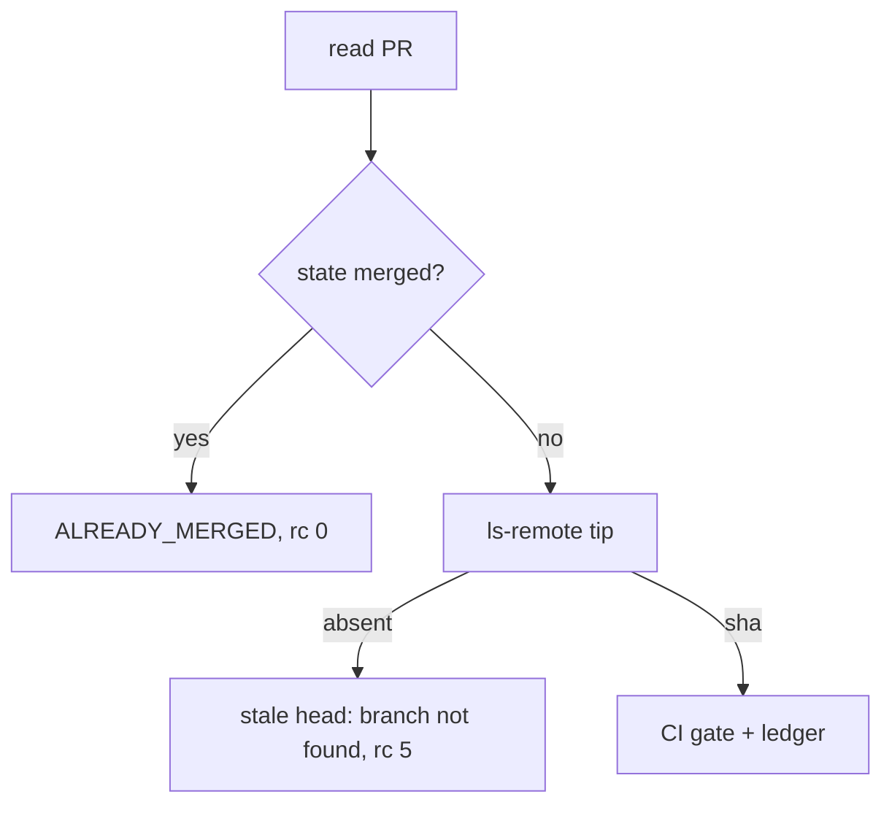

# The merge gate on a merged MR says ALREADY_MERGED

## Intent

`repoach review gate <N>` on a merged pull / merge request ends with
the fact — `ALREADY_MERGED`, rc 0, `merge=false` — instead of a refusal
with an empty reason. Every stale-head reason names its cause.

## Context

Measured 2026-10-20 on Yoob (GitLab): `repoach review gate <merged MR>`
ended rc 5 with `stale head: ls-remote failed:` — nothing after the
colon.

| # | Fact | Where |
|---|---|---|
| F1 | `evaluate_merge_gate` never reads the state; it goes straight to `resolve_verified_head` | `src/repoach/review/auto_merge.py` |
| F2 | The merged MR's source branch was deleted; `git ls-remote origin refs/heads/<b>` answers rc 0 with empty stdout | git behaviour |
| F3 | `resolve_verified_head` (and the duplicated `_ls_remote_tip`) folded "rc 0, empty" into the failure branch and printed `stderr or stdout`, both empty | `auto_merge.py` |
| F4 | `run_auto_merge` already maps `MERGED`/`CLOSED` to `ALREADY_MERGED` (rc 0); the read-only gate did not | `auto_merge.py` |

## Goals

- G1: the gate short-circuits on `state == "merged"`: `outcome = ALREADY_MERGED`, `merge = false`, reason `ALREADY_MERGED: #<N> is already merged into '<base>'`, rc 0, no `ls-remote`.
- G2: `_ls_remote_tip` is the only ls-remote parser; its reasons are `no head branch: …`, `branch '<b>' not found on origin (deleted, or never pushed)`, `ls-remote failed: <stderr>` or `ls-remote failed: exit <rc>, no output`.
- G3: the gate JSON carries `outcome` (the CI-gate outcome tag).

## Non-Goals

- NG1: a closed, unmerged MR stays a refusal (rc 5); nothing to celebrate there.
- NG2: no change to `run_auto_merge`'s state handling.

## Assumptions

- A1: both forges normalise a merged change request to `PullRequest.state == "merged"` (SP-UNIVERSAL-FORGE).

## Interface

- `repoach review gate <N>` JSON gains `"outcome": "<tag>"`; exit 0 also when `outcome == "ALREADY_MERGED"`.

## Behavior

### Nominal
Merged MR → `{"outcome": "ALREADY_MERGED", "merge": false, "reasons": ["ALREADY_MERGED: #283 is already merged into 'develop'"]}`, rc 0.

### Edge cases
- Open MR whose branch was deleted → rc 5, `stale head: branch 'feat/x' not found on origin (deleted, or never pushed)`.
- `ls-remote` fails silently → `stale head: ls-remote failed: exit 128, no output`.

### Failure scenarios
- The forge cannot read the MR → unchanged (`no head branch` reason, rc 5).

## Architecture Impact
- No new edge; the test drives the GitLab forge (SP-UNIVERSAL-FORGE) and parses the CLI's stdout (SP-CLI-STDOUT-ONE-JSON).

## Diagram

## Acceptance Criteria
- [x] AC1: `pytest -q tests/unit/test_gate_merged_mr.py::test_merged_mr_is_already_merged` → green: GitLab MR `state: merged`, ls-remote rc 0 empty → `ALREADY_MERGED`, `merge` False, the named reason, zero `git` spawns.
- [x] AC2: `pytest -q tests/unit/test_gate_merged_mr.py::test_open_mr_with_deleted_branch_names_the_reason` → green.
- [x] AC3: `pytest -q tests/unit/test_gate_merged_mr.py::test_silent_ls_remote_failure_names_its_exit_code` → green.
- [x] AC4: `pytest -q tests/unit/test_gate_merged_mr.py::test_gate_cli_exit_code` → green: merged → rc 0 `outcome: ALREADY_MERGED`; open with a deleted branch → rc 5 `outcome: SKIP_STALE_HEAD`; no reason ends with `": "`.
