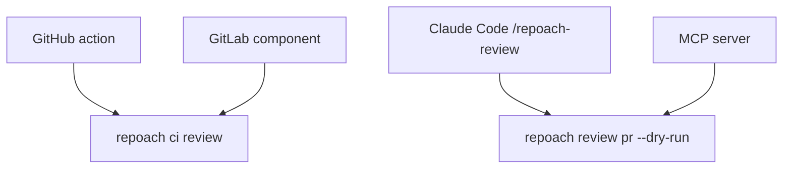

# Discovery channels

## Intent

People find a reviewer where they already configure their pipeline or
their agent. repoach is listed in four places — GitHub Marketplace (an
action), GitLab (a CI/CD component), Claude Code (a plugin with a
`/repoach-review` command) and the MCP registry — each a thin wrapper
over the same CLI.

## Context

| # | Fact | Where |
|---|---|---|
| F1 | `repoach init --ci github` writes `.github/workflows/repoach-review.yml`; `init --ci gitlab` writes `.repoach/ci/gitlab-review.yml`; both install a pinned repoach then run `repoach ci review` | `SP-UNIVERSAL-CI-ENTRY` G6–G7 |
| F2 | `ci review` is advisory by default and posts only on `REPOACH_ADVISORY_POST=1` | `SP-UNIVERSAL-CI-ENTRY` G8 |
| F3 | No action repository, CI/CD component, plugin or MCP server exists | `repoachhq` organisation on 2026-10-20 |

## Goals

- G1 (GitHub action): a public repository `repoachhq/repoach-review` with `action.yml` (composite): inputs `version` (default the latest release), `post` (default `false`), `strict` (default `false`), `anthropic-api-key`, `claude-code-oauth-token`, `gateway-url`, `gateway-token`; steps: `setup-python`, `pipx install repoach==<version>` with every secret unset, `repoach ci review [--post] [--strict]` with only the chosen provider secret. Its README shows the four-line usage. `repoach init --ci github --action` writes a workflow that `uses: repoachhq/repoach-review@<sha>` instead of the inline steps.
- G2 (GitHub Marketplace listing): requires a public repository with one `action.yml` at its root, a unique name, the owner accepting the Marketplace Developer Agreement, and 2FA; a free action needs no verified publisher. A paid GitHub App listing (a later step, for `repoach_team`) requires a verified publisher organisation, a privacy policy URL, a support URL and a pricing plan billed through GitHub.
- G3 (GitLab): a CI/CD component project `gitlab.com/repoachhq/repoach-review` with `templates/review.yml` (`spec: inputs:` version, post, strict, stage) published to the GitLab CI/CD Catalog on a semantic tag; `repoach init --ci gitlab --component` writes `include: - component: gitlab.com/repoachhq/repoach-review/review@<version>`. The GitLab partner or integration listing (a later step) requires a partner application, a privacy page and a support contact.
- G4 (Claude Code plugin): a plugin repository `repoachhq/repoach-claude-plugin` with a slash command `/repoach-review` that runs `repoach review pr --dry-run` on the current repository's PR (resolved from the branch), prints the verdict and the findings, and never posts; and a skill describing when to invoke it. Installable with `/plugin install` from a marketplace file in the same repository.
- G5 (MCP): `repoach mcp serve` exposes three read-only tools — `review_pr_dry_run(pr)`, `gate(pr)`, `digest(since)` — over stdio; a `server.json` is submitted to the MCP registry under the `io.github.repoachhq/repoach` namespace.
- G6 (billing path): every listing in this spec is free and installs the Apache-2.0 package; the paid tier is reached through `docs/pricing.md` (`SP-OPEN-CORE-BOUNDARY`) and, later, a GitHub Marketplace paid plan on a GitHub App. No listing collects a payment before D3 of that spec is decided.
- G7: `docs/privacy.md`: what each channel sends where (the forge, the configured provider, nothing else), required by the paid listings and linked from all four.

## Non-Goals

- NG1: no hosted GitHub App or GitLab app that runs reviews on repoach's infrastructure in this spec.
- NG2: no MCP tool that writes to a forge.

## Assumptions

- A1: `SP-PYPI-RELEASE` has published, so every wrapper installs from PyPI by version.
- A2: Claude Code's plugin format (a `.claude-plugin/plugin.json` manifest with commands and skills) is stable at implementation time; re-read its documentation then.

## Interface

- `uses: repoachhq/repoach-review@<sha>` with `with: { anthropic-api-key: ${{ secrets.ANTHROPIC_API_KEY }} }`.
- `include: - component: gitlab.com/repoachhq/repoach-review/review@0.1.0`.
- `/repoach-review` in Claude Code.
- `repoach mcp serve` (stdio).

## Behavior

### Nominal
Each wrapper resolves to `repoach ci review` or `repoach review pr
--dry-run` with the same exit contract; the version is pinned.

### Edge cases
- `/repoach-review` on a branch with no open PR → prints `no pull request for branch <b>` (exit 6 of the CLI), suggests `repoach review pr <n>`.

### Failure scenarios
- The action's secret is absent → the CLI's named skip (`skipped, ... is not set`) appears in the job log, the job is green unless `strict: true`.

## Architecture Impact
- Adds dependency: SP-MARKETPLACE-LISTINGS -> SP-PYPI-RELEASE (every wrapper pins a published version)
- Adds dependency: SP-MARKETPLACE-LISTINGS -> SP-UNIVERSAL-CI-ENTRY (the action and component wrap `ci review` and `init --ci`)
- Adds dependency: SP-MARKETPLACE-LISTINGS -> SP-OPEN-CORE-BOUNDARY (the billing path and the free/paid split of the listings)
- New / changed coupling, cycles, or shared state: three wrapper repositories outside this one; `repoach mcp serve` is a new CLI command in the free package.

## Diagram

## Acceptance Criteria
- [ ] AC1: in a test repository, a workflow with `uses: repoachhq/repoach-review@<sha>` and no secret → job green, log contains `skipped` naming the missing provider variable.
- [ ] AC2: `repoach init --ci github --action --print | grep -c 'uses: repoachhq/repoach-review@'` → 1.
- [ ] AC3: the GitLab Catalog page `gitlab.com/explore/catalog/repoachhq/repoach-review` lists version `0.1.0`; a test project including it → job `review:advisory` runs and ends `skipped` without secrets.
- [ ] AC4: in Claude Code, `/plugin install repoach@repoachhq` then `/repoach-review` in the demo repository → the verdict line and `mode: dry-run`; `gh pr view <n> --json comments` shows no new comment.
- [ ] AC5: `echo '{"jsonrpc":"2.0","id":1,"method":"tools/list"}' | repoach mcp serve` → a response listing exactly `review_pr_dry_run`, `gate`, `digest`.
- [ ] AC6: `python scripts/check_links.py docs/privacy.md` → exit 0; each listing's page links to it.

## Owner decisions needed
- D1 (owner task): accept the GitHub Marketplace Developer Agreement for `repoachhq`; later, request publisher verification (needs a domain and the company entity of `SP-OPEN-CORE-BOUNDARY` D2).
- D2 (owner task): create the `repoachhq` group on gitlab.com and the component project.
- D3: publish the Claude Code plugin in a repoach-owned marketplace file only, or also submit it to a community plugin directory.
- D4: whether `repoach mcp serve` ships in 0.1.x or waits for `digest` (`SP-PRECISION-MEASUREMENT`).

## Gaps
- Listing requirements (G2, G3) are stated from the platforms' documentation as known on 2026-10-20 and must be re-read on the submission day.

## Open Questions
- Q1: does the action default to `post: false` on the Marketplace (safer first contact) while the repository's own workflow posts? Proposed: yes.
