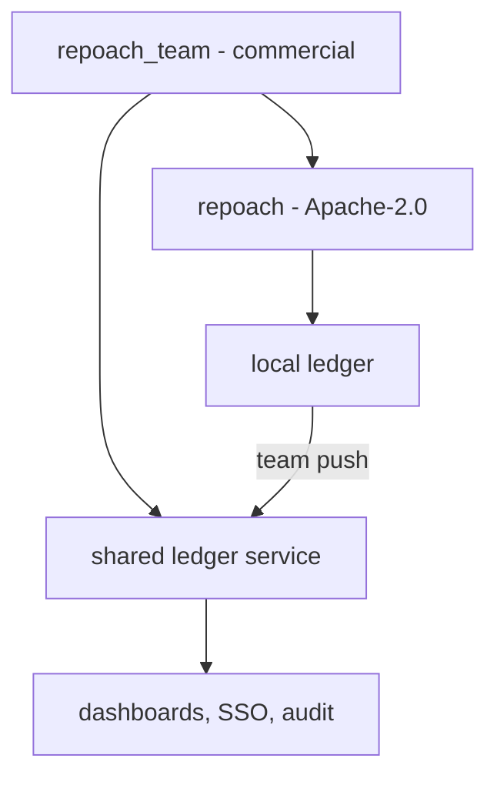

# The open-core boundary

## Intent

Everything one developer needs to review and gate their own repository
is free and open source. What a team needs to run repoach across many
repositories and people — a shared ledger, dashboards, SSO, audit — is
paid. The boundary is a package boundary, checked by a test, so it
cannot erode by accident.

## Context

| # | Fact | Where |
|---|---|---|
| F1 | The repository is MIT (`LICENSE`, `pyproject.toml` `license = "MIT"`); the README badge says MIT | `LICENSE:1`, `pyproject.toml:8` |
| F2 | Vendored code under MIT from a third party (`free-claude-code`, Ali Khokhar) lives in `llm_proxy/` and `llm/` | `licenses/free-claude-code-LICENSE`; `src/repoach/llm_proxy/__init__.py` |
| F3 | 205 of 205 commits are by the owner, so a relicence needs no other contributor's consent today | `git log` |
| F4 | Owner strategy accepted 2026-10-20: free = CLI, review, `init --ci`, direct providers; paid = shared ledger, multi-repo, SSO, audit, precision dashboard; 12–30 $/seat or 2 $/review BYOK; free under 50 reviews/month on public repositories; onboarding services 2–5 k€ | owner conversation |
| F5 | Market band: 0.25–5 $/review or 12–48 $/seat | `docs/plans/2026-10-19_positioning-and-market-map.md` §1, §4 |

## Goals

- G1 (free, Apache-2.0, package `repoach` in `src/repoach/`): the CLI, the review bench and refuter, the merge gate, the local ledger and `stats`/`usage`/`bench`/`digest` on the local SQLite file, `init`, `init --ci`, `ci review`, `doctor`, the forge adapters (GitHub, GitLab), every direct provider and the optional gateway, the spec registry and `arch check`, the Planner and Developer.
- G2 (paid, proprietary, package `repoach_team` in a separate private repository, published to a private index): the shared ledger service (one ledger for many repositories and users, HTTP API), the multi-repo dashboard, the precision dashboard over the shared ledger, SSO (SAML/OIDC), audit export (signed JSONL of every gate decision), spend caps per team.
- G3 (direction of imports): `repoach_team` imports `repoach`; `repoach` never imports `repoach_team`. The free package reaches a paid feature only through an entry point group `repoach.extensions`, discovered at runtime; with nothing installed the CLI behaves identically and lists no paid command.
- G4 (`repoach --license`): prints `repoach <version>: Apache-2.0`, the third-party notices (F2), and one line per installed extension (`repoach_team <version>: commercial, licence key <valid|absent|expired>`), then exits 0.
- G5 (pricing, published in `docs/pricing.md`): Free — all of G1, unlimited on a self-hosted install, and on the hosted shared ledger up to 50 reviews per month for public repositories. Team — 12–30 $ per seat per month (final figure D4) or 2 $ per review with the customer's own key, shared ledger and dashboards. Enterprise — SSO, audit export, self-hosted shared ledger, support. Onboarding services: 2–5 k€ per engagement.
- G6: `LICENSE` becomes Apache-2.0 with a `NOTICE` file; the MIT notice of F2 is kept in `licenses/`; `pyproject.toml` `license = "Apache-2.0"`; the README badge follows.

## Non-Goals

- NG1: no licence key check inside the free package, ever.
- NG2: no feature removed from the free package to create the paid tier: every G1 item exists today or is specified as free.
- NG3: no telemetry added to make the free tier countable; the 50-review limit applies only to the hosted shared ledger, which counts its own requests.

## Assumptions

- A1: F3 still holds when G6 lands; if an outside contribution has merged by then, its author's consent is needed (D1).
- A2: `SP-UNIVERSAL-LEDGER`'s local ledger schema is the shared ledger's ingest format, so the paid service adds storage and access control, not a new data model.

## Interface

- `[project.entry-points."repoach.extensions"]` in the paid package; `repoach.extensions.load() -> list[Extension]` in the free one.
- `repoach --license` (G4).
- `tests/unit/test_open_core_boundary.py`: walks `src/repoach/**/*.py` with `ast` and fails on any import of `repoach_team` or of a module listed in `PAID_MODULES`.

## Behavior

### Nominal
`pipx install repoach` → every G1 command; `pip install repoach-team`
from the private index with a licence key → extra commands
(`repoach team login`, `repoach team push`) appear.

### Edge cases
- An extension fails to import → one stderr line naming it, the free CLI continues.
- An expired key → paid commands exit 2 `licence expired on <date>`; free commands are unaffected.

### Failure scenarios
- The shared ledger is unreachable → `team push` queues locally and exits 2; reviews and gates never depend on it.

## Architecture Impact
- Adds dependency: SP-OPEN-CORE-BOUNDARY -> SP-UNIVERSAL-LEDGER (the local ledger is the shared ledger's ingest format)
- Adds dependency: SP-OPEN-CORE-BOUNDARY -> SP-USAGE-LEDGER (per-review billing reads usage rows)
- Adds dependency: SP-OPEN-CORE-BOUNDARY -> SP-PRECISION-MEASUREMENT (the precision dashboard is the paid view of `bench`/`digest`)
- New / changed coupling, cycles, or shared state: one entry point group; no import from free to paid.

## Diagram

## Acceptance Criteria
- [ ] AC1: `repoach --license` with no extension installed → first line `repoach 0.1.0: Apache-2.0` (version from the wheel), a `third-party:` section naming `free-claude-code (MIT)`, exit 0.
- [ ] AC2: `pytest -q tests/unit/test_open_core_boundary.py` → green; adding `import repoach_team` to any file under `src/repoach/` makes it fail naming the file and line.
- [ ] AC3: `grep -rn 'repoach_team' src/repoach/ | grep -v extensions` → no output.
- [ ] AC4: `head -1 LICENSE` → `Apache License`; `python -c "import tomllib; print(tomllib.load(open('pyproject.toml','rb'))['project']['license'])"` → `Apache-2.0`.
- [ ] AC5: `docs/pricing.md` lists the three tiers and the onboarding offer, with the free limit `50 reviews/month, public repositories, hosted shared ledger only`.

## Owner decisions needed
- D1: the free licence: Apache-2.0 (patent grant, as the strategy says) or keep MIT; and whether a CLA or DCO is required for outside contributions before the relicence.
- D2: the company entity that sells `repoach_team` and signs the onboarding contracts.
- D3: Stripe account (or another processor) for seat and per-review billing.
- D4: the seat price inside 12–30 $, and whether per-review billing (2 $ BYOK) and seats coexist or are alternatives.
- D5: the hosted shared ledger's region and data-retention policy.

## Gaps
- No shared ledger service exists; this spec only draws the boundary. The service is its own spec once D2 and D3 are decided.

## Open Questions
- Q1: is the precision dashboard paid while `bench report` (its CLI form) is free? Proposed: yes; the dashboard's value is the shared, multi-repo data, not the arithmetic.
