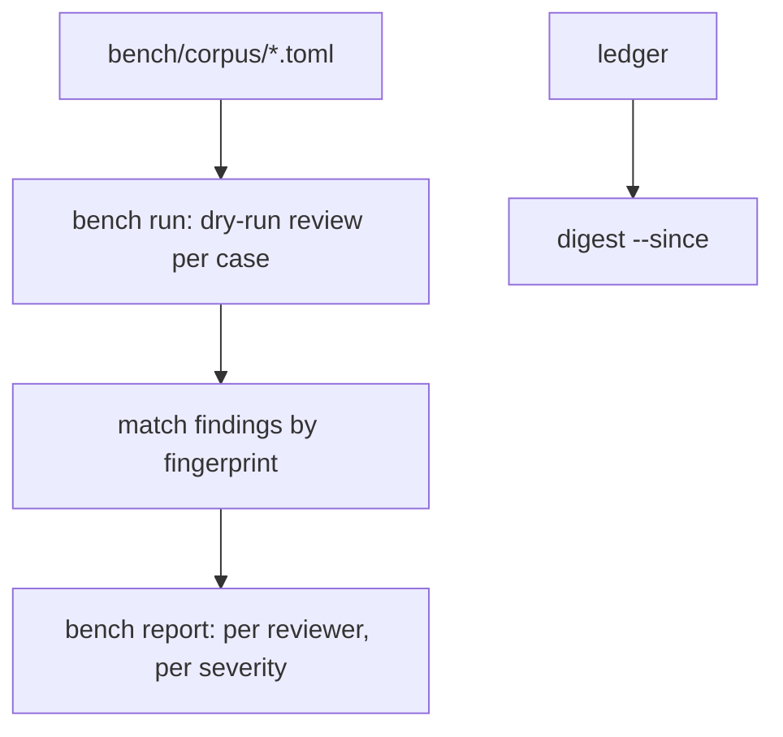

# Precision and recall of findings on a labelled corpus

## Intent

A reviewer is worth what its findings are worth. repoach publishes, with
its date and corpus size, the precision and recall of its findings on a
corpus anyone can re-run, and a weekly digest of what the gate refused —
the same data, read two ways.

## Context

| # | Fact | Where |
|---|---|---|
| F1 | `review insights` prints per-lens precision = verified ÷ (verified + refuted): repoach grading itself, no human ground truth | `SP-UNIVERSAL-LEDGER` L10; `src/repoach/cli/review_cmds.py` |
| F2 | `SP-UNIVERSAL-LEDGER` defines `finding_fate` (fixed / ignored / disputed read from the forge) and `repoach stats` with the four calibration cells refuter × human; it measures live use, not a fixed corpus | `docs/specs/2026-10-19_SP-UNIVERSAL-LEDGER_*.md` G1–G3 |
| F3 | The only measured Yoob run before 2026-10-20 (W1, !283): 12 findings, 9 proposed, 2 refuted, 1 verified | `SP-UNIVERSAL-LEDGER` L11 |
| F4 | The README states "No precision or false-positive rate has been measured yet" | `README.md` Status, Cost row |
| F5 | The market map names a published precision number as a table stake repoach is missing | `docs/plans/2026-10-19_positioning-and-market-map.md` §3 |

## Goals

- G1 (definitions): a *finding* is one `pr_findings` row; its *label* is one of `true`, `false`, `unsure`, set by a human in the corpus file. A finding is a **true positive** when its label is `true` and its final status is not `refuted`; a **false positive** when its label is `false` and its status is not `refuted`; a **correct refutation** when its label is `false` and the refuter refuted it; a **wrong refutation** when its label is `true` and it was refuted. A **planted defect** is *found* when at least one non-refuted finding's file and line range overlaps the defect's recorded range and its label is `true`. `unsure` is excluded from every ratio and counted on its own line.
- G2 (metrics): precision = TP ÷ (TP + FP) over posted (non-refuted) findings; recall = planted defects found ÷ planted defects; refuter precision = correct refutations ÷ refutations; each printed with its numerator and denominator, never a bare percentage, and `cannot say` when a denominator is 0.
- G3 (corpus): `bench/corpus/<name>.toml` lists cases; a case is a repository URL, a base and head SHA, the planted defects (`file`, `lines`, `kind`) if any, and the labelled findings (`fingerprint`, `label`, `labeller`, `labelled_on`). Three sources: the Yoob MRs reviewed so far (labels by the owner; the diff stays private, the corpus file carries only fingerprints and labels), planted-defect cases (one per defect kind, on the demo repository and on two public repositories), and the demo repository's PRs.
- G4 (`repoach bench`): `repoach bench run <corpus> [--provider P] [--reviewers R,...]` reviews each case at its head in dry-run, matches findings to labels by fingerprint, and writes `bench/results/<date>_<corpus>_<provider>.json`; `repoach bench report <result>` prints two tables — per reviewer (Architect, Sentinel, Tester, Scribe) and per severity (blocker, major, minor, nit) — with TP, FP, unsure, precision, refuter precision, and, for planted cases, recall; plus tokens and wall time per case. Unlabelled findings of a new run are listed for labelling (`bench label <result>` prompts one at a time) and excluded until labelled.
- G5 (publication): the README Status row "Precision" carries `precision P (TP/(TP+FP)), recall R (found/planted) on N labelled findings across C cases, corpus <name>@<sha>, measured <date>, provider <p>`; the number is regenerated by `repoach bench report --readme-line`, never typed by hand.
- G6 (`repoach digest`): `repoach digest --since DATE [--format md|json]` reads the ledger and prints "what the gate refused": refuted findings (reviewer, claim, refutation reason, PR link), refused LGTMs (PR, head SHA, the gate fact that failed), and merges that passed after a refusal, with counts at the top. It is the raw material of the launch articles and uses the same `finding_fate` and gate facts as G2.

## Non-Goals

- NG1: no claim of precision from live use without labels: `stats` (F2) stays the live view; `bench` is the published number.
- NG2: no automatic labelling by a model; the refuter's verdict is an input to G1, never the label.
- NG3: the private Yoob diffs are never published; only fingerprints, labels and aggregates are.

## Assumptions

- A1: a finding's fingerprint (file, normalised line window, claim hash) is stable across two runs of the same head closely enough to carry labels; G4 reports the match rate, and a rate under 70 % fails the run as `labels stale`.
- A2: `SP-UNIVERSAL-LEDGER` lands `finding_fate` and the gate facts G6 reads.

## Interface

```python
def run_bench(corpus: Corpus, provider: str, reviewers: list[str]) -> BenchResult: ...
def score(result: BenchResult) -> Scorecard: ...
def digest(db: Engine, since: date) -> Digest: ...
```

- `repoach bench run|report|label`, `repoach digest --since`.
- Exit codes: 0 done; 2 corpus or provider unavailable; 4 `labels stale` (A1).

## Behavior

### Nominal
`bench run` over the corpus, `bench label` on the new findings,
`bench report` prints the tables and the README line.

### Edge cases
- A case whose head SHA no longer exists on its forge → skipped, named, counted in `cases skipped`.
- Two findings match the same planted defect → the defect counts once found; both findings are scored on their labels.

### Failure scenarios
- The provider fails mid-corpus → the result file keeps finished cases with `partial: true`; `report` prints `partial` in its header and refuses `--readme-line`.

## Architecture Impact
- Adds dependency: SP-PRECISION-MEASUREMENT -> SP-UNIVERSAL-LEDGER (`finding_fate`, `review_runs` and the gate facts are read)
- Adds dependency: SP-PRECISION-MEASUREMENT -> SP-REFUTER (refuted status is a scored outcome)
- Adds dependency: SP-PRECISION-MEASUREMENT -> SP-PUBLIC-DEMO-REPO (the demo PRs and planted defects are corpus cases)
- New / changed coupling, cycles, or shared state: `bench/` files; read-only on the ledger.

## Diagram


## Acceptance Criteria
- [ ] AC1: `repoach bench run bench/corpus/demo.toml --provider claude_code` → exit 0, writes `bench/results/<date>_demo_claude_code.json`; `repoach bench report <that file>` prints a table whose header is `reviewer | TP | FP | unsure | precision | refuter precision | recall` and a second table keyed by severity.
- [ ] AC2: `pytest -q tests/unit/test_bench_score.py` → green: a fixture with 3 TP, 1 FP, 1 correct refutation, 1 wrong refutation, 1 unsure and 2 planted defects of which 1 is found prints `precision 3/4`, `refuter precision 1/2`, `recall 1/2`, `unsure 1`.
- [ ] AC3: `repoach bench report <result> --readme-line` → one line matching `precision [0-9.]+ \([0-9]+/[0-9]+\), recall [0-9.]+ \([0-9]+/[0-9]+\) on [0-9]+ labelled findings across [0-9]+ cases, corpus .+@[0-9a-f]{7,}, measured 20[0-9-]{8}, provider .+`; the same line is in `README.md`.
- [ ] AC4: `repoach digest --since 2026-10-13 --format json | python -m json.tool` → exit 0 with keys `refuted_findings`, `refused_lgtms`, `passed_after_refusal`, `counts`; each item carries `pr_url`.
- [ ] AC5: the published corpus has ≥ 100 labelled findings (`constraints.corpus_min_labelled_findings`); `bench report` refuses `--readme-line` below that, exit 2 `corpus too small: N < 100`.

## Owner decisions needed
- D1: label the Yoob findings (owner time: about one minute per finding).
- D2: which two public repositories host planted-defect cases (permission is not needed for a fork, but the cases must be on forks the owner controls).
- D3: publish the per-reviewer table, or only the aggregate line.

## Gaps
- No finding has a human label today; the first number needs D1.
- The fingerprint stability of A1 is unmeasured.

## Open Questions
- Q1: recall on real (non-planted) defects needs defects found after merge; out of scope until `finding_fate` has a few months of data.
