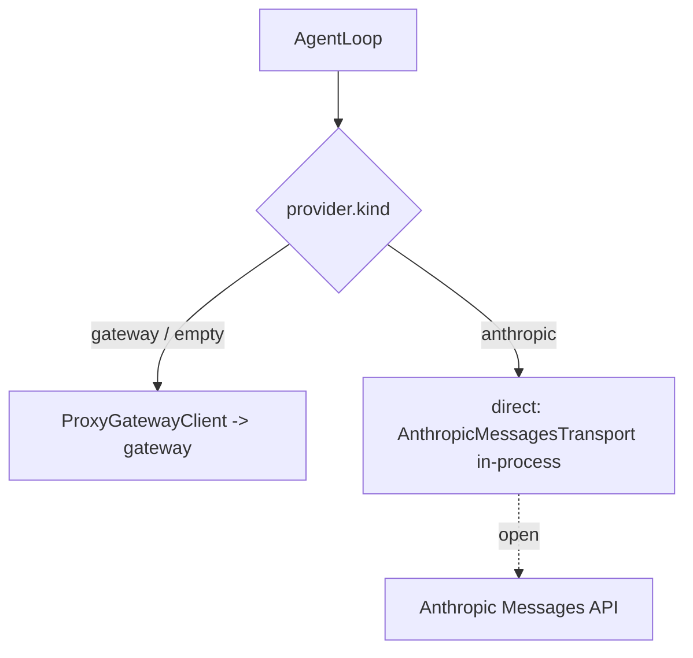

# Route REPOACH_PROVIDER=anthropic without the gateway

## Intent

On a foreign repository a CI job with `REPOACH_PROVIDER=anthropic` and
`ANTHROPIC_API_KEY` reaches a model without booting the gateway. Until
that ships, `repoach doctor` says the provider is not routed and which
route is live, instead of implying the key is enough.

**Status `open`.** Shipped in this change: the `doctor` line (G4).
Not shipped: the direct path (G1–G3), measured above the ~300-line
budget set for a fix branch — see Context F6. Tracked in
`docs/tech_debt.md` row 30.

## Context

Measured 2026-10-20 plugging repoach into Yoob (GitLab, no gateway):

| # | Fact | Where |
|---|---|---|
| F1 | `REPOACH_PROVIDER` is read into `[provider].kind` (values `anthropic`, `claude_code`, `openai`, `openai_compatible`, `gateway`) and printed by `config`; no code routes on it | `project/resolve.py` env map `"provider.kind": ("REPOACH_PROVIDER",)`; `project/config.py` `ProviderKind` |
| F2 | Every model call goes through `ProxyGatewayClient` at `require_llm_proxy_base_url(settings)` with `REPOACH_ANTHROPIC_AUTH_TOKEN`; no in-process alternative | `agent_engine/agent_loop.py` constructor, `agent_engine/adapters.py` |
| F3 | The gateway's `anthropic` upstream is `AnthropicMessagesTransport` (async httpx SSE stream, `x-api-key` + `anthropic-version`), built from the `anthropic` descriptor (`credential_env="ANTHROPIC_API_KEY"`) | `llm_proxy/providers/anthropic_messages.py`, `providers/registry.py` `_build_generic_anthropic`, `providers/catalog.py` |
| F4 | `repoach/v1` ↔ Messages translation exists only inside the gateway, as private helpers of the dispatcher: `_translate_request`, `_aggregate_sse_stream`, `_translate_content_blocks`, stop-reason map | `llm_proxy/api/agent_dispatcher.py` |
| F5 | SP-UNIVERSAL-INSTALL plans `pip install repoach[gateway]` as an optional extra; SP-UNIVERSAL-PROVIDERS (draft) designs the general `Provider` protocol whose `AnthropicProvider` this spec is one slice of | those specs |
| F6 | Size of the direct path, counted against the code it must touch: a sync client with `ProxyGatewayClient.call`'s signature (translate, run the transport under `asyncio.run`, aggregate, map SSE error events to `GatewayTransportError` / `GatewayError`) ≈ 150 lines; tier → model id (`[provider].opus/sonnet/haiku`, defaults) ≈ 25; `ThinkingConfig` pass-through without the gateway's effort map ≈ 30; `AgentLoop` selection on `[provider].kind` ≈ 30; settings for the key ≈ 15; a transport-injection seam for a truthful `httpx.MockTransport` test ≈ 10; tests ≈ 150. ≈ 260 lines of code plus ≈ 150 of tests | this spec |

## Goals

- G1: `[provider].kind = "anthropic"` (or `REPOACH_PROVIDER=anthropic`) with `ANTHROPIC_API_KEY` in the environment or `~/.config/repoach/env` → the agent loop calls the Anthropic Messages API in-process through the gateway's own `AnthropicMessagesTransport` and translation helpers (made public in `llm_proxy/api/agent_dispatcher.py`), no proxy, no `REPOACH_LLM_PROXY_BASE_URL`, no `REPOACH_ANTHROPIC_AUTH_TOKEN`.
- G2: tier → model id from `[provider].opus/sonnet/haiku`, else the SP-UNIVERSAL-PROVIDERS G3 defaults.
- G3: transport failures surface as `GatewayTransportError` (retried by the reviewer backoff, then `ERROR` per SP-REVIEW-TRANSPORT-ERROR-VERDICT); a 401 is `GatewayError` naming `ANTHROPIC_API_KEY`, never its value.
- G4 (shipped): `doctor` prints `provider=<kind> (<source>; not routed)` and `provider_route=gateway (<url>)` or `provider_route=none`; with no gateway URL it fails rc 2 with `provider <kind>: not routed, set REPOACH_LLM_PROXY_BASE_URL`. Once G1 ships, `provider_route=anthropic (direct)`.

## Non-Goals

- NG1: no failover, no chain, no breaker on the direct path (SP-UNIVERSAL-PROVIDERS NG1).
- NG2: `claude_code`, `openai`, `openai_compatible` direct paths — SP-UNIVERSAL-PROVIDERS.
- NG3: the usage ledger (SP-UNIVERSAL-PROVIDERS G5).

## Assumptions

- A1: the transport and translation helpers stay in the base install; `repoach[gateway]` may gate only the server (fastapi, uvicorn).

## Interface

- `[provider].kind = "anthropic"` / `REPOACH_PROVIDER=anthropic`; credential `ANTHROPIC_API_KEY`.
- `doctor`: `provider=…`, `provider_route=…` lines.

## Behavior

### Nominal
`REPOACH_PROVIDER=anthropic ANTHROPIC_API_KEY=… repoach review pr N --dry-run`, no gateway → four reviews from the API (G1, open).

### Edge cases
- Key missing → rc 2 before any call, naming `ANTHROPIC_API_KEY` (open).
- Both a gateway URL and `kind = anthropic` → today: the gateway is used and `doctor` says so; after G1: the direct path.

### Failure scenarios
- API unreachable → each reviewer `ERROR`, team `ERROR`, rc 3 (already true through the gateway path).

## Architecture Impact
- Adds dependency (when G1 lands): `agent_engine` → `llm_proxy.providers.anthropic_messages` (SP-PROVIDER-INIT-DEDUP) and the dispatcher's translation (SP-AGENT-THINKING-CONTROL).
- Today: `cli/doctor_cmds.py` reads the resolved `[provider].kind` (SP-UNIVERSAL-PROJECT-CONFIG).

## Diagram

## Acceptance Criteria
- [x] AC1: `pytest -q tests/unit/test_doctor_provider_route.py::test_anthropic_without_gateway_is_not_routed` → green: `REPOACH_PROVIDER=anthropic`, no gateway URL → stdout `provider=anthropic (env; not routed)`, `provider_route=none`; stderr `provider anthropic: not routed, set REPOACH_LLM_PROXY_BASE_URL`; rc 2.
- [x] AC2: `pytest -q tests/unit/test_doctor_provider_route.py::test_anthropic_with_gateway_names_the_live_route` → green: `provider_route=gateway (<url>)`.
- [x] AC3: `pytest -q tests/unit/test_doctor_provider_route.py::test_gateway_kind_is_unchanged` → green.
- [ ] AC4: `REPOACH_PROVIDER=anthropic ANTHROPIC_API_KEY=$KEY repoach review pr <n> --dry-run` with no gateway process → rc 0 or 2, `len(reviews) == 4`, no `ERROR`.
- [ ] AC5: `pytest -q tests/unit/test_provider_direct_anthropic.py` → green with an `httpx.MockTransport` answering the Messages SSE stream: one `AgentResponse` per call; a 401 → `GatewayError` naming `ANTHROPIC_API_KEY`; a connect error → `GatewayTransportError`.
- [ ] AC6: `repoach doctor` with `kind = anthropic` and the key → `provider_route=anthropic (direct)`, rc 0.

## Open Questions
- Q1: credential name — `ANTHROPIC_API_KEY` (the gateway descriptor, this request) or `REPOACH_ANTHROPIC_API_KEY` (SP-UNIVERSAL-PROVIDERS G2). Proposed: read both, `REPOACH_` first, and update SP-UNIVERSAL-PROVIDERS.
- Q2: ship G1 as this slice, or only as SP-UNIVERSAL-PROVIDERS's `AnthropicProvider` behind the `Provider` protocol — building it twice is the risk.
