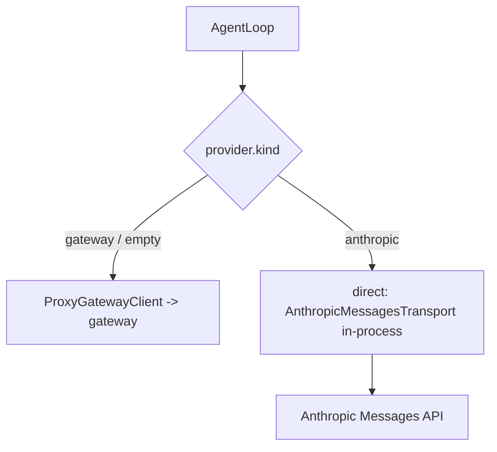

# Route REPOACH_PROVIDER=anthropic without the gateway

## Intent

On a foreign repository a CI job with `REPOACH_PROVIDER=anthropic` and
`REPOACH_ANTHROPIC_API_KEY`, else `ANTHROPIC_API_KEY` reaches a model without booting the gateway. Until
that ships, `repoach doctor` says the provider is not routed and which
route is live, instead of implying the key is enough.

**Status `delivered` (0.3, 2026-10-20).** The direct path (G1–G3)
landed once, as SP-UNIVERSAL-PROVIDERS slice 1: `[provider].kind =
"anthropic"` builds a `DirectProvider` (`src/repoach/providers/`) over
the gateway's own `AnthropicMessagesTransport` and the dispatcher's
translation, made public (`translate_request`, `aggregate_sse_stream`,
`translate_content_blocks`, `ANTHROPIC_TO_AGENT_STOP`). `doctor` prints
`provider_route=direct (anthropic)` (G4 final wording). AC5 and AC6 are
green; AC4 needs a real key and was not run on the measuring machine
(`docs/tech_debt.md`). `docs/tech_debt.md` row 34 is removed.

Found while delivering: the gateway's `anthropic` descriptor posted to
`https://api.anthropic.com/messages`, which answers 404 (measured
2026-10-20: `/messages` 404, `/v1/messages` 401 without a key), so the
`ci review` loopback gateway could never have reached the API either.
`ANTHROPIC_DEFAULT_BASE` now carries `/v1`.

## Context

Measured 2026-10-20 plugging repoach into Yoob (GitLab, no gateway):

| # | Fact | Where |
|---|---|---|
| F1 | `REPOACH_PROVIDER` is read into `[provider].kind` (values `anthropic`, `claude_code`, `openai`, `openai_compatible`, `gateway`) and printed by `config`; no code routes on it | `project/resolve.py` env map `"provider.kind": ("REPOACH_PROVIDER",)`; `project/config.py` `ProviderKind` |
| F2 | Every model call goes through `ProxyGatewayClient` at `require_llm_proxy_base_url(settings)` with `REPOACH_ANTHROPIC_AUTH_TOKEN`; no in-process alternative | `agent_engine/agent_loop.py` constructor, `agent_engine/adapters.py` |
| F3 | The gateway's `anthropic` upstream is `AnthropicMessagesTransport` (async httpx SSE stream, `x-api-key` + `anthropic-version`), built from the `anthropic` descriptor (`credential_env="ANTHROPIC_API_KEY"`) | `llm_proxy/providers/anthropic_messages.py`, `providers/registry.py` `_build_generic_anthropic`, `providers/catalog.py` |
| F4 | `repoach/v1` ↔ Messages translation exists only inside the gateway, as private helpers of the dispatcher: `_translate_request`, `_aggregate_sse_stream`, `_translate_content_blocks`, stop-reason map | `llm_proxy/api/agent_dispatcher.py` |
| F5 | SP-UNIVERSAL-INSTALL plans `pip install repoach[gateway]` as an optional extra; SP-UNIVERSAL-PROVIDERS (draft) designs the general `Provider` protocol whose `AnthropicProvider` this spec is one slice of | those specs |
| F6 | Size of the direct path, counted against the code it must touch: a sync client with `ProxyGatewayClient.call`'s signature (translate, run the transport under `asyncio.run`, aggregate, map SSE error events to `GatewayTransportError` / `GatewayError`) ≈ 150 lines; tier → model id (`[provider].opus/sonnet/haiku`, defaults) ≈ 25; `ThinkingConfig` pass-through without the gateway's effort map ≈ 30; `AgentLoop` selection on `[provider].kind` ≈ 30; settings for the key ≈ 15; a transport-injection seam for a truthful `httpx.MockTransport` test ≈ 10; tests ≈ 150. ≈ 260 lines of code plus ≈ 150 of tests | this spec |

## Goals

- G1 (delivered): `[provider].kind = "anthropic"` (or `REPOACH_PROVIDER=anthropic`) with `REPOACH_ANTHROPIC_API_KEY`, else `ANTHROPIC_API_KEY` in the environment or `~/.config/repoach/env` → the agent loop calls the Anthropic Messages API in-process through the gateway's own `AnthropicMessagesTransport` and translation helpers (made public in `llm_proxy/api/agent_dispatcher.py`), no proxy, no `REPOACH_LLM_PROXY_BASE_URL`, no `REPOACH_ANTHROPIC_AUTH_TOKEN`.
- G2 (delivered): tier → model id from `[provider].opus/sonnet/haiku`, else the SP-UNIVERSAL-PROVIDERS G3 defaults.
- G3 (delivered): transport failures surface as `GatewayTransportError` (retried by the reviewer backoff, then `ERROR` per SP-REVIEW-TRANSPORT-ERROR-VERDICT); a 401 is `GatewayError` naming the variable that supplied the key, never its value.
- G4 (shipped): `doctor` prints `provider=<kind> (<source>; not routed)` and `provider_route=gateway (<url>)` or `provider_route=none`, and for `anthropic` `provider_credential=<NAME> (present)` (first of `REPOACH_ANTHROPIC_API_KEY`, `ANTHROPIC_API_KEY`) or `provider_credential=none (reads REPOACH_ANTHROPIC_API_KEY, then ANTHROPIC_API_KEY)`; with no gateway URL it fails rc 2 with `provider <kind>: not routed, set REPOACH_LLM_PROXY_BASE_URL`. Since G1 shipped: `provider=anthropic (<source>)`, `provider_route=direct (anthropic)`, and a missing key is a doctor problem (rc 2) naming both variables.

## Non-Goals

- NG1: no failover, no chain, no breaker on the direct path (SP-UNIVERSAL-PROVIDERS NG1).
- NG2: `claude_code`, `openai`, `openai_compatible` direct paths — SP-UNIVERSAL-PROVIDERS.
- NG3: the usage ledger (SP-UNIVERSAL-PROVIDERS G5).

## Assumptions

- A1: the transport and translation helpers stay in the base install; `repoach[gateway]` may gate only the server (fastapi, uvicorn).

## Interface

- `[provider].kind = "anthropic"` / `REPOACH_PROVIDER=anthropic`; credential `REPOACH_ANTHROPIC_API_KEY`, else `ANTHROPIC_API_KEY` (first set wins).
- `doctor`: `provider=…`, `provider_route=…` lines.

## Behavior

### Nominal
`REPOACH_PROVIDER=anthropic ANTHROPIC_API_KEY=… repoach review pr N --dry-run`, no gateway → four reviews from the API (G1).

### Edge cases
- Key missing → rc 2 before any forge call, naming both variables.
- Both variables set → `REPOACH_ANTHROPIC_API_KEY` wins; `doctor` names it.
- Both a gateway URL and `kind = anthropic` → the direct path; the explicit kind wins.

### Failure scenarios
- API unreachable → each reviewer `ERROR`, team `ERROR`, rc 3 (already true through the gateway path).

## Architecture Impact
- Adds dependency (when G1 lands): `agent_engine` → `llm_proxy.providers.anthropic_messages` (SP-PROVIDER-INIT-DEDUP) and the dispatcher's translation (SP-AGENT-THINKING-CONTROL).
- Today: `cli/doctor_cmds.py` reads the resolved `[provider].kind` (SP-UNIVERSAL-PROJECT-CONFIG).

## Diagram

## Acceptance Criteria
- [x] AC1 (superseded 0.3 by AC6): `pytest -q tests/unit/test_doctor_provider_route.py::test_anthropic_without_a_key_is_a_named_problem` → green: no key → `provider_route=direct (anthropic)`, stderr `provider anthropic: no API key`, rc 2; the not-routed wording now belongs to `openai` / `openai_compatible` (`test_unrouted_kind_without_gateway`).
- [x] AC2 (superseded 0.3): `pytest -q tests/unit/test_doctor_provider_route.py::test_unrouted_kind_with_gateway_names_the_live_route` → green: `provider_route=gateway (<url>)` for an unrouted kind.
- [x] AC3: `pytest -q tests/unit/test_doctor_provider_route.py::test_gateway_kind` → green.
- [x] AC3b: `pytest -q tests/unit/test_doctor_provider_route.py::test_anthropic_credential_order_never_prints_the_value` → green: both set → `REPOACH_ANTHROPIC_API_KEY (present)`; only the second → `ANTHROPIC_API_KEY (present)`; none → the `reads …` line; no value in the output.
- [ ] AC4: `REPOACH_PROVIDER=anthropic ANTHROPIC_API_KEY=$KEY repoach review pr <n> --dry-run` with no gateway process → rc 0 or 2, `len(reviews) == 4`, no `ERROR`. Not run: no Anthropic key on the measuring machine (`docs/tech_debt.md`); the same path end to end is pinned against a loopback HTTP server by AC5, and the `claude_code` sibling was measured live (SP-UNIVERSAL-PROVIDERS AC3b).
- [x] AC5: `pytest -q tests/unit/test_provider_direct_anthropic.py` → green (a real loopback HTTP server, not `httpx.MockTransport`: the transport builds its own client) with an `httpx.MockTransport` answering the Messages SSE stream: one `AgentResponse` per call; a 401 → `GatewayError` naming the variable; a connect error → `GatewayTransportError`.
- [x] AC6: `pytest -q tests/unit/test_doctor_provider_route.py::test_anthropic_with_its_key_is_direct_even_beside_a_gateway` → green: `provider_route=direct (anthropic)`, no provider problem (wording follows SP-UNIVERSAL-PROVIDERS: `direct (<kind>)`).

## Open Questions
- Q1 (decided 2026-10-20): read `REPOACH_ANTHROPIC_API_KEY` first, then `ANTHROPIC_API_KEY`. SP-UNIVERSAL-PROVIDERS G2 names only the first and must adopt the fallback when it implements `AnthropicProvider`.
- Q2 (decided 2026-10-20): the direct path ships once, as SP-UNIVERSAL-PROVIDERS's `AnthropicProvider`; this spec carries no implementation of its own.
