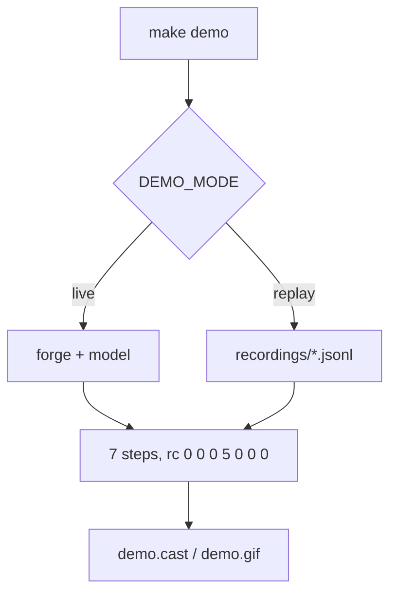

# A public demo repository and a 90-second walkthrough

## Intent

Show, on a repository anyone can clone, the one thing only repoach does:
a reviewer finds a planted defect, the gate refuses an LGTM that has no
evidence, and the fix makes the gate pass. The same script records the
video, runs in CI, and opens in a browser playground.

## Context

| # | Fact | Where |
|---|---|---|
| F1 | Every recorded repoach run so far is on repoach itself (GitHub, Python) or on Yoob (private GitLab project); none is public on a foreign repository | `README.md` Status; owner conversation 2026-10-20 |
| F2 | `repoach init`, `init --ci github`, `ci review`, `review pr`, `review gate` exist on `develop` d6335de | `repoach --help`, `repoach review --help` |
| F3 | A `claude_code` review took 69–103 s on Yoob; a 90-second walkthrough cannot wait on a live review | owner conversation 2026-10-20 |
| F4 | `SP-UNIVERSAL-GATES` ships verifiers for Python and TypeScript only | `src/repoach/gates/languages.py:24-25` |

## Goals

- G1: a public repository `repoachhq/repoach-demo` (GitHub), with a mirror `gitlab.com/repoachhq/repoach-demo`: a small Python package and a small TypeScript module (≤ 400 lines together), each with tests, a `repoach.toml` written by `repoach init`, the job written by `repoach init --ci github` / `--ci gitlab`, and one governed spec in `docs/specs/`.
- G2: `make demo` runs the walkthrough end to end against the forge: (1) `repoach init` on a clean clone (already-initialised files report `unchanged`), (2) open a PR from branch `demo/planted-defect-<ts>` carrying one planted defect from `demo/defects/` (an off-by-one in the Python package and an unchecked `null` in the TypeScript module, each with a test that would catch it but is not run by the PR), (3) the advisory job reviews it, (4) `repoach review gate <n>` on a head where a reviewer said `APPROVE` while a blocking finding is still `proposed` → refused, exit 5, the reason printed, (5) a second commit fixes the defect, (6) review and gate again → `APPROVE`, exit 0, (7) the PR is closed and the branch deleted.
- G3: `make demo DEMO_MODE=replay` plays the same seven steps from a recorded run (`demo/recordings/<date>.jsonl`: every command, its stdout, stderr and exit code) with no forge and no model, in ≤ 90 s, for the video and for CI; `DEMO_MODE=live` (default for the owner) calls the forge and the model.
- G4: `make demo-record` produces `demo/demo.cast` (asciinema v2) from a replay and `demo/demo.gif` from the cast (`agg`); the README of repoach embeds the gif and links the cast.
- G5: one-click playground: a `.devcontainer/devcontainer.json` (GitHub Codespaces) and `.gitpod.yml` that install the released wheel with `pipx install repoach==<pinned>`, open `PLAYGROUND.md`, and run `make demo DEMO_MODE=replay` in the first terminal; a pinned PR `#1 planted defect (already reviewed)` stays open on the demo repository with its review and the gate's refusal visible, so the first contact needs no key.
- G6: the repoach CI runs `make demo DEMO_MODE=replay` from a clean clone of the demo repository on every release tag.

## Non-Goals

- NG1: no Coder or Developer step in the walkthrough: the demo shows the gate and the reviewer only.
- NG2: no hosted repoach service behind the playground; the playground runs the replay locally in the container and, with the user's own key or Claude Code login, a live run.
- NG3: no Verilog or other language beyond F4.

## Assumptions

- A1: `SP-PYPI-RELEASE` has published a version the devcontainer can pin.
- A2: the owner's GitHub organisation can host a second public repository and a Codespaces prebuild.
- A3: a recording made on one repoach version replays on the next; a recording is re-made when its commands' JSON keys change (AC3 detects it).

## Interface

- `make demo [DEMO_MODE=live|replay] [FORGE=github|gitlab]` → exit 0 when the seven steps produced the expected exit codes `0, 0, 0, 5, 0, 0, 0`.
- `make demo-record` → `demo/demo.cast`, `demo/demo.gif`.
- `demo/recordings/<date>.jsonl`: one object per step `{step, argv, rc, stdout, stderr, elapsed_s}`.

## Behavior

### Nominal
Live: about 4–6 minutes dominated by two reviews (F3). Replay: ≤ 90 s,
paced by the recorded output.

### Edge cases
- The planted defect is not found by any reviewer in a live run → step 4 has no blocker; the script fails naming the defect file, and the run is kept as a recall miss for `SP-PRECISION-MEASUREMENT`.
- A previous demo branch is still open → the script closes it first, one line.

### Failure scenarios
- No forge token or no model access in live mode → `repoach ci review` names the missing input (its skip contract); `make demo` exits 2 and suggests `DEMO_MODE=replay`.

## Architecture Impact
- Adds dependency: SP-PUBLIC-DEMO-REPO -> SP-PYPI-RELEASE (the playground pins a published wheel)
- Adds dependency: SP-PUBLIC-DEMO-REPO -> SP-UNIVERSAL-CI-ENTRY (`init --ci` and `ci review` are the steps shown)
- Adds dependency: SP-PUBLIC-DEMO-REPO -> SP-PURE-MERGE-GATE (step 4 is the gate's refusal)
- Adds dependency: SP-PUBLIC-DEMO-REPO -> SP-REFUTER (the refuted findings shown in the review)
- New / changed coupling, cycles, or shared state: a second public repository; nothing in `src/repoach` imports it.

## Diagram

## Acceptance Criteria
- [ ] AC1: `git clone https://github.com/repoachhq/repoach-demo /tmp/d && cd /tmp/d && make demo DEMO_MODE=replay; echo rc=$?` → the last two lines are `demo: 7/7 steps, rcs 0 0 0 5 0 0 0` and `rc=0`, elapsed ≤ 90 s.
- [ ] AC2: with `GH_TOKEN` and `CLAUDE_CODE_OAUTH_TOKEN` set, `make demo DEMO_MODE=live` → `demo: 7/7 steps`, rc 0; the run's clock from `pipx install repoach` to the end of step 3 is printed as `install-to-first-review: N s` (the "5-minute install" measurement for `SP-README-PRODUCT-STATEMENT` D1).
- [ ] AC3: `make demo DEMO_MODE=replay DEMO_VERIFY=1` re-runs each recorded command's JSON through the installed repoach's schema and exits 1 naming the step when a key disappeared.
- [ ] AC4: opening the repository in Codespaces → within 3 minutes the first terminal shows the replay's step 4 refusal line; `gh codespace logs` shows `pipx install repoach==<pinned>` succeeded.
- [ ] AC5: `ls demo/demo.cast demo/demo.gif` → both present; `asciinema play -s 4 demo/demo.cast` exits 0.

## Owner decisions needed
- D1: the demo lives under `repoachhq` (same organisation, shared stars) or a separate organisation.
- D2: whose model access the live CI run of G6 uses (a dedicated API key with a monthly cap, or none: replay only in CI).
- D3: Gitpod in addition to Codespaces, or Codespaces only.

## Gaps
- No recording exists yet; the first one is made live by the owner.
- Codespaces prebuilds cost the organisation storage; the cost is not measured.

## Open Questions
- Q1: is a planted defect detected in 100 % of live runs? Unknown until five live runs are measured; the answer feeds the corpus of `SP-PRECISION-MEASUREMENT`.
