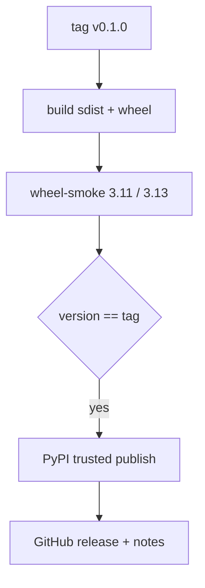

# pipx install repoach installs the release cut from a v-tag

## Intent

Nobody outside the owner's machine could install repoach, so nobody
did. A tag `v0.1.0` must produce a wheel that CI has installed with
`pipx` on two Python versions and run, then publish it to PyPI through
trusted publishing, with release notes generated from the commits.

## Context

| # | Fact | Where |
|---|---|---|
| F1 | `pyproject.toml` declares `name = "repoach"`, `version = "0.1.0"`; `src/repoach/__init__.py` also hard-codes `__version__ = "0.1.0"` — two sources of the version | `pyproject.toml:2-3`, `src/repoach/__init__.py:3` |
| F2 | `.github/workflows/publish.yml` builds and publishes on `v*` tags through `pypa/gh-action-pypi-publish`; it states it is inert until the PyPI project and its trusted publisher exist | `.github/workflows/publish.yml:1-12` |
| F3 | The README says a `repoach 0.0.1` on PyPI is a name reservation | `README.md:129`, `:219` |
| F4 | `publish.yml` runs on `${{ vars.REPOACH_RUNNER \|\| 'self-hosted' }}`; PyPI trusted publishing accepts GitHub-hosted and self-hosted runners alike, but the owner's runner is the only self-hosted one | `publish.yml:27` |
| F5 | No job installs the built wheel outside an editable checkout; the wheel boot is `SP-UNIVERSAL-INSTALL`'s contract | `.github/workflows/ci.yml` |
| F6 | `repoach --version` and `repoach version` exist | `repoach --help` on `develop` d6335de |

## Goals

- G1: one version source: `pyproject.toml` reads the version from the git tag (`setuptools-scm` or `hatch-vcs`, chosen in D3); `repoach.__version__` reads `importlib.metadata.version("repoach")`.
- G2: a job `wheel-smoke` (in `ci.yml` for every PR and in `publish.yml` before the upload step) builds the sdist and wheel once, then on Python 3.11 and 3.13: `pipx install dist/repoach-*.whl` in a clean `HOME`, outside any checkout, and runs `repoach --version`, `repoach --help`, `repoach doctor`, `repoach init --print` in an empty `git init` directory. Any non-zero exit fails the job.
- G3: in `publish.yml`, the upload step `needs: wheel-smoke` and refuses when `repoach --version` printed by the installed wheel differs from the tag without its `v` (`v0.1.0` → `0.1.0`).
- G4: release notes: `scripts/release_notes.py <prev-tag> <tag>` groups the Conventional Commit subjects between the two tags by type (`feat`, `fix`, `perf`, `refactor`, `docs`, other), lists breaking changes first, and is attached to the GitHub release created by the same workflow.
- G5: the README Quickstart replaces "install from a clone" with `pipx install repoach` once G2 is green on the tag, and the Status row "Install" is re-measured.

## Non-Goals

- NG1: no conda-forge, Homebrew or container image in this spec.
- NG2: no publication of the paid packages (`SP-OPEN-CORE-BOUNDARY`) to public PyPI.
- NG3: no signing beyond what trusted publishing attaches (PEP 740 attestations are produced by the action by default).

## Assumptions

- A1: the owner controls the PyPI account that holds the `repoach` name reservation (F3); if not, D1 applies.
- A2: the `SP-UNIVERSAL-INSTALL` contract holds: the wheel boots with no `.env`, no checkout and no gateway.

## Interface

- `git tag v0.1.0 && git push origin v0.1.0` → `publish.yml` → `wheel-smoke` (3.11, 3.13) → version check → upload → GitHub release with notes.
- `scripts/release_notes.py PREV TAG` → Markdown on stdout, exit 0; exit 2 when a tag does not exist.

## Behavior

### Nominal
Tag pushed → wheel built once → smoke green on both Pythons → version
matches → uploaded → release page carries the notes.

### Edge cases
- A tag on a commit that is not on `main` → the workflow stops before building (`git merge-base --is-ancestor`), one line naming the commit.
- `v0.1.0rc1` → published to PyPI as a pre-release; `pipx install repoach` does not pick it, `pipx install repoach==0.1.0rc1` does.

### Failure scenarios
- The trusted publisher is not configured → the upload step fails with PyPI's `invalid-publisher`; the smoke job stays green and the release is not created.
- The version on PyPI already exists → upload refused; the fix is a new tag, never an overwrite.

## Architecture Impact
- Adds dependency: SP-PYPI-RELEASE -> SP-UNIVERSAL-INSTALL (the smoke is that spec's boot contract run on the built wheel)
- New / changed coupling, cycles, or shared state: the PyPI project `repoach` and the GitHub environment `pypi` become release state.

## Diagram

## Acceptance Criteria
- [ ] AC1: `python -m build --wheel && pipx install --force dist/repoach-*.whl && cd "$(mktemp -d)" && repoach --version` → prints the version of the checked-out tag, exit 0.
- [ ] AC2: the `wheel-smoke` job on a PR → two green legs named `wheel-smoke (3.11)` and `wheel-smoke (3.13)` in `gh pr checks <n>`.
- [ ] AC3: pushing `v0.1.0` → `pip index versions repoach` lists `0.1.0`; `pipx install repoach && repoach --version` in a fresh container prints `0.1.0`.
- [ ] AC4: a tag whose version differs from the wheel (forced in a test workflow run on a `v0.0.0-mismatch` tag) → the upload step is skipped, the job log contains `version mismatch: wheel 0.1.0, tag 0.0.0`.
- [ ] AC5: `python scripts/release_notes.py v0.0.1 v0.1.0 | head -3` → a `## v0.1.0` heading and a `### Features` section.
- [ ] AC6: `python -c "import repoach, importlib.metadata as m; assert repoach.__version__ == m.version('repoach')"` → exit 0.

## Owner decisions needed
- D1 (owner task): sign in to the PyPI account that holds `repoach`, or recover it; enable 2FA.
- D2 (owner task): on PyPI, add a trusted publisher: owner `repoachhq`, repository `repoach`, workflow `publish.yml`, environment `pypi`; on GitHub, create the environment `pypi` with a required reviewer.
- D3: `setuptools-scm` (keeps the current build backend) or `hatch-vcs`.
- D4: run `publish.yml` on a GitHub-hosted runner (no dependency on the owner's machine being up) or keep `self-hosted`.

## Gaps
- No test pins today that the wheel contains `prompts/`, `chains.env` defaults and the spec template it needs at runtime; G2's `init --print` and `doctor` cover part of it, a package-data test is a separate row.

## Open Questions
- Q1: does `0.1.0` ship the gateway (`llm_proxy`) in the base wheel or as an extra `repoach[gateway]`? Proposed: extra, decided with `SP-OPEN-CORE-BOUNDARY`.
