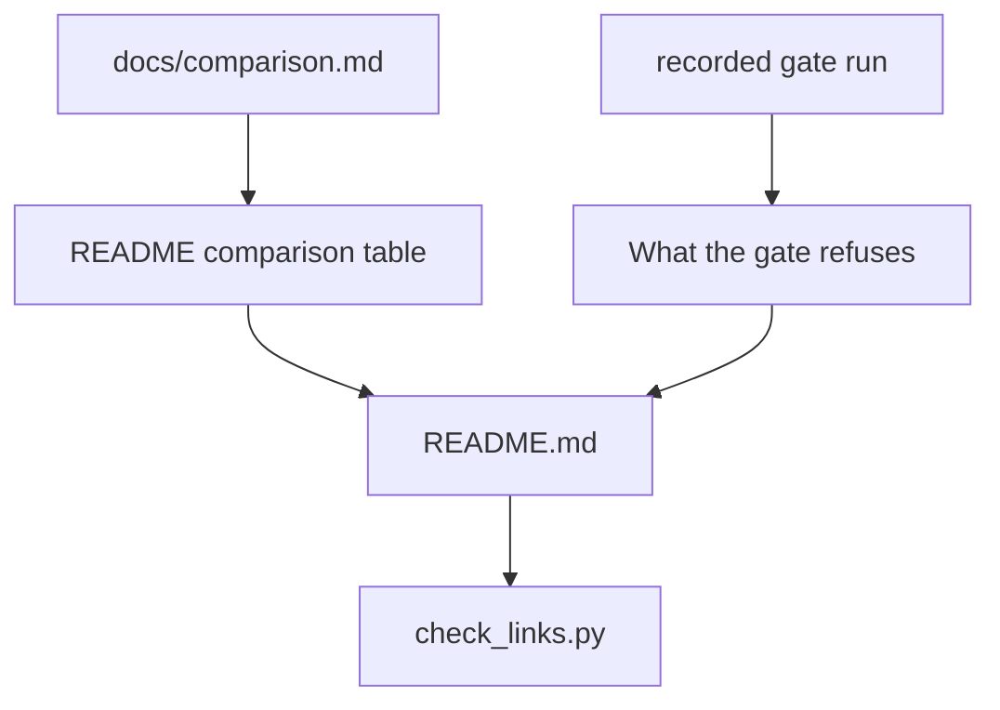

# The README says what repoach is in its first line

## Intent

A reader who sees only the top of `README.md` must leave knowing that
repoach is an evidence-first merge gate and PR reviewer for GitHub and
GitLab that they can install in minutes with their own model access.
Today the top of the page sells a "self-forging software factory", and
readers file repoach next to the agents that write code instead of next
to the tools that review it.

## Context

| # | Fact | Where |
|---|---|---|
| F1 | Line 10 is `### The self-forging software factory.`; the first paragraph says "autonomous software factory" and "Today it runs on one repository — this one, on GitHub, in Python" | `README.md:10`, `:20` |
| F2 | A general-purpose LLM asked about repoach on 2026-10-20 classified it with OpenHands, SWE-agent, Aider and Forgejo — agents and forges — not with code reviewers | owner conversation, 2026-10-20 |
| F3 | The products a buyer compares repoach with are review tools: GitHub Copilot code review, Cursor Bugbot, CodeRabbit, Qodo PR-Agent, Greptile, Ellipsis, Sourcery, GitLab Duo Code Review | `docs/plans/2026-10-19_positioning-and-market-map.md` §1 |
| F4 | The README's Status table still says "Forge: GitHub only" and "Install: from a clone", both overtaken by `SP-UNIVERSAL-FORGE`, `SP-UNIVERSAL-CI-ENTRY` (#217) and `SP-PROVIDER-DIRECT-ANTHROPIC` | `README.md:211-225` |
| F5 | Measured on Yoob (GitLab, Python + TypeScript + Verilog): about 70 k tokens and 0.5–1.7 $ per review on an API key, 69–103 s through a Claude Code login, 17 min through the owner's shared gateway | owner conversation, 2026-10-20 |
| F6 | The Coder / Developer loop ("It builds itself") occupies the second screen | `README.md:35-37`, `:104` |

## Goals

- G1: line 1 of the rendered text (the first non-markup line of `README.md`, the `
`/`<picture>` header excluded) is exactly: `Evidence-first merge gate and PR reviewer for GitHub and GitLab. Bring your Claude Code login or your key. Install in minutes.` (D1: "install in minutes" until the clock of `SP-PUBLIC-DEMO-REPO` AC2 is measured; then the measured `N-minute install`)
- G2: the phrase "self-forging" and the word "factory" do not appear in the first 20 lines; "autonomous" does not appear before the first `##` heading.
- G3: a section `## Works after your agents, not instead of them`, placed before any section about the Coder or Developer, states that Aider, OpenHands, Copilot coding agent, Cursor and humans are PR sources, and repoach reviews and gates what they open.
- G4: a section `## What the gate refuses` shows, with a real excerpt from a recorded run, one refuted finding and one refused LGTM (an `APPROVE` with the ledger's `review_complete=False` or a surviving blocker), with the PR link.
- G5: a comparison table with at most eight competitor rows and these columns: forges, blocks a merge on evidence, re-verifies findings at the merge head, spec in the repo gates the plan, model choice (BYOK), self-host, price as listed. Each cell is copied from `docs/comparison.md` (`SP-COMPARISON-PAGE`), which carries the source URL and the check date; the README table links there and prints the check date under the table.
- G6: the Coder loop, the Developer and `repoach develop` move under `## Later: the spec-driven builder`, after Quickstart, CI and Safety.
- G7: the Status table is re-measured on the commit that lands this spec; every row carries the commit and date it was read on.
- G8: every relative link and every `https://` link in `README.md` resolves (`scripts/check_links.py README.md`, shared with `SP-COMPARISON-PAGE`).

## Non-Goals

- NG1: no change to the code, the CLI or the logo.
- NG2: no claim that is not measured: "5-minute install" is a measured clock (see Owner decisions), the precision number is added by `SP-PRECISION-MEASUREMENT`, not here.
- NG3: no comparison with autonomous developers (Devin, OpenHands, SWE-agent) in the table: they are PR sources, named in G3 only.

## Assumptions

- A1: `docs/comparison.md` exists with its generator before this spec's README table lands (dependency `SP-COMPARISON-PAGE`).
- A2: GitHub renders the `
` header; the reader test strips it.

## Interface

Inputs: `README.md`, `docs/comparison.md`.

Outputs:
- `README.md` with the section order: header, statement (G1), one-paragraph "how it decides", Quickstart, `Works after your agents`, `What the gate refuses`, comparison (G5), Run repoach in CI, Safety, Status, `Later: the spec-driven builder`, Contributing.
- `scripts/check_links.py <file>...`: exit 0 when every link resolves, 1 with one line per dead link (`<file>:<line> <url> <status>`).

## Behavior

### Nominal
A reader runs `head -20` on the stripped README and reads: what it is,
what it needs, how long it takes, where it sits relative to their
agents.

### Edge cases
- A competitor row whose source page cannot be re-read on the landing day → the row is dropped from the README table and kept in `docs/comparison.md` with `unverified`.
- The "5-minute" clock exceeds five minutes when measured → the line states the measured figure instead (`N-minute install`), never the target.

### Failure scenarios
- A link checker network failure (DNS, rate limit) → exit 2 `cannot say`, distinct from a dead link; CI treats 2 as a retry, never as green.

## Architecture Impact
- Adds dependency: SP-README-PRODUCT-STATEMENT -> SP-COMPARISON-PAGE (the README table is a projection of `docs/comparison.md` and reuses its link checker)
- New / changed coupling, cycles, or shared state: none.

## Diagram

## Acceptance Criteria
- [ ] AC1: `sed -e '/^<div/,/^<\/div>/d' -e '/^$/d' -e '/^---$/d' README.md | head -5` → the first line is the G1 sentence verbatim, and the five lines contain both "merge gate" and "reviewer".
- [ ] AC2: `head -20 README.md | grep -ciE 'self-forging|factory'` → `0`.
- [ ] AC3: `grep -n '^## ' README.md` → `Works after your agents, not instead of them` precedes `Later: the spec-driven builder`, and no heading before it contains "Coder" or "Developer".
- [ ] AC4: `python scripts/check_links.py README.md` → exit 0, last line `links: N checked, 0 dead`.
- [ ] AC5: `grep -c 'docs/comparison.md' README.md` → ≥ 1, and the line under the table matches `checked on 20[0-9]{2}-[0-9]{2}-[0-9]{2}`.
- [ ] AC6 (fresh reader): a model with no repository access is given only `head -40` of the stripped README and asked "which three products is this closest to?"; at least two of the three named products are in F3's list. The prompt, the model and the answer are saved under `docs/plans/` with the date.

## Owner decisions needed
- D1: ship the G1 sentence with "5-minute install" before the clock of `SP-PUBLIC-DEMO-REPO` AC2 is measured, or ship it with "install in minutes" until then.
  Decided 2026-10-21: "install in minutes" until the clock is measured.
- D2: keep "self-forging" anywhere (tagline below the fold, the logo alt text) or retire it.
  Decided 2026-10-21: retired from the README; the `pyproject.toml` description is left to a code change (NG1).

## Gaps
- The excerpt for G4 needs one recorded run where the gate refused an LGTM on a public PR; the Yoob runs are on a private GitLab project, so the first public excerpt comes from the demo repository (`SP-PUBLIC-DEMO-REPO`).
- `scripts/check_links.py` does not exist; it is introduced by `SP-COMPARISON-PAGE`.

## Open Questions
- Q1: does the README keep the shield `License: MIT` until `SP-OPEN-CORE-BOUNDARY` D1 (licence choice) is decided? Proposed: yes, change both in one commit.
