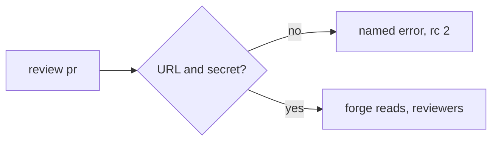

# review pr checks the gateway before any forge call

## Intent

A review that cannot reach its gateway says which variable is missing,
in one line, rc 2, before it reads the forge.

## Context

| # | Fact | Where |
|---|---|---|
| F1 | Independent verification 2026-10-20: `REPOACH_LLM_PROXY_BASE_URL` set, `REPOACH_ANTHROPIC_AUTH_TOKEN` unset → four forge reads, then a `ValueError` traceback, rc 1 | `agent_engine/agent_loop.py` constructor, reached when the reviewers are built inside `review_pr` |
| F2 | `require_llm_proxy_base_url` raised a bare `ValueError`; the CLI caught only `ForgeError` | `core/config.py`, `cli/review_cmds.py` |

## Goals

- G1: `GatewayConfigError(ValueError)`; `require_gateway_credentials(settings)` checks the URL then the secret, naming the variable, never a value.
- G2: `run_review` calls it first; `review pr` prints `repoach: <message>` on stderr and exits 2.

## Non-Goals

- NG1: no probe of the gateway itself (a dead gateway is SP-REVIEW-TRANSPORT-ERROR-VERDICT's `ERROR`, rc 3).

## Assumptions

- A1: every review model call still goes through the gateway (SP-PROVIDER-DIRECT-ANTHROPIC is open).

## Interface

- `repoach.core.config.GatewayConfigError`, `require_gateway_credentials`.

## Behavior

### Nominal
URL and secret set → unchanged.

### Edge cases
- URL missing → the existing `llm_proxy_base_url unresolved -- set REPOACH_LLM_PROXY_BASE_URL …` message, rc 2.

### Failure scenarios
- Secret missing → `repoach: REPOACH_ANTHROPIC_AUTH_TOKEN is not set -- the gateway at <url> needs its shared secret; set it in the environment or ~/.config/repoach/env`, rc 2, empty stdout.

## Architecture Impact
- No new edge.

## Diagram

## Acceptance Criteria
- [x] AC1: `pytest -q tests/unit/test_review_gateway_preflight.py::test_missing_token_is_a_named_error_before_any_forge_call` → green: one stderr line naming the variable, rc 2, empty stdout; a forge fake that fails on any call is never touched.
- [x] AC2: `pytest -q tests/unit/test_review_gateway_preflight.py::test_missing_url_is_a_named_error_before_any_forge_call` → green.
