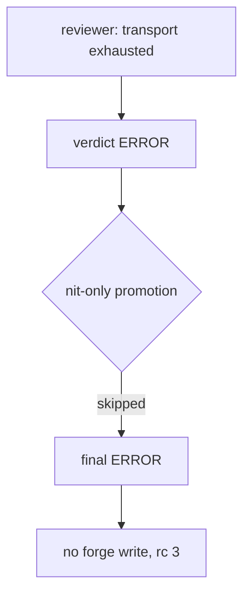

# A reviewer that could not reach a model ends ERROR

## Intent

A review that did not happen must say so. When the model is
unreachable, each reviewer ends `ERROR` — a terminal state that is
never promoted to `APPROVE` — the team verdict is `ERROR`, nothing is
published to the forge even without `--dry-run`, and `review pr` exits
3.

## Context

Measured 2026-10-20 plugging repoach into Yoob (GitLab, foreign
repository) with the gateway unreachable / an invalid upstream:

| # | Fact | Where |
|---|---|---|
| F1 | All four reviewers ended `[parse_failed:TRANSPORT]` | `review/reviewer.py` `_call_with_retry` stub and `_parse_response` TRANSPORT branch, both `verdict = COMMENT` |
| F2 | Each was then reported `verdict: APPROVE` with `[auto-promoted: nit-only]` | `review/orchestrator.py` nit-only promotion: any non-APPROVE outcome without blocker/major comments is promoted — a reviewer with no comments because it never ran qualifies |
| F3 | Final `REQUEST_CHANGES` with 0 blockers (ledger `review_complete=False`), rc 2 — indistinguishable from a real request for changes | `merge_gate.verdict_from_facts`; `cli/review_cmds.py` |
| F4 | A crashed reviewer (`_(bot crashed: …)_`) took the same COMMENT → APPROVE path, pinned by `test_one_failing_reviewer_does_not_break_team` | `orchestrator.py` reviewer fan-out |
| F5 | Without `--dry-run` the four "APPROVE" reviews would have been posted | `orchestrator.py` `_publish_all` guard was `self._post` only |

## Goals

- G1: `ReviewVerdict.ERROR`; a transport-exhausted reviewer (`_FailedRunResult` stub), a TRANSPORT-classified response, a crashed reviewer and an unreadable diff all carry it.
- G2: the nit-only promotion never touches `ERROR`.
- G3: any `ERROR` reviewer makes `final_verdict = ERROR`; the forge sees no write (reviews, inline comments, refuted sentinels, archive), the escalation routine does not fire, `posting_outcome = "SKIP_ERROR"`.
- G4: `repoach review pr` exits 3 on `ERROR` (2 stays request-changes / spec missing, 5 stays the merge gate).

## Non-Goals

- NG1: MALFORMED / TRUNCATED parse failures keep `REQUEST_CHANGES` (the model answered; the answer was unusable).
- NG2: no change to the merge gate; a PR whose last review errored is still refused by `review_complete=False`.

## Assumptions

- A1: consumers of the JSON (`auto-review.yml`, `ci_local.sh --review`) treat an unknown `final_verdict` as not-approve.

## Interface

- `ReviewVerdict.ERROR = "ERROR"` (`review/reviewer.py`).
- `EXIT_REVIEW_ERROR = 3` (`cli/review_cmds.py`).
- `TeamOutcome.posting_outcome == "SKIP_ERROR"` when posting was requested and suppressed.
- `review pr` JSON carries `posting_outcome` (`SKIP_ERROR`, `SKIP_STATE` or null).

## Behavior

### Nominal
Gateway unreachable → each reviewer retries per its backoff, ends
`ERROR` with `[parse_failed:TRANSPORT] …`; JSON `final_verdict:
"ERROR"`, every `reviews[].verdict: "ERROR"`, rc 3, zero forge writes.

### Edge cases
- One reviewer errored, three approved → `ERROR`, nothing posted.

### Failure scenarios
- None new: the outcome is still persisted to L4 so the run is auditable.

## Architecture Impact
- No new edge; the test reaches the reviewer (SP-RETRY-BACKOFF-DEDUP) and orchestrator (SP-ORCH-DOCSTRING) owners already declared.

## Diagram

## Acceptance Criteria
- [x] AC1: `pytest -q tests/unit/test_review_transport_error_verdict.py::test_transport_exhaustion_yields_error_verdict` → green: a reviewer whose loop raises `GatewayTransportError` ends `ERROR`.
- [x] AC2: `pytest -q tests/unit/test_review_transport_error_verdict.py::test_unreachable_gateway_posts_nothing_and_ends_error` → green: four unreachable reviewers with `post_to_github=True` → every verdict `ERROR`, no `auto-promoted`, final `ERROR`, `posting_outcome == "SKIP_ERROR"`, the forge's review/comment/batch/archive logs empty.
- [x] AC3: `pytest -q tests/unit/test_review_transport_error_verdict.py::test_one_errored_reviewer_makes_the_team_error` → green.
- [x] AC4: `pytest -q tests/unit/test_review_transport_error_verdict.py::test_review_pr_cli_exits_3_on_error_verdict` → green: rc 3, JSON `final_verdict == "ERROR"`.
- [x] AC5: `pytest -q tests/unit/test_review_team.py::test_one_failing_reviewer_does_not_break_team` → green with the crashed reviewer asserted `ERROR` (it asserted `APPROVE` + `auto-promoted` before).

- [x] AC6: `pytest -q tests/unit/test_review_transport_error_verdict.py::test_review_pr_cli_reports_skip_error_posting_outcome` → green: `review pr 42` (no `--dry-run`) with four unreachable reviewers → stdout passes `python -m json.tool`, `posting_outcome == "SKIP_ERROR"`, rc 3, no forge write. Found by independent verification 2026-10-20 (the key was absent from the JSON).

## Open Questions
- Q1: a MALFORMED reviewer with no comments is still promoted to `APPROVE` at the per-reviewer level (the team verdict stays `REQUEST_CHANGES` through `review_complete`). Same honesty defect, smaller blast radius: `docs/tech_debt.md` row 35.
