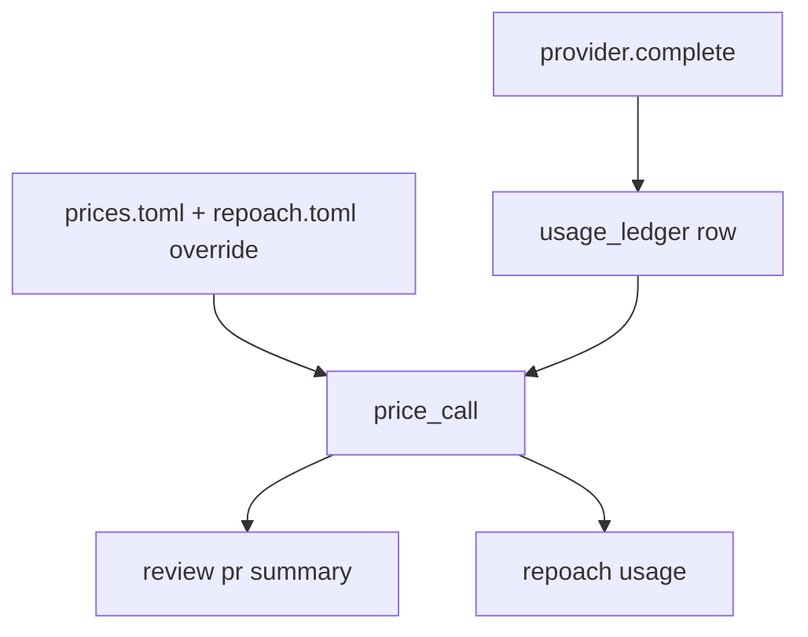

# Tokens, cost estimate and duration per review

## Delivered (0.2, 2026-10-21) — the core; three goals as amended or partial

Delivered with `SP-UNIVERSAL-PROVIDERS` slice 2 (which owns the
`usage_ledger` table and `src/repoach/providers/`).

- G1 as built: `usage_ledger` (`providers/usage.py`) has `run_id`,
  `command`, `pr_number`, `reviewer`, `provider`, `model`,
  `prompt_tokens` (uncached), `completion_tokens`, `cache_read_tokens`,
  `cache_write_tokens`, `duration_ms`, `cost_usd` (null when unpriced,
  on a subscription, or the call failed), `price_source`, `error`,
  `created_at`.  One write site: `AgentLoop._provider_call`, for every
  route including the gateway.  Reviewers are attributed through
  context variables bound into the orchestrator's worker threads;
  Q1 → the refuter is its own row, `Refuter`.  `run_id` is minted per
  `review pr` (`review_runs` does not exist yet, tech_debt #54).  An
  unwritable ledger logs `usage_ledger.write_failed` once and the
  summary ends `usage not recorded`.
- G2 as amended by the owner (2026-10-20): the price table is
  `src/repoach/providers/prices.py`, not `prices.toml` — `PriceRow`
  with `source_url`, `read_on` 2026-10-21 and an optional
  `valid_until` (a temporary vendor price stops pricing after it).
  Rows: Anthropic `claude-opus-5` 5 / 25, `claude-sonnet-5` 2 / 10,
  `claude-haiku-4-5` 1 / 5 (with cache write / read), OpenAI
  `gpt-6-astra`, `gpt-6.1-sol`, `gpt-6-luna`, Gemini `gemini-3.8-flash`
  (through 2026-12-31), `gemini-2.5-pro`, `gemini-2.5-flash`,
  `gemini-2.5-flash-lite`.  `claude_code` → null, shown as
  `subscription (tokens only)`; `ollama` → 0, `self-hosted`; gateway
  and every other model → null (D1 left open).  Not built: the
  `[usage.prices]` override (tech_debt #51).
- G3 as amended by the owner: `review pr` prints one stderr line,
  `repoach: usage: N calls, T tokens (in …, out …, cached …), W s,
  <cost>`, where `<cost>` is `$X.XXXX (prices read 2026-10-21)`,
  `subscription (tokens only)`, `cannot say (N unpriced calls)` or a
  mix with `+ N unpriced calls`; the JSON gains `usage` with
  `per_reviewer`, `total`, `providers`, `run_id`, `prices_read_on`,
  `recorded`.  The table of G3 is not printed (tech_debt #52), so AC2
  is unmet as written.
- G4: `repoach usage [--since 7d|24h|2w|DATE] [--until …] [--by
  model|provider|reviewer|pr|day|command] [--json]`, default 7 days by
  model; text output `key | calls | in | out | cached | wall_s | cost`.
- G5: `may be stale` is appended to the dollar figure when the table
  was read more than 90 days before the run.
- D2: the stderr line is on by default; `ci review` runs the review as
  a child, so the line is in the child's stderr.

## Intent

A user who pays per token wants to know, at the end of every review,
what it cost, and over a month what all of them cost. This is slice 2
of `SP-UNIVERSAL-PROVIDERS` (its G5): the usage ledger, the cost model
per provider, the end-of-review summary and `repoach usage`.

## Context

| # | Fact | Where |
|---|---|---|
| F1 | `SP-UNIVERSAL-PROVIDERS` G5 specifies a `usage_ledger` table and `repoach usage [--since] [--json]`, with `cost_usd` null when the provider reports no price; it owns `db:table:usage_ledger` | `docs/specs/2026-10-18_SP-UNIVERSAL-PROVIDERS_*.md:12`, `:59` |
| F2 | Neither the table nor `src/repoach/providers/` exists on `develop` d6335de | `ls src/repoach` |
| F3 | Tokens are recorded per review only, in `pr_reviews.tokens_used`, with no per-call, per-model or cost column | `SP-UNIVERSAL-PROVIDERS` Context |
| F4 | Measured on Yoob 2026-10-20: about 70 k tokens and 0.5–1.7 $ per review on an API key; 69–103 s through a Claude Code login; 17 min through the owner's gateway | owner conversation |
| F5 | `SP-UNIVERSAL-LEDGER` G3 writes one `review_runs` row per `review pr` (tokens, elapsed, provider kind); this spec writes the per-call rows that row sums | `docs/specs/2026-10-19_SP-UNIVERSAL-LEDGER_*.md` G3 |

## Goals

- G1: every model call writes one `usage_ledger` row as `SP-UNIVERSAL-PROVIDERS` G5 lists it, plus `run_id` (the `review_runs` id), `reviewer` (Architect, Sentinel, Tester, Scribe, Refuter, Coder, Planner, Developer) and `price_source` (the `prices` row used, null when none).
- G2 (cost model): `src/repoach/providers/prices.toml` holds one row per `(provider, model)`: input, output, cache-write and cache-read price per million tokens in USD, `source_url`, `read_on`. Rows for the direct Anthropic models and the OpenAI-compatible defaults are filled from the vendor pricing page on the implementation day; `cost_usd = Σ tokens × price` when a row exists. `claude_code` is a subscription: its rows have no price, `cost_usd` stays null, and the display says `subscription (tokens only)`. Gateway calls are priced by the upstream model the gateway reports in its response headers, else null. A user override `[usage.prices]` in `repoach.toml` wins over the shipped table.
- G3 (end of review): `review pr` prints, on stderr after the verdict line, one table `reviewer | calls | in | out | cached | cost | wall` and a total line `total: N tokens, $X.XX (prices read <date>) | subscription (tokens only) | cannot say, W s`; the JSON gains `usage: {per_reviewer: [...], total: {...}}`.
- G4: `repoach usage [--since DATE] [--until DATE] [--by reviewer|model|pr|day] [--json]` prints totals with the same columns; a cost column mixing priced and unpriced rows prints the priced sum and `+ N unpriced calls`.
- G5: a price row whose `read_on` is older than 90 days prints `prices read <date>, may be stale` once per run.

## Non-Goals

- NG1: no billing, quota or spend cap: display only (spend caps belong to the paid tier, `SP-OPEN-CORE-BOUNDARY`).
- NG2: no estimate for `claude_code` from list API prices: a subscription user sees tokens, never an invented dollar figure.
- NG3: no network fetch of prices at runtime.

## Assumptions

- A1: the provider abstraction of `SP-UNIVERSAL-PROVIDERS` slice 1 is the single place every call passes through, so G1 has one write site.
- A2: Anthropic responses carry `usage.input_tokens`, `output_tokens`, `cache_creation_input_tokens`, `cache_read_input_tokens`; OpenAI-compatible endpoints may omit `usage` (recorded null, counted as `unmetered`).

## Interface

```python
class PriceRow(BaseModel):
    provider: str
    model: str
    input_per_mtok: Decimal
    output_per_mtok: Decimal
    cache_write_per_mtok: Decimal | None
    cache_read_per_mtok: Decimal | None
    source_url: HttpUrl
    read_on: date

def price_call(row: UsageRow, prices: Mapping[tuple[str, str], PriceRow]) -> Decimal | None: ...
def summarize(db: Engine, *, since: date | None, until: date | None, by: str) -> UsageSummary: ...
```

Prices table, shape (values filled on the implementation day from the source page, never from memory):

| provider | model | in $/Mtok | out $/Mtok | cache write | cache read | source_url | read_on |
|---|---|---|---|---|---|---|---|
| anthropic | opus tier model | from page | from page | from page | from page | Anthropic pricing page | date |
| anthropic | sonnet tier model | from page | from page | from page | from page | Anthropic pricing page | date |
| anthropic | haiku tier model | from page | from page | from page | from page | Anthropic pricing page | date |
| openai | default model | from page | from page | n/a | from page | OpenAI pricing page | date |
| claude_code | any | subscription | subscription | — | — | Claude plans page | date |
| openai_compatible (Ollama, vLLM) | any | 0 (self-hosted) | 0 | — | — | — | date |

## Behavior

### Nominal
Four reviewers and the refuter on an API key → ≥ 5 rows, a priced
total within the measured 0.5–1.7 $ band of F4 on a Yoob-sized diff.

### Edge cases
- A model missing from `prices.toml` → `cost cannot say` for that row, the run total adds `+ 1 unpriced call`.
- Mixed run (gateway head failed over to `claude_code`) → the subscription rows are tokens only, the priced rows are summed.

### Failure scenarios
- The ledger is unwritable → the call returns, `usage_ledger.write_failed` logged once (F1's rule); the end-of-review table prints `usage not recorded`.

## Architecture Impact
- Adds dependency: SP-USAGE-LEDGER -> SP-UNIVERSAL-PROVIDERS (slice 2 of it; the `usage_ledger` table stays owned by that spec, this one adds columns and readers)
- New / changed coupling, cycles, or shared state: `prices.toml` shipped data; `review_runs` (SP-UNIVERSAL-LEDGER) can sum `usage_ledger` by `run_id` instead of carrying its own token count.

## Diagram


## Acceptance Criteria
- [x] AC1 (as built: the price fixture is the shipped table, hand-computed in the test): `pytest -q tests/unit/test_usage_ledger.py` → green: a fake Anthropic transport returning fixed usage → one row per call with `reviewer` and `run_id` set and `cost_usd` equal to the hand-computed value for a two-row price fixture; a `claude_code` call → `cost_usd` null, `price_source` null.
- [ ] AC2 (unmet as written: one line instead of a table, owner decision; no Anthropic key to run it, tech_debt #48, #52): `repoach review pr <n> --dry-run 2>&1 >/dev/null | tail -6` on a direct-Anthropic run → a table whose header is `reviewer | calls | in | out | cached | cost | wall` and a last line starting `total:` with a dollar figure and `prices read 20`.
- [x] AC3 (measured 2026-10-21 on Yoob MR 296: `repoach: usage: 8 calls, 300374 tokens (in 16, out 7166, cached 293192), 113.0 s, subscription (tokens only)`): the same through `claude_code` → the last line contains `subscription (tokens only)` and no `$`.
- [x] AC4 (`test_usage_ledger.py::test_usage_command_groups_the_period`): `repoach usage --since 2026-10-01 --by reviewer --json | python -c "import json,sys; d=json.load(sys.stdin); assert {'rows','totals'} <= d.keys()"` → exit 0.
- [x] AC5 (as amended: the table is `prices.py`; `test_usage_ledger.py::test_every_price_row_names_its_source_and_day`): `python -c "import tomllib,pathlib; rows=tomllib.loads(pathlib.Path('src/repoach/providers/prices.toml').read_text())['price']; assert all(r['source_url'] and r['read_on'] for r in rows)"` → exit 0.

## Owner decisions needed
- D1: show a dollar estimate for gateway runs priced by the upstream header, or tokens only for every gateway call.
- D2: whether the per-review summary is on by default in `ci review` output (it lengthens the job log by about eight lines).

## Gaps
- The gateway does not yet report the upstream model in a response header; D1 needs that header (gateway rows are unpriced).
- `docs/tech_debt.md` #51 (prices, override), #52 (one-line summary), #54 (run id).

## Open Questions
- Q1: does the refuter count as a reviewer row or its own line? Proposed: its own row named `Refuter`.
