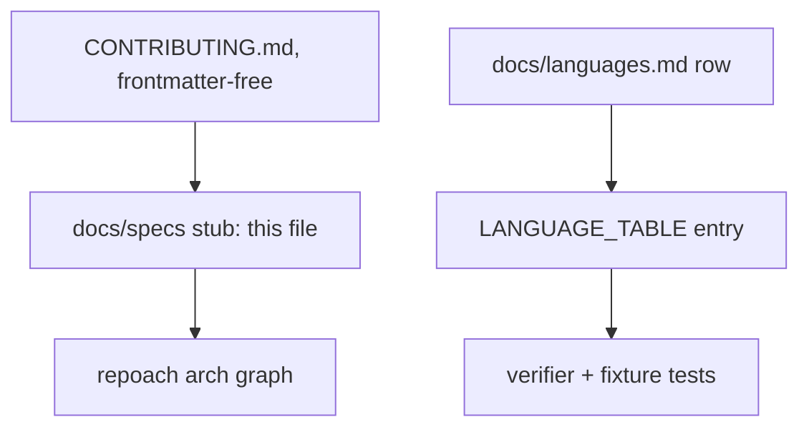

# CONTRIBUTING.md is a governed spec

## Intent

`CONTRIBUTING.md`, the issue templates, the code of conduct, the
language table and the community ritual are code: owned, listed in
the architecture graph, and reviewed the same way a diff to `src/` is
reviewed. `SP-COMMUNITY-ONBOARDING` (2026-10-20) designed this; this
spec is the governed artifact that carries its `owns` declaration,
because the registry (`load_registry`, `repoach/arch/registry.py`)
only globs `*.md` directly under its configured specs directory
(default `docs/specs/`, non-recursive) — a file at the repository root
is invisible to it regardless of what frontmatter it opens with.

## Context

| # | Fact | Where |
|---|---|---|
| F1 | `load_registry` globs `specs_dir.glob("*.md")` only — a root-level file is never read | `src/repoach/arch/registry.py:207` |
| F2 | `repoach.toml` sets `[arch].require_frontmatter = true` for this repository | `repoach.toml:75` |
| F3 | `LANGUAGE_TABLE` already detects `go` and `rust` (extensions, `go`'s test selector) but neither has a verifier | `src/repoach/gates/languages.py` rows for `Language.GO`, `Language.RUST` |
| F4 | `doctor --gates`'s install hint (`node_install_hint`) only covers Node packages — Python, Go and Rust binaries get no install hint | `src/repoach/gates/verifiers.py:755` |

This answers `SP-COMMUNITY-ONBOARDING`'s Q1 (can the registry read a
spec outside `docs/specs/`): no. The resolution it already names in
its own Failure scenario is this file — a stub under `docs/specs/`
that carries the registry frontmatter and owns the root-level
artifacts, so `CONTRIBUTING.md` itself stays frontmatter-free and
readable as plain prose.

## Goals

- G1: this spec owns `CONTRIBUTING.md`, `.github/ISSUE_TEMPLATE/`, `CODE_OF_CONDUCT.md`, `docs/community.md`, `docs/languages.md`; `repoach arch graph` lists `SP_CONTRIBUTING`.
- G2: `CONTRIBUTING.md`'s rules are each checked by a named gate (`scripts/lint_no_inline_comments.py`, `scripts/lint_no_silent_except.py`, `repoach arch check`, `scripts/ci_local.sh`'s lint stage) or stated as a convention with no mechanical check.
- G3: `scripts/check_contributing.py` fails when `CONTRIBUTING.md` names a repository-relative path or script that does not exist on disk, and is wired into `scripts/ci_local.sh`'s lint stage.
- G4: `docs/languages.md` lists exactly the languages with a landed verifier (Python, TypeScript) today; Go and Rust stay out of the table until their verifier spec lands, matching `LANGUAGE_TABLE`'s current state.

## Non-Goals

- NG1: this spec does not add the Go or Rust verifiers themselves — that is the `good first spec` issue this spec opens.
- NG2: this spec does not change the merge gate, the bot review chain, or `/repoach review`'s trigger surface (`SP-COMMUNITY-ONBOARDING` G7 is out of scope here).

## Assumptions

- A1: a frontmatter-free `CONTRIBUTING.md` plus a `docs/specs/` stub is an acceptable reading of `SP-COMMUNITY-ONBOARDING` G1 ("starts with the spec frontmatter") — the stub is where the registry reads the frontmatter; `CONTRIBUTING.md` names the spec by id in prose instead.

## Interface

- `docs/specs/2026-10-21_SP-CONTRIBUTING_contributing-guide-as-a-governed-spec.md` (this file) — the registry node.
- `scripts/check_contributing.py <file>...` — exit 0 when every repository-relative path or script cited in backticks or a fenced code block exists on disk; exit 1 with one `<file>:<line> <token> missing` line per dead reference.

## Behavior

### Nominal
`repoach arch graph | grep -c SP-CONTRIBUTING` finds this node;
`repoach arch check --base origin/develop` reports `edge-honesty: ok`;
`scripts/check_contributing.py CONTRIBUTING.md` exits 0.

### Edge cases
- A future edit to `CONTRIBUTING.md` renames `scripts/ci_local.sh` without updating the guide → `check_contributing.py` fails the PR, naming the dead path.

### Failure scenarios
- A path cited only as prose, not inside backticks or a fenced block (e.g. "the `scripts/` directory holds the gates") is not a candidate — `check_contributing.py` only judges tokens whose first path segment is a real top-level entry of the repository, read from backticked spans and fenced code blocks.

## Architecture Impact
- Adds dependency: SP-CONTRIBUTING -> SP-SPEC-TEMPLATE (the stub's frontmatter follows the template's contract).
- Adds dependency: SP-CONTRIBUTING -> SP-UNIVERSAL-GATES (`docs/languages.md`'s table mirrors `LANGUAGE_TABLE`; a language row with no matching table entry would be a lie the gate cannot catch mechanically, so it stays a declarative coupling).
- New / changed coupling, cycles, or shared state: none.

## Diagram

## Acceptance Criteria
- [x] AC1: `repoach arch graph | grep -c SP-CONTRIBUTING` → ≥ 1, and `repoach arch check --base origin/develop` → `edge-honesty: ok`.
- [x] AC2: `head -30 CONTRIBUTING.md | grep -c '^[1-5]\. '` → 5, and step 2 names a measured test duration.
- [x] AC3: `python scripts/check_contributing.py CONTRIBUTING.md` → exit 0.
- [x] AC4: `grep -c '^| ' docs/languages.md` → 4 (header, separator, Python, TypeScript) — Go and Rust are detected in code but not yet in this table.

## Open Questions

(none — Q1 from `SP-COMMUNITY-ONBOARDING` is answered in Context above.)
