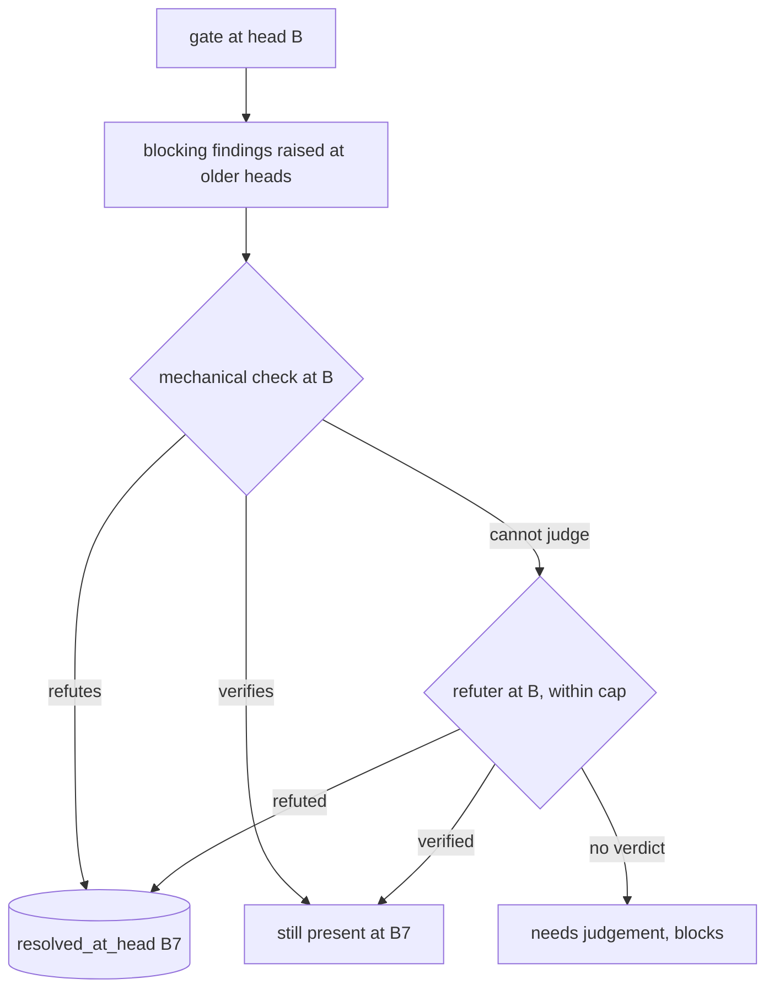

# The gate re-verifies open findings of older heads at the head

## Intent

`repoach review gate` promises a decision "re-verified at the exact
head". For a finding raised at an earlier head it does not keep that
promise: only repoach's own Coder loop moves a finding to `resolved`,
so when a person pushes the fix the gate refuses forever. This spec
makes the gate re-check, at the head it decides on, every open blocking
finding recorded at an older head, settle the ones the head no longer
supports, and name the others.

## Context

Measured on `develop` `f8915fc` (2026-10-21), reproduction on
`repoachhq/repoach-demo` #6 (`docs/tech_debt.md` row 59 of PR #229).

| # | Fact | Where |
|---|---|---|
| F1 | After the fix commit `bbfb62f`, all four reviewers answered `APPROVE` with 0 blocking findings, coverage was `covered`, CI green, and `review gate 6` still refused: `5 open blocking finding(s) at head`, exit 5 | demo recording `demo/recorded/2026-10-21.jsonl`, step 6 |
| F2 | The five were raised at `cf64ff6`: four judged (`design` ×2, `security` ×2) `verified` by the refuter, one `missing_test` on `frontend/src/InvoiceTable.ts:36` `verified` by the `tests/`-only Python symbol search | demo ledger `pr_findings` ids 23, 24, 26, 27, 30 |
| F3 | `gather_merge_facts` counts a judged finding past `proposed` at ANY sha (SP-GATE-JUDGED-FAIL-CLOSED) and re-checks mechanical ones with `verify_finding`, without ever changing a status | `src/repoach/review/merge_gate.py` (`gather_merge_facts`) |
| F4 | `judge_findings_for_pr` judges only `proposed` findings, and with `scope_head` only those of the current head; older ones are counted `stale` and left alone | `src/repoach/review/refuter.py` (`judge_findings_for_pr`) |
| F5 | The only `-> resolved` path is `coder_findings.reverify_resolution_for_pr`, called after the Coder's own push: `verify_finding` for mechanical claims, `refute_finding` for judged ones, `open -> resolved` when the check refutes | `src/repoach/review/coder_findings.py` |
| F6 | The `missing_test` verifier searches `def test_<name>` in `tests/**/*.py`; a Vitest test in `frontend/src/*.test.ts` can never refute it | `src/repoach/review/finding_verifiers.py` (`_verify_missing_test`), `src/repoach/review/hallucination_guard.py` (`make_tests_symbol_searcher`) |
| F7 | `decide_at_head` is the single unit both `review gate` and `review merge` reach, so a change there keeps the two decisions identical | `src/repoach/review/auto_merge.py` (`decide_at_head`) |
| F8 | `compute_spec_coverage` requires `promised_body_non_trivial`, which splits every selector on `::` and parses the file with Python's `ast`; a Vitest selector written with ` > ` is never a file (reported missing with the test present), and the `::` spelling passes only because a TypeScript `SyntaxError` returns `True` | `src/repoach/review/spec_gate.py` (`promised_body_non_trivial`); tech_debt row 60 |

SP-REVIEW-PINS-HEAD G3 (every stamp carries the head) and G4 (no
`APPROVE` over `proposed` blockers) are about recording the head a
finding was raised at. Neither re-checks a finding at a later head:
this spec builds on G2 (the gate's verifiers read the pinned head tree)
and is the missing half.

## Goals

- G1: at gate time, every blocking finding in `proposed`, `verified`,
  `open` or `stuck` whose `head_sha` differs from the decided head is
  re-checked against the head tree before the facts are gathered.
- G2: a finding the head no longer supports moves to the new terminal
  status `resolved_at_head`, with `checked_at_sha` = the head and the
  reason in `verification_result` (`resolved at <sha7>: <why>`).
- G3: a finding the head still supports stays blocking, and the gate's
  reasons name it with the head it was raised at and
  `still present at <sha7>`.
- G4: a finding no mechanical check can settle at the head is handed to
  the refuter at the head (within the refuter cap); one it cannot judge
  either is listed `unresolved: needs judgement (<reason>)` in the
  reasons and keeps blocking — never kept silently.
- G5: the gate JSON carries `reverified: {resolved, still_open,
  needs_judgement}` and stderr one line
  `gate: re-verified <n> finding(s) of older heads at <sha7>: resolved <a>, still open <b>, needs judgement <c>`.
- G6 (tech_debt row 60): `promised_body_non_trivial` dispatches every
  non-pytest selector through `parse_selector`; a Vitest selector (` > `
  or `::`) is judged by its `it`/`test`/`describe` block having a
  non-empty callback body, and a TypeScript file never reaches Python's
  `ast` (a parse error is never a non-empty body).

## Non-Goals

- NG1: `review pr` does not re-verify older findings; its summary keeps
  reading the ledger. A gate run before the review shows the settled
  state.
- NG2: no change to the Coder loop's `open -> resolved` path.
- NG3: no "the cited lines did not change, so it still holds" shortcut:
  a fix elsewhere in the function would never clear it.
- NG4: `broken_behavior` findings are settled by CI at the head (green
  → resolved), not by a test run of their own.

## Assumptions

- A1: the gate reads the head tree (SP-REVIEW-PINS-HEAD G2); the
  re-check never reads the checkout.
- A2: the refuter cap and the gate configuration come from the
  checkout (trusted), never from the PR head's `repoach.toml`.
- A3: a finding the re-check resolves says nothing about whether it was
  real at its own head; `resolved_at_head` stays out of
  `CONFIRMED_REAL_STATUSES`, so reviewer precision ignores it.

## Interface

```python
class FindingStatus(StrEnum):
    RESOLVED_AT_HEAD = "resolved_at_head"   # terminal, non-blocking

@dataclass(frozen=True)
class Reverification:
    finding_id: int | None
    claim_type: ClaimType
    file: str
    line_start: int
    recorded_at: str
    state: Literal["resolved", "still_open", "needs_judgement"]
    reason: str

@dataclass(frozen=True)
class HeadReverification:
    head_sha: str
    outcomes: tuple[Reverification, ...] = ()
    model_calls: int = 0
    def counts(self) -> dict[str, int]: ...
    def summary_line(self) -> str: ...
    def reasons(self) -> list[str]: ...

def reverify_older_findings(
    db_path: Path, *, pr_number: int, repo_root: Path, head_sha: str,
    ci_green: bool, config: GatesConfig, max_judged: int,
    judge_factory: Callable[[], Judge] = make_refuter_judge,
) -> HeadReverification: ...
```

`decide_at_head` runs `reverify_older_findings` before
`gather_merge_facts` and returns facts carrying `reverified` (the
counts) and `reverify_reasons`; `compute_merge_decision` appends those
reasons when it refuses.

Re-check per claim type:

| Claim | Check at head | resolved when | still open when | otherwise |
|---|---|---|---|---|
| `missing_test` / `missing_docstring` / `lint_convention` | `verify_finding` | it refutes, or the cited file is gone | it verifies | refuter |
| `missing_test` on a non-Python file | the symbol declared on the cited line, searched in the language's test files (`*.test.*`, `*.spec.*`, `__tests__/`, `*_test.go`) | a test file names it | none does | refuter (no symbol on the line) |
| `design` / `security` / `spec_gap` | refuter, cited evidence read at head | refuted, or the cited file is gone | verified | needs judgement |
| `broken_behavior` | CI at head | green | red | — |

A finding already re-checked at this head (`checked_at_sha` = head,
recorded at another head) is counted `still_open` with its stored
reason, without a second model call.

Outputs:
- gate JSON: `reverified: {"resolved": int, "still_open": int, "needs_judgement": int}`.
- stderr: the G5 line, once per gate that reached the ledger.

Errors: none new. A judge that cannot be built or raises leaves every
judged finding `needs judgement (judge call failed: <type>)`.

## Behavior

### Nominal
Head A plants a SQL injection; the review verifies a `security`
finding at A. A person pushes B binding the parameter. `review gate`
at B: the refuter reads `store.py` at B, refutes, the finding becomes
`resolved_at_head` with `resolved at <B7>: <reasoning>`; with CI green,
a complete review at B and coverage held, the gate exits 0 and prints
`gate: re-verified 1 finding(s) of older heads at <B7>: resolved 1, still open 0, needs judgement 0`.

### Edge cases
- the fix does not remove the defect → the refuter verifies, the
  finding stays `verified` with `checked_at_sha` = B, the reasons say
  `finding <id>: security src/x.py:3 raised at <A7>, still present at <B7>`, exit 5.
- the gate runs twice at B → the second run makes no model call.
- more judged findings than the cap → the rest are `needs judgement
  (judging cap N reached)`.
- a finding recorded at B itself → untouched (the review at B owns it).

### Failure scenarios
- no provider / the judge raises → every judged finding is `needs
  judgement (judge call failed: <type>)` and blocks; exit 5.
- `head_sha` empty → nothing is re-checked; the gate already refuses
  `head_sha unknown`.

## Architecture Impact
- Adds dependency: SP-GATE-REVERIFIES-AT-HEAD -> SP-FINDINGS-INIT-RACE (`head_reverify.py` reads and transitions `pr_findings` rows; `findings.py` gains `RESOLVED_AT_HEAD`)
- Adds dependency: SP-GATE-REVERIFIES-AT-HEAD -> SP-REFUTER-JUDGES-WHAT-IT-CAN (`verify_finding`, `refute_finding`, `make_refuter_judge`)
- Adds dependency: SP-GATE-REVERIFIES-AT-HEAD -> SP-UNIVERSAL-GATES (`GatesConfig`, `is_js_test_file`, `parse_selector` for the Vitest body check)
- Adds dependency: SP-GATE-REVERIFIES-AT-HEAD -> SP-REVIEW-PINS-HEAD (the gate tests materialise the head tree through `review_head`)
- Adds dependency: SP-GATE-REVERIFIES-AT-HEAD -> SP-DEDUP-CLASSIFICATION-CONSTANTS (owner of `merge_gate.py`: `MergeFacts` gains `reverified`, `reverify_reasons`, `reverify_line`; the tests build one)
- Adds dependency: SP-GATE-REVERIFIES-AT-HEAD -> SP-PLAN-SELECTOR-AUDIT-WIRE (owner of `spec_gate.py`: G6 changes `promised_body_non_trivial`; the tests call it)
- Adds dependency: SP-GATE-REVERIFIES-AT-HEAD -> SP-PLAN-CONTRACT-LINTS (the coverage test builds an `ActionPlan`)
- Adds dependency: SP-GATE-REVERIFIES-AT-HEAD -> SP-UNIVERSAL-FORGE (the gate tests drive a `GitHubForge` with a real `git`)
- `auto_merge.py` is frontier; it gains the call into `head_reverify.py`. No cycle: `head_reverify` imports neither `merge_gate` nor `auto_merge`.

## Diagram


## Acceptance Criteria
- [ ] AC1: `pytest -q tests/unit/test_gate_reverifies_at_head.py::test_human_fix_resolves_the_finding_and_the_gate_passes` → green: a git repository whose head A plants an f-string SQL query, a `security` finding verified at A, a fix commit B; `evaluate_merge_gate` at B with a refuter that refutes over the head evidence → the finding is `resolved_at_head`, `verification_result` starts `resolved at <B7>`, `decision.merge is True`. Today: `5 open blocking finding(s)`-shaped refusal, merge False.
- [ ] AC2: `pytest -q tests/unit/test_gate_reverifies_at_head.py::test_fix_that_keeps_the_defect_is_named_still_present` → green: B keeps the f-string; the reasons contain `raised at <A7>, still present at <B7>`, merge False.
- [ ] AC3: `pytest -q tests/unit/test_gate_reverifies_at_head.py::test_unjudgeable_finding_is_needs_judgement_not_silent` → green: the judge factory raises; the reasons contain `unresolved: needs judgement (judge call failed: RuntimeError)`, `reverified == {"resolved": 0, "still_open": 0, "needs_judgement": 1}`, merge False.
- [ ] AC4: `pytest -q tests/unit/test_gate_reverifies_at_head.py::test_vitest_test_added_at_head_resolves_missing_test` → green: a `missing_test` on `frontend/src/t.ts:1` (`export function dueTotal`) verified at A; B adds `frontend/src/t.test.ts` naming `dueTotal` → `resolved_at_head`, no model call.
- [ ] AC5: `pytest -q tests/unit/test_gate_reverifies_at_head.py::test_second_gate_at_the_same_head_makes_no_model_call` → green.
- [ ] AC6: `repoach review gate <N> 2>&1 >/dev/null | grep '^gate: re-verified'` → one line; `repoach review gate <N> 2>/dev/null | jq -c .reverified` → `{"resolved":…,"still_open":…,"needs_judgement":…}`. Pinned by `pytest -q tests/unit/test_gate_reverifies_at_head.py::test_cli_prints_the_line_and_the_json_key`.
- [ ] AC7: `pytest -q tests/unit/test_spec_gate_vitest_body.py` → green: a Vitest selector with ` > ` and with `::` whose `it` block has a body is present; an `it` with an empty callback, an `it.todo`, and a `.ts` file that is not valid Python are not non-trivial bodies. Today: ` > ` reported missing, `::` on an empty `it` reported present.
- [ ] AC8: `cd repoach-demo && make demo DEMO_MODE=live` with `REPOACH_PROVIDER=claude_code` → last line `demo: 7/7 steps, rcs 0 0 0 5 0 0 0`.
- [ ] AC9: `repoach arch check --base origin/develop` and `--base origin/main` → `edge-honesty: ok`.

## Open Questions
- Q1: should `review pr` at a new head run the same re-check before
  summarising, so its verdict reads `APPROVE` after a person's fix
  instead of keeping the older head's `REQUEST_CHANGES`? Recommendation:
  yes, in a follow-up that calls `reverify_older_findings` from the
  orchestrator after the refuter pass.
