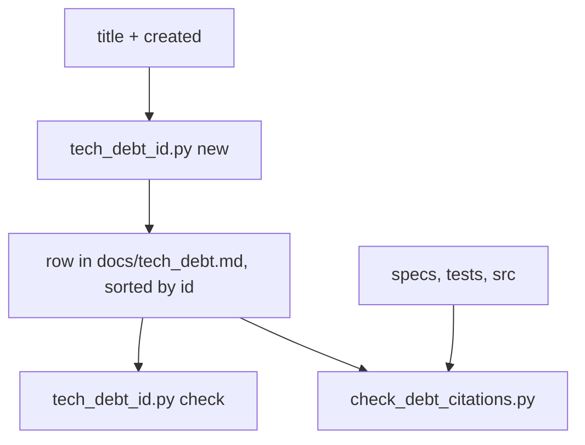

# Tech-debt rows carry a content-hash id, so two branches never compete for the next number

## Intent

A `docs/tech_debt.md` row is named by a hand-assigned integer, "the next
one after the last". Two branches opened the same day both take that
number, and whichever merges second renumbers its row and every citation
of it. This spec replaces the integer with an id derived from the row
itself (`TD-4b9e1d`), assigned by a script, so an append on one branch can
never collide with an append on another.

## Context

| # | Fact | Where |
|---|---|---|
| F1 | The ledger is one Markdown table, `\| # \| Item \| Why it's debt \| Location \| Fix \|`, 71 rows numbered 1..79 by hand | `docs/tech_debt.md:7-8`, `grep -c '^\| [0-9]' docs/tech_debt.md` → 71 |
| F2 | Rows are removed when they land ("Remove an entry when it lands"), leaving gaps after 17, 33, 45 and 58; a removed row's number is never reused, but every citation of it then points at nothing | `docs/tech_debt.md:3-5`; gap scan of the `#` column, 2026-10-21 |
| F3 | Rows are cited by number from specs, tests and PR bodies, in at least five spellings: `tech_debt #57`, `tech debt #18`, `` `tech_debt.md` row 41 ``, `tech_debt.md entry 10`, `tech-debt ledger item #1` | `grep -rhoE 'tech[_ -]debt[^\|]{0,20}#[0-9]+\|tech_debt\.md[^ ]{0,10} ?(row\|entry\|#) ?[0-9]+' docs src tests`, 31 files mention the ledger |
| F4 | Citations reach code and tests, not only docs: `tests/unit/test_review_team.py:775` (`tech_debt #69`), `tests/unit/test_spec_gate_vitest_body.py:3` (`tech_debt row 60`), and the Context table of `SP-REFUTER-JUDGES-WHAT-IT-CAN` cites `docs/tech_debt.md:62` (row 57) — a line number and a row number, both of which move | those files |
| F5 | On 2026-10-21 every merge conflict across Yoob and repoach came from hand-numbered rows: PRs #229, #230 and #231 here (and Yoob !301-!304) each needed their row renumbered by hand, #231 twice, with the citations in specs, tests and PR bodies fixed after | reported by the owner's session, 2026-10-21; `git log --since=2026-10-20 -- docs/tech_debt.md` shows the three PRs and their `Merge remote-tracking branch 'origin/develop'` commits |
| F6 | No check today resolves a row citation: `scripts/check_links.py` resolves Markdown links and paths, `scripts/check_contributing.py` the paths of `CONTRIBUTING.md`; a citation of a removed or renumbered row passes every gate | `scripts/check_links.py:1-30`, `scripts/ci_local.sh:142-144` |
| F7 | The sister ledger in Yoob (`docs/BACKLOG.md`, `B-nnn`) has the same defect and gets the same design in its own spec (`docs/specs/2026-10-21_order-independent-backlog-ids.md` there); the two scripts share the algorithm, not the code | Yoob `docs/BACKLOG.md`, Yoob MR for that spec |

## Goals

- G1: a new row's id is a function of the row, not of the rows before it:
  two branches appending the same day produce two different ids and no
  renumbering.
- G2: the id is assigned by `scripts/tech_debt_id.py`, never typed; a lint
  refuses a duplicate id and a row added with an id the script would not
  have produced.
- G3: every existing citation keeps resolving for one release, through an
  alias column holding the old number.
- G4: a citation of a ledger id anywhere in docs, specs, src and tests
  resolves to a row (open, or closed with a tombstone), or the check fails
  naming the citing `file:line`.

## Non-Goals

- NG1: no change to what a debt row means or to its columns other than
  `id`, `alias` and `created`.
- NG2: no rewrite of past PR bodies on GitHub; they keep the old numbers,
  which the alias column resolves.
- NG3: no shared library between Yoob and repoach: each repository owns
  its script, the algorithm is restated in each spec.
- NG4: no change to the spec-id scheme (`SP-*`), which is already
  order-independent.

## Assumptions

- A1: a row's title (the `Item` cell) and its creation date are known when
  the row is written; for migrated rows the creation date is the date of
  the commit that first added the row (`git log --diff-filter=A -S`).
- A2: the ledger stays under a few hundred rows: 6 hex digits (16.7 M
  values) make a collision between 300 rows about 0.3 % likely, and the
  script detects it rather than trusting the odds.

## Interface

Id:

- `TD-<h>` where `<h>` = the first 6 hex digits of
  `sha1(normalise(title) + "\n" + created)`; `normalise` = NFC, strip,
  collapse internal whitespace, strip Markdown backticks. `created` is
  `YYYY-MM-DD`.
- The id is computed once, at creation, and frozen: a later edit of the
  title does not change it. The lint judges the formula only on rows a
  diff adds (see Behavior).

Ledger table (new columns first, order otherwise unchanged):

`| id | alias | created | Item | Why it's debt | Location | Fix |`

- `alias`: the old `#` number for migrated rows, empty for new ones;
  removed after one release (owner decision D1).
- Rows are sorted by `id` (owner decision D3), so two appends land at
  unrelated positions in the file and merge without a textual conflict.
- A `## Closed` table keeps `| id | alias | closed | by |` for every row
  removed after this spec lands, so a citation of a closed row still
  resolves.

`scripts/tech_debt_id.py`:

- `new "<title>" [--created YYYY-MM-DD]` prints the id (today by default);
  exit 1 `duplicate id TD-xxxxxx (row "<title>")` if it already exists.
- `check [--base <ref>]` — the lint: exit 0 or 1 with one line per defect:
  `duplicate id TD-xxxxxx at lines a, b`, `malformed id <cell> at line n`,
  `hand-written id TD-xxxxxx at line n: expected TD-yyyyyy` (only for rows
  added relative to `--base`), `unsorted at line n`.
- `migrate` — one-shot: adds `id`/`alias`/`created`, fills `created` from
  git history, sorts, prints the old→new map.
- `resolve <citation>` — prints the row for `TD-xxxxxx` or for an alias
  number; exit 1 if neither exists.

`scripts/check_debt_citations.py`:

- scans `docs/`, `src/`, `tests/`, `scripts/` for the patterns of F3 and
  `TD-[0-9a-f]{6}`; exit 1 with `<file>:<line> <citation> unresolved`.
- run from `scripts/ci_local.sh` (fast mode) beside the other lints.

## Behavior

### Nominal

1. A contributor adding debt runs `python scripts/tech_debt_id.py new
   "<title>"`, inserts the row at its sorted place with the printed id.
2. `scripts/ci_local.sh --fast` runs `tech_debt_id.py check --base
   origin/develop` and `check_debt_citations.py`; both pass.
3. Two branches adding rows the same day get different ids at different
   positions; the second merge is a plain merge.

### Edge cases

- Two rows with the same title on the same day -> same id -> `duplicate
  id`, which is a real duplicate to merge by hand, not a numbering race.
- A 6-hex collision between different titles -> `new` refuses with
  `duplicate id`; the contributor rewords the title (owner decision D2
  may raise the length instead).
- A row whose title is edited later -> id unchanged; `check` judges the
  formula only on added rows, so the edit is not flagged.
- A citation of an alias number after the alias column is dropped ->
  `check_debt_citations.py` fails, naming it; the fix is to cite the id.

### Failure scenarios

- `migrate` cannot date a row from history -> stops, naming the row; no
  default date is invented.
- `check` with an unreachable `--base` -> exit 2 `cannot judge added
  rows: base <ref> not found`, never a silent pass.

## Architecture Impact

- Adds dependency: none — two standalone scripts under `scripts/`, no
  import of `src/repoach`.
- New / changed coupling, cycles, or shared state: the ledger format
  becomes a contract read by two scripts; it stays un-owned (`owns: []`)
  like the other `scripts/` lints.

## Diagram

## Acceptance Criteria

Run from the repository root with
`PATH=.venv/bin:$PATH PYTHONPATH=$PWD/src`.

- [ ] AC1: `python scripts/tech_debt_id.py new "Example" --created 2026-10-21`
  prints `TD-` + the first 6 hex of `sha1("Example\n2026-10-21")`, and
  `pytest tests/unit/test_tech_debt_id.py -k formula -v` pins it.
- [ ] AC2: `pytest tests/unit/test_tech_debt_id.py -k "duplicate or hand_written or unsorted" -v`
  — an engineered ledger with each defect produces exactly that message
  and exit 1; a clean ledger exits 0.
- [ ] AC3: `python scripts/tech_debt_id.py check --base origin/develop`
  exits 0 on the migrated `docs/tech_debt.md`, and every row has a
  non-empty `created`; each migrated row's `alias` equals its former `#`.
- [ ] AC4: `python scripts/check_debt_citations.py` exits 0 on the tree
  after migration, and `pytest tests/unit/test_check_debt_citations.py -v`
  shows a planted `tech_debt #999` and `TD-000000` each reported with
  their `file:line`.
- [ ] AC5: two branches from the same base each run `new` and add a row;
  `git merge` of the second into the first completes without conflict —
  a scripted case in `tests/unit/test_tech_debt_id.py -k concurrent_appends`.
- [ ] AC6: `scripts/ci_local.sh --fast` runs both scripts and is green;
  `repoach arch check --base origin/develop` is unchanged.

## Owner decisions needed

- D1: how long the `alias` column lives — one release (proposed), or until
  `check_debt_citations.py` finds no alias citation left.
- D2: hash length — 6 hex (proposed; ~0.3 % collision odds at 300 rows,
  detected by `new`) or 8 hex (negligible odds, longer citations).
- D3: sort key — by `id` (proposed: appends scatter, so two branches
  rarely touch adjacent lines) or by `created` (readable chronology, but
  same-day appends meet at the tail and still conflict textually, without
  renumbering).
- D4: a closed row — tombstone in a `## Closed` table (proposed) or keep
  today's plain removal and accept that its citations go dead.

## Gaps

- F5's six conflicts are the owner session's report; this spec measured
  the repoach side (three PRs touching `docs/tech_debt.md` with
  `origin/develop` merges on 2026-10-20/21), not each manual renumbering.
- PR bodies already on GitHub keep their old numbers (NG2); they resolve
  only while the alias column lives.

## Open Questions

- Q1: D1-D4 above. Must be resolved before `status` moves past `draft`.
- Q2: does `check_debt_citations.py` also scan open PR bodies through
  `gh pr view`, or only the tree? The tree is proposed; a PR body is
  judged by its reviewer.
