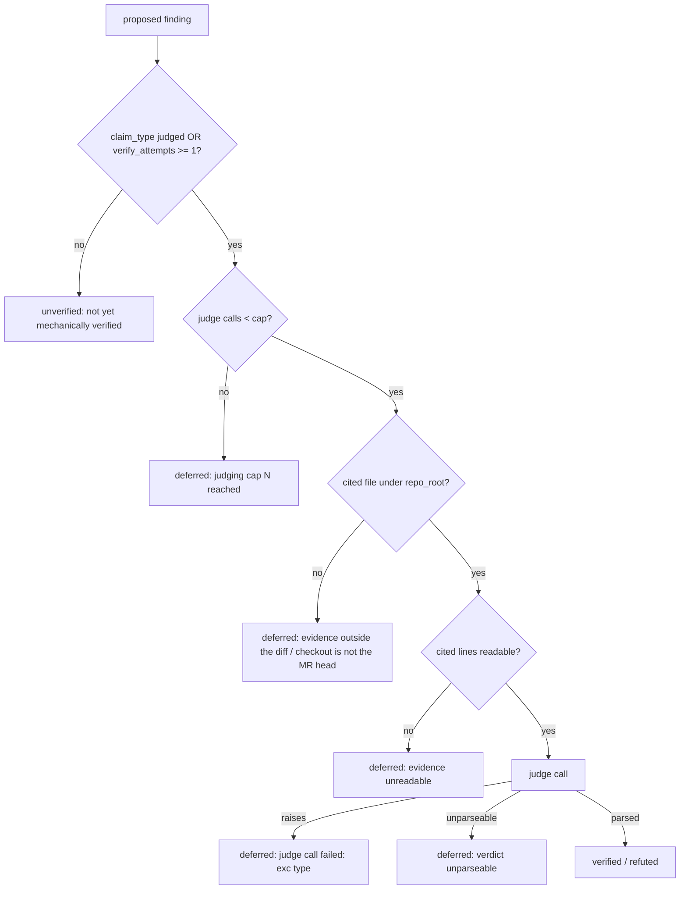

# Every deferred finding carries a named reason, and the judging cap is a setting

## Amendment (0.3, 2026-10-26): the report lists every finding that drives the verdict

| # | Fact | Where |
|---|---|---|
| F16 | Yoob MRs !324 (job 17451293380) and !327 (job 17451279178) ended `final_verdict = REQUEST_CHANGES` on one finding the mechanical pre-check had verified, while the JSON said 8 findings, 8 refuted: the gate blocked on a finding the report never showed | the two CI job logs |
| F17 | `verify_findings_for_pr` returned only aggregate counts, so no caller could name the findings it verified | `src/repoach/review/finding_verifiers.py` (before this amendment) |
| F18 | `review pr` printed `findings = [r.as_json() for r in team.refutations]`, the refuter's outcomes alone; a mechanically verified finding is no longer `proposed`, so the refuter never sees it | `src/repoach/cli/review_cmds.py`, `src/repoach/review/orchestrator.py` (`team.refutations = list(judging.outcomes)`) |
| F19 | `summarise_ledger_facts` / `verdict_from_facts` count a mechanically verified blocking finding as open, which is correct; only the report missed it | `src/repoach/review/merge_gate.py` |
| F20 | `tests/unit/test_review_head_guard.py::test_orchestrator_head_guard_overlaps_reviewer_fanout` failed on this amendment's first push (run 40241867969, 3.11 and 3.13) and fails alone on a loaded host (4.91 s against a 2.10 s bound) while it passes at the base `2706bb6`: `report_findings` called `init_findings_schema`, and creating the SQLite schema on a ledger nothing had initialised took 3.27 s of DDL there | `tests/unit/test_review_head_guard.py`, `src/repoach/review/report.py` (`755638f`) |

- G16: `verify_findings_for_pr` returns a `VerificationReport`: one
  `MechanicalVerification` per proposed finding (id, state, the
  verifier's method and evidence line); `.counts` keeps the former
  aggregate shape. `recorded_verifications` reads the same outcomes back
  from the ledger for a replayed run.
- G17: `MergeFacts.open_blocking_ids` lists exactly the ids
  `open_blocking_findings` counts, in both `summarise_ledger_facts` and
  `gather_merge_facts`.
- G18: the report (`review pr` JSON `findings[]`, the stderr
  `report: N finding(s) listed` table, the sticky report and the archive JSON)
  lists every finding that can move `final_verdict`, each once, with
  `judge` in {`mechanical`, `refuter`, `reverify`, `ledger`}, `state`,
  `verification_method` (`mechanical:<claim_type>` for a mechanical
  verifier) and `evidence`: mechanically settled findings, every
  refuter outcome (its `refutation` object kept whole: `state`,
  `reason` and, per G10, `evidence`, `evidence_truncated`,
  `evidence_tokens` and `detail` when set), the
  findings of older heads re-checked at the head, and any id of
  `open_blocking_ids` no judge of the run named.
- G19: the JSON carries `verdict_basis` = `open_blocking_ids`; every id
  in it is one `findings[]` entry with `blocking: true`.
- G20: the report only reads the ledger. An absent database or an
  absent `pr_findings` table is an empty ledger: the run's own outcomes
  are listed and nothing is written, so building the report never
  creates the schema (F20).

- [x] AC19: `pytest tests/unit/test_report_lists_every_verdict_finding.py -k "every_blocking_finding_counted" -v`
  — on a fixture with 1 mechanically verified + 2 refuter-refuted + 1
  cap-deferred finding, the report lists 4 entries, the blocking ones
  equal `open_blocking_ids` (1) and each such id appears once.
- [x] AC20: `pytest tests/unit/test_report_lists_every_verdict_finding.py -k "judge_and_method or replay or no_judge_named" -v`
  — the mechanical entry is `judge = mechanical`,
  `verification_method = mechanical:missing_test`; a replay rebuilt from
  the ledger yields the same JSON; a blocking id no judge named is
  still listed.
- [x] AC21: `pytest tests/unit/test_report_lists_every_verdict_finding.py -k "stderr_table or archive or authoritative" -v`
  — the stderr table and the sticky report render the judge column and
  the verdict basis; the archive JSON carries `findings` and
  `verdict_basis`; `gather_merge_facts` names the same ids.
- [x] AC22: real check, from a Yoob checkout with this branch on
  `PYTHONPATH`: `REPOACH_PROVIDER=claude_code repoach review pr 327
  --dry-run --forge gitlab` lists the mechanically verified finding with
  its method and `verdict_basis` names it.
- [x] AC23: `pytest tests/unit/test_report_lists_every_verdict_finding.py -k "uninitialised_ledger or never_creates or what_the_judge_was_served" -v`
  — an absent database stays absent, an empty file stays 0 bytes, and
  a refuter entry's `refutation` carries its evidence record.

## Amendment (0.2, 2026-10-25): the refuter defers what it cannot see, and its evidence fills its own context

### Facts

| # | Fact | Where |
|---|---|---|
| F12 | Yoob MRs !324/!327, `review:gate` artefacts (2026-10-25): the refuter marked 13/13 findings `refuted`. An independent re-read of each one against the head tree found 8 of the 13 verdicts wrong. Every wrong one reasons "<X> is not in the evidence, so the claim cannot be confirmed": a hand-typed `AcceleratorBoard` enum with no parity test, a half-derived hls4ml board table with 4 divergent boards, an Alembic migration with zero tests | `review-gate.json` of job 17451279178 (pipeline 2987034797, !327 head `8740195`), findings 1-4, 6-9 |
| F13 | The judge saw `_EVIDENCE_CONTEXT = 25` lines on each side of the cited range and nothing else. Persona v0.2.1 told it to answer **refuted** whenever the claim was "about code you cannot see". Not seeing the code was turned into the claim being false | `src/repoach/review/refuter.py:72` (develop `2706bb6`), `prompts/review/refuter_0.2.1.md` "Your task" |
| F14 | Owner rule (2026-10-25): "la fenêtre de contexte pour le réfuteur doit en tout cas être suffisamment grande pour qu'il fasse son travail". SP-AGENT-CONTEXT-LOOP D1 (draft) sets the refuter's `context_tokens` to 40 000 and discloses the estimator `ceil(utf8_chars / 3)`. This slice divides UTF-8 **bytes**, `ceil(utf8_bytes / 3)`: equal on ASCII, larger on multi-byte text, so it never under-counts | branch `docs/sp-agent-context-loop`, `docs/specs/2026-10-25_SP-AGENT-CONTEXT-LOOP_*.md` D1 and constraints |
| F15 | No `evidence_reads` ledger table exists on develop (#246 is a draft spec). So what the judge was served is recorded on the finding's refutation payload | `grep -rn evidence_reads src/` on develop `2706bb6`: no hit |

### Goals

- G6: The judge answers one of three verdicts: `refuted`, `verified` or `cannot_judge`. `cannot_judge` defers the finding with `evidence outside window`. So does a `refuted` whose reasoning only says the code was not visible ("not in the evidence", "cannot be confirmed", "cannot see", "unseen", "not visible", "outside the window"). Such a finding is never `refuted`. It stays `proposed`, is reported deferred and counts as not validated, exactly like a cap-deferred finding.
- G7: The evidence budget is the refuter's own `context_tokens`. The default and floor is 40 000 (F14). It is set by `[gates].refuter_context_tokens`, and `REPOACH_REFUTER_CONTEXT_TOKENS` outranks it. A value below the floor is refused. The budget is the context less the prompt, a 4 096-token contract reserve and the 2 048-token reply.
- G8: The evidence fills that budget in this priority order, read-only, path-jailed, from the pinned head tree:
  1. the whole cited file, with the cited lines marked `N:>`. A file over the budget is cut to a slice around the cited range. The slice never goes below the old ±25 lines: that window is now a floor, not the default;
  2. for every identifier, path and test name the claim names, the `git grep -n -I -F -w` hits over the tracked files with ±10 lines each (hit lines marked `N:*`, at most 50 hits in all, one `git grep` per finding, ranked nearest first: the cited file, then the files the claim names, then tests, then the rest), and whether each named path is present. A bare file name is looked up among the tracked files, and a file the claim names is served whole when it fits;
  3. the PR's diff hunks on the cited file;
  4. the spec section the finding cites: the blocks carrying a cited label (`G3`, `AC2`, ...) of the PR's spec or of a spec the claim names. A claim that names the spec, or a `spec_gap`, with no label gets the whole spec.
- G9: Content is cut only when the budget runs out, or when the 50-hit cap is reached. Then every item left out is named in the payload (`evidence_truncated`). The evidence opens with `PARTIAL EVIDENCE`, and the persona tells the judge that a claim resting on an item not served is `cannot_judge`.
- G11: The refuter cannot refute what it was not served. When the claim names an identifier whose hits exist but none was served (the search timed out or could not run, or the budget, the hit cap or the deadline left every hit out), the finding is deferred with `evidence outside window (<identifier> not served)` and the judge is not called. When only some hits were served, the judge may answer, but a `refuted` whose reasoning names that identifier becomes `cannot_judge`.
- G12: Bounds per finding: one `git grep` and at most one `git ls-files` (shared by every bare file name), each within 60 s; the whole assembly within 180 s (30/90 deferred everything on the review runner, a loaded machine). A step the deadline leaves out is named in `evidence_truncated`. When load kept the search from running, the deferral names it: `evidence outside window (grep timed out after 60 s: <ids>)` or `(assembly deadline of 180 s reached: <ids>)`, apart from `(<ids> not served)`. The judge's reply cap is 2 048 tokens, so the reasoning and the verdict line are never cut (a cut verdict is deferred and blocks the merge for a wrong reason). Thinking is off for the judge (`{"type": "disabled"}`, SP-AGENT-THINKING-CONTROL). The `claude_code` CLI receives both: `CLAUDE_CODE_MAX_OUTPUT_TOKENS` from the request's `max_tokens`, and `MAX_THINKING_TOKENS=0`.
- G13: Consumption is reported per run, and only reported. The run line ends `evidence_tokens total T`. The `review pr` / `review:gate` JSON carries `refuter_tokens: {evidence, total}`, where `total` is the `Refuter` row of the usage ledger. On !327 that row went from 14 299 to 397 057 tokens (×28, mostly cache writes); tech_debt #92 tracks prompt caching across the findings of one run.
- G14 (owner rule 2026-10-26: "la fenêtre de contexte doit se mesurer en tokens, pas en argent"): the evidence window is governed by `context_tokens` alone (floor 40 000). No cost figure — `max_cost_usd` of SP-AGENT-CONTEXT-LOOP, the usage ledger, `refuter_tokens` — cuts or shapes the evidence; they are reported after the run. Sizes use the one estimator this spec names, `ceil(utf8_bytes / 3)`.
- G15: The estimator's error is measured, not guessed. On !327 (claude_code, 9 calls), the estimate per call was about 16 550 tokens: 15 152 of evidence on average, plus the persona and the claim. The provider counted 43 281 input tokens per call: (18 + 162 108 cache read + 227 402 cache write) / 9, a ratio of 2.6. That gap includes the `claude` CLI's own system prompt, which this run cannot separate from the estimator's own error. A calibration factor per provider, derived from the usage ledger, is tech_debt #93. Until it lands, the budget stays the raw estimate.
- G10: Each outcome records what was served (`evidence`), what was not (`evidence_truncated`) and its size (`evidence_tokens`). They are in the `review pr` JSON and in the stored review run.

### Interface (delta)

```python
Verdict = Literal["refuted", "verified", "cannot_judge"]
EVIDENCE_OUTSIDE_WINDOW = "evidence outside window"   # added to DEFERRAL_REASONS

@dataclass(frozen=True)
class Refutation:
    ...
    evidence: tuple[str, ...] = ()            # e.g. "src/m.py:1-120 (whole file)", "grep X: 9 hits (9 served)"
    detail: str = ""                          # the judge's reasoning behind a cannot_judge
    evidence_truncated: tuple[str, ...] = ()  # items not served, each named
    evidence_tokens: int = 0                  # ceil(utf8_bytes / 3)

def judge_finding(finding, *, repo_root, judge, absent_reason=..., context_tokens=40_000,
                  diff="", pr_spec=None) -> Judgement: ...
def judge_findings_for_pr(..., diff: str = "", pr_spec: tuple[str, str] | None = None,
                          context_tokens: int | None = None) -> JudgingReport: ...
```

Persona `prompts/review/refuter_0.3.0.md` replaces `refuter_0.2.1.md`. Verdict line: `VERDICT: {"verdict": "refuted" | "verified" | "cannot_judge", "reasoning": "..."}`. The parser still reads the old `{"refuted": <bool>}` shape. Evidence assembly lives in `src/repoach/review/refuter_evidence.py`.

### Acceptance Criteria (amendment)

- [x] AC7: `pytest tests/unit/test_refuter_defers_unseen.py -k "cannot_judge or unseen_refutation"`: the literal `cannot_judge`, and a refutation whose reasoning says the code is not in the evidence, both parse to `cannot_judge`. A refutation that cites proof stays `refuted`.
- [x] AC8: `-k truly_absent`: the claims end `deferred` with `evidence outside window`. The ledger keeps them `proposed`, none is `refuted`, `summary_line()` reads `deferred 2 (evidence outside window ×2)`, and the payload carries `evidence`, `evidence_truncated` and `evidence_tokens`.
- [x] AC9: `-k "hand_typed_enum or half_derived_table or untested_migration"`: the three hidden !327 cases are built as fixtures. The judge now sees the enum's other users, the second table and its contents, and the migration's absent test. It returns `verified`, never `refuted`.
- [x] AC10: `-k "whole_cited_file or over_the_budget or ten_lines or fifty or priority_order or diff_hunks or spec_section or bare_file_name or too_common"`: the whole file is served (300 lines, no truncation). A file over the budget becomes a named slice that never goes below ±25 lines. Hits come with ±10 lines and are capped at 50, the overflow named. Budget exhaustion is named. Diff hunks and the cited spec block are served.
- [x] AC11: `-k context_tokens_floor`: the default is 40 000. `repoach.toml` and then the env override it. A value below 40 000 is refused.
- [x] AC12: `-k "path_jailed or forge_a_verdict"`: a path outside the tree is reported absent, and no evidence line can start with `VERDICT:` at column one.
- [x] AC13: the real check, read-only. `REPOACH_PROVIDER=claude_code repoach review pr 327 --dry-run --forge gitlab --force` from the Yoob checkout, with this branch on `PYTHONPATH`. It reports every finding's state and its `evidence_tokens`. Several of the findings formerly `refuted` for unseen code are now `verified` or `deferred`.
- [x] AC15: `-k "grep_timeout or cut_by_the_budget or partly_served or nearest_fifty or closed_set_template"`. A `git grep` timeout and hits cut by the budget both defer with `evidence outside window (<identifier> not served)`, and the judge is not called. An identifier with 212 hits serves the 50 nearest (the named file first, then the test). A `refuted` that names a partly served identifier ends `deferred`; one that does not stays `refuted`.
- [x] AC16: `-k "deadline or one_ls_files"`: a passed deadline names the search and the diff as not served; two bare file names cost one `git ls-files`.
- [x] AC17: `pytest tests/unit/test_claude_code_output_cap.py`: `max_tokens` reaches the CLI child as `CLAUDE_CODE_MAX_OUTPUT_TOKENS`, also through a filtered environment, and a disabled `thinking` as `MAX_THINKING_TOKENS=0`. `-k refuter_route`: the refuter's loop asks for at least 2 048 tokens with thinking disabled. `-k grep_timeout`: the reason reads `evidence outside window (grep timed out after 60 s: <ids>)`.
- [x] AC18: `-k "refuter_cost or tokens_never_money"`: the run line ends `evidence_tokens total T`, and `refuter_tokens_json` returns `{evidence, total}` from the usage row. Neither the evidence assembly nor the refuter imports the usage ledger, and no parameter of `build_evidence`, `judge_finding` or `judge_findings_for_pr` names a cost (G14).
- [x] AC14: measurement method. A refuter verdict is checked by an **independent re-read**: a reviewer who did not produce it re-reads each `refuted` claim against the head tree. A refutation is wrong when the claim holds at the head. The ratio of wrong refutations is the metric, never the refuter's own counts.

### Measurement (AC13, 2026-10-25)

Before: `review:gate` artefact of job 17451279178, head `8740195`, persona v0.2.1, ±25-line window. All 8 judged findings (ids 1-4, 6-9) were `refuted`. After (run after the last code edit): `REPOACH_PROVIDER=claude_code repoach review pr 327 --dry-run --forge gitlab --force` from the Yoob checkout, run on this branch at the same head. The reviewers ran again, so the after-run carries its own findings. A finding is matched to the earlier one at the same file within 6 lines. Findings 7, 8 and 9 of the earlier run were not raised again.

| id | finding | type | before | after | evidence tokens | truncated items | reason / detail |
|---|---|---|---|---|---|---|---|
| 31 | `src/yoob/codegen/hls4ml/pipeline.py:294` | design | refuted (#2) | verified | 29070 | 2 | BOARD_FPGA_PARTS derives only orangecrab from BOARD_CONFIGS; the other 7 entries are hand-typed; open B-201 lists clock/part mismatches; the parity te |
| 42 | `api/exceptions.py:585` | design | new | refuted | 19206 | 0 | Import is lazy (l.599), API→core like yoob.errors at l.40; spec requires one shared message helper, so building the message at raise sites duplicates  |
| 43 | `api/schemas/accelerator.py:57` | design | refuted (#1) | refuted | 15883 | 0 | validate_board takes valid boards from AcceleratorBoard itself (no copied list); runs mode=before to swap pydantic's enum error for UnknownBoardError  |
| 44 | `api/routes/reference_apps.py:143` | design | refuted (#4) | verified | 5983 | 1 | SoCBody.__post_init__ (reference_application.py:484) already raises on board not in BOARD_CONFIGS; route lines 141-145 re-import and re-run the identi |
| 45 | `src/yoob/codegen/hls4ml/pipeline.py:294` | design | refuted (#2) | verified | 29070 | 2 | Seven boards in BOARD_FPGA_PARTS are hand-typed; only orangecrab reads BOARD_CONFIGS. The parity test checks keys only and no other hit compares value |
| 35 | `api/schemas/accelerator.py:58` | missing_test | refuted (#6) | verified | 12202 | 3 | Named test has 0 hits; test_unknown_board_refusal.py (served whole) only posts 'generic'; all AcceleratorBoard hits served, none passes an enum member |
| 46 | `api/alembic/versions/n0g1e2n3r4c5_relabel_generic_board.py:47` | missing_test | new | verified | 2833 | 1 | Head-tree search finds 0 hits for the named roundtrip test and 0 for the migration's file stem, so no test loads it by path; the diff adds only the mi |
| 47 | `api/alembic/versions/n0g1e2n3r4c5_relabel_generic_board.py:98` | missing_test | new | deferred | 2830 | 1 | evidence outside window / 0 hits for the suggested test name and module stem, but the revision ID and generic offline/--sql migration tests weren' |
| 48 | `api/tests/test_unknown_board_refusal.py:109` | missing_test | new | verified | 19295 | 2 | Line 118 hard-codes len(boards)==8 right after line 117's sorted equality with sorted(BOARD_CONFIGS), which already fixes the count. The literal is re |

Run line: `refuter: judged 8, refuted 2, deferred 1 (evidence outside window), unverified 0`. There are 9 outcomes: 6 `verified`, 2 `refuted`, 1 `deferred` (`judged 8` counts the verdicts of this pass; 31 and 45 are two findings on the same site). Finding 31 was deferred by an earlier run on the same head. It was still `proposed`, so this run judged it again, and it ended `verified`.

How the earlier refuted sites ended, where the reviewers raised them again:

| earlier `refuted` | now |
|---|---|
| #2 `hls4ml/pipeline.py:294`, half-derived table | `verified` (31 and 45): 7 of the 8 boards are hand-typed, and the parity test checks keys only |
| #4 `reference_apps.py:144`, duplicated board check | `verified` (44) |
| #6 `accelerator.py:58`, missing validator test | `verified` (35): the named test has 0 hits, and the test file was served whole |
| #9 migration, missing test | `verified` (46, line 47) and `deferred` (47, line 98) |
| #1 `accelerator.py:57`, hand-typed enum | `verified` in the first after-run (30 in `after_v1.json`: "validate_board derives `valid` from the hand-typed AcceleratorBoard enum"). In this run the reviewers raised a different claim at that site (43: `validate_board` duplicates the enum and imports `api.exceptions`), and its refutation is accurate |
| #3 `exceptions.py:596` | `refuted` (42, line 585), on cited lines |
| #7, #8 | not raised again by the reviewers in this run |

Evidence size per judged finding, under `ceil(utf8_bytes / 3)`: min 2 830, median 15 883, max 29 070 tokens across the 9 outcomes. Every finding fit in the 40 000-token context with the prompt and the 4 896-token reserve of that run (6 144 since the reply cap is 2 048). No item was left out for budget. Every `truncated items` entry is either the 50-hit cap or an identifier over 200 hits that this run left unserved. That rule left `BOARD_CONFIGS` (202 hits) unserved on 3 findings and is replaced by G11/G12: the 50 nearest hits are served, and a refutation resting on the rest is deferred. 9 judge calls in 109.4 s. The run was not repeated after G11–G13: the table above measures the code before them.

The run before the last edit used one `git grep` per identifier with a 30 s timeout. On the loaded tower it timed out 5 times, and two deferrals came from it. It was replaced by one `git grep` per finding with a 120 s timeout: 0 timeouts in this run. G12 brings the timeout back to 30 s, now for the one search of the finding, under a 90 s deadline; a timeout now defers the finding without a judge call (G11).

## Intent

`judge_findings_for_pr` collapses five unrelated reasons a finding does
not get a verdict into one integer (`counts["deferred"]`) — and, in one
of the five, into nothing at all: the finding is neither counted nor
logged. tech_debt #57 ("The refuter made no model call on Yoob !296")
is unresolvable from the log line alone because of this. This spec
names every deferral, so the aggregate the refuter logs and the number
an operator reads are never two different things again.

## Context

| # | Fact | Where |
|---|---|---|
| F1 | Two real `REPOACH_PROVIDER=claude_code --dry-run` reviews of Yoob MR !296 the same day: the earlier run made 3 refuter calls; the later `review pr 296 --dry-run` (69 s, 223 k tokens) recorded 19 findings deferred, 0 judged, no refuter row in the usage ledger, against 5 reviewer-role model calls (4 lenses + 1 round-2 Sentinel) | `docs/tech_debt.md:62` (row 57) |
| F2 | MR !296 touches only `ci/review-advisory.sh`, `.gitlab-ci.yml`, `docs/BACKLOG.md`, `docs/developer_guide/workflows.md`, `tests/scripts/test_ci_minutes.sh`, `tests/scripts/test_review_advisory.sh` — shell/YAML/Markdown, no Python | `glab mr diff 296 --repo josephwfaye/yoob_2` (yoob_2 repo, read-only) |
| F3 | `JUDGED_CLAIM_TYPES = {DESIGN, SECURITY, SPEC_GAP}`; a finding of any other claim type only reaches the refuter once `verify_attempts >= 1` | `src/repoach/review/findings.py:58`, `src/repoach/review/refuter.py:202-206` |
| F4 | `verify_finding` defers (returns `PROPOSED`, bumping `verify_attempts`) every claim type with no mechanical verifier — `BROKEN_BEHAVIOR`, `SPEC_GAP`, `DESIGN`, `SECURITY` all hit this branch, not only the judged types | `src/repoach/review/finding_verifiers.py:176-178` |
| F5 | A finding with `verify_attempts == 0` and a non-judged claim type is excluded from `judged_targets` entirely — it contributes to none of `verified`/`refuted`/`deferred`. Already pinned by the existing suite | `src/repoach/review/refuter.py:201-206`, `tests/unit/test_refuter.py:186-201` (`test_judge_findings_no_targets_never_builds_judge`, asserts `counts == {"verified": 0, "refuted": 0, "deferred": 0}`) |
| F6 | `_evidence_excerpt` returns `None` — no model call, reason `"evidence unreadable"` computed then discarded by the caller — when the finding's cited file does not resolve under `repo_root` | `src/repoach/review/refuter.py:82-95,168-170`, `src/repoach/review/hallucination_guard.py:147-168` (`_default_file_reader`, `target.is_file()`) |
| F7 | `_MAX_JUDGED = 10` is a module constant; findings past the cap are added to `counts["deferred"]` in bulk with no per-finding identity | `src/repoach/review/refuter.py:59-61,224` |
| F8 | `orchestrator.py` wraps `verify_findings_for_pr` in its own `try`/`except`; a raise there is logged and swallowed, leaving every non-judged-type finding's `verify_attempts` at 0 before `judge_findings_for_pr` runs two lines later — the F5 condition | `src/repoach/review/orchestrator.py:672-698` |
| F9 | tech_debt #57 itself names a sixth, untraced candidate this spec does not rule out: a finding whose content was already judged in the ledger from the earlier same-day run, filtered before ever reaching `judged_targets` by some dedup path this investigation did not locate | `docs/tech_debt.md:62` |
| F10 | `refuter.py` never reads `severity`, and has no comment-only verdict branch — the two candidate predicates named in the triggering investigation brief are ruled out by reading the source | `src/repoach/review/refuter.py` (full read) |
| F11 | `refuter.py`, `finding_verifiers.py` and `hallucination_guard.py` are currently frontier (no `owns.code` in any spec's frontmatter); `findings.py` is owned by `SP-FINDINGS-INIT-RACE`, `orchestrator.py` by `SP-ORCH-DOCSTRING` | `repoach arch graph --format json` (develop 45712b2), cross-checked against `docs/tech_debt.md:61` (row 56, same frontier gap on `cli/`) |

F11 means this spec's `depends_on` can only name the two files that are
actually owned today. `refuter.py`, `finding_verifiers.py` and
`hallucination_guard.py` have no owning spec to depend on — the
implementation slice that follows this draft is the natural place to
promote `refuter.py` into the governed regime (give it an `owns`), per
`SP-SPEC-TEMPLATE`'s opportunistic-erosion rule, rather than this
documentation-only slice inventing an edge to a spec that owns nothing.

## Goals

- G1: Every deferred finding carries a named reason, both in
  `judge_findings_for_pr`'s return value and in whatever the
  orchestrator logs — a closed set of tags, not a free-text string that
  drifts (the table under Interface).
- G2: F5's silent exclusion gets an explicit bucket (`unverified`) so
  it is counted and named instead of invisible.
- G3: The judging cap (`_MAX_JUDGED`) becomes a `GatesConfig` setting
  (`refuter_max_judged`, default 10) instead of a hardcoded module
  constant, read the same way `verify_finding` already reads
  `load_gates_config(repo_root)`.
- G4: The refuter judges every finding whose evidence is readable — the
  cap and unreadable-evidence paths remain the only two ways a
  judgeable finding can still end up without a verdict.
- G5: F9 is resolved or explicitly closed as not-applicable before this
  spec can move past `draft` — either the dedup path is found and
  named as a sixth tag, or an implementation-slice trace (tech_debt
  #57's own prescribed fix: "log why each finding is deferred, and
  assert a refuter row when a judgeable finding exists," run with the
  ledger reset) shows it was never the cause.

## Non-Goals

- NG1: Changing what counts as "evidence unreadable" (whether an
  off-diff or hallucinated file should be judgeable at all) —
  `SP-FINDINGS-OFFDIFF-FILTER` owns the off-diff question at recording
  time; this spec only names the outcome when evidence is unreadable at
  judging time.
- NG2: Raising or removing the default cap value — 10 stays the
  default; only its configurability is in scope.
- NG3: Any merge-gate or verdict change — still dual-run, no merge
  decision changes here.
- NG4: Claiming ownership of `refuter.py` / `finding_verifiers.py` /
  `hallucination_guard.py` in this spec's `owns` — that is the
  implementation slice's decision, not this draft's (taken: see Gaps).

## Assumptions

- A1: `judge_findings_for_pr`'s former `dict[str, int]` contract
  had a small, enumerable set of callers
  (`orchestrator.py` plus the unit suite) that can all be updated in
  one slice — verified by F8 and the existing test file being the only
  non-orchestrator caller.
- A2: `GatesConfig` already supports project-level overrides read from
  `repo_root` (F4's sibling, `finding_verifiers.py:179`), so adding one
  more key is additive, not a new mechanism.

## Interface

```python
RefutationState = Literal["verified", "refuted", "deferred", "unverified"]

@dataclass(frozen=True)
class Refutation:
    finding_id: int | None
    file: str
    line_start: int
    claim_type: ClaimType
    state: RefutationState
    reason: str  # the judge's reasoning for a verdict, else one closed-set reason

@dataclass(frozen=True)
class JudgingReport:
    outcomes: tuple[Refutation, ...]
    model_calls: int
    counts: dict[str, int]            # property: verified / refuted / deferred / unverified
    deferrals: tuple[Refutation, ...]  # property: outcomes without a verdict
    def summary_line(self) -> str: ...

def judge_findings_for_pr(
    db_path: Path,
    *,
    pr_number: int,
    repo_root: Path,
    head_sha: str | None,
    judge_factory: Callable[[], Judge] = make_refuter_judge,
    max_judged: int | None = None,  # None reads GatesConfig.refuter_max_judged, default 10
    diff_files: Collection[str] = (),
    tree_sha: str | None = None,
    review_head: str | None = None,  # defaults to head_sha
) -> JudgingReport: ...
```

Inputs: unchanged, plus the optional `max_judged` override (tests only;
production reads `[gates].refuter_max_judged`), the diff's paths, the
commit `repo_root` is at, and the head the review is about.

Outputs: one `Refutation` per proposed finding, each in exactly one
state; `sum(counts.values()) == len(outcomes)` always. Reasons of the
two verdict-less states come from a closed set, details inline:

| State | Reason |
|---|---|
| `deferred` | `evidence outside the diff` — cited file is not a file under `repo_root` |
| `deferred` | `checkout is not the MR head (<sha7>)` — cited file is in the diff, absent from a tree whose commit is not the head |
| `deferred` | `evidence unreadable` — file there, cited lines not |
| `deferred` | `judging cap N reached` |
| `deferred` | `verdict unparseable` |
| `deferred` | `judge call failed: <exception type>` |
| `unverified` | `not yet mechanically verified` |

The cap counts judge calls, so a finding with unreadable evidence never
uses a slot. `review pr` adds `findings[i] = {id, file, line,
claim_type, refutation: {state, reason}}` to its JSON and one stderr
line, `refuter: judged 3, refuted 1, deferred 2 (evidence unreadable
×2), unverified 1 (not yet mechanically verified)`.

Errors: none new — a judge exception yields `judge call failed:
<exception type>`, never an unhandled raise; a judge factory that
raises is built once and names its exception on every finding it
leaves.

## Behavior

### Nominal
A `design` finding with readable evidence and a well-formed judge reply
→ `verified` or `refuted`, absent from `deferrals`.

### Edge cases
- Non-judged claim type, `verify_attempts == 0` (the verifiers have not
  run on it this pass) → `unverified`, reason `not yet mechanically
  verified` (before: invisible, F5).
- 12 judgeable findings, cap 10 → 10 judged, 2 `deferred` with
  `judging cap 10 reached`, each named by id, file and claim type (F7).
- Cited file absent under `repo_root` → `deferred`, `evidence outside
  the diff`, or `checkout is not the MR head (<sha7>)` when the file is
  in the diff and the tree is not at the head; zero model calls (F6).

### Failure scenarios
- Judge raises → `deferred`, `judge call failed: <exception type>`; the
  PR review itself is unaffected (the orchestrator guards the call, F8).
- `verify_findings_for_pr` raises → logged at warning with the
  exception name; the findings it left are reported `unverified`.
- `[gates].refuter_max_judged` invalid → the config load refuses it; the
  refuter logs the error and falls back to 10, never a crash.

## Architecture Impact

- Adds dependency: SP-REFUTER-JUDGES-WHAT-IT-CAN -> SP-FINDINGS-INIT-RACE
  (reads/writes the `pr_findings` ledger `findings.py` owns — unchanged
  schema).
- Adds dependency: SP-REFUTER-JUDGES-WHAT-IT-CAN -> SP-ORCH-DOCSTRING
  (the orchestrator's `judge_findings_for_pr` call site logs one
  `review_team.finding_deferred` event per verdict-less finding).
- Owns `refuter.py`, `hallucination_guard.py` and
  `finding_verifiers.py` (formerly frontier, F11);
  SP-UNIVERSAL-GATES declares its edge to this spec
  (`tests/unit/test_gates_language.py` imports `finding_verifiers.py`).

## Diagram



## Acceptance Criteria

Run from `repoach` with `PATH=.venv/bin:$PATH PYTHONPATH=$PWD/src`.

- [x] AC1: `pytest tests/unit/test_refuter.py -k "deferral_reason" -v` —
  each deferral reason (outside the diff, checkout not at head,
  unreadable, cap, unparseable, judge failed) is produced by an
  engineered finding with that exact text.
- [x] AC2: `pytest tests/unit/test_refuter.py -k "unverified_target" -v`
  — a `BROKEN_BEHAVIOR` finding with `verify_attempts == 0` ends
  `unverified`, reason `not yet mechanically verified`, and
  `counts["unverified"] == 1` (before: counted nowhere, F5).
- [x] AC3: `pytest tests/unit/test_refuter.py -k "judges_every_readable" -v`
  — N findings with readable evidence and N <= `max_judged` all end
  `verified` or `refuted`, never `proposed`.
- [x] AC4: `grep -n "refuter_max_judged" src/repoach/gates/config.py &&
  pytest tests/unit/test_refuter.py -k "max_judged_configurable" -v` —
  `refuter_max_judged = 3` caps a 5-finding batch at 3 judged + 2
  `deferred` with `judging cap 3 reached`; an unset config keeps 10.
- [x] AC5: `pytest tests/unit/test_review_team.py -k "finding_deferred_event" -v`
  — one `review_team.finding_deferred` event per verdict-less finding;
  `review_team.findings_judged` logs the four counts and `model_calls`.
- [x] AC6: `ruff check` / `ruff format --check` on the touched modules
  and `pytest tests/unit/test_refuter.py tests/unit/test_review_team.py
  tests/unit/test_finding_verifiers.py` green;
  `test_judge_findings_no_targets_never_builds_judge` now asserts the
  `unverified` bucket instead of pinning the silent exclusion.

## Owner decisions needed

- D1 (taken by the implementation slice): `judge call failed` carries
  the exception type name only, never the message.

## Gaps

- F9 / G5: the "already judged in the ledger from the earlier run"
  candidate from tech_debt #57 is not traced by this spec. Until it is
  either found in the code or ruled out by a reset-ledger re-run (as
  tech_debt #57 itself prescribes), this spec's F5/F6/F7 predicates are
  the demonstrated causes of a zero-call, all-deferred refuter pass —
  not yet proven to be the *only* ones that produced !296's specific 19.
- The implementation slice promoted `refuter.py`,
  `hallucination_guard.py` and `finding_verifiers.py` into this spec's
  `owns.code`; `repoach arch graph --check` lists the same cycles with
  and without the promotion (none involves this spec), which answers
  Q2.
- Verdicts read the checkout, not the head, until SP-REVIEW-PINS-HEAD:
  a review that reads a tree other than the PR head judges stale or
  absent evidence; the `checkout is not the MR head` reason names the
  absent case, a present-but-stale file is still judged as it stands.

## Open Questions

- Q1: when G5's trace lands, does it add another deferral reason
  tag ("already judged this PR") or show F9 was never the cause on
  !296? Must be resolved before `status` can move past `draft`.
- Q2: does the implementation slice promote `refuter.py` with its own
  `owns.code`, or fold it into `SP-FINDINGS-INIT-RACE` / a renamed
  verification-pipeline spec covering `finding_verifiers.py` too? Must
  be resolved before `status: approved` (an un-owned file the
  implementation slice edits is itself the kind of frontier gap
  tech_debt #56 already flags for `cli/`).
