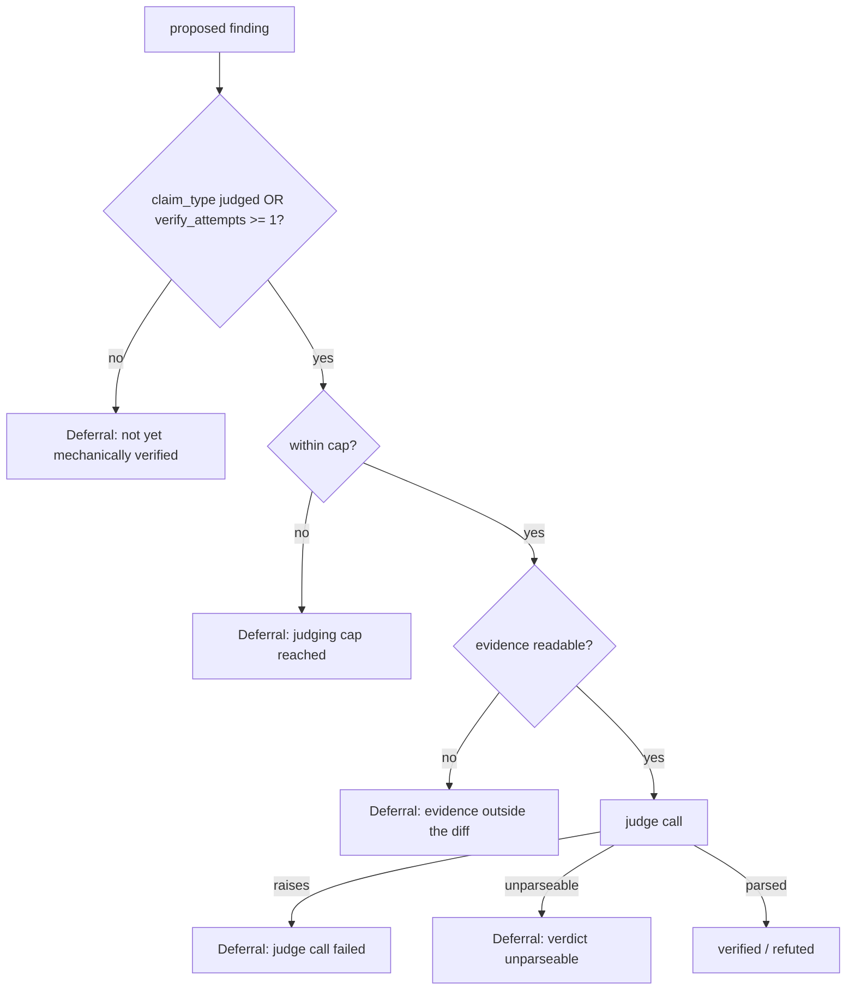

# Every deferred finding carries a named reason, and the judging cap is a setting

## Intent

`judge_findings_for_pr` collapses five unrelated reasons a finding does
not get a verdict into one integer (`counts["deferred"]`) — and, in one
of the five, into nothing at all: the finding is neither counted nor
logged. tech_debt #57 ("The refuter made no model call on Yoob !296")
is unresolvable from the log line alone because of this. This spec
names every deferral, so the aggregate the refuter logs and the number
an operator reads are never two different things again.

## Context

| # | Fact | Where |
|---|---|---|
| F1 | Two real `REPOACH_PROVIDER=claude_code --dry-run` reviews of Yoob MR !296 the same day: the earlier run made 3 refuter calls; the later `review pr 296 --dry-run` (69 s, 223 k tokens) recorded 19 findings deferred, 0 judged, no refuter row in the usage ledger, against 5 reviewer-role model calls (4 lenses + 1 round-2 Sentinel) | `docs/tech_debt.md:62` (row 57) |
| F2 | MR !296 touches only `ci/review-advisory.sh`, `.gitlab-ci.yml`, `docs/BACKLOG.md`, `docs/developer_guide/workflows.md`, `tests/scripts/test_ci_minutes.sh`, `tests/scripts/test_review_advisory.sh` — shell/YAML/Markdown, no Python | `glab mr diff 296 --repo josephwfaye/yoob_2` (yoob_2 repo, read-only) |
| F3 | `JUDGED_CLAIM_TYPES = {DESIGN, SECURITY, SPEC_GAP}`; a finding of any other claim type only reaches the refuter once `verify_attempts >= 1` | `src/repoach/review/findings.py:58`, `src/repoach/review/refuter.py:202-206` |
| F4 | `verify_finding` defers (returns `PROPOSED`, bumping `verify_attempts`) every claim type with no mechanical verifier — `BROKEN_BEHAVIOR`, `SPEC_GAP`, `DESIGN`, `SECURITY` all hit this branch, not only the judged types | `src/repoach/review/finding_verifiers.py:176-178` |
| F5 | A finding with `verify_attempts == 0` and a non-judged claim type is excluded from `judged_targets` entirely — it contributes to none of `verified`/`refuted`/`deferred`. Already pinned by the existing suite | `src/repoach/review/refuter.py:201-206`, `tests/unit/test_refuter.py:186-201` (`test_judge_findings_no_targets_never_builds_judge`, asserts `counts == {"verified": 0, "refuted": 0, "deferred": 0}`) |
| F6 | `_evidence_excerpt` returns `None` — no model call, reason `"evidence unreadable"` computed then discarded by the caller — when the finding's cited file does not resolve under `repo_root` | `src/repoach/review/refuter.py:82-95,168-170`, `src/repoach/review/hallucination_guard.py:147-168` (`_default_file_reader`, `target.is_file()`) |
| F7 | `_MAX_JUDGED = 10` is a module constant; findings past the cap are added to `counts["deferred"]` in bulk with no per-finding identity | `src/repoach/review/refuter.py:59-61,224` |
| F8 | `orchestrator.py` wraps `verify_findings_for_pr` in its own `try`/`except`; a raise there is logged and swallowed, leaving every non-judged-type finding's `verify_attempts` at 0 before `judge_findings_for_pr` runs two lines later — the F5 condition | `src/repoach/review/orchestrator.py:672-698` |
| F9 | tech_debt #57 itself names a sixth, untraced candidate this spec does not rule out: a finding whose content was already judged in the ledger from the earlier same-day run, filtered before ever reaching `judged_targets` by some dedup path this investigation did not locate | `docs/tech_debt.md:62` |
| F10 | `refuter.py` never reads `severity`, and has no comment-only verdict branch — the two candidate predicates named in the triggering investigation brief are ruled out by reading the source | `src/repoach/review/refuter.py` (full read) |
| F11 | `refuter.py`, `finding_verifiers.py` and `hallucination_guard.py` are currently frontier (no `owns.code` in any spec's frontmatter); `findings.py` is owned by `SP-FINDINGS-INIT-RACE`, `orchestrator.py` by `SP-ORCH-DOCSTRING` | `repoach arch graph --format json` (develop 45712b2), cross-checked against `docs/tech_debt.md:61` (row 56, same frontier gap on `cli/`) |

F11 means this spec's `depends_on` can only name the two files that are
actually owned today. `refuter.py`, `finding_verifiers.py` and
`hallucination_guard.py` have no owning spec to depend on — the
implementation slice that follows this draft is the natural place to
promote `refuter.py` into the governed regime (give it an `owns`), per
`SP-SPEC-TEMPLATE`'s opportunistic-erosion rule, rather than this
documentation-only slice inventing an edge to a spec that owns nothing.

## Goals

- G1: Every deferred finding carries a named reason, both in
  `judge_findings_for_pr`'s return value and in whatever the
  orchestrator logs — a closed set of tags, not a free-text string that
  drifts: `"evidence outside the diff"`, `"judging cap N reached"`,
  `"verdict unparseable"`, `"judge call failed: <exc type>"`,
  `"not yet mechanically verified"`.
- G2: F5's silent exclusion gets an explicit third bucket
  (`unverified_targets`) so it is counted and named instead of invisible.
- G3: The judging cap (`_MAX_JUDGED`) becomes a `GatesConfig` setting
  (`refuter_max_judged`, default 10) instead of a hardcoded module
  constant, read the same way `verify_finding` already reads
  `load_gates_config(repo_root)`.
- G4: The refuter judges every finding whose evidence is readable — the
  cap and unreadable-evidence paths remain the only two ways a
  judgeable finding can still end up without a verdict.
- G5: F9 is resolved or explicitly closed as not-applicable before this
  spec can move past `draft` — either the dedup path is found and
  named as a sixth tag, or an implementation-slice trace (tech_debt
  #57's own prescribed fix: "log why each finding is deferred, and
  assert a refuter row when a judgeable finding exists," run with the
  ledger reset) shows it was never the cause.

## Non-Goals

- NG1: Changing what counts as "evidence unreadable" (whether an
  off-diff or hallucinated file should be judgeable at all) —
  `SP-FINDINGS-OFFDIFF-FILTER` owns the off-diff question at recording
  time; this spec only names the outcome when evidence is unreadable at
  judging time.
- NG2: Raising or removing the default cap value — 10 stays the
  default; only its configurability is in scope.
- NG3: Any merge-gate or verdict change — still dual-run, no merge
  decision changes here.
- NG4: Claiming ownership of `refuter.py` / `finding_verifiers.py` /
  `hallucination_guard.py` in this spec's `owns` — that is the
  implementation slice's decision, not this draft's.

## Assumptions

- A1: `judge_findings_for_pr`'s current two-value contract
  (`dict[str, int]`) has a small, enumerable set of callers
  (`orchestrator.py` plus the unit suite) that can all be updated in
  one slice — verified by F8 and the existing test file being the only
  non-orchestrator caller.
- A2: `GatesConfig` already supports project-level overrides read from
  `repo_root` (F4's sibling, `finding_verifiers.py:179`), so adding one
  more key is additive, not a new mechanism.

## Interface

```python
class Deferral(BaseModel):
    finding_id: int | None
    file: str
    claim_type: ClaimType
    reason: Literal[
        "evidence outside the diff",
        "judging cap reached",
        "verdict unparseable",
        "judge call failed",
        "not yet mechanically verified",
    ]
    detail: str  # cap value, exception type name, or "" when the tag is self-explanatory

def judge_findings_for_pr(
    db_path: Path,
    *,
    pr_number: int,
    repo_root: Path,
    head_sha: str | None,
    judge_factory: Callable[[], Judge] = make_refuter_judge,
    max_judged: int | None = None,  # None reads GatesConfig.refuter_max_judged, default 10
) -> tuple[dict[str, int], list[Deferral]]: ...
```

Inputs: unchanged, plus the optional `max_judged` override (tests only;
production reads the config).

Outputs: the existing `{"verified": n, "refuted": n, "deferred": n}`
aggregate (byte-for-byte compatible — no existing reader breaks) plus
`deferrals`, one entry per deferred finding, `len(deferrals) ==
counts["deferred"]` always.

Errors: none new — a judge exception still yields a `Deferral` with
reason `"judge call failed"`, never an unhandled raise.

## Behavior

### Nominal
A `design` finding with readable evidence and a well-formed judge reply
→ `verified` or `refuted`, zero entries in `deferrals` for it.

### Edge cases
- Non-judged claim type, `verify_attempts == 0`, judged before
  `verify_findings_for_pr` ran on it this pass → one `Deferral`,
  reason `"not yet mechanically verified"`, and `counts["deferred"]`
  now includes it (today: invisible, F5).
- 12 judgeable findings, cap 10 → 10 judged normally, 2 each get a
  `Deferral` with reason `"judging cap reached"` and the file/claim_type
  identity that is missing today (F7).
- Cited file absent under `repo_root` → one `Deferral`, reason
  `"evidence outside the diff"`, zero model calls (F6).

### Failure scenarios
- Judge raises → `Deferral` reason `"judge call failed"`, `detail` the
  exception type name; the PR review itself is unaffected (orchestrator
  already guards the whole call, F8).
- `GatesConfig.refuter_max_judged` unset or invalid → falls back to 10,
  logged once, never a crash.

## Architecture Impact

- Adds dependency: SP-REFUTER-JUDGES-WHAT-IT-CAN -> SP-FINDINGS-INIT-RACE
  (reads/writes the `pr_findings` ledger `findings.py` owns — unchanged
  schema, new read pattern for the `unverified_targets` bucket).
- Adds dependency: SP-REFUTER-JUDGES-WHAT-IT-CAN -> SP-ORCH-DOCSTRING
  (the orchestrator's `judge_findings_for_pr` call site, `orchestrator.py:688-698`,
  must unpack the new `(counts, deferrals)` return and add the
  per-deferral log event).
- New / changed coupling: none to `refuter.py` / `finding_verifiers.py`
  / `hallucination_guard.py` as spec edges — they are frontier (F11);
  the implementation slice should either promote `refuter.py` with its
  own `owns` or fold it under one of the two depended-on specs, not
  leave the edge undeclared once code changes.

## Diagram



## Acceptance Criteria

Run from `repoach` with `PATH=.venv/bin:$PATH PYTHONPATH=$PWD/src`.

- [ ] AC1: `pytest tests/unit/test_refuter.py -k "deferral_reason" -v` —
  for each of the four reason tags produced inside `refute_finding`'s
  own call path (evidence/cap/unparseable/judge-failed), an engineered
  finding yields a `Deferral` carrying that exact tag.
- [ ] AC2: `pytest tests/unit/test_refuter.py -k "unverified_target" -v`
  — a `BROKEN_BEHAVIOR` finding with `verify_attempts == 0`, judged
  before any `verify_findings_for_pr` call, appears in `deferrals` with
  reason `"not yet mechanically verified"` and `counts["deferred"] == 1`
  (today: `0`, F5).
- [ ] AC3: `pytest tests/unit/test_refuter.py -k "judges_every_readable" -v`
  — N findings with readable evidence and N <= `max_judged` all end
  `verified` or `refuted`, never `proposed`, for any fixed judge
  returning a well-formed verdict.
- [ ] AC4: `grep -n "refuter_max_judged" src/repoach/gates/config.py &&
  pytest tests/unit/test_refuter.py -k "max_judged_configurable" -v` —
  a `GatesConfig(refuter_max_judged=3)` caps a 5-finding batch at 3
  judged + 2 `Deferral(reason="judging cap reached")`; an unset config
  keeps the default of 10.
- [ ] AC5: `pytest tests/unit/test_review_team.py -k "finding_deferred_event" -v`
  — the orchestrator emits one `review_team.finding_deferred` event per
  `Deferral`, and `review_team.findings_judged` still logs the same
  aggregate counts shape as before this change.
- [ ] AC6: `ruff check src/repoach/review/refuter.py
  src/repoach/review/orchestrator.py src/repoach/gates/config.py &&
  ruff format --check src/repoach/review/refuter.py
  src/repoach/review/orchestrator.py && pytest tests/unit/test_refuter.py
  tests/unit/test_review_team.py tests/unit/test_finding_verifiers.py -v`
  — full green, no regression on the existing
  `test_judge_findings_for_pr_transitions_and_counts` /
  `test_judge_findings_no_targets_never_builds_judge` pair (the second
  one's assertion is the thing G2 changes — update it in the same
  commit, do not leave it pinning the old silent behavior).

## Owner decisions needed

- D1: should `Deferral.detail` for `"judge call failed"` include the
  exception message (truncated, as `reasoning` already is elsewhere in
  this module) or only the exception type name — the message may carry
  provider-specific text not worth committing to a stable log schema.

## Gaps

- F9 / G5: the "already judged in the ledger from the earlier run"
  candidate from tech_debt #57 is not traced by this spec. Until it is
  either found in the code or ruled out by a reset-ledger re-run (as
  tech_debt #57 itself prescribes), this spec's F5/F6/F7 predicates are
  the demonstrated causes of a zero-call, all-deferred refuter pass —
  not yet proven to be the *only* ones that produced !296's specific 19.
- No `owns` promotion for `refuter.py` / `finding_verifiers.py` /
  `hallucination_guard.py` in this draft (F11) — left to the
  implementation slice.

## Open Questions

- Q1: when G5's trace lands, does it add a sixth `Deferral` reason
  tag ("already judged this PR") or show F9 was never the cause on
  !296? Must be resolved before `status` can move past `draft`.
- Q2: does the implementation slice promote `refuter.py` with its own
  `owns.code`, or fold it into `SP-FINDINGS-INIT-RACE` / a renamed
  verification-pipeline spec covering `finding_verifiers.py` too? Must
  be resolved before `status: approved` (an un-owned file the
  implementation slice edits is itself the kind of frontier gap
  tech_debt #56 already flags for `cli/`).
