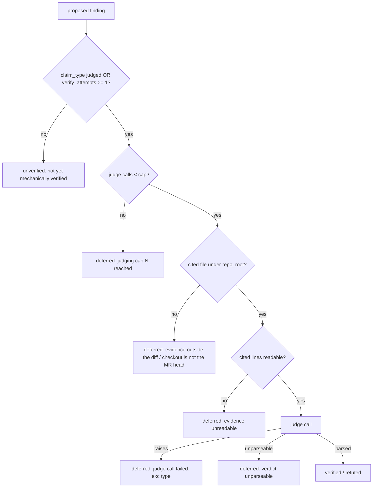

# Every deferred finding carries a named reason, and the judging cap is a setting

## Amendment (0.2, 2026-10-25): the report lists every finding that drives the verdict

| # | Fact | Where |
|---|---|---|
| F12 | Yoob MRs !324 (job 17451293380) and !327 (job 17451279178) ended `final_verdict = REQUEST_CHANGES` on one finding the mechanical pre-check had verified, while the JSON said 8 findings, 8 refuted: the gate blocked on a finding the report never showed | the two CI job logs |
| F13 | `verify_findings_for_pr` returned only aggregate counts, so no caller could name the findings it verified | `src/repoach/review/finding_verifiers.py` (before this amendment) |
| F14 | `review pr` printed `findings = [r.as_json() for r in team.refutations]`, the refuter's outcomes alone; a mechanically verified finding is no longer `proposed`, so the refuter never sees it | `src/repoach/cli/review_cmds.py`, `src/repoach/review/orchestrator.py` (`team.refutations = list(judging.outcomes)`) |
| F15 | `summarise_ledger_facts` / `verdict_from_facts` count a mechanically verified blocking finding as open, which is correct; only the report missed it | `src/repoach/review/merge_gate.py` |

- G6: `verify_findings_for_pr` returns a `VerificationReport`: one
  `MechanicalVerification` per proposed finding (id, state, the
  verifier's method and evidence line); `.counts` keeps the former
  aggregate shape. `recorded_verifications` reads the same outcomes back
  from the ledger for a replayed run.
- G7: `MergeFacts.open_blocking_ids` lists exactly the ids
  `open_blocking_findings` counts, in both `summarise_ledger_facts` and
  `gather_merge_facts`.
- G8: the report (`review pr` JSON `findings[]`, the stderr
  `findings: N listed` table, the sticky report and the archive JSON)
  lists every finding that can move `final_verdict`, each once, with
  `judge` in {`mechanical`, `refuter`, `reverify`, `ledger`}, `state`,
  `verification_method` (`mechanical:<claim_type>` for a mechanical
  verifier) and `evidence`: mechanically settled findings, every
  refuter outcome (its `refutation = {state, reason}` kept), the
  findings of older heads re-checked at the head, and any id of
  `open_blocking_ids` no judge of the run named.
- G9: the JSON carries `verdict_basis` = `open_blocking_ids`; every id
  in it is one `findings[]` entry with `blocking: true`.

- [x] AC7: `pytest tests/unit/test_report_lists_every_verdict_finding.py -k "every_blocking_finding_counted" -v`
  — on a fixture with 1 mechanically verified + 2 refuter-refuted + 1
  cap-deferred finding, the report lists 4 entries, the blocking ones
  equal `open_blocking_ids` (1) and each such id appears once.
- [x] AC8: `pytest tests/unit/test_report_lists_every_verdict_finding.py -k "judge_and_method or replay or no_judge_named" -v`
  — the mechanical entry is `judge = mechanical`,
  `verification_method = mechanical:missing_test`; a replay rebuilt from
  the ledger yields the same JSON; a blocking id no judge named is
  still listed.
- [x] AC9: `pytest tests/unit/test_report_lists_every_verdict_finding.py -k "stderr_table or archive or authoritative" -v`
  — the stderr table and the sticky report render the judge column and
  the verdict basis; the archive JSON carries `findings` and
  `verdict_basis`; `gather_merge_facts` names the same ids.
- [x] AC10: real check, from a Yoob checkout with this branch on
  `PYTHONPATH`: `REPOACH_PROVIDER=claude_code repoach review pr 327
  --dry-run --forge gitlab` lists the mechanically verified finding with
  its method and `verdict_basis` names it.

## Intent

`judge_findings_for_pr` collapses five unrelated reasons a finding does
not get a verdict into one integer (`counts["deferred"]`) — and, in one
of the five, into nothing at all: the finding is neither counted nor
logged. tech_debt #57 ("The refuter made no model call on Yoob !296")
is unresolvable from the log line alone because of this. This spec
names every deferral, so the aggregate the refuter logs and the number
an operator reads are never two different things again.

## Context

| # | Fact | Where |
|---|---|---|
| F1 | Two real `REPOACH_PROVIDER=claude_code --dry-run` reviews of Yoob MR !296 the same day: the earlier run made 3 refuter calls; the later `review pr 296 --dry-run` (69 s, 223 k tokens) recorded 19 findings deferred, 0 judged, no refuter row in the usage ledger, against 5 reviewer-role model calls (4 lenses + 1 round-2 Sentinel) | `docs/tech_debt.md:62` (row 57) |
| F2 | MR !296 touches only `ci/review-advisory.sh`, `.gitlab-ci.yml`, `docs/BACKLOG.md`, `docs/developer_guide/workflows.md`, `tests/scripts/test_ci_minutes.sh`, `tests/scripts/test_review_advisory.sh` — shell/YAML/Markdown, no Python | `glab mr diff 296 --repo josephwfaye/yoob_2` (yoob_2 repo, read-only) |
| F3 | `JUDGED_CLAIM_TYPES = {DESIGN, SECURITY, SPEC_GAP}`; a finding of any other claim type only reaches the refuter once `verify_attempts >= 1` | `src/repoach/review/findings.py:58`, `src/repoach/review/refuter.py:202-206` |
| F4 | `verify_finding` defers (returns `PROPOSED`, bumping `verify_attempts`) every claim type with no mechanical verifier — `BROKEN_BEHAVIOR`, `SPEC_GAP`, `DESIGN`, `SECURITY` all hit this branch, not only the judged types | `src/repoach/review/finding_verifiers.py:176-178` |
| F5 | A finding with `verify_attempts == 0` and a non-judged claim type is excluded from `judged_targets` entirely — it contributes to none of `verified`/`refuted`/`deferred`. Already pinned by the existing suite | `src/repoach/review/refuter.py:201-206`, `tests/unit/test_refuter.py:186-201` (`test_judge_findings_no_targets_never_builds_judge`, asserts `counts == {"verified": 0, "refuted": 0, "deferred": 0}`) |
| F6 | `_evidence_excerpt` returns `None` — no model call, reason `"evidence unreadable"` computed then discarded by the caller — when the finding's cited file does not resolve under `repo_root` | `src/repoach/review/refuter.py:82-95,168-170`, `src/repoach/review/hallucination_guard.py:147-168` (`_default_file_reader`, `target.is_file()`) |
| F7 | `_MAX_JUDGED = 10` is a module constant; findings past the cap are added to `counts["deferred"]` in bulk with no per-finding identity | `src/repoach/review/refuter.py:59-61,224` |
| F8 | `orchestrator.py` wraps `verify_findings_for_pr` in its own `try`/`except`; a raise there is logged and swallowed, leaving every non-judged-type finding's `verify_attempts` at 0 before `judge_findings_for_pr` runs two lines later — the F5 condition | `src/repoach/review/orchestrator.py:672-698` |
| F9 | tech_debt #57 itself names a sixth, untraced candidate this spec does not rule out: a finding whose content was already judged in the ledger from the earlier same-day run, filtered before ever reaching `judged_targets` by some dedup path this investigation did not locate | `docs/tech_debt.md:62` |
| F10 | `refuter.py` never reads `severity`, and has no comment-only verdict branch — the two candidate predicates named in the triggering investigation brief are ruled out by reading the source | `src/repoach/review/refuter.py` (full read) |
| F11 | `refuter.py`, `finding_verifiers.py` and `hallucination_guard.py` are currently frontier (no `owns.code` in any spec's frontmatter); `findings.py` is owned by `SP-FINDINGS-INIT-RACE`, `orchestrator.py` by `SP-ORCH-DOCSTRING` | `repoach arch graph --format json` (develop 45712b2), cross-checked against `docs/tech_debt.md:61` (row 56, same frontier gap on `cli/`) |

F11 means this spec's `depends_on` can only name the two files that are
actually owned today. `refuter.py`, `finding_verifiers.py` and
`hallucination_guard.py` have no owning spec to depend on — the
implementation slice that follows this draft is the natural place to
promote `refuter.py` into the governed regime (give it an `owns`), per
`SP-SPEC-TEMPLATE`'s opportunistic-erosion rule, rather than this
documentation-only slice inventing an edge to a spec that owns nothing.

## Goals

- G1: Every deferred finding carries a named reason, both in
  `judge_findings_for_pr`'s return value and in whatever the
  orchestrator logs — a closed set of tags, not a free-text string that
  drifts (the table under Interface).
- G2: F5's silent exclusion gets an explicit bucket (`unverified`) so
  it is counted and named instead of invisible.
- G3: The judging cap (`_MAX_JUDGED`) becomes a `GatesConfig` setting
  (`refuter_max_judged`, default 10) instead of a hardcoded module
  constant, read the same way `verify_finding` already reads
  `load_gates_config(repo_root)`.
- G4: The refuter judges every finding whose evidence is readable — the
  cap and unreadable-evidence paths remain the only two ways a
  judgeable finding can still end up without a verdict.
- G5: F9 is resolved or explicitly closed as not-applicable before this
  spec can move past `draft` — either the dedup path is found and
  named as a sixth tag, or an implementation-slice trace (tech_debt
  #57's own prescribed fix: "log why each finding is deferred, and
  assert a refuter row when a judgeable finding exists," run with the
  ledger reset) shows it was never the cause.

## Non-Goals

- NG1: Changing what counts as "evidence unreadable" (whether an
  off-diff or hallucinated file should be judgeable at all) —
  `SP-FINDINGS-OFFDIFF-FILTER` owns the off-diff question at recording
  time; this spec only names the outcome when evidence is unreadable at
  judging time.
- NG2: Raising or removing the default cap value — 10 stays the
  default; only its configurability is in scope.
- NG3: Any merge-gate or verdict change — still dual-run, no merge
  decision changes here.
- NG4: Claiming ownership of `refuter.py` / `finding_verifiers.py` /
  `hallucination_guard.py` in this spec's `owns` — that is the
  implementation slice's decision, not this draft's (taken: see Gaps).

## Assumptions

- A1: `judge_findings_for_pr`'s former `dict[str, int]` contract
  had a small, enumerable set of callers
  (`orchestrator.py` plus the unit suite) that can all be updated in
  one slice — verified by F8 and the existing test file being the only
  non-orchestrator caller.
- A2: `GatesConfig` already supports project-level overrides read from
  `repo_root` (F4's sibling, `finding_verifiers.py:179`), so adding one
  more key is additive, not a new mechanism.

## Interface

```python
RefutationState = Literal["verified", "refuted", "deferred", "unverified"]

@dataclass(frozen=True)
class Refutation:
    finding_id: int | None
    file: str
    line_start: int
    claim_type: ClaimType
    state: RefutationState
    reason: str  # the judge's reasoning for a verdict, else one closed-set reason

@dataclass(frozen=True)
class JudgingReport:
    outcomes: tuple[Refutation, ...]
    model_calls: int
    counts: dict[str, int]            # property: verified / refuted / deferred / unverified
    deferrals: tuple[Refutation, ...]  # property: outcomes without a verdict
    def summary_line(self) -> str: ...

def judge_findings_for_pr(
    db_path: Path,
    *,
    pr_number: int,
    repo_root: Path,
    head_sha: str | None,
    judge_factory: Callable[[], Judge] = make_refuter_judge,
    max_judged: int | None = None,  # None reads GatesConfig.refuter_max_judged, default 10
    diff_files: Collection[str] = (),
    tree_sha: str | None = None,
    review_head: str | None = None,  # defaults to head_sha
) -> JudgingReport: ...
```

Inputs: unchanged, plus the optional `max_judged` override (tests only;
production reads `[gates].refuter_max_judged`), the diff's paths, the
commit `repo_root` is at, and the head the review is about.

Outputs: one `Refutation` per proposed finding, each in exactly one
state; `sum(counts.values()) == len(outcomes)` always. Reasons of the
two verdict-less states come from a closed set, details inline:

| State | Reason |
|---|---|
| `deferred` | `evidence outside the diff` — cited file is not a file under `repo_root` |
| `deferred` | `checkout is not the MR head (<sha7>)` — cited file is in the diff, absent from a tree whose commit is not the head |
| `deferred` | `evidence unreadable` — file there, cited lines not |
| `deferred` | `judging cap N reached` |
| `deferred` | `verdict unparseable` |
| `deferred` | `judge call failed: <exception type>` |
| `unverified` | `not yet mechanically verified` |

The cap counts judge calls, so a finding with unreadable evidence never
uses a slot. `review pr` adds `findings[i] = {id, file, line,
claim_type, refutation: {state, reason}}` to its JSON and one stderr
line, `refuter: judged 3, refuted 1, deferred 2 (evidence unreadable
×2), unverified 1 (not yet mechanically verified)`.

Errors: none new — a judge exception yields `judge call failed:
<exception type>`, never an unhandled raise; a judge factory that
raises is built once and names its exception on every finding it
leaves.

## Behavior

### Nominal
A `design` finding with readable evidence and a well-formed judge reply
→ `verified` or `refuted`, absent from `deferrals`.

### Edge cases
- Non-judged claim type, `verify_attempts == 0` (the verifiers have not
  run on it this pass) → `unverified`, reason `not yet mechanically
  verified` (before: invisible, F5).
- 12 judgeable findings, cap 10 → 10 judged, 2 `deferred` with
  `judging cap 10 reached`, each named by id, file and claim type (F7).
- Cited file absent under `repo_root` → `deferred`, `evidence outside
  the diff`, or `checkout is not the MR head (<sha7>)` when the file is
  in the diff and the tree is not at the head; zero model calls (F6).

### Failure scenarios
- Judge raises → `deferred`, `judge call failed: <exception type>`; the
  PR review itself is unaffected (the orchestrator guards the call, F8).
- `verify_findings_for_pr` raises → logged at warning with the
  exception name; the findings it left are reported `unverified`.
- `[gates].refuter_max_judged` invalid → the config load refuses it; the
  refuter logs the error and falls back to 10, never a crash.

## Architecture Impact

- Adds dependency: SP-REFUTER-JUDGES-WHAT-IT-CAN -> SP-FINDINGS-INIT-RACE
  (reads/writes the `pr_findings` ledger `findings.py` owns — unchanged
  schema).
- Adds dependency: SP-REFUTER-JUDGES-WHAT-IT-CAN -> SP-ORCH-DOCSTRING
  (the orchestrator's `judge_findings_for_pr` call site logs one
  `review_team.finding_deferred` event per verdict-less finding).
- Owns `refuter.py`, `hallucination_guard.py` and
  `finding_verifiers.py` (formerly frontier, F11);
  SP-UNIVERSAL-GATES declares its edge to this spec
  (`tests/unit/test_gates_language.py` imports `finding_verifiers.py`).

## Diagram



## Acceptance Criteria

Run from `repoach` with `PATH=.venv/bin:$PATH PYTHONPATH=$PWD/src`.

- [x] AC1: `pytest tests/unit/test_refuter.py -k "deferral_reason" -v` —
  each deferral reason (outside the diff, checkout not at head,
  unreadable, cap, unparseable, judge failed) is produced by an
  engineered finding with that exact text.
- [x] AC2: `pytest tests/unit/test_refuter.py -k "unverified_target" -v`
  — a `BROKEN_BEHAVIOR` finding with `verify_attempts == 0` ends
  `unverified`, reason `not yet mechanically verified`, and
  `counts["unverified"] == 1` (before: counted nowhere, F5).
- [x] AC3: `pytest tests/unit/test_refuter.py -k "judges_every_readable" -v`
  — N findings with readable evidence and N <= `max_judged` all end
  `verified` or `refuted`, never `proposed`.
- [x] AC4: `grep -n "refuter_max_judged" src/repoach/gates/config.py &&
  pytest tests/unit/test_refuter.py -k "max_judged_configurable" -v` —
  `refuter_max_judged = 3` caps a 5-finding batch at 3 judged + 2
  `deferred` with `judging cap 3 reached`; an unset config keeps 10.
- [x] AC5: `pytest tests/unit/test_review_team.py -k "finding_deferred_event" -v`
  — one `review_team.finding_deferred` event per verdict-less finding;
  `review_team.findings_judged` logs the four counts and `model_calls`.
- [x] AC6: `ruff check` / `ruff format --check` on the touched modules
  and `pytest tests/unit/test_refuter.py tests/unit/test_review_team.py
  tests/unit/test_finding_verifiers.py` green;
  `test_judge_findings_no_targets_never_builds_judge` now asserts the
  `unverified` bucket instead of pinning the silent exclusion.

## Owner decisions needed

- D1 (taken by the implementation slice): `judge call failed` carries
  the exception type name only, never the message.

## Gaps

- F9 / G5: the "already judged in the ledger from the earlier run"
  candidate from tech_debt #57 is not traced by this spec. Until it is
  either found in the code or ruled out by a reset-ledger re-run (as
  tech_debt #57 itself prescribes), this spec's F5/F6/F7 predicates are
  the demonstrated causes of a zero-call, all-deferred refuter pass —
  not yet proven to be the *only* ones that produced !296's specific 19.
- The implementation slice promoted `refuter.py`,
  `hallucination_guard.py` and `finding_verifiers.py` into this spec's
  `owns.code`; `repoach arch graph --check` lists the same cycles with
  and without the promotion (none involves this spec), which answers
  Q2.
- Verdicts read the checkout, not the head, until SP-REVIEW-PINS-HEAD:
  a review that reads a tree other than the PR head judges stale or
  absent evidence; the `checkout is not the MR head` reason names the
  absent case, a present-but-stale file is still judged as it stands.

## Open Questions

- Q1: when G5's trace lands, does it add another deferral reason
  tag ("already judged this PR") or show F9 was never the cause on
  !296? Must be resolved before `status` can move past `draft`.
- Q2: does the implementation slice promote `refuter.py` with its own
  `owns.code`, or fold it into `SP-FINDINGS-INIT-RACE` / a renamed
  verification-pipeline spec covering `finding_verifiers.py` too? Must
  be resolved before `status: approved` (an un-owned file the
  implementation slice edits is itself the kind of frontier gap
  tech_debt #56 already flags for `cli/`).
