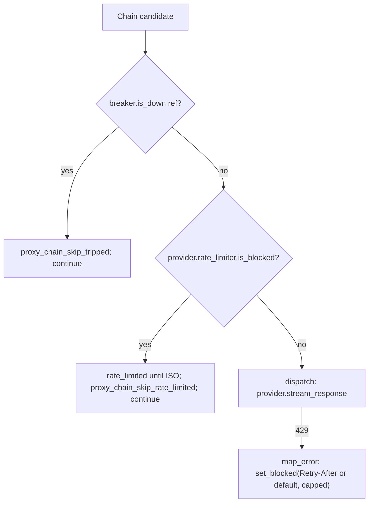

# Skip a rate-limited provider before dispatch instead of timing out

## Intent

A 429 against one model of a provider blocks that provider's
process-wide `GlobalRateLimiter` scope for 60s, but every sibling
model of the SAME provider keeps being dispatched — it sleeps inside
the limiter, misses the much tighter `first_byte_deadline_s` (20s),
and gets mis-recorded as `first_byte_timeout` instead of
`rate_limited` after burning 20s of the dispatch budget. Check the
limiter BEFORE dispatching so a blocked provider is skipped for free,
with the true reason recorded, and let a 429 that carries
`Retry-After` size its own block instead of the hardcoded 60s.

## Context

`ClaudeProxyService._stream_with_failover`
(`src/repoach/llm_proxy/api/services.py`, owned by
`SP-BUDGET-RETRY-FIXES`) walks the resolved chain with a `for` loop,
skipping a candidate up front only when its OWN breaker ref
(`get_breaker().is_down`) is tripped — a per-model check. The 429
path that actually blocks a provider lives one layer down:
`map_error` (`src/repoach/llm_proxy/providers/error_mapping.py:42`,
owned by `SP-PROVIDER-TRANSPORT-SPI`) calls
`GlobalRateLimiter.set_blocked(60)` on the provider-SCOPED limiter
(`src/repoach/llm_proxy/providers/rate_limit.py:99`, `get_scoped_instance`
keyed by `provider_name.lower()` — shared by every model of that
provider, unlike the per-model breaker ref). The dispatcher never
reads that limiter before dispatching — `BaseProvider` exposed no
accessor for it at all — so a second model of the same blocked
provider is dispatched anyway, and its request sleeps inside
`wait_if_blocked` / `execute_with_retry` until the block lifts or the
hop's own deadline fires first. Since `first_byte_deadline_s`
(`src/repoach/llm_proxy/api/services.py:684,909`, default 20.0,
`src/repoach/llm_proxy/config/settings.py:396`, owned by
`SP-PROXY-FIRST-BYTE-DEADLINE`) is far tighter than the 60s block, the
hop almost always times out first and is classified
`first_byte_timeout` — the real cause (`rate_limited`) is lost, and
20s of the dispatch budget is spent for nothing.

Found tracing the flaky `test_budget_retry_success_resets_breaker_counter`
(tech debt row 64, `docs/tech_debt.md`); the test-isolation half was
already fixed by `GlobalRateLimiter.reset_scoped_instances` (kept
unmodified by this spec, `tests/unit/conftest.py` +
`tests/unit/test_rate_limiter_scope_reset.py`).

## Goals

- G1: Before dispatching a chain candidate, the failover checks
  whether that candidate's provider-scoped `GlobalRateLimiter` is
  currently blocked, and skips it WITHOUT making a request when it
  is.
- G2: A skipped candidate's reason is recorded, consistently, as
  `rate_limited until <ISO time>` — in the structured failover log
  event, the per-hop breakdown (the closest thing to a usage ledger
  this dispatcher keeps), and, if the whole chain is exhausted, the
  terminal client-facing message.
- G3: `map_error`'s 429 handling honours the upstream `Retry-After`
  header when present (capped by a new settings ceiling) instead of
  always blocking for a hardcoded 60s.
- G4: The skip does NOT trip the candidate's own breaker ref — the
  candidate itself never failed, only its provider's shared limiter
  is cooling down from a DIFFERENT model's fault.

## Non-Goals

- NG1: No change to the per-model breaker (`routing/breaker.py`) or
  its escalation policy.
- NG2: No change to `GlobalRateLimiter.execute_with_retry`'s own
  internal exponential-backoff retry loop (its `set_blocked(delay)`
  call is a separate, pre-existing mechanism, untouched here).
- NG3: No HTTP-date form of `Retry-After` — only the delta-seconds
  form every provider observed in practice sends is honoured; an
  unparsable or missing header falls back to the existing default.
- NG4: No new persistent ledger table. A skip-without-dispatch leaves
  no breaker-trip row (G4), so there is nothing to write through to
  `breaker_persist`'s SQLite table for this event.

## Assumptions

- A1: Every concrete provider that talks to a real upstream already
  sets `self._global_rate_limiter` in its constructor (confirmed:
  `AnthropicMessagesTransport`, `OpenAIChatTransport`,
  `ClaudeCodeProvider`). A test double that never dispatches anywhere
  real is free to leave it unset.
- A2: `src/repoach/llm_proxy/api/services.py`,
  `src/repoach/llm_proxy/config/settings.py`,
  `src/repoach/llm_proxy/providers/base.py`,
  `src/repoach/llm_proxy/providers/registry.py`,
  `src/repoach/llm_proxy/providers/error_mapping.py`,
  `src/repoach/llm_proxy/providers/anthropic_messages.py`, and
  `src/repoach/llm_proxy/providers/openai_compat.py` stay owned by
  their current specs for the duration of this spec's implementation;
  this spec's Developer session edits them directly under the
  `depends_on` coupling rather than re-claiming them (same pattern
  `SP-PROXY-FIRST-BYTE-DEADLINE` used for its own edits to
  `services.py`). `src/repoach/llm_proxy/providers/rate_limit.py`
  stays frontier (unowned) — the two new public methods added to it
  are additive and do not change its existing contract.

## Interface

Inputs:
- `GlobalRateLimiter.is_blocked(now: float | None = None) -> bool` —
  NEW public method, `rate_limit.py`. Pure, clock-free when `now` is
  given.
- `GlobalRateLimiter.seconds_until_unblocked(now: float | None = None) -> float`
  — NEW public method, `rate_limit.py`. Floored at `0.0`.
- `BaseProvider.rate_limiter -> GlobalRateLimiter | None` — NEW public
  property, `providers/base.py`. Returns `self._global_rate_limiter`
  (class-level default `None`).
- `ProviderConfig.rate_limit_block_default_s: float` — NEW field,
  default `60.0` (unchanged behavior).
- `ProviderConfig.rate_limit_block_max_s: float` — NEW field, default
  `300.0`.
- `Settings.rate_limit_block_default_s: float` — NEW Pydantic field,
  default `60.0`, `ge=0`. Aliases: `REPOACH_PROXY_RATE_LIMIT_BLOCK_DEFAULT_S`
  / legacy `RATE_LIMIT_BLOCK_DEFAULT_S`.
- `Settings.rate_limit_block_max_s: float` — NEW Pydantic field,
  default `300.0`, `ge=0`. Aliases:
  `REPOACH_PROXY_RATE_LIMIT_BLOCK_MAX_S` / legacy `RATE_LIMIT_BLOCK_MAX_S`.
- `map_error(e, *, rate_limiter=None, rate_limit_block_default_s=60.0, rate_limit_block_max_s=300.0)`
  — two NEW keyword-only parameters, backward compatible.
- `provider_error_message(..., rate_limit_block_default_s=60.0, rate_limit_block_max_s=300.0)`
  — same two new parameters, threaded into `map_error`.

Outputs:
- A skipped chain candidate contributes `(provider_model_ref, "rate_limited until <ISO time>")`
  to `_stream_with_failover`'s `prior_failures` and a matching entry
  to `hop_breakdown`.
- `last_error` is set to `RateLimitError("rate_limited until <ISO time>")`
  when the skip is the most recent outcome, so a fully-exhausted chain's
  terminal SSE `chain_exhausted` message carries the phrase.

Errors: none new — the skip path never raises; it only `continue`s the
loop, matching the existing breaker-skip branch's shape.

## Behavior

### Nominal

`_stream_with_failover`, right after the existing per-model breaker
check and before computing the per-hop timeout:

```python
provider = self._provider_getter(candidate.provider_id)
limiter = provider.rate_limiter
if limiter is not None and limiter.is_blocked():
    blocked_until_iso = _rate_limit_blocked_until_iso(limiter)
    reason = f"rate_limited until {blocked_until_iso}"
    last_error = RateLimitError(reason)
    prior_failures.append((candidate.provider_model_ref, reason))
    hop_breakdown.append(
        {"provider_model_ref": candidate.provider_model_ref, "reason": reason, "elapsed_s": 0.0}
    )
    logger.warning(
        "proxy_chain_skip_rate_limited",
        dispatch_id=dispatch_id,
        candidate=candidate.provider_model_ref,
        attempt=attempt_index + 1,
        chain_length=len(chain),
        chain_remaining=len(chain) - attempt_index - 1,
        reason=reason,
        blocked_until=blocked_until_iso,
    )
    continue
```

`provider` is fetched once per iteration and reused by the existing
dispatch `try` block below (previously fetched twice).

`_rate_limit_blocked_until_iso` projects the limiter's monotonic
`seconds_until_unblocked()` onto a wall-clock ISO timestamp the same
way `breaker_persist.persist_state` already projects the breaker's
monotonic TTL (`wall_clock_now + timedelta(seconds=ttl_s)`) —
`GlobalRateLimiter` itself stays clock-free.

`map_error`'s two 429 branches change from `limiter.set_blocked(60)` to:

```python
limiter.set_blocked(
    _rate_limit_block_seconds(e, default_s=rate_limit_block_default_s, max_s=rate_limit_block_max_s)
)
```

where `_rate_limit_block_seconds` reads `e.response.headers["retry-after"]`
(both `httpx.HTTPStatusError` and `openai.APIStatusError` expose
`.response` as an `httpx.Response`) as a plain float, falls back to
`default_s` when absent or unparsable, and caps the result at `max_s`.

### Edge cases

- A candidate whose provider has no `_global_rate_limiter` set (a test
  double, or any future provider that does not dispatch to a real
  upstream) is never skipped by this check — `BaseProvider.rate_limiter`
  defaults to `None`, read as "never blocked".
- `Retry-After` present but non-numeric (an HTTP-date, or garbage) ->
  treated as absent, falls back to `rate_limit_block_default_s`.
- `Retry-After: 0` or negative -> treated as absent (a zero-or-negative
  block is meaningless), falls back to the default.
- The skip happens regardless of remaining dispatch budget — it costs
  no wall-clock time, so it is evaluated before the
  `dispatch_total_budget_s` exhaustion check (SP-CHAIN-REQUEST-BUDGET),
  not after.

### Failure scenarios

- Every chain candidate is blocked (or breaker-tripped, or both) ->
  `_stream_with_failover` exhausts the chain exactly as it does today;
  `last_error` carries the last `rate_limited until <ISO time>` or
  breaker-related failure seen, surfaced in the terminal
  `chain_exhausted` SSE message.

## Architecture Impact

- Adds dependency: SP-FAILOVER-SKIPS-BLOCKED-PROVIDER -> SP-BUDGET-RETRY-FIXES
  (edits `_stream_with_failover` in `services.py`, that spec's owned
  file — the new pre-dispatch check and the `GlobalRateLimiter` import).
- Adds dependency: SP-FAILOVER-SKIPS-BLOCKED-PROVIDER -> SP-PROXY-FIRST-BYTE-DEADLINE
  (adds the two `rate_limit_block_*_s` fields to `settings.py`, that
  spec's owned file).
- Adds dependency: SP-FAILOVER-SKIPS-BLOCKED-PROVIDER -> SP-PROVIDER-INIT-DEDUP
  (adds the `rate_limiter` property and the two `ProviderConfig`
  fields to `base.py`; threads the new `map_error`/`provider_error_message`
  kwargs through `anthropic_messages.py` — both owned by that spec).
- Adds dependency: SP-FAILOVER-SKIPS-BLOCKED-PROVIDER -> SP-PROVIDER-TRANSPORT-SPI
  (the `Retry-After` honouring in `error_mapping.py`; wires the two new
  `ProviderConfig` fields into `registry.py`'s `build_provider_config`
  — both owned by that spec).
- Adds dependency: SP-FAILOVER-SKIPS-BLOCKED-PROVIDER -> SP-USAGE-REASONING-SPLIT
  (threads the new `map_error`/`provider_error_message` kwargs through
  `openai_compat.py`, owned by that spec).
- Removes dependency: none.
- New / changed coupling: `src/repoach/llm_proxy/providers/rate_limit.py`
  stays frontier (unowned) — only additive public methods, no claim.
  No new cross-`owns.code` import is introduced: `services.py`'s new
  `from repoach.llm_proxy.providers.rate_limit import GlobalRateLimiter`
  targets a still-unowned (frontier) file, so the edge-honesty gate
  does not enforce it.

## Diagram



## Acceptance Criteria

- [x] AC1: a fake upstream returns 429 on the first provider, then a
  second provider in the chain serves content — the second provider
  is reached well under 1s (no 20s `first_byte_deadline_s` wait), and
  the captured `proxy_chain_skip_rate_limited` log event (or, when the
  blocked provider is the last candidate tried, the terminal
  `chain_exhausted` message) carries `rate_limited until` —
  `tests/unit/test_proxy_chain_failover.py::test_blocked_provider_is_skipped_without_dispatch_and_failover_is_fast`.
- [x] AC2: `GlobalRateLimiter.set_blocked` driven by `map_error` honours
  a `Retry-After: 5` header — the limiter unblocks around 5s later,
  not 60s — `tests/unit/test_error_mapping_rate_limit.py::test_429_with_retry_after_blocks_for_that_duration`.
- [x] AC3: a `Retry-After` value above `rate_limit_block_max_s` is
  capped — `tests/unit/test_error_mapping_rate_limit.py::test_retry_after_above_cap_is_clamped`.
- [x] AC4: a 429 with no `Retry-After` header still blocks for
  `rate_limit_block_default_s` (default `60.0`), unchanged from before
  this spec — `tests/unit/test_error_mapping_rate_limit.py::test_429_without_retry_after_uses_default`.
- [x] AC5: the skip does not trip the candidate's own breaker ref —
  `tests/unit/test_proxy_chain_failover.py::test_blocked_provider_skip_does_not_trip_its_own_breaker`.
- [x] AC6: `Settings().rate_limit_block_default_s` and
  `.rate_limit_block_max_s` default to `60.0`/`300.0` and resolve
  through their REPOACH_/legacy aliases —
  `tests/unit/test_settings_sharp_prefix_aliases.py` (existing
  parametrized round-trip + coverage tests, extended with the two new
  map entries).
- [x] AC7: the #234 test-isolation fixture
  (`GlobalRateLimiter.reset_scoped_instances`, `tests/unit/conftest.py`)
  is unmodified and still passes —
  `tests/unit/test_rate_limiter_scope_reset.py`.

## Open Questions

(none)
