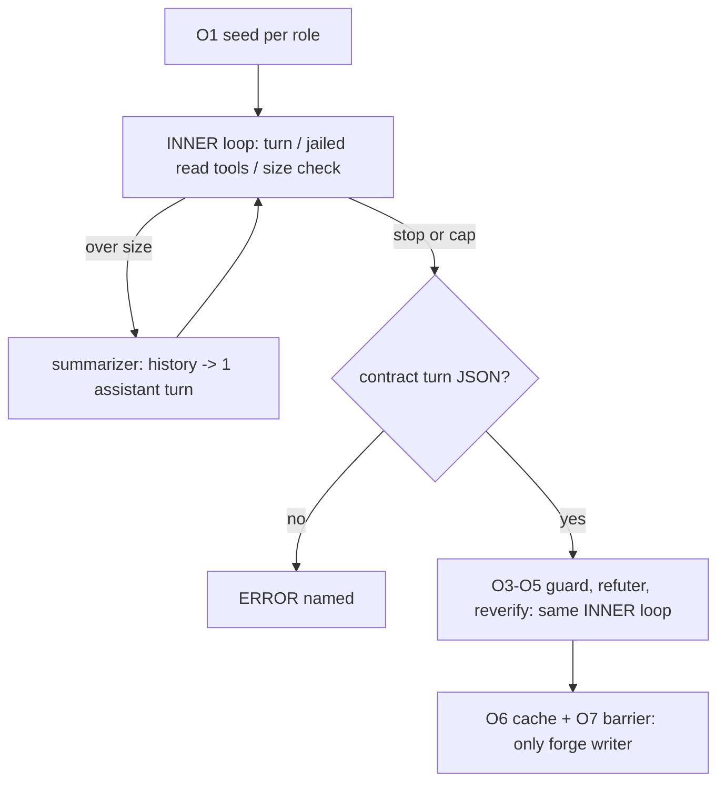

# Three-role context, a fixed context size with a summarizer, and one inner loop

## Amendment (0.2, 2026-10-25): the claude_code transport belongs to SP-CLAUDE-CODE-FIRST-CLASS

The sibling spec `SP-CLAUDE-CODE-FIRST-CLASS` measures the installed CLI
flags and the Agent SDK, and decides between an MCP server that exposes
repoach's read-only tools and the text emulation. This spec no longer
decides that. The 0.1 G7, the paragraph "Why not the MCP route", AC10,
AC11, AC12, A3 and Q4 are withdrawn. The later ACs and Qs are renumbered.
The facts about the current text emulation (F11, F17, F18) stay so the
sibling spec can cite them.

## Decisions (owner 2026-10-25)

These decide the open questions of 0.2. The Open Questions section is
empty. The status stays `draft` until the owner verifies the spec.

- D1 (owner 2026-10-25, was Q1): the starting defaults are
  `max_cost_usd` 0.50 per reviewer and 0.25 for the refuter, and
  `context_tokens` 60 000 per reviewer and 40 000 for the refuter. They
  are revised after M1–M3.
- D2 (owner 2026-10-25, was Q2): release gate for the default ON. The
  delivery PR is blocked if M1 precision at `max_turns = 6` is below
  precision at `max_turns = 0`, OR if the total cost of the
  `max_turns = 6` run is more than 2× the one-shot run (AC19).
- D3 (owner 2026-10-25, was Q3): the seed may take 60% of
  `context_tokens`. Items beyond that go to `truncated[]`.
- D4 (owner 2026-10-25, was the 0.1 Q4): the claude_code question moves
  to SP-CLAUDE-CODE-FIRST-CLASS (see the 0.2 amendment).
- D5 (owner 2026-10-25, was the 0.1 Q5): the refuter's summarizer runs
  on the refuter's own tier (OPUS). The reviewers' summarizer runs on
  HAIKU (AC21).
- D6 (owner 2026-10-25, was the 0.1 Q6): round 2 (F5) is removed once
  the inner loop is ON, on the condition that M4 shows no precision
  loss without it (AC20).

## Intent

Owner decisions of 2026-10-25: "context is managed through the three
prompt roles (system / user / assistant) and a model-side loop, composed
with the existing out-of-model loop"; "il faut l'assistant et la boucle
pour gérer le contexte et aussi consolider avec la boucle hors du
modèle"; "on fixe la taille du contexte et on a un summarizer lorsque le
contexte est plein".

Every review agent (the four reviewers and the refuter) gets an explicit
`AgentContext`: `system` carries the persona and the output contract,
`user` carries an evidence **seed** assembled by priority, and
`assistant` carries the history of a bounded, read-only, in-model loop.
That history is where context lives. Each role has a **fixed context
size**; when the next turn would exceed it, a dedicated summarizer
rewrites the assistant history into one structured assistant turn. The
seed is never summarized away and nothing is dropped silently. The inner
loop (turns within one agent) and the outer loop (stages across agents
and heads) become one state machine sharing one ledger. The outer loop
remains the only authority that decides and the only writer to the
forge.

## Context

Measured on `develop` `53bb844` (2026-10-25).

| # | Fact | Where |
|---|---|---|
| F1 | A reviewer makes one model call per attempt: `_call_with_retry` calls `self._loop.run_oneshot(prompt, json_response=True, accept_response=...)` and passes **no `system`**. The persona file is a template; the evidence placeholders are substituted into it, so persona, contract and evidence all travel as **one user message**. (The brief said "persona (system)": that is not what the code does.) | `src/repoach/review/reviewer.py:540`, `:725-776` |
| F2 | `run_oneshot` builds `messages = [Message(role="user", ...)]` and prepends "Respond with ONLY a single JSON object" to that user text. No assistant message is ever sent. | `src/repoach/agent_engine/agent_loop.py:487`, `:542`, `:546` |
| F3 | The diff is packed whole file by whole file under `_DIFF_HARD_CAP_CHARS = 140_000`. Omitted files are announced in the prompt and logged (`review.diff_scoped`), but they do not appear in the reviewer outcome or the JSON. | `src/repoach/review/diff_scoper.py:75-122`, `src/repoach/review/reviewer.py:54`, `:634-642` |
| F4 | The spec block is cut with `spec_plan[:_DIFF_HARD_CAP_CHARS]` and no note, so the reviewer cannot tell it saw part of the spec. | `src/repoach/review/reviewer.py:744` |
| F5 | Round 2 is the only second call. It is another one-shot whose user prompt carries `{DIALOGUE_CONTEXT}` (round-1 outcomes, guard verdicts, excerpts), not an assistant turn. | `src/repoach/review/orchestrator.py:723-742`, `:1302` |
| F6 | A tool loop already exists, `AgentLoop.run`: `max_turns` (default 15), unknown-tool and bad-argument errors returned to the model, tool results capped at 8 000 chars, an in-band budget nudge, and a wrap-up turn when the budget runs out that **returns prose**. The Planner and the Developer use it. The reviewers and the refuter do not. | `src/repoach/agent_engine/agent_loop.py:407`, `:699-1012`, `:888`, `:952` |
| F7 | The Planner already has read-only tools jailed to the repository: `list_dir`, `read_file`, `grep_repo`. Paths get a lexical check and then a resolved containment check. Caps: 24 000 chars per read, 200 entries, 80 matches. | `src/repoach/review/planner_tools.py:26-92` |
| F8 | The refuter is an OPUS one-shot (`max_tokens=800`) over a fixed ±25-line window (`_EVIDENCE_CONTEXT = 25`) of the pinned head tree. The evidence sits between per-prompt nonce markers. | `src/repoach/review/refuter.py:72`, `:212-258` |
| F9 | The hallucination guard re-reads the tree to disprove "missing X" claims (four observed modes) and downgrades the comment. | `src/repoach/review/hallucination_guard.py:1-40` |
| F10 | `Reviewer.__init__` computes `self._allowed_tools = allowed_tools_for(self.role)` from the fail-closed MCP whitelist. Nothing reads it (grep of `src/`). | `src/repoach/review/reviewer.py:488-490`, `src/repoach/review/mcp_whitelist.py` |
| F11 | `claude_code` runs `claude --print --disable-slash-commands --output-format json --model <m>`. The system prompt goes in through `--system-prompt-file` and the prompt on stdin. The history is flattened into one prompt. `tools` are stripped and rendered as a text appendix, and `<tool_use>{...}</tool_use>` text is parsed back into native tool calls. The command passes **no flag that restricts the CLI's built-in tools**. | `src/repoach/llm_proxy/providers/claude_code/client.py:116-125`, `:214-230`, `:393-476` |
| F12 | Direct providers translate `repoach/v1` into an Anthropic Messages request (`translate_request`) and then into each transport's own format. The OpenAI-compatible conversion (`tools[].function`, assistant `tool_calls`, `role: tool` + `tool_call_id`) is `llm_proxy/core/anthropic/conversion.py:79-146`. `gemini` uses its OpenAI-compatible surface; no native Gemini format exists in the tree. | `src/repoach/providers/direct.py:1-12`, `:207-240`, `src/repoach/providers/select.py:71-74` |
| F13 | `usage_ledger` holds one row per provider call (`run_id`, `reviewer`, tokens, `cost_usd`, `duration_ms`, `error`). It has no turn and no phase column. `record_call` is the only place that writes it. | `src/repoach/providers/usage.py:73-93`, `src/repoach/agent_engine/agent_loop.py` (`_provider_call`) |
| F14 | The run cache `pr_review_runs` replays a completed run at `(pr_number, head_sha)`. Its key does not include the reviewer configuration. | `src/repoach/review/findings.py:239-249`, `src/repoach/review/review_cache.py` |
| F15 | Bench baseline `bench/results/2026-10-21_planted_claude_code.json`: 10 planted cases, 45 findings, 2 383 115 tokens in total (134 989 to 349 091 per case), one-shot reviewers. | `bench/results/`, `bench/corpus/planted/` |
| F16 | `repoach.toml` has no `[agents]` table. The project configuration is parsed by `src/repoach/project/config.py`. | `repoach.toml`, `src/repoach/project/config.py` |
| F17 | The tool loop's text-emulation guard: a reply with no native tool call whose text matches `_LEAKED_TOOLCALL_MARKUP_RE` counts as a leak, and the loop asks the model to re-issue the call natively. After two consecutive leaks it adds the model to `skip_models`. The wrap-up turn retries once when it leaks markup. | `src/repoach/agent_engine/agent_loop.py:766-803`, `:971-1005` |
| F18 | The `claude` child runs in a fresh `tempfile.mkdtemp(prefix="repoach_claude_code_")` working directory, with an optional `child_env` filter. Every turn is a new `--print` process that receives the whole flattened history again on stdin, so the input tokens re-sent grow with the number of turns. | `src/repoach/llm_proxy/providers/claude_code/client.py:177-178`, `:214-260`, `:393-424` |

## Goals

- G1 **AgentContext.** Every reviewer and refuter call is built from one
  `AgentContext(system, user_seed, assistant_history, budget)`.
  - `system` = persona + output contract + provider capability notes.
  - `user_seed` = evidence bundle in the fixed priority order diff >
    spec > arch edges > prior review > lessons. It is filled until its
    share of the context size is used up. Every item that does not fit
    is listed in `context.truncated[]` with its name, size and reason,
    and stays reachable through the tools (G3).
  - `assistant_history` = the turns of the inner loop, plus a `{`
    prefill on the contract turn where the provider supports it (G6).
- G2 **The inner loop is on by default.** `[agents.<role>] max_turns`
  defaults to `6` for the four reviewers and the refuter. `max_turns =
  0` is an explicit opt-out per role and gives exactly today's one-shot
  (same prompt bytes, same parse). The assistant history carries the
  working context across turns.
- G3 **Read-only tools**, served by repoach in-process on the pinned head
  tree (SP-REVIEW-PINS-HEAD), path-jailed, with no network and no
  subprocess:
  - `read_file(path, start, end)`: window capped at 400 lines / 24 000 chars.
  - `grep(pattern, glob)`: 80 matches, 200 chars per line.
  - `list_dir(path)`: 200 entries.
  - `arch_edges(path)`: the owner spec of `path` and its `depends_on`.
  - `spec(id_or_path)`: a windowed spec text.

  Each tool result is delivered between per-call nonce markers, as the
  refuter's evidence is (F8).
- G4 **Fixed context size + summarizer.** `[agents.<role>]
  context_tokens` (default 60 000 for reviewers, 40 000 for the
  refuter) covers system + seed + assistant history + pending tool
  results + `contract_reserve_tokens`. The count comes from the
  provider's `prompt_tokens` for the part already sent plus the
  disclosed estimator `ceil(utf8_chars / 3)` for the delta. The JSON
  names the source (`context.size_source`).
  - If the next turn would exceed the size, the loop calls the
    summarizer first. The summarizer has its own persona
    (`prompts/review/summarizer_0.1.0.md`), runs on HAIKU for the
    reviewers and on OPUS for the refuter (D5), and has its own budget
    (`summarizer_max_output_tokens`).
    It rewrites the assistant history into a structured summary:
    findings so far with `file:line`, files read with their line
    ranges, open questions, and decisions taken.
  - The summary replaces the history as a single assistant turn. The
    seed is never summarized.
  - If seed + summary + contract reserve still exceed the size, the
    agent ends `ERROR` with `context_overflow: seed <a> + summary <b> +
    reserve <c> > context_tokens <n>`.
- G5 **Hard caps, and the last turn is the contract.** Each agent is
  bounded by `max_turns`, `max_tool_bytes` (sum of tool result bytes),
  `max_cost_usd` (summed from the agent's `usage_ledger` rows,
  summarizer included) and `wall_clock_s`.
  - When a cap is reached, or the model stops calling tools, the loop
    runs one contract turn with `tools=[]` and requires the role's JSON
    contract (`Reviewer._parse_response`, the refuter's `VERDICT:`
    line).
  - Anything else gives verdict `ERROR` with `[context:contract_missing]`
    (reviewer) or the reason `unverified: contract_missing` (refuter).
    A silent partial is never accepted. The prose wrap-up of
    `AgentLoop.run` (F6) is not used on these paths.
- G6 **Provider translation** is named and tested per route (table in
  Interface). `anthropic` uses native `tool_use`/`tool_result` blocks
  and the `{` prefill when thinking is off. `openai_compatible` and
  `gemini` use `function` tools, `tool_calls` and `role: tool` messages,
  with no prefill. `claude_code` is G7 (SP-CLAUDE-CODE-FIRST-CLASS).
- G7 **The claude_code transport.** The claude_code transport
  implements the inner loop as SP-CLAUDE-CODE-FIRST-CLASS says; the
  invariants INV1–INV8 and the ERROR-never-prose rule apply to it
  unchanged.
- G8 **One consolidated loop.** The outer loop (reviewers → guard →
  refuter → re-verification at a new head → cache → barrier) and the
  inner loop (turns of one agent) form one state machine (Behavior) and
  share one ledger: `usage_ledger` rows per turn (new nullable columns
  `agent_turn`, `phase`), `agent_evidence_reads` rows, the
  `context.compactions[]` of each outcome, and the `pr_findings`
  verdicts.
  - The refuter runs the same inner loop. Its seed is the ±25-line
    window, but the window no longer limits what it can read.
  - Re-verification at a new head (SP-GATE-REVERIFIES-AT-HEAD) replays
    the inner loop. Its seed is the finding's evidence reads, re-read
    at the new head.
- G9 **Evidence reads.** Every window an agent reads is recorded in
  `agent_evidence_reads` (run, PR, head, role, turn, path, start, end,
  sha256 of the bytes served). With it, the refuter can tell whether a
  citation was actually read from the head tree (`citation_read: full |
  partial | none`). The hallucination guard is kept, but only for
  claims whose cited path was never read and is not among the seed's
  included diff files.
- G10 **Cache.** The run cache key becomes `(pr_number, head_sha,
  budget_hash)`. `budget_hash` is the sha256 of the canonical JSON of
  every role's `{max_turns, context_tokens, max_tool_bytes,
  max_cost_usd, wall_clock_s, seed order, persona file, summarizer
  persona file}`. A changed budget is a new run, and stderr says
  `review: budget changed (<old7> -> <new7>), re-reviewing`.
- G11 **Measurement** before the default is released (Measurement plan):
  bench `planted`, `max_turns` 0 vs 6; compaction on vs a larger size;
  Yoob !306 re-run cost.

## Non-Goals

- NG1: No write, exec, network or forge tool, ever, for any review
  agent. The Coder and the Developer keep their own tool sets
  (`devagent_tools`), which this spec does not touch.
- NG2: No change to the write barrier, the forge protocol, secret
  scrubbing (`secret_env.scrubbed_env`), or the MCP whitelist
  (`mcp_whitelist.py` stays fail-closed and unchanged). The review
  tools are not MCP tools.
- NG3: No native Gemini `functionDeclarations` transport.
  `gemini` stays on its OpenAI-compatible surface (F12). A native
  mapping would need its own spec.
- NG4: No change to the Planner's or the Developer's loops, or to
  `AgentLoop.run`'s prose wrap-up for them.
- NG5: No reviewer-to-reviewer conversation inside the inner loop.
  Round 2 (F5) is an outer-loop stage. Per D6 it is removed when the
  inner loop is ON (`max_turns > 0`), provided M4 shows no precision
  loss (AC20). Until then it runs as it does today. With `max_turns = 0`
  it always runs.

## Assumptions

- A1: The agent configuration (`[agents.*]`) is read from the trusted
  checkout, never from the PR head's `repoach.toml`. A hostile PR cannot
  raise its own budget. This is the same rule as SP-GATE-REVERIFIES-AT-HEAD A2.
- A2: Every review agent reads the pinned head tree
  (SP-REVIEW-PINS-HEAD G2). When no tree is pinned, the tools are not
  offered: the role runs with `max_turns = 0` and reports
  `context.fallback = "no_head_tree"`.
- A3: withdrawn in 0.2 (the claude_code transport is
  SP-CLAUDE-CODE-FIRST-CLASS).
- A4: A provider that reports no price leaves `cost_usd` null
  (SP-USAGE-LEDGER). `max_cost_usd` then cannot be checked, and the
  JSON says so (`context.caps.cost = "unjudgeable: no price"`). The
  turn, byte and time caps still apply.

## Interface

```toml
[agents.architect]          # also sentinel, tester, scribe, refuter
max_turns = 6               # 0 = explicit opt-out: today's one-shot
context_tokens = 60000      # refuter default 40000
max_tool_bytes = 400000
max_cost_usd = 0.50         # refuter default 0.25
wall_clock_s = 600

[agents.summarizer]
max_output_tokens = 1500    # tier fixed: HAIKU for reviewers, OPUS for the refuter (D5)
```

```python
@dataclass(frozen=True)
class ContextBudget:
    max_turns: int
    context_tokens: int
    max_tool_bytes: int
    max_cost_usd: float
    wall_clock_s: float
    contract_reserve_tokens: int = 4096
    def digest(self) -> str: ...

@dataclass(frozen=True)
class SeedItem:
    name: Literal["diff", "spec", "arch_edges", "prior_review", "lessons"]
    text: str

@dataclass
class AgentContext:
    role: BotRole
    system: str
    user_seed: str
    assistant_history: list[Message]
    budget: ContextBudget
    truncated: list[Truncation]
    compactions: list[Compaction]
    def tokens(self) -> int: ...

def build_agent_context(role: BotRole, persona: str, contract: str,
                        seed: Sequence[SeedItem], budget: ContextBudget,
                        provider_notes: str) -> AgentContext: ...

def run_inner_loop(ctx: AgentContext, *, tools: Sequence[ToolDef],
                   provider: Provider, ledger: EvidenceLedger,
                   parse_contract: Callable[[str], ContractResult]
                   ) -> InnerLoopResult: ...

def summarize_history(ctx: AgentContext, *, provider: Provider) -> Compaction: ...

def make_review_tools(head_tree: Path, *, ledger: EvidenceLedger,
                      role: BotRole, turn: Callable[[], int]) -> list[ToolDef]: ...
```

`format:agent-context-json` is the `context` object each reviewer and
refuter outcome carries in the `review pr` JSON, the `ci review` JSON
and the `pr_review_runs` payload:

```json
{"context": {
  "max_turns": 6, "turns": 4, "context_tokens": 60000,
  "size_source": "provider_usage+ceil(utf8_chars/3)",
  "seed": {"included": ["diff", "spec", "arch_edges"], "tokens": 31200},
  "truncated": [{"item": "diff", "omitted": ["big/file.py"], "reason": "seed share exhausted", "reachable_by": "read_file"},
                {"item": "lessons", "omitted_chars": 5400, "reason": "seed share exhausted", "reachable_by": "none"}],
  "compactions": [{"turn": 4, "tokens_before": 61850, "tokens_after": 34100,
                   "summarizer_model": "anthropic/claude-haiku-...", "cost_usd": 0.004,
                   "dropped": ["tool results of turns 1-3"], "kept": ["seed", "summary: 3 findings, 5 reads"]}],
  "evidence_reads": 7, "tool_bytes": 52310,
  "caps": {"hit": null, "cost": "0.031 of 0.50"},
  "fallback": null,
  "budget_hash": "9c1e…"
}}
```

New schema (additive, nullable):
- `usage_ledger.agent_turn INTEGER NULL`, `usage_ledger.phase TEXT NULL`
  (`turn` | `summarize` | `contract` | `oneshot`). The table is owned by
  SP-UNIVERSAL-PROVIDERS.
- `agent_evidence_reads(id, run_id, pr_number, head_sha, role, turn,
  path, line_start, line_end, sha256, created_at)`, owned here.
- `pr_review_runs.budget_hash TEXT NULL`. A NULL row (written before
  this spec) never matches, so the first run after the upgrade
  re-reviews once.

Provider mapping (G6):

| `repoach/v1` | anthropic | openai_compatible / gemini | claude_code today (F11; the target is SP-CLAUDE-CODE-FIRST-CLASS) |
|---|---|---|---|
| `system` | top-level `system` | first `{"role":"system"}` message | `--system-prompt-file` |
| `ToolSpec{name, description, parameters_schema}` | `tools[{name, description, input_schema}]` | `tools[{type:"function", function:{name, description, parameters}}]` | text appendix on the system prompt (F11) |
| assistant `ToolCallBlock{id, name, args}` | `content[{type:"tool_use", id, name, input}]` | `tool_calls[{id, type:"function", function:{name, arguments:<JSON string>}}]` | `<tool_use>{"name","args"}</tool_use>` text, parsed back |
| user `ToolResultBlock{tool_call_id, result}` | `content[{type:"tool_result", tool_use_id, content, is_error}]` | `{"role":"tool", tool_call_id, content}` | `[user]` block in the flattened prompt carrying `<tool_result>` |
| contract-turn prefill `{` | trailing assistant message `{` (thinking off only) | none (capability note: "no prefill") | none |
| `stop_reason` | `tool_use` / `end_turn` / `max_tokens` | `tool_calls` / `stop` / `length` | `tool_use` if a block was parsed, else `end_turn` |

Errors (no new exception type crosses the module boundary; each one
becomes a named outcome):
- `context_overflow`: G4, the seed + summary + reserve do not fit.
- `contract_missing`: G5.
- `cap_reached:<turns|tool_bytes|cost|wall_clock>`: recorded in
  `context.caps.hit`. It ends the loop through the contract turn and is
  not an error by itself.
- `summarizer_failed:<type>`: the summarizer call raised or returned
  unparsable output → `ERROR`, with no fallback to truncation.

## Behavior

### State machine (outer and inner loop, one ledger)

```
OUTER (one review run at head H; only the outer loop writes to the forge)
  O0 CACHE_LOOKUP  (pr, H, budget_hash) hit -> O7 replay ; miss -> O1
  O1 SEED          build one AgentContext per reviewer from the pinned tree at H
  O2 REVIEW        4 x INNER(role) in parallel                     -> outcomes
  O3 GUARD         hallucination guard, only on claims whose path was never read
  O4 REFUTE        INNER(refuter) per proposed judged finding, seed = finding + ±25 window
  O5 REVERIFY      for each open finding of an older head A: INNER(refuter) at H,
                   seed = that finding's agent_evidence_reads re-read at H
  O6 CACHE_WRITE   pr_review_runs(pr, H, budget_hash, outcomes incl. context)
  O7 BARRIER       verdict -> forge write barrier (unchanged) -> sticky / review post

INNER(role) (no forge handle; read-only tools on the tree at H)
  I0 ASSEMBLE      system / user seed / empty assistant history; truncated[] named
  I1 SIZE_CHECK    tokens(next turn) > context_tokens ? -> I5 : I2
  I2 TURN          provider call (ledger row: agent_turn, phase=turn)
  I3 TOOLS?        tool calls -> I4 ; no tool call -> I6
  I4 EXECUTE       jailed read-only tools; each window -> agent_evidence_reads;
                   caps checked (turns, tool_bytes, cost, wall clock) -> hit ? I6 : I1
  I5 COMPACT       summarizer (phase=summarize) -> history := [summary turn];
                   seed+summary+reserve > size ? ERROR(context_overflow) : I2
  I6 CONTRACT      tools=[], prefill where supported (phase=contract)
                   parsable contract ? DONE : ERROR(contract_missing)
```

Invariants that make the consolidation safe:
- INV1: every inner turn is bounded. A turn adds at most one provider
  call and at most `max_tool_bytes - tool_bytes` of tool output. The
  loop ends in at most `max_turns + 1` model turns plus one summarizer
  call per compaction.
- INV2: every tool is read-only and path-jailed to the tree at H, with a
  lexical check then a resolved containment check (as in F7), so
  symlinks that escape the tree are refused. No tool opens a socket or
  spawns a process. `grep` runs in Python with a 200-char pattern cap.
- INV3: the last model turn of every agent is the JSON contract, or the
  agent's result is `ERROR`.
- INV4: the outer loop alone writes to the forge. `review_tools.py`,
  `agent_context.py` and `context_summarizer.py` import nothing from
  `repoach.forge`, and a test asserts it.
- INV5: the seed is never summarized. Compaction rewrites only the
  assistant history and the tool results.
- INV6: whatever is cut from the seed is named in `truncated[]`, and
  each compaction is named in `compactions[]`. Nothing is dropped
  without a record.
- INV7: every model call, summarizer included, writes one `usage_ledger`
  row with `agent_turn` and `phase`.
- INV8: tool output is untrusted PR-head content. It is delivered between
  nonce markers and never expanded as a placeholder.

### Nominal

The Architect reviews a 90 000-char diff with a spec of 40 000 chars.
The seed holds the diff and the spec; `lessons` does not fit and is
named in `truncated[]`. On turn 2 the model reads
`src/x/store.py:1-200` and `arch_edges("src/x/store.py")`. On turn 4
the next turn would reach 61 850 tokens, so the summarizer compacts the
history to 34 100 tokens and `compactions[]` gets one entry. Turn 5
stops calling tools, and the contract turn returns the JSON with two
findings citing `src/x/store.py:58`. `agent_evidence_reads` holds the
window 1-200, so the refuter sees `citation_read: full`.

### Edge cases

- `max_turns = 0` → I0 then I6. The prompt bytes and the parse are
  identical to today's one-shot (AC2), and no summarizer can run.
- A diff file that is larger than the seed share → named in
  `truncated[]` with `reachable_by: read_file`. The persona tells the
  agent that it can read the file.
- A citation to a path that was never read and is not in the included
  diff → the guard judges it (G9). A citation whose lines fall outside
  every read window → `citation_read: none`, which the refuter sees.
- The model calls a tool after the contract turn has started → no tool
  runs, and the output is judged as the contract (G5).
- The tool asks for a path outside the tree, an absolute path, `..`, or
  a symlink out → the error string `path outside the head tree` goes
  back to the model, and nothing is read or recorded.
- A second compaction in the same agent → allowed. Each one is recorded,
  and each one is bounded by INV1.
- A cost cap with no price → A4.
- Re-verification at H of a finding whose evidence read path no longer
  exists at H → the seed names `read <path>:<a>-<b> absent at <H7>`.
  The refuter then judges it like any other finding (SP-GATE-REVERIFIES-AT-HEAD
  table: "cited file is gone" resolves).

### Failure scenarios

- The summarizer raises or returns a summary that does not parse →
  `ERROR summarizer_failed:<type>`, never a silent truncation.
- The provider fails mid-loop → the existing per-turn transport retry
  (`_call_turn_with_retry`) applies. If it is exhausted, the agent
  outcome is `ERROR [parse_failed:TRANSPORT]`, as today.
- The wall clock is reached inside a provider call → the call is
  cancelled (existing cancel grace), and the contract turn runs if
  time remains; otherwise `ERROR cap_reached:wall_clock`.

## Measurement plan

- M1: `repoach bench run bench/corpus/planted --provider claude_code
  --max-turns 0` and `--max-turns 6` (a new flag that overrides every
  role's `max_turns` for the run). Both results go to `bench/results/`.
  `repoach bench report` gives, per run: precision, recall over the 10
  planted defects, total tokens, total `cost_usd`, and wall time. The
  baseline is F15.
- M2: the same corpus with `--max-turns 6 --context-tokens 60000` vs
  `--context-tokens 150000`. It gives the precision with compaction vs
  without, and the number of compactions per run.
- M3: Yoob !306 re-run with `--max-turns 0` and `6`: cost and tokens
  read from `usage_ledger` by `run_id`, and findings verified by the
  refuter.
- M4: the same corpus at `--max-turns 6` with round 2 and with
  `--no-round-two` (a new `bench run` flag). The result gives precision
  and recall with and without round 2 (D6).
- The four runs are recorded in one `bench/results/` file each and
  quoted with their numbers in the delivery PR.

## Architecture Impact

- Adds dependency: SP-AGENT-CONTEXT-LOOP -> SP-RETRY-BACKOFF-DEDUP (owner of `reviewer.py`; the reviewers build `AgentContext` and call `run_inner_loop`)
- Adds dependency: SP-AGENT-CONTEXT-LOOP -> SP-UNIVERSAL-PROVIDERS (owner of `agent_loop.py` and `db:table:usage_ledger`; new `agent_turn`/`phase` columns, the contract turn)
- Adds dependency: SP-AGENT-CONTEXT-LOOP -> SP-REFUTER-JUDGES-WHAT-IT-CAN (owner of `refuter.py` and `hallucination_guard.py`; the refuter runs the inner loop, the guard scope narrows)
- Adds dependency: SP-AGENT-CONTEXT-LOOP -> SP-ORCH-DOCSTRING (owner of `orchestrator.py`; the outer state machine wires the stages)
- Adds dependency: SP-AGENT-CONTEXT-LOOP -> SP-FINDINGS-BRIDGE-DOCFIX (owner of `review_cache.py`; key gains `budget_hash`)
- Adds dependency: SP-AGENT-CONTEXT-LOOP -> SP-FINDINGS-INIT-RACE (owner of `findings.py`; `pr_review_runs.budget_hash`, `pr_findings` reads)
- Adds dependency: SP-AGENT-CONTEXT-LOOP -> SP-REVIEW-PINS-HEAD (the tools are served on the pinned head tree)
- Adds dependency: SP-AGENT-CONTEXT-LOOP -> SP-GATE-REVERIFIES-AT-HEAD (owner of `head_reverify.py`; re-verification replays the inner loop)
- Adds dependency: SP-AGENT-CONTEXT-LOOP -> SP-UNIVERSAL-PROJECT-CONFIG (owner of `project/config.py`; the `[agents.*]` tables)
- Adds dependency: SP-AGENT-CONTEXT-LOOP -> SP-AGENT-THINKING-CONTROL (owner of `agent_dispatcher.py`; `translate_request` carries the prefill and the tool blocks)
- Adds dependency: SP-AGENT-CONTEXT-LOOP -> SP-USAGE-REASONING-SPLIT (owner of `openai_compat.py`; the `tool_calls` stream for openai_compatible / gemini)
- Adds dependency: SP-AGENT-CONTEXT-LOOP -> SP-PROVIDER-INIT-DEDUP (owner of `anthropic_messages.py`; native tool blocks and prefill)
- Adds dependency: SP-AGENT-CONTEXT-LOOP -> SP-PRECISION-MEASUREMENT (owner of `repoach bench`; `--max-turns` / `--context-tokens`)
- Adds dependency: SP-AGENT-CONTEXT-LOOP -> SP-CLAUDE-CODE-FIRST-CLASS (the claude_code transport of the inner loop; INV1–INV8 bind it)
- Frontier files touched without an edge: `diff_scoper.py`, `planner_tools.py` (its `_jail` is reused, not copied), `providers/usage.py`, `providers/direct.py`, `llm_proxy/core/anthropic/conversion.py`.
- No cycle: the new modules import `agent_engine`, `providers` and `review.findings`; nothing they import imports them back. They import nothing from `repoach.forge` (INV4).

## Diagram



## Acceptance Criteria

- [ ] AC1: `pytest -q tests/unit/test_agent_context.py::test_system_user_assistant_roles` → green: a reviewer call sends the persona and the contract as `system`, the seed as the single first `user` message, and the inner-loop turns as `assistant`/`user` pairs. Today `system is None` (F1).
- [ ] AC2: `pytest -q tests/unit/test_agent_context.py::test_max_turns_zero_is_todays_oneshot` → green: with `max_turns = 0` the provider receives exactly one call whose concatenated `system` + user text is byte-identical to today's `_render_prompt` output, and the parsed outcome is identical.
- [ ] AC3: `pytest -q tests/unit/test_agent_context.py::test_seed_truncation_is_named` → green: a diff of 3 files where one file exceeds the seed share and a 200 000-char spec → `context.truncated[]` names the file (`reachable_by: read_file`) and the spec cut with its omitted size. No truncation appears without an entry (today: F3/F4).
- [ ] AC4: `pytest -q tests/unit/test_context_compaction.py::test_reads_over_size_trigger_exactly_one_compaction` → green: a scripted provider whose tool reads push the history past `context_tokens = 8000` once → `len(context.compactions) == 1`, the entry carries `turn`, `tokens_before > 8000 >= tokens_after`, `summarizer_model`, `cost_usd`. The final outcome is a parsed JSON contract whose every finding's `file:line` exists in the head tree.
- [ ] AC5: `pytest -q tests/unit/test_context_compaction.py::test_seed_survives_compaction` → green: after a compaction, the next provider call's first `user` message is byte-identical to the seed sent on turn 1, and the history is exactly one assistant summary turn.
- [ ] AC6: `pytest -q tests/unit/test_context_compaction.py::test_impossible_size_is_error_named` → green: `context_tokens` smaller than seed + reserve → verdict `ERROR`, summary contains `context_overflow: seed`, and no truncated seed is ever sent.
- [ ] AC7: `pytest -q tests/unit/test_inner_loop_contract.py` → green, four cases: (a) a cap reached on each of turns, tool_bytes, cost and wall clock ends through a contract turn with `tools=[]`; (b) a contract turn that returns prose → `ERROR [context:contract_missing]`; (c) a summarizer that raises → `ERROR summarizer_failed:RuntimeError`; (d) a provider with no price → `caps.cost == "unjudgeable: no price"`, the other caps still bind.
- [ ] AC8: `pytest -q tests/unit/test_review_tools_jail.py` → green: `../`, an absolute path, a symlink out of the tree, a path present in the checkout but absent at the pinned head → each returns `path outside the head tree` (or `absent at <H7>`) and writes no `agent_evidence_reads` row. A served window writes one row with the sha256 of the served bytes. A 201-char pattern is refused. The module imports no `socket`, `subprocess` or `repoach.forge` (AST check).
- [ ] AC9: `pytest -q tests/unit/test_provider_tool_mapping.py` → green: one scripted round trip (tool call → tool result → contract) per route `anthropic`, `openai_compatible`, `gemini`, asserting the exact wire shapes of the mapping table, and the `{` prefill present on anthropic with thinking off and absent otherwise.
- [ ] AC10: `pytest -q tests/unit/test_outer_inner_consolidation.py::test_refuter_runs_the_inner_loop_and_sees_citation_read` → green: a finding citing `store.py:58` raised by a reviewer that read `store.py:1-200` → the refuter's seed carries `citation_read: full`; one that read nothing on that path → `none`; the refuter can call `read_file` beyond ±25 lines and that read is recorded under role `refuter`.
- [ ] AC11: `pytest -q tests/unit/test_outer_inner_consolidation.py::test_reverify_replays_evidence_reads_at_new_head` → green: a finding verified at A with two evidence reads, a head B → the re-verification seed holds those two windows re-read at B, and a read path removed at B is named `absent at <B7>`.
- [ ] AC12: `pytest -q tests/unit/test_outer_inner_consolidation.py::test_guard_scope_is_never_read_paths` → green: a "missing X" claim on a path that was read is left to the refuter (the guard makes no change); the same claim on a path never read and not in the included diff is handled by the guard as today.
- [ ] AC13: `pytest -q tests/unit/test_outer_inner_consolidation.py::test_budget_change_is_a_new_run` → green: a completed run at `(pr, H, h1)`; `review pr` at H with a changed `max_turns` → no replay, stderr `review: budget changed (<h1[:7]> -> <h2[:7]>), re-reviewing`; the same budget again → replay, no model call.
- [ ] AC14: `pytest -q tests/unit/test_outer_inner_consolidation.py::test_usage_ledger_rows_per_turn` → green: an agent with 3 turns, 1 compaction and 1 contract turn writes 5 `usage_ledger` rows with `phase` in `{turn, summarize, contract}` and increasing `agent_turn`; `repoach usage --json` sums them under the run.
- [ ] AC15: `pytest -q tests/unit/test_outer_inner_consolidation.py::test_inner_modules_never_reach_the_forge` → green: the AST of `agent_context.py`, `review_tools.py`, `context_summarizer.py`, `evidence_reads.py` imports nothing under `repoach.forge`; a review run with a forge stub records forge writes only from the orchestrator's barrier stage.
- [ ] AC16: `pytest -q tests/unit/test_agent_context.py::test_agents_config_read_from_checkout_not_pr_head` → green: a PR head `repoach.toml` setting `max_turns = 99` has no effect; the checkout's value is used (A1).
- [ ] AC17: M1, M2, M3 and M4 are run and their result files committed under `bench/results/`. The delivery PR quotes, per run: precision, recall over 10 planted defects, total tokens, total `cost_usd`, compactions; and for Yoob !306 the `usage_ledger` cost at `max_turns` 0 and 6.
- [ ] AC18: `repoach arch check --base origin/develop` → `edge-honesty: ok`; `scripts/ci_local.sh` → green.
- [ ] AC19 (D2, release gate): from the two M1 result files, `repoach bench report` gives precision P6 at `max_turns = 6` and P0 at `max_turns = 0`, and total `cost_usd` C6 and C0. The delivery PR that turns the default ON merges only if `P6 >= P0` AND `C6 <= 2.0 × C0`. The PR quotes the four numbers and the verdict. Either condition false → the PR is blocked, and `max_turns` keeps a default of 0 until a new measurement passes.
- [ ] AC20 (D6, round 2): from the two M4 result files, precision P6 without round 2 and P6r with round 2. Round 2 is removed when `max_turns > 0` only if `P6 >= P6r`. The PR quotes both numbers. Otherwise round 2 stays. `pytest -q tests/unit/test_outer_inner_consolidation.py::test_round_two_skipped_when_inner_loop_on` → green: once removed, a run with `max_turns > 0` makes no round-2 call, and a run with `max_turns = 0` still makes one.
- [ ] AC21 (D5): `pytest -q tests/unit/test_context_compaction.py::test_summarizer_tier_per_role` → green: a compaction in a reviewer calls the provider with capability HAIKU, and one in the refuter with OPUS. `context.compactions[].summarizer_model` names the model used.

## Open Questions

None. All of them were decided by the owner on 2026-10-25 (D1–D6).
