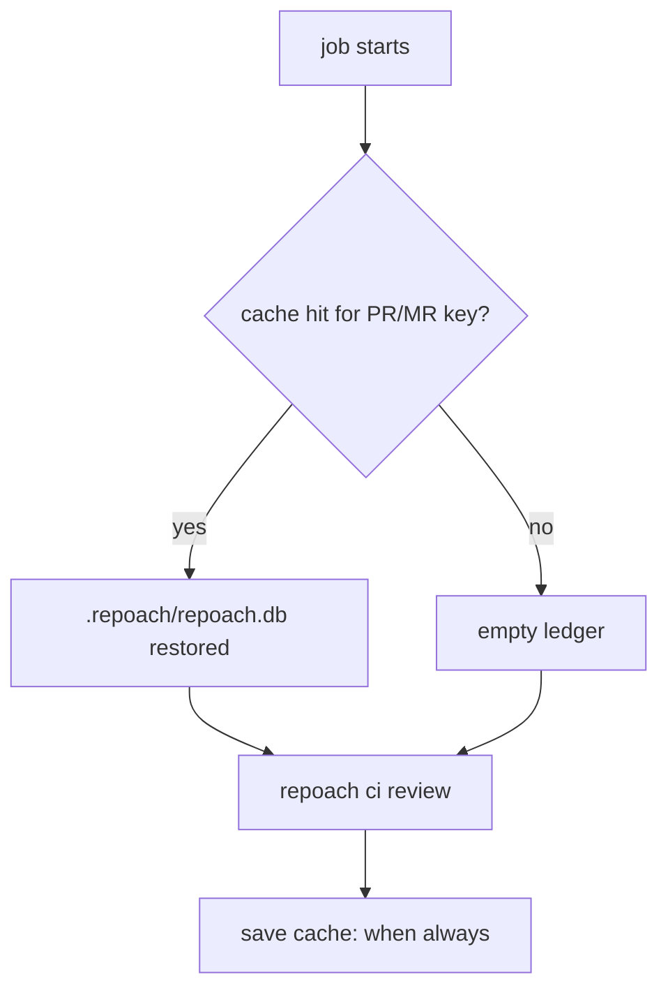

# The generated CI jobs keep the findings ledger between jobs of one PR / MR

## Intent

`repoach init --ci gitlab|github` writes a job that starts every run
with an empty findings ledger, so the run cache of
SP-FINDINGS-BRIDGE-DOCFIX 0.3 (a completed `review pr` at the same head
is replayed from `pr_review_runs`) never fires in CI, and the older-head
re-check of SP-GATE-REVERIFIES-AT-HEAD has no earlier finding to
re-check. Make both generated jobs keep the ledger per PR / MR, and let
`doctor --ci` say whether they do.

## Context

Tech-debt row 84 (`docs/tech_debt.md`), verbatim: "CI never warms the
`review pr` run cache — SP-FINDINGS-BRIDGE-DOCFIX 0.3 replays a
completed run at the same head from `pr_review_runs` in
`.repoach/repoach.db`, but the snippets `repoach init --ci` generates
keep no state between jobs: the GitLab job has no `cache:` for
`.repoach/`, the GitHub workflow no `actions/cache` step, so every CI
job starts with an empty ledger, the replay never fires there and
`REPOACH_REVIEW_FORCE` is inert. The GitHub workflow's `Review` step
also does not pass `REPOACH_REVIEW_FORCE` through `env:`, so even a
warmed cache could not be forced. (verified 2026-10-22)"

Measured on `origin/develop` 2706bb6 (2026-10-25):

- F1: `render_gitlab_job` (`src/repoach/ci_entry/snippets.py`) emits
  `review:advisory` with `needs`, `rules`, `allow_failure`,
  `interruptible`, `timeout`, `image`, `variables`
  (`REPOACH_INSTALL`, `REPOACH_ADVISORY_POST`) and `script`; no
  `cache:` key.
- F2: `render_github_workflow` emits checkout, setup-python, the
  scrubbed install step and a `Review` step whose `env:` carries
  `GH_TOKEN`, `REPOACH_ADVISORY_POST`, the direct key and the two
  gateway variables; no `actions/cache` step and no
  `REPOACH_REVIEW_FORCE` (`FORCE_VAR`, `ci_entry/variables.py:36`,
  read by `ci_entry/advisory.py:583`).
- F3: the ledger is not under `.repoach/` by default.
  `Settings.db_path` (`core/config.py`) and `resolve_db_path`
  (`core/paths.py:382`) default to
  `$XDG_DATA_HOME/repoach/<project-slug>/repoach.db`
  (`default_db_path`, SP-UNIVERSAL-INSTALL G4), outside the checkout;
  only `REPOACH_DB_PATH` (or `[state].db_path` in `repoach.toml`, which
  Yoob sets to `.repoach/repoach.db`, Yoob `docs/BACKLOG.md` B-132)
  moves it into the workspace. A `cache:` on `.repoach/` alone would
  cache an empty directory in a project that has not set the path.
- F4: the generated GitLab job file itself lives under `.repoach/`
  (`GITLAB_JOB_PATH = .repoach/ci/gitlab-review.yml`): a cache of the
  whole directory restores an older copy of that tracked file over the
  checkout.
- F5: measured precedent. Yoob's `review:gate` job (Yoob
  `.gitlab-ci.yml`, `origin/develop`) declares
  `cache: {key: repoach-ledger-mr-$CI_MERGE_REQUEST_IID, paths: [.repoach/], when: always}`;
  on Yoob !314 (2026-10-25) the third pipeline restored
  `repoach-ledger-mr-314` and the gate ran its older-head re-check from
  it (Yoob `docs/specs/2026-10-20_advisory-review-runner.md` C4). The
  same-head replay is measured locally only: SP-FINDINGS-BRIDGE-DOCFIX
  AC17, yoob !306, run 1 `usage: 8 calls`, run 2 `usage: 0 calls`,
  `cached: true`, with both runs sharing one ledger.
- F6: a GitHub Actions cache entry is immutable once saved, and
  `actions/cache`'s post step saves only when the job succeeds. A key
  of the PR number alone is therefore written once and never refreshed;
  the generated job is `continue-on-error: true` and its `Review` step
  may fail, which would skip the save.

## Goals

- G1: the generated GitLab job sets `REPOACH_DB_PATH: ".repoach/repoach.db"`
  in `variables:` and declares
  `cache: {key: repoach-ledger-mr-$CI_MERGE_REQUEST_IID, paths: [.repoach/repoach.db], when: always}`
  (F5's key; the path narrowed to the ledger file, F4).
- G2: the generated GitHub workflow sets
  `REPOACH_DB_PATH: .repoach/repoach.db` on the `Review` step, restores
  the ledger before it with `actions/cache/restore` (key
  `repoach-ledger-pr-<number>-<run_id>-<run_attempt>`, `restore-keys:
  repoach-ledger-pr-<number>-`) and saves it after it with
  `actions/cache/save` under `if: always()` (F6), both pinned by commit
  SHA as `CHECKOUT_ACTION` is.
- G3: the GitHub `Review` step passes
  `REPOACH_REVIEW_FORCE: ${{ vars.REPOACH_REVIEW_FORCE }}` through
  `env:`.
- G4: a second job of the same PR / MR at an unchanged head restores
  the first job's ledger and `review pr` replays the completed run:
  `cached: true`, 0 reviewer calls, 0 judge calls.
- G5: `doctor --ci` prints the ledger path `ci review` would use,
  whether it lies inside the workspace (the only place a CI cache can
  keep), whether the file is present at that moment (a restored cache),
  and whether the generated job file in the checkout declares the
  ledger cache.

## Non-Goals

- NG1: no ledger shared across PRs / MRs (Yoob B-132's remaining part):
  the key is per PR / MR.
- NG2: no change to the replay itself (SP-FINDINGS-BRIDGE-DOCFIX G9-G13)
  or to the older-head re-check.
- NG3: no rewrite of a project's own CI file: `.gitlab-ci.yml` and
  existing workflows stay untouched (SP-UNIVERSAL-CI-ENTRY); a job file
  already present and different stays `differs` without `--force`.
- NG4: no distributed GitLab cache setup; a runner without a shared
  cache keeps the ledger only on that runner (edge case below).

## Assumptions

- A1: `REPOACH_DB_PATH` relative to the project root resolves inside
  the CI workspace (`Settings._anchor_relative_paths`,
  `resolve_db_path`).
- A2: `REPOACH_DB_PATH` is not a secret and reaches the `ci review`
  child (`review/secret_env.py` names it among the non-secret config).
- A3: `src/repoach/ci_entry/` stays owned by SP-UNIVERSAL-CI-ENTRY;
  this spec edits `snippets.py`, `variables.py` and `cli.py` there
  under the `depends_on` edge and claims only its new test.
  `src/repoach/cli/doctor_cmds.py` is frontier and needs no edit
  (`doctor --ci` prints `ci_doctor_lines`).

## Interface

Inputs:
- `render_gitlab_job(target) -> str` and
  `render_github_workflow(target) -> str`: unchanged signatures; new
  content per G1-G3.
- `LEDGER_PATH: Path = Path(".repoach") / "repoach.db"` (new, in
  `ci_entry/snippets.py`): the one path both snippets set and cache.
- `CACHE_RESTORE_ACTION`, `CACHE_SAVE_ACTION` (new constants):
  `actions/cache/restore@<sha>` and `actions/cache/save@<sha>`.
- `ci_doctor_lines(env, root: Path | None = None) -> list[str]`: `root`
  added, the checkout the job file is read from; `None` skips the
  job-file line.

Outputs (new `doctor --ci` lines, names only, never a value of a
secret):
- `ledger=<path> (inside workspace|outside workspace)`
- `ledger_present=yes|no`
- `ledger_cache=declared|not declared|no generated job file`
  (`declared` when the job file at `GITLAB_JOB_PATH` /
  `GITHUB_WORKFLOW_PATH` carries `LEDGER_PATH` under a `cache:` or an
  `actions/cache` step).

Errors: none new.

## Behavior

### Nominal

Job 1 of MR `!N` at head `H`: the cache misses, `review pr` runs the
reviewers and writes `pr_review_runs` into `.repoach/repoach.db`, the
job saves the cache (`when: always` / `if: always()`). Job 2 of `!N`
at `H` (a retry, or a pipeline re-run): the cache restores the ledger,
`review pr` finds the completed run and replays it (`cached: true`,
`usage: 0 calls`). With `REPOACH_REVIEW_FORCE=1` job 2 runs the
reviewers again. Job 3 at a new head `H'`: the restored ledger holds
`H`'s findings, which the older-head re-check re-verifies at `H'`.

### Edge cases

- A project that set `[state].db_path` to another in-workspace path:
  the job's `REPOACH_DB_PATH` wins (process environment over
  `repoach.toml`) and the ledger is the cached one; `doctor --ci`
  prints the path actually used.
- A project whose effective ledger is outside the workspace (no
  `REPOACH_DB_PATH`, a hand-written job) -> `doctor --ci` prints
  `ledger=… (outside workspace)` and `ledger_cache=not declared` or
  `no generated job file`.
- GitLab runner without a distributed cache: a job landing on another
  runner starts from an empty ledger and reviews from scratch, as Yoob
  documents (Yoob `docs/developer_guide/workflows.md`, "A fix push").
- GitHub `cancel-in-progress` cancels job 1 before the save: job 2
  restores the newest earlier entry by `restore-keys`, or none.
- A PR from a fork: the cache is scoped to that PR's ref by GitHub; the
  key never crosses PRs.

### Failure scenarios

- The cache restore fails or misses -> the job runs exactly as today
  (empty ledger), never fails because of the cache.
- The save fails -> logged by the runner; the review's result is
  unchanged.

## Architecture Impact

- Adds dependency: SP-CI-LEDGER-PERSISTS -> SP-UNIVERSAL-CI-ENTRY
  (edits `ci_entry/snippets.py`, `variables.py`, `cli.py`, owned there).
- Adds dependency: SP-CI-LEDGER-PERSISTS -> SP-FINDINGS-BRIDGE-DOCFIX
  (the replay from `pr_review_runs`, `review/review_cache.py`, is what
  the persisted ledger feeds; read, not edited).
- Removes dependency: none.
- New / changed coupling: none beyond the ledger file, already
  `db:`-level state of the findings ledger.

## Diagram

## Acceptance Criteria

- [ ] AC1: `render_gitlab_job` output parses as YAML and its
  `review:advisory` job has `variables.REPOACH_DB_PATH ==
  ".repoach/repoach.db"` and `cache == {key:
  "repoach-ledger-mr-$CI_MERGE_REQUEST_IID", paths:
  [".repoach/repoach.db"], when: "always"}` —
  `tests/unit/test_ci_ledger_persists.py`.
- [ ] AC2: `render_github_workflow` output parses as YAML; the
  `review` job has an `actions/cache/restore@<40-hex>` step before
  `Review` and an `actions/cache/save@<40-hex>` step after it with
  `if: always()`, both on path `.repoach/repoach.db`, the save key
  containing `github.event.pull_request.number`, `github.run_id` and
  `github.run_attempt`, the restore key prefix
  `repoach-ledger-pr-${{ github.event.pull_request.number }}-`.
- [ ] AC3: the GitHub `Review` step's `env:` contains
  `REPOACH_REVIEW_FORCE: ${{ vars.REPOACH_REVIEW_FORCE }}` and
  `REPOACH_DB_PATH: .repoach/repoach.db`.
- [ ] AC4 (fixture): two simulated jobs of PR 7 at one head, each in a
  fresh workspace, with only the paths the rendered snippet caches
  copied from job 1's workspace into job 2's, and fake reviewers and
  judge that count their calls: job 1 makes ≥1 reviewer call and
  reports `cached: false`; job 2 reports `cached: true`, 0 reviewer
  calls, 0 judge calls, the same verdict.
- [ ] AC5 (fixture): the same as AC4 with `REPOACH_REVIEW_FORCE=1` in
  job 2's environment: job 2 reports `cached: false` and calls the
  reviewers.
- [ ] AC6: `doctor --ci` with `REPOACH_DB_PATH=.repoach/repoach.db`,
  the ledger file present and the generated GitLab job file in the
  checkout prints `ledger=<root>/.repoach/repoach.db (inside
  workspace)`, `ledger_present=yes`, `ledger_cache=declared`; without
  `REPOACH_DB_PATH` it prints `(outside workspace)`; with a job file
  lacking the cache stanza it prints `ledger_cache=not declared`.
- [ ] AC7: `repoach init --ci gitlab` on a checkout holding the
  previous rendering reports `differs` (and `--force` rewrites it):
  the existing `plan_ci_init` contract holds for the new content.
- [ ] AC8 (measured, recorded in the PR): on one GitLab MR using the
  generated job, two pipelines at the same head; the second job's log
  shows the cache restored, `review: cached at <sha7>` and `usage: 0
  calls`. Job URLs in the PR description.

## Open Questions

- Q1: should the snippet set `REPOACH_DB_PATH` unconditionally (G1/G2,
  overriding a project's `[state].db_path`), or only cache whatever
  `[state].db_path` names and leave the default alone when it is
  unset?
- Q2: GitLab `cache:` is per runner unless a distributed cache is
  configured; is that limit acceptable for the generated job (Yoob
  accepted it), or should `doctor --ci` also warn when the runner
  reports no shared cache?
- Q3: should `ledger_cache` also recognise a hand-written job (Yoob's
  `review:gate` in `.gitlab-ci.yml`), or is the generated file the only
  one `doctor --ci` reads?
