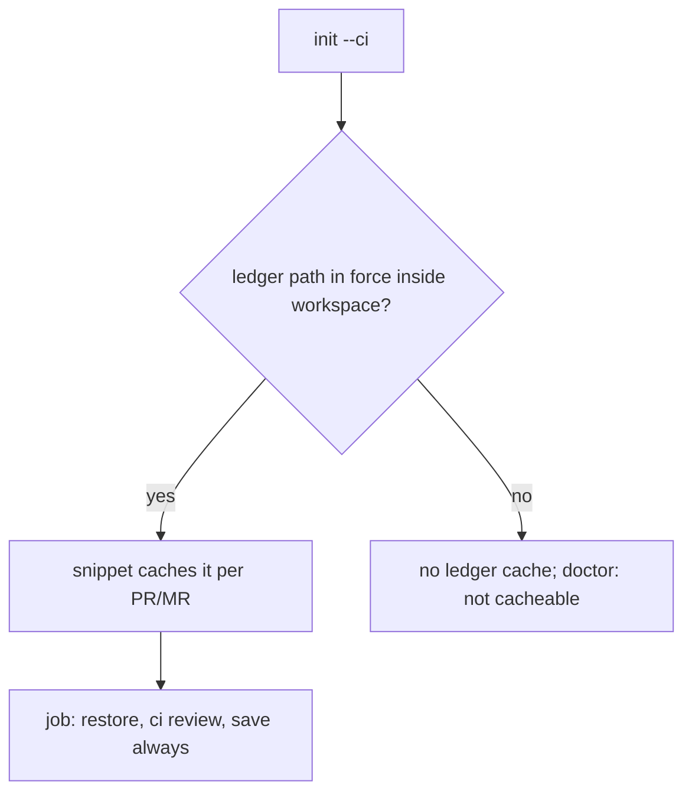

# The generated CI jobs keep the findings ledger between jobs of one PR / MR

Amendment (0.5, 2026-11-18): personal strings replaced by placeholders (SP-SCRUB-PERSONAL-DATA-AT-HEAD D2); the fixture oracle is the class lint (D6).

## Amendment (0.4, 2026-11-18): the hand-written job is an anonymised fixture; the spec is for every project

Owner principle 2026-11-17, repoach is for everyone. 0.3 named one
project's hand-written job as D3's "first client and reference fixture"
and copied it into a test named after that project. The fixture is now
`tests/fixtures/ci/hand_written_review_job.yml`, owned here: a
hand-written GitLab job that names `repoach` in `variables:` and
`cache:` and not in `script:` (the shape F7 measured), with every
project value replaced by a placeholder (runner tag `<runner tag>`,
environment `<environment>`, script `bash ci/<review script>.sh`, no
project id, no host, no login), and the test is
`test_doctor_reads_a_hand_written_job`. The End state, the edge cases,
NG1, NG6 and the Open Questions describe any project; the project
measured in F3, F5 and F7 appears as "Reference measurement (owner's
dogfood)" and C2 names it as one instance.

## Amendment (0.3, 2026-11-17): approved and ordered; the facts re-measured on `92cd241`

The owner scheduled this draft on 2026-11-17 as row 7b of
SP-REVIEW-CONVERGES, after SP-REVIEW-DELTA-FIRST and before row 8 (the
thread composite), because SP-GITLAB-NOTE-RECEIVER (8c) generates a
`threads:reply` job that restores and saves the merge request's ledger
and cannot cite a cache stanza no spec writes. Nothing of 0.2's design
changes; this version re-measures every fact on `origin/develop`
`92cd241`, states the format impact (D4), adds the sections an approved
spec carries (End state, Easy solution rejected, Hard part, Tests with
their red mutation, Success conditions with an external oracle), names
the `LedgerPlan` 8c consumes, and closes the two live measurements of
0.2 on the one project known to run the pattern today, whose
hand-written `review:gate` job already caches the ledger with the key
this spec generates (F5, a reference measurement).

## Intent

`repoach init --ci gitlab|github` writes a job that starts every run
with an empty findings ledger, so the run cache of
SP-FINDINGS-BRIDGE-DOCFIX 0.3 (a completed `review pr` at the same head
is replayed from `pr_review_runs`) never fires in CI, the older-head
re-check of SP-GATE-REVERIFIES-AT-HEAD has no earlier finding to
re-check, and every thread row of SP-THREAD-REPLY-AGENT would be lost
between pipelines. Make both generated jobs keep the ledger per PR / MR,
and let `doctor --ci` say whether they do.

## Context

Tech-debt row 84 (`docs/tech_debt.md:81`), verbatim: "CI never warms the
`review pr` run cache — SP-FINDINGS-BRIDGE-DOCFIX 0.3 replays a
completed run at the same head from `pr_review_runs` in
`.repoach/repoach.db`, but the snippets `repoach init --ci` generates
keep no state between jobs: the GitLab job has no `cache:` for
`.repoach/`, the GitHub workflow no `actions/cache` step, so every CI
job starts with an empty ledger, the replay never fires there and
`REPOACH_REVIEW_FORCE` is inert. The GitHub workflow's `Review` step
also does not pass `REPOACH_REVIEW_FORCE` through `env:`, so even a
warmed cache could not be forced. (verified 2026-10-22)"

Measured on `origin/develop` `92cd241` (2026-11-17). F3's last
sentence, F5 and F7 are a reference measurement (owner's dogfood) on
the owner's GitLab project, Yoob, at its `origin/develop` `6ee04ab`;
they show the pattern in use, they are a condition of nothing:

| # | Fact | Where |
|---|---|---|
| F1 | `render_gitlab_job` emits `review:advisory` with `needs`, `rules` (`merge_request_event`), `allow_failure`, `interruptible`, `timeout`, `image`, `variables` (`REPOACH_INSTALL`, `REPOACH_ADVISORY_POST`) and `script`; no `cache:` key, no ledger path | `src/repoach/ci_entry/snippets.py:93-119`; `GITLAB_JOB_PATH = .repoach/ci/gitlab-review.yml` `:36`, `GITLAB_JOB_NAME` `:39` |
| F2 | `render_github_workflow` emits a `review` job, `continue-on-error: true`, checkout (`CHECKOUT_ACTION`, pinned by commit SHA), setup-python, the install step and a `Review` step whose `env:` carries `GH_TOKEN`, the posting switch, the direct key and the two gateway variables; no `actions/cache` step, no `REPOACH_DB_PATH`, no `REPOACH_REVIEW_FORCE` | `snippets.py:44`, `:122-162` (the `Review` step `:153-160`); `FORCE_VAR = "REPOACH_REVIEW_FORCE"` `ci_entry/variables.py:36`, read by `ci_entry/advisory.py:583` |
| F3 | The ledger is not under `.repoach/` by default: `Settings.db_path` maps to `REPOACH_DB_PATH` and defaults through `resolve_db_path` / `default_db_path` to `$XDG_DATA_HOME/repoach/<project-slug>/repoach.db`, outside the checkout; only `REPOACH_DB_PATH` or `[state].db_path` in `repoach.toml` moves it into the workspace. Yoob sets `[state] db_path = ".repoach/repoach.db"` | `src/repoach/core/config.py:227`, `:252-257`; `src/repoach/core/paths.py:303`, `:382`; Yoob `repoach.toml:92-95` |
| F4 | The generated GitLab job file itself lives under `.repoach/` (F1's path): a cache of the whole directory restores an older copy of that tracked file over the checkout | `snippets.py:36` |
| F5 | Measured precedent: Yoob's hand-written `review:gate` declares `cache: {key: repoach-ledger-mr-$CI_MERGE_REQUEST_IID, paths: [.repoach/], when: always}`; on Yoob !314 (2026-10-25) the third pipeline restored `repoach-ledger-mr-314` and the gate ran its older-head re-check from it; its script says so (`the ledger under .repoach/ is the job's cache, keyed per merge request`). The same-head replay prints `review: cached at <sha7> (run <id>, <when>)` | Yoob `.gitlab-ci.yml:1645-1669`; Yoob `ci/review-gate.sh:12-14`; `src/repoach/review/review_cache.py:150` |
| F6 | A GitHub Actions cache entry is immutable once saved, and `actions/cache`'s post step saves only when the job succeeds; a key of the PR number alone is written once and never refreshed; the generated job is `continue-on-error: true` and its `Review` step may fail, which would skip the save | `docs.github.com/actions/.../caching-dependencies` (read 2026-10-25); F2 |
| F7 | Yoob's `review:gate` names `repoach` in its `variables:` (`REPOACH_REF`, `REPOACH_LLM_PROXY_BASE_URL`, `REPOACH_REVIEW_POST`) and its `cache.key`, not in its `script:` (`bash ci/review-gate.sh`) | Yoob `.gitlab-ci.yml:1658-1669` |
| F8 | A GitLab job cannot read its runner's cache configuration (the runner host's `config.toml`); what a job can observe is whether a declared cache was restored, that is whether the ledger file exists when the job starts | GitLab runner docs; F5 |
| F9 | `ci_doctor_lines(env: Mapping[str, str]) -> list[str]` prints the `doctor --ci` lines from the environment alone and reads no checkout; `plan_ci_init(root, kind, target, *, force)` returns `create` / `unchanged` / `differs` / `overwrite` for the rendered file | `src/repoach/ci_entry/cli.py:212`; `snippets.py:169`, `:207-215` |
| F10 | SP-GITLAB-NOTE-RECEIVER D8 generates a `threads:reply` job whose cache key is `repoach-ledger-mr-$REPOACH_THREADS_REPLY_MR`, the same string as this spec's key for that merge request, so the review job and the thread job share one ledger; it takes the path from `LedgerPlan` | SP-GITLAB-NOTE-RECEIVER D8 |

## Decisions (0.2, 2026-10-25; D4 2026-11-17)

- D1 (Q1): a project's explicit ledger path is never overridden. `init
  --ci` reads the project's `[state].db_path`: when none is set, the
  snippet sets `REPOACH_DB_PATH=.repoach/repoach.db`; when one is set,
  the snippet sets no `REPOACH_DB_PATH` and caches that path. When the
  path in force lies outside the workspace, the snippet declares no
  ledger cache at all (never a wrong path) and `doctor --ci` prints
  `ledger not cacheable (outside workspace)`.
- D2 (Q2): `doctor --ci` warns, without changing its exit code, when a
  GitLab MR pipeline declares the ledger cache but the ledger is absent
  at job start (F8: the runner's cache backend is not observable, its
  effect is). Information only.
- D3 (Q3): `doctor --ci` also reads hand-written jobs: any job of the
  checkout's `.gitlab-ci.yml` that names `repoach` in its `script`,
  `variables` or `cache` counts as a repoach job (F7). The fixture is
  `tests/fixtures/ci/hand_written_review_job.yml` (0.4), an anonymised
  hand-written job of that shape: runner tag, environment, script name
  and every project value replaced by placeholders; the redaction rule
  of the family applies (logins → role class, hosts, ids and paths →
  placeholders).
- D4 (0.3, SP-LEDGER-FORMAT-IS-VERSIONED): this spec adds no table, no
  column and no enum value to the ledger; it moves the file and caches
  it. `LEDGER_FORMAT` is untouched (`ledger_format_after: none`);
  `python -m repoach.review.ledger_format snapshot` is byte-equal before
  and after this pull request.

## End state

A project that ran `repoach init --ci gitlab` opens a merge request; the
first pipeline's `review:advisory` reviews it and saves
`repoach-ledger-mr-<iid>`; a re-run of the same pipeline restores it and
its log says `review: cached at <sha7>` with `usage: 0 calls`; a fix
push restores it and the older-head re-check runs on the first head's
findings. The GitHub workflow does the same through `actions/cache`
restore and save, the save under `if: always()`. `repoach doctor --ci`
prints the ledger path, whether it is cacheable and present, and which
jobs declare the cache. On a project whose hand-written review job
carries the key, `threads:reply` (8c) restores the ledger that job
wrote, under one key.

## Easy solution rejected

Cache `.repoach/` whole, as a hand-written job may (F5): the generated job file lives
there (F4) and an older copy of a tracked file would be restored over
the checkout; the path is narrowed to the ledger file. Also rejected:
always setting `REPOACH_DB_PATH=.repoach/repoach.db` in the snippet,
which overrides a project's explicit `[state].db_path` (D1); and a
GitHub cache keyed by the PR number alone, which is written once and
never refreshed (F6), hence the `run_id`/`run_attempt` suffix with a
prefix `restore-keys`.

## Hard part

The path. The ledger's location is decided by three sources with a
precedence (environment, then `repoach.toml`, then the XDG default,
F3), only the first two can put it inside the workspace, and a cache
stanza on the wrong path caches nothing while looking right. The
snippet therefore derives one `LedgerPlan` from the project's own
configuration at `init --ci` time, declares the cache only when the
path is inside the workspace, and `doctor --ci` prints the path in
force at job time so a drift between the two is read, not guessed.
The second hard part is GitHub's immutable entries (F6): the key must
be unique per run and the restore must fall back to the newest earlier
entry of the same PR.

## Goals

- G1: the generated GitLab job declares `cache: {key: repoach-ledger-mr-$CI_MERGE_REQUEST_IID, paths: [<ledger>], when: always}` (F5's key; the path narrowed to the ledger file, F4), where `<ledger>` is the path in force (D1); it sets `REPOACH_DB_PATH: ".repoach/repoach.db"` in `variables:` only when the project sets no `[state].db_path`.
- G2: the generated GitHub workflow restores the ledger before the `Review` step with `actions/cache/restore` (key `repoach-ledger-pr-<number>-<run_id>-<run_attempt>`, `restore-keys: repoach-ledger-pr-<number>-`) and saves it after it with `actions/cache/save` under `if: always()` (F6), both pinned by commit SHA as `CHECKOUT_ACTION` is; it sets `REPOACH_DB_PATH: .repoach/repoach.db` on the `Review` step under the same D1 rule.
- G3: the GitHub `Review` step passes `REPOACH_REVIEW_FORCE: ${{ vars.REPOACH_REVIEW_FORCE }}` through `env:`.
- G4: a second job of the same PR / MR at an unchanged head restores the first job's ledger and `review pr` replays the completed run: `cached: true`, 0 reviewer calls, 0 judge calls.
- G5: a ledger path in force outside the workspace yields no ledger cache in either snippet (D1).
- G6: `doctor --ci` prints the ledger path `ci review` would use, whether it is cacheable (inside the workspace), whether the file is present at that moment (a restored cache), and which repoach jobs declare the ledger cache: the generated job files and every hand-written `.gitlab-ci.yml` job naming `repoach` (D3).
- G7: `doctor --ci` prints one warning line, exit code unchanged, when it runs in a GitLab MR pipeline whose repoach job declares the ledger cache and the ledger is absent (D2).
- G8 (0.3): `LedgerPlan` is importable by `ci_entry` callers so SP-GITLAB-NOTE-RECEIVER's `threads:reply` job caches the same path under the same key string (F10).

## Non-Goals

- NG1: no ledger shared across PRs / MRs: the key is per PR / MR.
- NG2: no change to the replay itself (SP-FINDINGS-BRIDGE-DOCFIX G9-G13) or to the older-head re-check.
- NG3: no rewrite of a project's own CI file: `.gitlab-ci.yml` and existing workflows stay untouched (SP-UNIVERSAL-CI-ENTRY); a job file already present and different stays `differs` without `--force`.
- NG4: no distributed GitLab cache setup; a runner without a shared cache keeps the ledger only on that runner (D2 makes it visible).
- NG5: `doctor --ci` does not follow `include:` entries of `.gitlab-ci.yml` other than the generated job file it already reads.
- NG6 (0.3): no change to repoach's own `auto-review.yml`, which is hand-written and persists its ledger as an artifact (SP-REVIEW-RESUMES-FAILED-ROLES D4), nor to any project's hand-written job (NG3).

## Assumptions

- A1: `REPOACH_DB_PATH` relative to the project root resolves inside the CI workspace (`Settings._anchor_relative_paths`, `resolve_db_path`); the environment outranks `repoach.toml` (`core/config.py`, "environment > file > built-in default").
- A2: `REPOACH_DB_PATH` is not a secret and reaches the `ci review` child (`review/secret_env.py` names it among the non-secret config).
- A3: `src/repoach/ci_entry/` stays owned by SP-UNIVERSAL-CI-ENTRY; this spec edits `snippets.py`, `variables.py` and `cli.py` there under the `depends_on` edge and claims only its new test. `src/repoach/cli/doctor_cmds.py` is frontier; it passes the project root to `ci_doctor_lines`.
- A4: `actions/cache/restore` and `actions/cache/save` exist as sub-actions of the `actions/cache` repository at a commit the implementer reads and pins (40 hex) when the pull request opens.

## Interface

```python
# src/repoach/ci_entry/snippets.py (SP-UNIVERSAL-CI-ENTRY's file, edited under the edge)
DEFAULT_LEDGER_PATH: Path = Path(".repoach") / "repoach.db"
CACHE_RESTORE_ACTION = "actions/cache/restore@<40 hex>"
CACHE_SAVE_ACTION = "actions/cache/save@<40 hex>"
class LedgerPlan(BaseModel):          # frozen
    path: Path | None                 # workspace-relative ledger to cache; None when not cacheable
    sets_env: bool                    # whether the snippet sets REPOACH_DB_PATH
def ledger_plan(root: Path) -> LedgerPlan: ...                                   # D1, from [state].db_path
def render_gitlab_job(target: InstallTarget, ledger: LedgerPlan) -> str: ...      # G1
def render_github_workflow(target: InstallTarget, ledger: LedgerPlan) -> str: ... # G2, G3
# render(kind, target) and plan_ci_init(root, kind, target, *, force) pass ledger_plan(root)

# src/repoach/ci_entry/cli.py (same owner)
def ci_doctor_lines(env: Mapping[str, str], root: Path | None = None) -> list[str]: ...   # G6, G7; None skips the job lines
```

Outputs (new `doctor --ci` lines, names only, never a secret's value):
`ledger=<path> (cacheable)`, or `ledger=<path>` followed by `ledger not
cacheable (outside workspace)`; `ledger_present=yes|no`;
`ledger_cache=<job> declared|<job> not declared`, one line per repoach
job found (generated files and `.gitlab-ci.yml` jobs, D3), or
`ledger_cache=no repoach job found`; the warning of D2 on stderr:
`repoach: warning: ledger cache declared but not restored; a runner
without a shared cache keeps the ledger only on the runner that wrote
it`.

Errors: none new; an unparsable `.gitlab-ci.yml` prints
`ledger_cache=.gitlab-ci.yml unreadable` and exit 0.

## Behavior

### Nominal

Job 1 of MR `!N` at head `H`: the cache misses, `review pr` runs the
reviewers and writes `pr_review_runs` into the ledger, the job saves
the cache (`when: always` / `if: always()`). Job 2 of `!N` at `H` (a
retry, or a pipeline re-run): the cache restores the ledger,
`review pr` finds the completed run and replays it (`cached: true`,
`usage: 0 calls`). With `REPOACH_REVIEW_FORCE=1` job 2 runs the
reviewers again. Job 3 at a new head `H'`: the restored ledger holds
`H`'s findings, which the older-head re-check re-verifies at `H'`.

### Edge cases

- `[state].db_path = ".repoach/repoach.db"` (a project that sets it) → no `REPOACH_DB_PATH` in the snippet, cache path `.repoach/repoach.db`.
- `[state].db_path` absolute, or relative but resolving outside the root → no ledger cache, no `REPOACH_DB_PATH`; `doctor --ci` prints `ledger not cacheable (outside workspace)`.
- A CI/CD variable `REPOACH_DB_PATH` set by the project outranks both; `doctor --ci` prints the path actually in force and whether it is cacheable.
- `[state].db_path` changed after `init --ci` → the rendered file differs; `init --ci` reports `differs` until `--force` (F9).
- GitLab runner without a distributed cache: a job landing on another runner starts from an empty ledger and reviews from scratch; `doctor --ci` warns (D2).
- The first pipeline of an MR: the ledger is legitimately absent; the D2 warning says "declared but not restored" without claiming a fault.
- GitHub `cancel-in-progress` cancels job 1 before the save: job 2 restores the newest earlier entry by `restore-keys`, or none.
- A PR from a fork: the cache is scoped to that PR's ref by GitHub; the key never crosses PRs.

### Failure scenarios

- The cache restore fails or misses → the job runs exactly as today (empty ledger), never fails because of the cache.
- The save fails → logged by the runner; the review's result is unchanged.

## Tests

| Test | What it pins | Mutation that must turn it red |
|---|---|---|
| `tests/unit/test_ci_ledger_persists.py::test_gitlab_job_caches_the_default_ledger_and_sets_the_path` | AC1 | drop `cache:` or `when: always` |
| `::test_github_workflow_restores_before_review_and_saves_always_after` | AC2 | save without `if: always()`, or key on the PR number alone |
| `::test_github_review_step_passes_the_force_variable` | AC3 | leave `env:` as today |
| `::test_explicit_relative_path_is_cached_without_setting_the_env` | AC4, D1 | set `REPOACH_DB_PATH` anyway |
| `::test_path_outside_the_workspace_yields_no_cache_in_either_snippet` | AC4, G5 | cache `/var/lib/repoach.db` |
| `::test_second_job_at_the_same_head_replays_from_the_cached_paths_only` | AC5, G4: two simulated jobs in fresh workspaces, only the cached paths copied; job 2 `cached: true`, 0 reviewer and 0 judge calls, same verdict | copy nothing, or copy the whole workspace |
| `::test_force_in_job_two_reviews_again` | AC6 | ignore `REPOACH_REVIEW_FORCE` |
| `::test_doctor_prints_the_ledger_lines` | AC7, G6 | print the path without the cacheable verdict |
| `::test_doctor_reads_a_hand_written_job` | AC8, D3: the anonymised fixture `tests/fixtures/ci/hand_written_review_job.yml` (0.4) | match `script:` only |
| `::test_doctor_warns_once_when_declared_but_absent` | AC9, D2 | change the exit code, or warn when present |
| `::test_init_reports_differs_for_the_previous_rendering` | AC10 | overwrite without `--force` |
| `::test_snapshot_is_unchanged` | D4: `ledger_format.snapshot()` equals `tests/fixtures/ledger_format/<LEDGER_FORMAT>.json` and `ls tests/fixtures/ledger_format/` gains no file | add a column |

## Success conditions

- C1 (oracle: AC5's fixture test): `pytest -q tests/unit/test_ci_ledger_persists.py::test_second_job_at_the_same_head_replays_from_the_cached_paths_only -s` prints `calls: job1=<n≥1> job2=0`.
- C2 (external oracle: the live pipelines of any GitLab project whose review job carries the key, generated or hand-written): on the first merge request with two pipelines at one head after this lands, `glab api projects/<id>/jobs/<second review job id>/trace | grep -c 'Successfully extracted cache'` → `1` and the same trace holds `review: cached at <sha7>`; written beside this line with both job ids by the verifier. After SP-GITLAB-NOTE-RECEIVER lands, the same grep on a `threads:reply` job of that merge request → `1`, which proves the shared key (F10). Before any live project, C1's fixture test proves the replay on a fresh machine. Reference measurement (owner's dogfood): the owner's project, whose hand-written job carries the key today (F5), is the first this runs on; its ids are an instance, not the oracle.
- C3 (oracle: the suites): `pytest -q tests/unit/test_ci_ledger_persists.py tests/unit/test_ci_entry.py` → green; `repoach arch check --base origin/develop` → `edge-honesty: ok`; `repoach arch graph --check 2>&1 | grep -c 'dependency cycle'` → `27`; `python -m repoach.review.ledger_format snapshot` byte-equal to `origin/develop`'s (D4).

## Architecture Impact

- Adds dependency: SP-CI-LEDGER-PERSISTS -> SP-UNIVERSAL-CI-ENTRY (edits `ci_entry/snippets.py`, `variables.py`, `cli.py`, owned there).
- Adds dependency: SP-CI-LEDGER-PERSISTS -> SP-FINDINGS-BRIDGE-DOCFIX (the replay from `pr_review_runs`, `review/review_cache.py`, is what the persisted ledger feeds; read, not edited).
- Adds dependency (0.3): SP-CI-LEDGER-PERSISTS -> SP-UNIVERSAL-PROJECT-CONFIG (`ledger_plan` reads `[state].db_path` through the project-config resolver).
- Consumed by SP-GITLAB-NOTE-RECEIVER (`LedgerPlan`, the key prefix), which declares the edge.
- No table, no column, no enum value (D4); no cycle.

## Diagram



## Acceptance Criteria

- [ ] AC1: with no `[state].db_path`, `render_gitlab_job` output parses as YAML and its `review:advisory` job has `variables.REPOACH_DB_PATH == ".repoach/repoach.db"` and `cache == {key: "repoach-ledger-mr-$CI_MERGE_REQUEST_IID", paths: [".repoach/repoach.db"], when: "always"}` (`tests/unit/test_ci_ledger_persists.py`). Today (`92cd241`): the file does not exist and `render_gitlab_job` emits no `cache:` (F1).
- [ ] AC2: `render_github_workflow` output parses as YAML; the `review` job has an `actions/cache/restore@<40-hex>` step before `Review` and an `actions/cache/save@<40-hex>` step after it with `if: always()`, both on the ledger path, the save key containing `github.event.pull_request.number`, `github.run_id` and `github.run_attempt`, the restore key prefix `repoach-ledger-pr-${{ github.event.pull_request.number }}-`.
- [ ] AC3: the GitHub `Review` step's `env:` contains `REPOACH_REVIEW_FORCE: ${{ vars.REPOACH_REVIEW_FORCE }}`, and `REPOACH_DB_PATH: .repoach/repoach.db` when no `[state].db_path` is set.
- [ ] AC4 (D1): with `[state].db_path = "state/ledger.db"` both snippets contain no `REPOACH_DB_PATH` and cache `state/ledger.db`; with `[state].db_path = "/var/lib/repoach.db"` (or `../x.db`) both contain no `REPOACH_DB_PATH` and no ledger cache step or `cache:` key.
- [ ] AC5 (fixture): two simulated jobs of PR 7 at one head, each in a fresh workspace, with only the paths the rendered snippet caches copied from job 1's workspace into job 2's, and fake reviewers and judge that count their calls: job 1 makes ≥1 reviewer call and reports `cached: false`; job 2 reports `cached: true`, 0 reviewer calls, 0 judge calls, the same verdict.
- [ ] AC6 (fixture): the same as AC5 with `REPOACH_REVIEW_FORCE=1` in job 2's environment: job 2 reports `cached: false` and calls the reviewers.
- [ ] AC7: `doctor --ci` with `REPOACH_DB_PATH=.repoach/repoach.db`, the ledger file present and the generated GitLab job file in the checkout prints `ledger=<root>/.repoach/repoach.db (cacheable)`, `ledger_present=yes`, `ledger_cache=review:advisory declared`; with an absolute path outside the root it prints `ledger not cacheable (outside workspace)`; with a job file lacking the cache stanza it prints `ledger_cache=review:advisory not declared`.
- [ ] AC8 (D3): the anonymised fixture `tests/fixtures/ci/hand_written_review_job.yml` (0.4: a `review:gate` job with script `bash ci/<review script>.sh`, `REPOACH_*` variables, `tags: [<runner tag>]`, `environment: <environment>`, `cache: {key: repoach-ledger-mr-$CI_MERGE_REQUEST_IID, paths: [.repoach/], when: always}`, and no project id, host or login: `scripts/lint_no_personal_data.py --tree tests/fixtures/ci/hand_written_review_job.yml` → `personal-data: ok` (judged when SP-NO-PERSONAL-DATA-GATE lands), and `grep -c "[0-9]\{8\}" tests/fixtures/ci/hand_written_review_job.yml` → `0` for the project id) yields `ledger_cache=review:gate declared`; a job not naming `repoach` is not listed.
- [ ] AC9 (D2): `CI_PIPELINE_SOURCE=merge_request_event`, a repoach job declaring the ledger cache, the ledger absent → the warning line on stderr and exit 0; the ledger present → no warning.
- [ ] AC10: `repoach init --ci gitlab` on a checkout holding the previous rendering reports `differs` (and `--force` rewrites it): the existing `plan_ci_init` contract holds for the new content (F9).
- [ ] AC11 (0.3): `repoach arch check --base origin/develop` → `edge-honesty: ok`; `pytest -q tests/unit/test_ci_entry.py tests/unit/test_ledger_format_skew.py` → green with no new `tests/fixtures/ledger_format/N.json` (D4).

## Open Questions

- None. 0.2's Q1–Q3 are D1–D3; the live measurement 0.2 asked for is C2, on any project whose review job carries the key.
