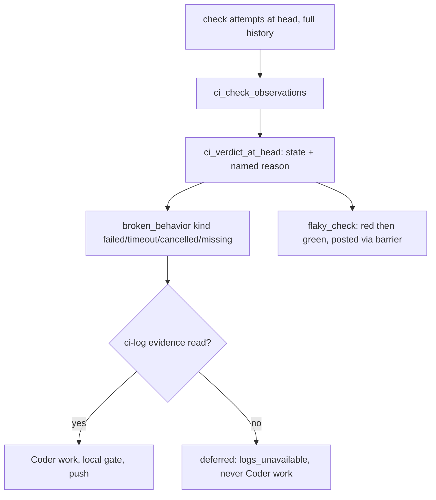

# Red, pending, missing and flaky CI are named findings, and a Coder fix needs the failing log

## Decisions (owner 2026-10-25)

The six open questions of version 0.1 were settled by the owner on
2026-10-25. The body below already applies these decisions.

- **Q1 → required checks on `develop` AND `main`.** The six required
  checks are `Test suite (Python 3.11)`, `Test suite (Python 3.13)`,
  `ShellCheck (warning-level)`, `wheel-build`, `wheel-smoke (3.11)` and
  `wheel-smoke (3.13)`. repoach's own review and merge jobs are left
  out, because requiring them would be circular: `Architect / Sentinel /
  Tester / Scribe`, `Coder auto-fix loop`, `Auto-merge to develop`.
  `repoach.toml` `[ci] required_checks` lists the six until the ruleset
  rule exists (AC12, AC13).
- **Q2 → `doctor --ci` exits `2` when no required checks are configured.**
  A gate that cannot see CI is a missing precondition. Plain `doctor`
  stays a report: it prints the same line and exits `0` (G2, AC17).
- **Q3 → the Coder's `git push` goes through the write barrier in a
  follow-up spec.** This spec keeps D5 unchanged and names the
  follow-up in NG4.
- **Q4 → `FindingStatus.DEFERRED` is a real status.** The readers that
  must learn it are listed, and AC18 checks each of them.
- **Q5 → a recurring flaky check blocks.** The first occurrence of a
  `flaky_check` is advisory. When a `flaky_check` for the **same check
  name** has been recorded on another PR within the last 14 days, the
  new one is **blocking** until `docs/tech_debt.md` has a row naming
  that check. The gate reads the file for the check name (G5b, AC19,
  AC20).
- **Q6 → accepted.** SP-AGENT-CONTEXT-LOOP v0.5 (PR #246) now defines the
  `ci-log:<check name>@<attempt id>` / `role='ci'` namespace in
  `agent_evidence_reads`. Rows in that namespace are written only by
  this spec's CI evidence path and are never served by the jailed tools
  (its G9b, AC23).

## Intent

The owner decided on 2026-10-25 that the blind spots repoach has on a
red CI become specified behaviour. Today a CI that has not reported
anything reads as green. A cancelled check is only logged. A check
that goes red and then green at the same SHA leaves no trace. A CI
finding whose log could not be fetched still goes to the Coder. This
spec makes each of those a named state or a named finding. It also
adds one invariant: the Coder never attempts a fix for a CI failure
whose log it has not read.

## Context

Measured on `origin/develop` at `53bb844` (2026-10-25), on
`repoachhq/repoach` (GitHub) and on `josephwfaye/yoob_2` (GitLab).

| # | Fact | Where |
|---|------|-------|
| F1 | `fetch_ci_status` returns `CI_GREEN, []` when `forge.checks()` reports **zero rows**. A CI run that has not been dispatched yet reads exactly like an all-green one, and `run_findings_coder` then calls `resolve_broken_behavior_findings`, which moves every open `broken_behavior` finding to `resolved`. `CI_UNKNOWN` is returned only on a `ForgeError`. | `src/repoach/review/coder_loop.py:809-853` (`:829-835`), `src/repoach/review/coder_findings.py:510-522` |
| F2 | The workflow comment that says `fetch_ci_status` "reads CI_UNKNOWN on this repo" is stale. SP-CI-STATUS-CLIENT-CLASSIFY (2026-07-24) dropped the `--required` filter, so the function now classifies every reported check. The comment still describes the old behaviour. | `.github/workflows/auto-review.yml:391-400` |
| F3 | `skipping` and `cancel` buckets are only logged (`coder.ci_check_non_blocking`). They go into neither `failed_rows` nor the pending test, so a run whose checks are **all cancelled** falls through to `CI_GREEN`. | `src/repoach/review/coder_loop.py:837-851` |
| F4 | `evaluate_ci_gate` distinguishes `SKIP_CI_FAILED`, `SKIP_CI_TIMEOUT`, `SKIP_CI_MISSING` and `SKIP_CI_PENDING`. The GitHub classifier, however, folds `CANCELLED`, `TIMED_OUT`, `ACTION_REQUIRED`, `STARTUP_FAILURE` and `STALE` into one `failed` list (`required_check_failed: <name>=<CONCLUSION>`), so the gate's "timeout" means *the gate's own wait expired*, not *the check timed out*. Two separate classifiers exist (Coder loop and gate), and they disagree on cancelled checks. | `src/repoach/review/auto_merge.py:103-144`, `:284-310`; `src/repoach/forge/github.py:80-86`, `:218-262` |
| F5 | There is no notion of a flaky check. `classify_required_checks` collapses duplicate check runs to the **latest `startedAt` per name**, and GitLab `checks()` reads "latest attempt of each" job. A red attempt that a re-run turns green at the same SHA is erased, and nothing records it. | `src/repoach/forge/github.py:234-242`, `src/repoach/forge/gitlab.py:775-783`, `src/repoach/review/auto_merge.py:208-311` |
| F6 | `fetch_failed_check_logs` turns a failed log fetch into a placeholder line (`_(<forge> log fetch failed: …)_` or `_(no log link found in: …)_`). `record_ci_failures_as_findings` then records the finding `verified` with `verification_result` taken from the block matched by name. That is the placeholder, or `""` when no block matched. The Coder receives that finding as work anyway. | `src/repoach/review/coder_loop.py:856-887` (`:872-886`), `src/repoach/review/coder_findings.py:210-288` |
| F7 | The Coder commits and pushes to the PR head branch only after the local gate passes (`run_pytest_matrix`, `run_ruff_gate`). It refuses a push when the head branch is unresolved. The push itself is a raw `git push origin HEAD:<branch>`. | `src/repoach/review/coder_loop.py:769-800`, `src/repoach/review/coder_findings.py:690-724` |
| F8 | `MAX_CODER_ROUNDS = 3`. The fourth start-check escalates to `stuck`. | `src/repoach/review/stuck.py:48-58` |
| F9 | The pure merge gate names a CI refusal only as `CI not green at head`. | `src/repoach/review/merge_gate.py:176-177` |
| F10 | On GitHub, the required check names come from the **classic** branch-protection endpoint only. When that endpoint is unreadable or empty, they fall back to the hard-coded `DEFAULT_REQUIRED_CHECK_NAMES = ("Test suite (Python 3.11)", "Test suite (Python 3.13)")`, which are repoach's own check names. On a foreign repository with no protection, the gate therefore waits for two checks that will never exist and refuses with `required_check_missing: Test suite (Python 3.11), …`. | `src/repoach/forge/github.py:70-78`, `:1441-1446`, `:1647-1669` |
| F11 | **repoach's own repository has no required checks.** `GET repos/repoachhq/repoach/branches/{develop,main}/protection` returns `404 Branch not protected`. The repository uses two active **rulesets** instead: `develop: pull requests only, never rewritten` and `main: releases land as merge commits`. Their rules are `deletion`, `non_fast_forward` and `pull_request`, with no `required_status_checks`. `GET …/rules/branches/develop` returns `["deletion","non_fast_forward","pull_request"]`. repoach does not read rulesets at all. | measured 2026-10-25 with `gh api` |
| F12 | Check names reported on repoach PR #245: `Architect / Sentinel / Tester / Scribe`, `Auto-merge to develop`, `Coder auto-fix loop`, `ShellCheck (warning-level)`, `Test suite (Python 3.11)`, `Test suite (Python 3.13)`, `wheel-build`, `wheel-smoke (3.11)`, `wheel-smoke (3.13)`. | `gh pr checks 245` |
| F13 | **Yoob (GitLab):** `only_allow_merge_if_pipeline_succeeds = true` and `merge_method = merge`. On `develop` today two jobs are `allow_failure: true`: `prepare:runner-quota` (`.gitlab-ci.yml:363-369`) and `review:advisory` (`:1497-1505`). Every other job is required by GitLab's own semantics. Yoob MR !314 (open, auto-merge armed, "ci(review): make the repoach review a blocking gate that runs first") renames `review:advisory` → `review:gate`, sets `allow_failure: false` and moves it first. **This spec assumes !314 merged**, so the required-job list is every job except `prepare:runner-quota`, and it includes `review:gate`. repoach's GitLab adapter reads this as `required_checks=["pipeline"]` and judges `head_pipeline.status` alone, with `canceled` and `skipped` counted as failure. | `src/repoach/forge/gitlab.py:84-86`, `:732-773`, `:891-918`; measured with `glab api projects/josephwfaye%2Fyoob_2` |
| F14 | **Flakes are real and leave no trace.** Of 60 Yoob merge-request pipelines (2026-10-18 → 2026-10-25), 3 contain a job that failed and then succeeded inside the same pipeline: `2985935610` `test:api:unit` at `5aa17688`, `2972485058` `prepare:runner-quota` at `c4970719` (allow_failure), and `2968989923` `lint:conventions` at `d62ae6f5`. All three pipelines ended `success`. On repoach, 1 of 100 PR workflow runs (2026-10-21 → 10-25) is a second attempt: `Auto Review (review bots)`, `success` at `e5a6d2fc`. | `glab api …/pipelines/<id>/jobs?include_retried=true`; `gh api …/actions/runs?event=pull_request` |
| F15 | The forge write barrier (`ForgeWriteBarrier`, SP-DRY-RUN-NEVER-POSTS) gates every **forge** write: API calls and mutating `gh`/`glab` argv. The Coder's `git push` (F7) is a git transport write and does not pass through it. | `src/repoach/forge/protocol.py:248-300`, `src/repoach/review/coder_loop.py:795-797` |
| F16 | SP-AGENT-CONTEXT-LOOP (draft v0.5, PR #246) defines the evidence ledger `agent_evidence_reads(id, run_id, pr_number, head_sha, role, turn, path, line_start, line_end, sha256, created_at)`. Its G9b reserves the `ci-log:<check name>@<attempt id>` / `role='ci'` namespace for this spec. Its AC23 pins the namespace: rows are written through the ledger API, and `read_file`/`grep` refuse such a path, so no tool can serve or write one. | that spec, G9, G9b, AC23 |
| F17 | `FindingStatus` has no `deferred` value. "Deferred" exists only as a refuter count with named tags (SP-REFUTER-JUDGES-WHAT-IT-CAN). | `src/repoach/review/findings.py:86-109` |

The tech-debt ledger tracks these gaps as rows that this spec is to
close (docs PR #248, branch `docs/red-ci-gaps-as-debt-rows`). They are
cited here by their text, not by their number:

- "`fetch_ci_status` reads "zero checks reported" as `CI_GREEN`, not pending/unknown" (F1)
- "`fetch_ci_status` drops cancelled/skipped checks from both the fail and pending buckets" (F3)
- "No record of a check that flips red to green at the same SHA (manual re-run)" (F5, F14)
- "A placeholder sentence, not an error, can become the whole `verification_result` of a CI finding" (F6)
- the older row "Required CI check names hand-synced with ci.yml" is partly addressed by G1 (F10)

## Goals

- **G1 (D1) CI that is unknown, pending, missing or cancelled is never an implicit green.**
  The Coder loop and the merge gate read CI through **one** classifier,
  `ci_verdict_at_head` (`review/ci_evidence.py`). Its `state` is exactly
  one of `green`, `red`, `pending`, `missing`, `cancelled` or `unknown`,
  and every non-green state carries one named reason:

  | state | reason (exact prefix) | when |
  |-------|-----------------------|------|
  | `unknown` | `ci_unknown: no required checks configured` | the forge names no required check (GitHub: neither classic protection nor a ruleset `required_status_checks` rule on the integration branch; GitLab: `only_allow_merge_if_pipeline_succeeds` false), and `repoach.toml` declares no `[ci] required_checks` |
  | `unknown` | `ci_unknown: forge unreadable: <message>` | the forge call raised |
  | `pending` | `ci_pending: <n> checks running` | at least one required check is queued or in progress, and none has failed |
  | `missing` | `ci_missing: no checks reported at <sha7>` | the forge reports zero checks at the head (F1) |
  | `missing` | `ci_missing: <n> required checks never reported: <names>` | some required names are absent at the head, and nothing is pending |
  | `cancelled` | `ci_cancelled: <n> checks cancelled: <names>` | no required check failed, and at least one was cancelled (an all-cancelled run included, F3) |
  | `red` | `ci_red: <n> checks failed: <name>=<kind>, …` | at least one required check `failed` or `timeout` |
  | `green` | — | every required check succeeded, with at least one check reported at the head |

  `review gate` and `review merge` refuse every non-green state and put
  the reason verbatim in `reasons`, in place of the bare
  `CI not green at head` (F9). `resolve_broken_behavior_findings` runs
  only on `green` (F1). A green verdict has no other source.
- **G2 (D1) `doctor --ci` reports the required checks.** It prints
  `ci.required_checks=<comma-separated names> (<source>)`, where
  `<source>` is one of `branch_protection`, `ruleset`,
  `gitlab:only_allow_merge_if_pipeline_succeeds` or `repoach.toml`.
  With none configured it prints
  `ci.required_checks=none (review gate will refuse: ci_unknown: no required checks configured)`.
  When no forge can be resolved it prints `ci.required_checks=cannot say (<why>)`.
  `doctor --ci` exits `2` on `none`, because the gate cannot see CI
  without them (owner 2026-10-25, Q2). Otherwise it exits `0`, as
  today. Plain `doctor` prints the same `ci.required_checks=` line, and
  this spec does not change its exit code.
- **G3 (D1) `init --ci` offers to configure the required checks.**
  `init --ci github|gitlab` prints a `required checks:` section. It
  shows what repoach would set and the exact forge call it would make:
  - GitHub: a ruleset rule `required_status_checks` on the integration
    branch and on the release branch (`develop` and `main` for repoach,
    Q1). The names are `[ci] required_checks` when declared (for repoach,
    the six checks of Q1). Without that key, they come from the latest
    integration-branch
    head: every check reported there that did not end `SKIPPED`/`NEUTRAL`
    and is not one of repoach's own review/merge jobs.
  - GitLab: `PUT projects/:id only_allow_merge_if_pipeline_succeeds=true`.
    GitLab offers nothing per job to set, so the required jobs are all
    jobs that are not `allow_failure`, and they are listed.

  The call is made only with `--apply-required-checks`, through the
  forge write barrier. Without the flag, or under `--dry-run`/`--print`,
  nothing is written. A missing admin scope gives the named refusal
  `required checks not applied: <forge> refused (<status>): <what the owner must do>`.
- **G4 (D2) Every non-green required check becomes a `broken_behavior` finding with a `kind`.**
  `kind` ∈ {`failed`, `timeout`, `cancelled`, `missing`}. GitHub maps
  `FAILURE`/`ACTION_REQUIRED`/`STARTUP_FAILURE`/`STALE` → `failed`,
  `TIMED_OUT` → `timeout`, `CANCELLED` → `cancelled`, and an absent
  required name → `missing`. GitLab maps a job `failed` → `failed`,
  `failed` with `failure_reason=job_execution_timeout` → `timeout`,
  `canceled` → `cancelled`, and a `skipped` pipeline or absent job →
  `missing`. The finding's `claim` is `CI check <kind>: <name>` and its
  `verification_method` is `ci:<kind>`. Logs are fetched whenever the
  forge exposes one (`failed`, `timeout`, and `cancelled` when the job
  started).
- **G5 (D3) A flaky check is a `flaky_check` finding, posted, with the failing test names.**
  Two sources together prove that the same `(head_sha, check name)` was
  observed `failed` or `timeout` and later `success`:
  - the forge's full attempt history at that SHA (GitHub
    `commits/<sha>/check-runs?filter=all`; GitLab
    `pipelines/<id>/jobs?include_retried=true` across every pipeline of
    that SHA);
  - repoach's own `ci_check_observations` rows.

  That proof yields **one** finding: `claim_type=flaky_check`,
  `severity=advisory`, `status=verified`. It does not block a green
  head. It is posted once on the PR as a comment through the write
  barrier. Its JSON entry (format `flaky-check-json`) carries the failing
  test names extracted from the red attempt's log, plus a proposed
  tech-debt row text. A flaky never passes without a trace: when the
  verdict is `green` and a flaky was observed, the gate JSON lists it
  under `flaky_checks`, and the ledger holds it even when the post is
  refused (dry-run, closed barrier).
- **G5b (D3, owner 2026-10-25 Q5) A recurring flaky blocks until it is
  a debt row.** A new `flaky_check` is recorded `severity=blocking`
  when both of these hold:
  - the findings ledger holds another `flaky_check` with the **same
    check name** on a **different PR**, recorded within the last 14
    days (`flaky_recurrence_window_days`);
  - no table row of the tech-debt file names that check. "Names" means
    the check name appears verbatim on a line that starts with `|`.
    The file is `[ci] tech_debt_file`, default `docs/tech_debt.md`.

  Otherwise it is `advisory`. The gate re-reads the file at the head on
  every evaluation. Once a row names the check, the blocking finding
  becomes `resolved` with
  `verification_result="debt row present: <first 80 chars of the row>"`.
  While it blocks, `reasons` carries
  `flaky_check recurring: <check> (<n> PRs in 14 days), no tech-debt row names it`.
  The JSON entry carries `recurrence: {"prs": [<numbers>], "window_days": 14}`
  and `blocking: true|false`.
- **G6 (D4) No fix without evidence.** A CI finding becomes Coder work
  only after the log was read. "Read" means: an `agent_evidence_reads`
  row (SP-AGENT-CONTEXT-LOOP) exists for that PR and head, with
  `role='ci'` and `path='ci-log:<check name>@<attempt id>'`, written
  when the log was fetched, whose `sha256` is that of a non-empty log
  body. A placeholder never counts.
  The namespace is defined by SP-AGENT-CONTEXT-LOOP v0.5 G9b and pinned
  by its AC23 (owner 2026-10-25, Q6). When no such row exists, the
  finding is `deferred` with reason `logs_unavailable: <why>`, and the
  Coder must not attempt a fix for it. `cancelled` and `missing`
  findings are never Coder work: there is no code fact to fix.
- **G7 (D5) The Coder's push stays exactly where it is.** It stays
  behind the local gate (pytest matrix + ruff, F7) and the
  unresolved-head refusal. This spec adds no new push path. The only
  forge writes it adds are the flaky comment (G5) and
  `--apply-required-checks` (G3), and both pass through
  `ForgeWriteBarrier`. `MAX_CODER_ROUNDS` (3) and `stuck` are unchanged
  (F8).

## Non-Goals

- NG1: No automatic re-run of a red or cancelled check. repoach
  observes re-runs and never triggers them; triggering one would hide
  exactly the flake G5 records.
- NG2: No quarantine and no auto-skip of a flaky test. The proposed
  tech-debt row is text in the JSON, and repoach never writes
  `docs/tech_debt.md`.
- NG3: No change to the Coder's local gate, `MAX_CODER_ROUNDS` or the
  `stuck` policy.
- NG4: No routing of `git push` through `ForgeWriteBarrier` here.
  Owner 2026-10-25 (Q3): a follow-up spec,
  `SP-CODER-PUSH-BEHIND-BARRIER` (not yet written), routes the Coder's
  `git push` (F7, F15) through the write barrier. With it, a dry-run
  or closed barrier refuses the push the same way it refuses any forge
  write. This spec keeps D5 exactly as F7 measures it.
- NG5: No failing-test extraction beyond the patterns listed under
  Interface. Other runners get `tests_source: "not_extracted"`, named.
- NG6: The forge settings are never changed silently. G3 writes only
  with `--apply-required-checks`.

## Assumptions

- A1: SP-AGENT-CONTEXT-LOOP lands `agent_evidence_reads` before this
  spec's implementation. Until then G6 cannot be implemented (it is
  `depends_on`). Its G9b and AC23 (v0.5, PR #246) reserve the `ci-log:`
  namespace and make its jailed read tools refuse such paths, so the
  `ci-log:` rows are written by `ci_evidence.py`, which is an
  orchestrator stage, never by an agent tool.
- A2: GitHub returns every attempt of a check run at a SHA with
  `filter=all`, and GitLab returns retried jobs with `include_retried=true`
  (F14 used the latter).
- A3: The files owned by other specs (`coder_loop.py`,
  `coder_findings.py`, `merge_gate.py`, `findings.py`, `init_cmds.py`,
  `forge/`, `ci_entry/`) stay with their owners. This spec's
  implementation edits them under the `depends_on` edges, as earlier
  specs did. `auto_merge.py` and `doctor_cmds.py` are frontier.

## Interface

```python
# src/repoach/review/ci_evidence.py
CIState = Literal["green", "red", "pending", "missing", "cancelled", "unknown"]
CheckKind = Literal["failed", "timeout", "cancelled", "missing"]

@dataclass(frozen=True)
class CheckFact:
    name: str
    kind: CheckKind | None          # None == success
    attempt_id: str                 # GitHub check-run id / GitLab job id
    link: str
    started_at: str

@dataclass(frozen=True)
class CIVerdict:
    state: CIState
    reason: str                     # "" only when state == "green"
    head_sha: str
    required: tuple[str, ...]
    required_source: str            # branch_protection | ruleset | gitlab:… | repoach.toml | none
    checks: tuple[CheckFact, ...]
    flaky: tuple["FlakyCheck", ...]

def ci_verdict_at_head(forge: Forge, pr_number: int, *, head_sha: str,
                       db_path: Path) -> CIVerdict: ...
def required_checks(forge: Forge, branch: str, root: Path) -> tuple[tuple[str, ...], str]: ...
def record_ci_findings(db_path: Path, verdict: CIVerdict, forge: Forge, *,
                       pr_number: int, run_id: str) -> CIFindingsResult: ...
def coder_actionable(db_path: Path, finding: Finding) -> bool: ...
def extract_failing_tests(log: str) -> tuple[list[str], str]: ...  # (names, tests_source)
```

`fetch_ci_status` stays as a thin adapter over `ci_verdict_at_head`
for its existing callers. `CI_GREEN` is returned only for
`state == "green"`. `evaluate_ci_gate` polls `ci_verdict_at_head` and
maps `state` to its outcome tags: `red` → `SKIP_CI_FAILED`,
`pending` (deadline reached) → `SKIP_CI_TIMEOUT` (unchanged meaning:
the gate's wait expired), `missing` → `SKIP_CI_MISSING`, and
`cancelled` → new `SKIP_CI_CANCELLED`. `unknown` maps to
`SKIP_CI_UNKNOWN` for `no required checks configured` and stays
`SKIP_CI_RED` for `forge unreadable` (that call path is unchanged).
Both new tags join `NON_FATAL_SKIP_OUTCOMES` (exit 5).

New enum values (`review/findings.py`):
- `ClaimType.FLAKY_CHECK = "flaky_check"`
- `FindingStatus.DEFERRED = "deferred"` is a real status, not a prefix
  on `proposed` (owner 2026-10-25, Q4). It is non-terminal. It counts as
  open blocking for the merge gate when its severity is blocking, and
  the gate names it `<n> deferred CI finding(s): logs_unavailable`.
  Every reader that switches on status learns it (AC18):

  | Reader | Where | DEFERRED |
  |--------|-------|----------|
  | `CONFIRMED_REAL_STATUSES` | `review/findings.py:111-113` | **excluded** (nothing confirmed yet) |
  | `ALLOWED_TRANSITIONS` | `review/findings.py:118-138` | new key `DEFERRED → {VERIFIED, RESOLVED, RESOLVED_AT_HEAD}`; `PROPOSED → DEFERRED` added |
  | merge-gate `_SETTLED` | `review/merge_gate.py:57-64` | **excluded** (it is not settled) |
  | merge authority `gather_merge_facts` | `review/merge_gate.py:221-286` | **counted in `open_blocking` → `MergeFacts.open_blocking_findings`** when `severity=blocking`, and named separately in `reasons` as `<n> deferred CI finding(s): logs_unavailable`. Today `broken_behavior` is in neither `MECHANICAL_CLAIM_TYPES` nor `JUDGED_CLAIM_TYPES` (`:262-266`), so any unsettled blocking one lands in `blocking_unverified` as `has no verifier`. A DEFERRED one is taken out of that path *before* the claim-type test: it adds 1 to `open_blocking` and nothing to `blocking_unverified`. Other `broken_behavior` statuses keep their current path. A blocking `flaky_check` (G5b) is counted the same way, with its own reason line |
  | display sibling `summarise_ledger_facts` | `review/merge_gate.py:288-350` | **mirrors** `gather_merge_facts`: an unsettled `broken_behavior` still sets `ci_red`, and a blocking DEFERRED one *also* adds 1 to `open_blocking`, so the report and the gate show the same count |
  | `_BLOCKING_STATUSES` | `review/merge_gate.py:72`, `:338` | unchanged; DEFERRED is counted by the explicit DEFERRED branch above, not by membership here |
  | head re-check `_UNSETTLED` | `review/head_reverify.py:75-77`, used at `:432` | **included**. A DEFERRED CI finding raised at an older head must be re-checkable at the new head. With `reads_ci`, its re-check is CI at the head plus a log read: if the log is available at the new head, it becomes `verified` there with a `ci-log:` evidence row (or `resolved_at_head` when the check is green) |
  | `_BROKEN_BEHAVIOR_OPEN` (CI-finding idempotency) | `review/coder_findings.py:205-208` | **included** (a deferred finding is live, so it is not recorded twice) |
  | `fetch_open_blocking_findings` (Coder work set) | `review/coder_findings.py:77` | **excluded** (never Coder work, G6) |
  | `review report` grouping | `review/report.py:84-93` | rendered as its own `### deferred (<n>)` group, each line with its `logs_unavailable: <why>` |

Config (`repoach.toml`, SP-UNIVERSAL-PROJECT-CONFIG):
```toml
[ci]
# Check names the gate requires when the forge declares none.
# required_checks = []
# The file a recurring flaky_check must be named in (G5b).
# tech_debt_file = "docs/tech_debt.md"
```
Resolution order: forge (classic protection → ruleset → GitLab project
flag) → `[ci] required_checks` → none. `DEFAULT_REQUIRED_CHECK_NAMES`
stops being a silent fallback.

repoach's own `repoach.toml` declares the six checks the owner chose
(Q1) until the ruleset rule exists on `develop` and `main`. Once the
forge names them, the forge wins:
```toml
[ci]
required_checks = ["Test suite (Python 3.11)", "Test suite (Python 3.13)", "ShellCheck (warning-level)", "wheel-build", "wheel-smoke (3.11)", "wheel-smoke (3.13)"]
```

New table (owned here, additive):
`ci_check_observations(id, pr_number, head_sha, check_name, attempt_id,
kind, conclusion, observed_at, log_sha256)`, unique on
`(head_sha, check_name, attempt_id)`. One row per attempt observed by
any `ci_verdict_at_head` call.

Evidence row (written into SP-AGENT-CONTEXT-LOOP's
`agent_evidence_reads`, no schema change): `role='ci'`, `turn=0`,
`path='ci-log:<check name>@<attempt id>'`, `line_start`/`line_end` =
the served tail's line range, `sha256` = sha256 of the served bytes.

`flaky-check-json` (one entry per flaky, under `flaky_checks` in the
`review gate` / `review merge` JSON and in the PR comment's hidden
marker):
```json
{"check": "test:api:unit", "head_sha": "5aa17688…",
 "red_attempt": {"id": "…", "kind": "failed", "link": "…"},
 "green_attempt": {"id": "…", "link": "…"},
 "failing_tests": ["api/tests/unit/test_x.py::test_y"],
 "tests_source": "log",
 "proposed_debt_row": "| ? | Flaky check `test:api:unit` (api/tests/unit/test_x.py::test_y) | Red then green at 5aa1768 with no code change (<red link> → <green link>) | api/tests/unit/test_x.py | Find the non-determinism; a re-run is not a fix |"}
```
`tests_source` ∈ {`log`, `not_extracted`, `logs_unavailable`}.
Extraction patterns: pytest `^(FAILED|ERROR) (\S+::\S+)`, jest/vitest
`^\s*(FAIL|×|✕) (\S+)`, go `^--- FAIL: (\S+)`. Duplicates are removed
and order is kept.

Errors: none raised to callers. Every forge failure becomes
`state="unknown"` with `ci_unknown: forge unreadable: <message>`.

## Behavior

### Nominal

1. Read the head SHA. Resolve `required_checks`, then read the check
   attempts at that SHA (full history). Upsert each attempt into
   `ci_check_observations`.
2. Collapse the attempts to the latest per name. Classify each required
   name into success or a `kind`. Derive `state` and `reason` with this
   precedence: `unknown` > `red` > `pending` > `cancelled` > `missing` >
   `green`. "Zero checks at head" is evaluated before the per-name
   checks.
3. For every non-success required check, `record_ci_findings` creates
   or keeps one `broken_behavior` finding (idempotent per
   `(head_sha, name, kind)`). For `failed`/`timeout` it fetches the log.
   - **Non-empty log:** write the `ci-log:` evidence row, set status
     `verified`, and put the log tail in `verification_result`.
   - **Placeholder or exception:** no evidence row, status `deferred`,
     `verification_result = "deferred: logs_unavailable: <why>"`.
   - **`cancelled`/`missing`:** status `verified`,
     `verification_result = "ci:<kind>"`. These findings are never Coder
     work.
4. Flaky detection: each `(head_sha, name)` with an earlier
   `failed`/`timeout` attempt and a later `success` attempt yields one
   `flaky_check` finding. Its red log is fetched for the test names; an
   unreadable log gives `tests_source="logs_unavailable"`, never a
   guessed name. The finding is posted once through the barrier. Its
   severity follows G5b: it is `blocking` when the same check had a
   `flaky_check` on another PR in the last 14 days and no tech-debt row
   names the check, and `advisory` otherwise. A blocking flaky is never
   Coder work, because there is nothing in the diff to fix; only a
   debt row settles it.
5. The Coder's work set = open blocking findings **where
   `coder_actionable` is true**. For a CI finding that requires
   `verification_method ∈ {ci:failed, ci:timeout}` AND a matching
   `ci-log:` evidence row at this head. When the set holds only
   non-actionable CI findings, the Coder returns no-op with
   `ReasonCode.EVIDENCE_UNAVAILABLE` and a reason that names each
   finding. No push follows.
6. On `green`: `resolve_broken_behavior_findings` resolves the open and
   deferred `broken_behavior` findings of this PR. `flaky_check`
   findings stay recorded.

### Edge cases

- The forge reports zero checks at the head (a run not yet dispatched)
  → `missing: ci_missing: no checks reported at <sha7>`. It is never
  green, and nothing is resolved (F1).
- All checks are cancelled (concurrency cancel, manual cancel) →
  `cancelled`. One `kind=cancelled` finding per required check, none of
  them Coder work (F3).
- Cancelled at an **older** SHA after a new push → not this head, not
  observed. No finding.
- Cancelled then green at the same SHA → a superseded attempt, **not**
  flaky (no failure was observed). The observation row is kept.
- Timeout then green at the same SHA → flaky with
  `red_attempt.kind="timeout"`.
- Red → green → red at the same SHA → state `red` (blocking) **and**
  one `flaky_check`.
- A whole GitLab pipeline retried (a new pipeline at the same SHA) →
  attempts are read across every pipeline of that SHA, and the
  observation ledger covers what the API stops listing.
- A GitHub required check `SKIPPED` → success, as GitHub branch
  protection treats it (unchanged). A GitLab pipeline `skipped` →
  `missing`.
- An `allow_failure` GitLab job red then green → the pipeline status is
  unaffected, but a `flaky_check` is still recorded, as `advisory` with
  `allow_failure: true` in its JSON (F14 `prepare:runner-quota`).
- A required name never reported while others are pending →
  `pending` until the gate deadline, then `SKIP_CI_TIMEOUT` naming
  both the pending and the missing names (unchanged).
- A check renamed between two heads → the old name's findings belong
  to the old head. SP-GATE-REVERIFIES-AT-HEAD settles them: a
  `broken_behavior` finding's re-check is CI at the head.
- A log is present but empty (0 bytes) → a placeholder, so `deferred`.
- A dry-run or closed barrier → the flaky comment is refused and
  recorded by the barrier. The finding and the JSON entry still exist.

### Failure scenarios

- The forge is unreadable mid-poll →
  `unknown: ci_unknown: forge unreadable: <message>`. No finding
  created, none resolved.
- The ruleset API is forbidden (no admin scope) during `doctor --ci` →
  `ci.required_checks=cannot say (rulesets unreadable: <status>)`. The
  gate falls back to `[ci] required_checks` or `none`.
- `--apply-required-checks` is refused by the forge → named refusal,
  exit 2, nothing else written.

## Architecture Impact

- Adds dependency: SP-CI-RED-IS-EVIDENCE -> SP-AGENT-CONTEXT-LOOP (the `agent_evidence_reads` ledger the D4 invariant reads and writes `ci-log:` rows into)
- Adds dependency: SP-CI-RED-IS-EVIDENCE -> SP-CI-STATUS-CLIENT-CLASSIFY (owner of `coder_loop.py`; `fetch_ci_status` becomes an adapter)
- Adds dependency: SP-CI-RED-IS-EVIDENCE -> SP-DEDUP-CLASSIFICATION-CONSTANTS (owner of `merge_gate.py` and `coder_findings.py`; named CI reasons, the actionable filter)
- Adds dependency: SP-CI-RED-IS-EVIDENCE -> SP-FINDINGS-INIT-RACE (owner of `findings.py`; `flaky_check`, `deferred`)
- Adds dependency: SP-CI-RED-IS-EVIDENCE -> SP-REPOACH-INIT-SCAFFOLD (owner of `init_cmds.py`; the `--ci` required-checks section)
- Adds dependency: SP-CI-RED-IS-EVIDENCE -> SP-UNIVERSAL-FORGE (owner of `forge/`; ruleset reading, full attempt history, GitLab job kinds)
- Adds dependency: SP-CI-RED-IS-EVIDENCE -> SP-UNIVERSAL-CI-ENTRY (owner of `ci_entry/`; the `doctor --ci` lines)
- Adds dependency: SP-CI-RED-IS-EVIDENCE -> SP-UNIVERSAL-PROJECT-CONFIG (the `[ci] required_checks` key)
- Adds dependency: SP-CI-RED-IS-EVIDENCE -> SP-DRY-RUN-NEVER-POSTS (the flaky comment and the ruleset write pass the barrier)
- Adds dependency: SP-CI-RED-IS-EVIDENCE -> SP-REFUTER-JUDGES-WHAT-IT-CAN (the deferred-reason tag vocabulary; `logs_unavailable` joins it)
- Adds dependency: SP-CI-RED-IS-EVIDENCE -> SP-GATE-REVERIFIES-AT-HEAD (CI findings of older heads are settled by CI at the head)
- Frontier files touched without an edge: `src/repoach/review/auto_merge.py`, `src/repoach/cli/doctor_cmds.py`, `.github/workflows/auto-review.yml` (the stale F2 comment is corrected).
- New shared state: `db:table:ci_check_observations` (owned here). New rows in `agent_evidence_reads` under the `ci-log:` path namespace (table owned by SP-AGENT-CONTEXT-LOOP; no schema change).
- No cycle: `ci_evidence.py` imports `forge`, `review.findings` and `review.evidence_reads`. Nothing it imports imports it back. `coder_loop.py` imports it lazily, like the existing helpers.

## Diagram



## Acceptance Criteria

- [ ] AC1: `pytest -q tests/unit/test_ci_verdict.py::test_zero_checks_is_missing_not_green` → green: a forge stub reporting `[]` at head `abc1234…` gives `state == "missing"` and `reason == "ci_missing: no checks reported at abc1234"`. `fetch_ci_status` returns a value other than `CI_GREEN`, and `run_findings_coder` resolves **0** open `broken_behavior` findings.
- [ ] AC2: `pytest -q tests/unit/test_ci_verdict.py::test_all_cancelled_is_cancelled_not_green` → green: two required checks with bucket `cancel` give `state == "cancelled"`, `reason == "ci_cancelled: 2 checks cancelled: a, b"`, two findings with `verification_method == "ci:cancelled"`, and `coder_actionable` False for both.
- [ ] AC3: `pytest -q tests/unit/test_ci_verdict.py::test_one_classifier` → green: for each of the 12 fixtures (green, red, timeout, pending, missing name, zero checks, all cancelled, mixed cancel+fail, forge error, no required configured, GitLab skipped, GitLab canceled), `fetch_ci_status`, `evaluate_ci_gate(wait_seconds=0)` and `ci_verdict_at_head` agree. A table maps each to its expected `(state, outcome_tag)`, and an AST check shows `coder_loop.py` no longer reads `row.bucket`.
- [ ] AC4: `pytest -q tests/unit/test_ci_required_checks.py` → green. The cases:
  - classic protection 404 + a ruleset with `required_status_checks: [x]` → `(("x",), "ruleset")`;
  - both empty + `[ci] required_checks=["y"]` → `(("y",), "repoach.toml")`;
  - all empty → `((), "none")`, and the gate refuses with `ci_unknown: no required checks configured`, never waiting on `DEFAULT_REQUIRED_CHECK_NAMES`;
  - GitLab `only_allow_merge_if_pipeline_succeeds=true` → `(("pipeline",), "gitlab:only_allow_merge_if_pipeline_succeeds")`.
- [ ] AC5: `repoach review gate <n>` on a stub PR in each non-green state exits `5`, and `reasons` contains the exact reason string from the G1 table. The string `CI not green at head` no longer appears in `src/repoach/review/merge_gate.py` (`grep -c` → 0).
- [ ] AC6: `pytest -q tests/unit/test_ci_flaky.py::test_red_then_green_same_sha_is_flaky` → green. Attempts `failed` (log containing `FAILED api/tests/unit/test_x.py::test_y`) then `success` for `test:api:unit` at one SHA give:
  - `state == "green"`;
  - exactly one `flaky_check` finding, `severity == "advisory"`;
  - a JSON entry with `failing_tests == ["api/tests/unit/test_x.py::test_y"]`, `tests_source == "log"`, and a `proposed_debt_row` that starts with `| ? | Flaky check \`test:api:unit\``;
  - exactly one barrier-admitted comment write.

  A second call creates no second finding or comment.
- [ ] AC7: `pytest -q tests/unit/test_ci_flaky.py::test_cancelled_then_green_is_not_flaky` and `pytest -q tests/unit/test_ci_flaky.py::test_timeout_then_green_is_flaky` → green.
- [ ] AC8: `pytest -q tests/unit/test_ci_flaky.py::test_dry_run_still_records_flaky` → green: under a closed barrier the comment is refused (one `forge.write_refused`), the finding exists, and the gate JSON `flaky_checks` has one entry.
- [ ] AC9: `pytest -q tests/unit/test_ci_evidence.py::test_no_fix_without_evidence` → green. A `failed` check whose `check_log` raises `ForgeError` gives a finding with `status == "deferred"` and `verification_result` starting `deferred: logs_unavailable:`, plus no `agent_evidence_reads` row. `run_findings_coder` returns `reason_code == EVIDENCE_UNAVAILABLE`, applies 0 fixes and calls `git_commit_and_push` 0 times. The same fixture with a 1-byte-or-more log writes one `ci-log:<name>@<id>` row whose `sha256` equals that of the served bytes, and the finding is Coder work.
- [ ] AC10: `pytest -q tests/unit/test_ci_evidence.py::test_placeholder_is_never_evidence` → green: both placeholder strings of `fetch_failed_check_logs` (F6) and a 0-byte log each give `deferred`, never `verified`.
- [ ] AC11: `pytest -q tests/unit/test_ci_evidence.py::test_push_path_unchanged` → green. The AST of `coder_findings.py` shows `git_commit_and_push` reachable only after `run_pytest_matrix` and `run_ruff_gate` returned True, `MAX_CODER_ROUNDS == 3`, and `ci_evidence.py` contains no `git` subprocess call.
- [ ] AC12: `repoach doctor --ci` in a repoach checkout, before the ruleset rule exists, prints `ci.required_checks=Test suite (Python 3.11),Test suite (Python 3.13),ShellCheck (warning-level),wheel-build,wheel-smoke (3.11),wheel-smoke (3.13) (repoach.toml)` and exits 0. After the owner adds the ruleset rule on `develop` (M1), it prints the same six names with `(ruleset)`. The test `tests/unit/test_ci_required_checks.py::test_repoach_toml_lists_the_six` asserts that repoach's own `repoach.toml` `[ci] required_checks` equals that list in that order, and that it contains none of `Architect / Sentinel / Tester / Scribe`, `Coder auto-fix loop`, `Auto-merge to develop`.
- [ ] AC13: `repoach init --ci github --print` in a repoach checkout prints a `required checks:` section with one block per branch, `develop` and `main`. Each block lists `ruleset`, the branch and exactly the six checks of AC12, along with the exact `gh api` call. The three review/merge jobs are absent. It writes nothing (`git status --porcelain` unchanged, no forge write admitted). `repoach init --ci gitlab --print` in a Yoob checkout prints `only_allow_merge_if_pipeline_succeeds: true (already set)` and the required job list. That list excludes `prepare:runner-quota` only and includes `review:gate`. It assumes Yoob !314 merged (F13); before that merge, the list would show `review:advisory` excluded instead, and the AC is run after it.
- [ ] AC14 (M1, repoach): the measurement below is run and its output quoted in the delivery PR. It covers `doctor --ci`, the ruleset rules read back with `gh api repos/repoachhq/repoach/rules/branches/develop --jq '[.[].type]'` (shows `required_status_checks` once M1 is done), and `review gate` on one open PR, which shows a named CI reason or green.
- [ ] AC15 (M2, Yoob): `repoach review gate <iid> --forge gitlab` on Yoob MRs whose pipelines are `2985935610`, `2972485058` and `2968989923` (F14). Each run reports one `flaky_check` (`test:api:unit`, `prepare:runner-quota` with `allow_failure: true`, `lint:conventions`), and the delivery PR quotes the three JSON entries. This needs the MRs still readable; otherwise the PR names the substitute pipelines used. The gate's required-job reading assumes Yoob !314 merged (F13): `review:gate` is required, and only `prepare:runner-quota` is `allow_failure`.
- [ ] AC16: `scripts/ci_local.sh --fast` green and `repoach arch check --base origin/develop` green on the implementation branch. `.github/workflows/auto-review.yml` no longer claims `fetch_ci_status` reads `CI_UNKNOWN` (`grep -c "reads CI_UNKNOWN"` → 0).
- [ ] AC17 (Q2): `pytest -q tests/unit/test_ci_doctor_required_checks.py::test_doctor_ci_exits_2_without_required_checks` → green.
  - No required checks resolved (no protection, no ruleset rule, no `[ci] required_checks`): `repoach doctor --ci` prints `ci.required_checks=none (review gate will refuse: ci_unknown: no required checks configured)` and exits `2`.
  - The same fixture under plain `repoach doctor` prints the same line, and the line does not change its exit code: `0` when forge and provider are usable.
  - With required checks, `doctor --ci` exits `0`.
- [ ] AC18 (Q4): `pytest -q tests/unit/test_ci_evidence.py::test_deferred_status_readers` → green. Each assertion is one row of the Interface table:
  - `DEFERRED not in CONFIRMED_REAL_STATUSES`;
  - `ALLOWED_TRANSITIONS[DEFERRED] == {VERIFIED, RESOLVED, RESOLVED_AT_HEAD}` and `DEFERRED in ALLOWED_TRANSITIONS[PROPOSED]`;
  - `DEFERRED not in merge_gate._SETTLED`;
  - a blocking DEFERRED `broken_behavior` finding makes `gather_merge_facts(...).open_blocking_findings` exactly 1 greater than the same ledger without it, leaves `blocking_unverified` unchanged (no `has no verifier` line for it), and puts `1 deferred CI finding(s): logs_unavailable` in `reasons`;
  - `summarise_ledger_facts(...)` on the same ledger gives the same `open_blocking_findings` as `gather_merge_facts` and `ci_green == False`;
  - `DEFERRED in head_reverify._UNSETTLED`. In `tests/unit/test_ci_evidence.py::test_deferred_at_a_rechecked_at_b`, a finding deferred at head A (`check_log` raised) is re-checked at head B, where the same check is red and its log is readable. It becomes `verified` at B, one `ci-log:<name>@<id>` row exists with `head_sha == B`, and the finding becomes Coder work. A variant where the check is green at B gives `resolved_at_head`;
  - `DEFERRED in _BROKEN_BEHAVIOR_OPEN`, so a second `record_ci_findings` call creates no duplicate;
  - `fetch_open_blocking_findings` excludes it;
  - `repoach review report <n>` renders a `### deferred (1)` group.

  An AST/grep check that lists every `FindingStatus.` membership set in `src/repoach/review/` finds none that is missing from this test's inventory.
- [ ] AC19 (Q5, first occurrence): `pytest -q tests/unit/test_ci_flaky.py::test_first_flaky_is_advisory` → green. With no other `flaky_check` for `test:api:unit` in the ledger, a red-then-green observation gives one `flaky_check` with `severity == "advisory"` and JSON `blocking == false`, and the gate's verdict stays `merge: true`.
- [ ] AC20 (Q5, recurrence): `pytest -q tests/unit/test_ci_flaky.py::test_recurring_flaky_blocks_until_debt_row` → green.
  - **Blocks:** a `flaky_check` for `test:api:unit` on PR 10, recorded 13 days ago, followed by a new one on PR 11, gives `severity == "blocking"`, JSON `recurrence.prs == [10, 11]`, gate exit `5`, and `reasons` containing `flaky_check recurring: test:api:unit (2 PRs in 14 days), no tech-debt row names it`.
  - **Debt row unblocks:** adding a line `| 91 | Flaky check \`test:api:unit\` … |` to the head's `docs/tech_debt.md` makes the next gate evaluation resolve the finding with `verification_result` starting `debt row present:`, and the gate passes.
  - **Outside the window or same PR, advisory:** the same pair 15 days apart, or both on the same PR, gives `advisory`.
  - **Mention outside a table row, still blocking:** a check name that appears only outside a `|` row still blocks.

## Measurement plan

- **M1 — repoach (GitHub).** repoach today has **no required checks**
  (F11), so this spec's own refusal would fire on its own PRs once
  `[ci] required_checks` is removed. What the owner must click: GitHub
  → `repoachhq/repoach` → Settings → Rules → Rulesets → `develop: pull
  requests only, never rewritten` → Add rule → **Require status checks
  to pass** → add the six checks below → Save. Then the same for
  `main: releases land as merge commits` (owner 2026-10-25, Q1). The
  six checks: `Test suite (Python 3.11)`, `Test suite (Python 3.13)`,
  `ShellCheck (warning-level)`, `wheel-build`, `wheel-smoke (3.11)`,
  `wheel-smoke (3.13)`. Then run AC12 and AC14. `doctor --ci` must show
  `(ruleset)`, and `gh api repos/repoachhq/repoach/rules/branches/main
  --jq '[.[].type]'` must include `required_status_checks`.
- **M2 — Yoob (GitLab).** Nothing to click.
  `only_allow_merge_if_pipeline_succeeds` is already true (F13), and
  once Yoob !314 has merged, the required jobs are all jobs except
  `prepare:runner-quota`, `review:gate` included (F13). Run AC13
  (gitlab half) and AC15 after that merge.

## Open Questions

None. All six questions of v0.1 were settled by the owner on 2026-10-25 (see Decisions).
