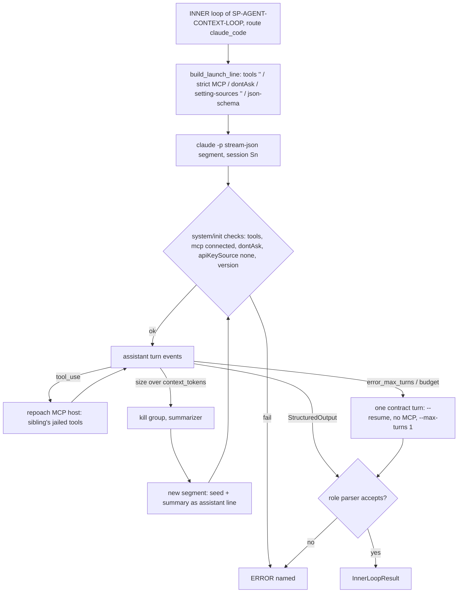

# Claude Code as a first-class transport for the review inner loop

## Intent

Owner request of 2026-10-25: "dans une autre spec, on va fluidifier
l'intégration de Claude Code". SP-AGENT-CONTEXT-LOOP makes a bounded,
read-only, in-model loop with a summarizer the one context mechanism of
every review agent, and leaves the `claude_code` transport to this spec
(its G7, its Amendment 0.2). Today that transport is a one-shot that
flattens the history into stdin, strips the tools, asks the model to
write `<tool_use>` as text and parses the text back (F11 of the sibling
spec). This spec replaces that with Claude Code's own loop: repoach's
read-only tools are served to the CLI as an MCP server and are the
only tools the CLI sees. `--max-turns` bounds the loop. repoach's
summarizer stays the only thing that compacts the context. Every
number comes from `--output-format stream-json`. The login is the only
credential. INV1–INV8 of the sibling spec hold on this transport
without exception.

## Context

Measured on this machine on 2026-10-25, `claude --version` =
`2.1.302 (Claude Code)`, repoach `develop` `53bb844`. The probes are
headless `claude -p` runs on `--model haiku` with a 30-line stdio MCP
server that serves one `read_file` tool. Their transcripts were
inspected event by event. Total probe spend: under 0.03 USD.

### Flags (quoted from `claude --help`; `claude -p --help` prints the same options)

| Flag | Help text (verbatim) | Measured behaviour | Used here |
|---|---|---|---|
| `-p, --print` | "Print response and exit (useful for pipes). Note: The workspace trust dialog is skipped …" | headless | yes |
| `--output-format <format>` | "Output format (only works with --print): "text" (default), "json" (single result), or "stream-json" (realtime streaming)" | P19: `stream-json` without `--verbose` → `Error: When using --print, --output-format=stream-json requires --verbose`, rc 1 | `stream-json` |
| `--verbose` | "Override verbose mode setting from config" | needed for stream-json (P19) | yes |
| `--input-format <format>` | ""text" (default), or "stream-json" (realtime streaming input)" | P18: an `{"type":"assistant",…}` line followed by a user line on stdin is accepted. The model answered `4217` from the injected assistant turn alone | `stream-json` |
| `--include-partial-messages` | "Include partial message chunks as they arrive (only works with --print and --output-format=stream-json)" | not needed: complete `assistant` events already arrive turn by turn | no |
| `--max-turns` | **not listed in `--help`** | accepted (P3, P13). P3: `--max-turns 1` + one tool call → `result.subtype = "error_max_turns"`, `is_error: true`, `terminal_reason: "max_turns"`, `errors: ["Reached maximum number of turns (1)"]`, rc 1 | yes |
| `--system-prompt-file` | **not listed in `--help`** (only named inside the `--bare` text: "--system-prompt[-file]") | accepted. `/nonexistent` → `Error: System prompt file not found: /nonexistent` in 0.165 s, before any model call (P22) | yes (as today) |
| `--system-prompt <prompt>` | "System prompt to use for the session" | — | no (argv size) |
| `--append-system-prompt <prompt>` | "Append a system prompt to the default system prompt" | — | no: repoach replaces the whole system prompt |
| `--tools <tools...>` | "Specify the list of available tools from the built-in set. Use "" to disable all tools, "default" to use all tools, or specify tool names" | P1/P4: `--tools ""` → `init.tools = ["mcp__repoach__read_file"]` (+ `StructuredOutput` with `--json-schema`). P8: without it, 25 built-ins incl. `Bash`, `Edit`, `Write`, `WebFetch`, `Task` | `""` |
| `--allowedTools, --allowed-tools <tools...>` | "Comma or space-separated list of tool names to allow (e.g. "Bash(git *) Edit")" | P7: an MCP tool present but not allowed → `system/permission_denied`, `result.permission_denials[]` filled | the five repoach tools |
| `--disallowedTools, --disallowed-tools <tools...>` | "Comma or space-separated list of tool names to deny" | not needed once `--tools ""` | no |
| `--permission-mode <mode>` | "(choices: "acceptEdits", "auto", "bypassPermissions", "manual", "dontAsk", "plan")" | P7/P8: `dontAsk` denies every tool not in `--allowedTools` without a prompt, and the model is told so | `dontAsk` |
| `--permission-prompts <target>` | ""host" … or "none" (nobody: anything that would prompt is denied automatically; the permission mode still decides everything else)" | P20: accepted, run `success` | `none` |
| `--mcp-config <configs...>` | "Load MCP servers from JSON files or strings (space-separated)" | P1: `init.mcp_servers = [{"name":"repoach","status":"connected","source":"dynamic"}]` | stdio host |
| `--strict-mcp-config` | "Only use MCP servers from --mcp-config, ignoring all other MCP configurations" | P17: the user-scope `magic` server of `~/.claude.json` does not appear; without the flag it would load | yes |
| `--setting-sources <sources>` | "Comma-separated list of setting sources to load (user, project, local)." | `""` is accepted. P1 (before the flag was added) with cwd inside a repository whose `.claude/settings.json` holds hooks: the `UserPromptSubmit` hook blocked the prompt, and the result was `subtype "success"`, `is_error: false`, `num_turns: 0`, `total_cost_usd: 0`, `result` = the hook's error text. With `--setting-sources ""`: 0 `hook_started` events | `""` |
| `CLAUDE_CODE_DISABLE_CLAUDE_MDS=1` (env) | — | P9/P10/P12: cwd inside the Yoob checkout → 11 793 prompt tokens, and the model quotes `# Yoob Project Memory` (the user's auto-memory). Same cwd + this variable → 1 070 tokens, "No". Outside any repository → 1 107 | set |
| `--safe-mode` | "Start with all customizations (CLAUDE.md, skills, installed plugins, hooks, MCP servers, …) disabled" | P11: `init.tools = []`, `mcp_servers = []`: it also drops `--mcp-config` | **refused** |
| `--bare` | "… Anthropic auth is strictly ANTHROPIC_API_KEY or apiKeyHelper via --settings (OAuth and keychain are never read)." | — | **refused**: it cannot use the login |
| `--json-schema <schema>` | "JSON Schema for structured output validation." | P1/P2/P14: adds a `StructuredOutput` tool; `result.structured_output = {"magic": 4217}` and `result.result = "{\"magic\":4217}"` | yes |
| `--resume, -r [value]` | "Resume a conversation by session ID, or open interactive picker" | P2: the resumed session re-reads the whole prior transcript (`cache_read_input_tokens` 11 980 ≥ the first session's 11 881). P14: `--resume <sid> --max-turns 1`, no MCP, `--json-schema` → `structured_output` delivered, `terminal_reason: "completed"` | contract turn only |
| `--session-id <uuid>` | "Use a specific session ID for the conversation (must be a valid UUID)" | — | yes (repoach chooses the id) |
| `-c, --continue` | "Continue the most recent conversation in the current directory" | — | no (ambiguous under concurrency) |
| `--fork-session` | "When resuming, create a new session ID instead of reusing the original" | — | no |
| `--no-session-persistence` | "Disable session persistence - sessions will not be saved to disk and cannot be resumed" | — | no (the contract turn resumes) |
| `--model <model>` | "Provide an alias for the latest model (e.g. 'fable', 'opus', or 'sonnet') or a model's full name." | `init.model = "claude-haiku-5-5"` for `haiku` | yes (as today) |
| `--max-budget-usd <amount>` | "Maximum dollar amount to spend on API calls (only works with --print)" | P21: cap 0.00001 → `subtype "error_max_budget_usd"`, `terminal_reason "budget_exhausted"`, `total_cost_usd 0.00041`: **checked after the turn**, so one turn can overshoot | yes, = remaining `max_cost_usd` |
| `--autocompact <auto\|tokens>` | "Auto-compact window size (auto, or 100k–1M tokens)" | P16: `50000` → `error: … must be 'auto', or between 100k and 1M`. The floor is 100k | `1M` |
| `--disable-slash-commands` | "Disable all skills" | — | yes (as today) |
| `claude auth status` | "Show authentication status" | prints JSON `loggedIn`, `authMethod` (`"claude.ai"`), `subscriptionType`, plus e-mail and org (never kept, as today). Empty `CLAUDE_CONFIG_DIR` → `loggedIn: false`, `authMethod: "none"` | doctor |
| unknown flag | — | `error: unknown option '--bogus-flag'`, no model call | doctor probe |

### stream-json events (measured)

| Event | Fields read | Measured |
|---|---|---|
| `system/init` | `tools[]`, `mcp_servers[].status`, `permissionMode`, `apiKeySource`, `claude_code_version`, `model`, `session_id` | `apiKeySource: "none"` on the login. P5: a broken MCP command gives `status: "failed"`, `tools: []`, **and the run goes on as a plain chat**: `success`, the model answered "Bonjour !" |
| `assistant` | `message.id`, `message.content[]` (`text`, `thinking`, `tool_use{name,input}`), `message.usage` (`input_tokens`, `cache_creation_input_tokens`, `cache_read_input_tokens`, `output_tokens`) | one event per content block. Blocks of one message repeat the same `message.usage` (P2), so they are de-duplicated by `message.id` |
| `user` | `tool_result` blocks | the MCP result, verbatim |
| `system/permission_denied` | `tool_name`, `decision_reason_type` | P7 |
| `rate_limit_event` | `rate_limit_info.status`, `resetsAt`, `rateLimitType` | `status: "allowed"`, `rateLimitType: "five_hour"` |
| `system/hook_started`, `hook_response` | — | only when settings load (see `--setting-sources`) |
| `system/thinking_tokens` | — | informational |
| `result` | `subtype`, `is_error`, `num_turns`, `session_id`, `total_cost_usd`, `usage`, `modelUsage{<model>:{costUSD, contextWindow, costBasis}}`, `structured_output`, `terminal_reason`, `permission_denials[]`, `errors[]` | `costBasis: "list"`; `contextWindow: 1000000` for haiku. P15, not logged in: rc 1, `subtype "success"`, `is_error: true`, `terminal_reason "api_error"`, `result "Not logged in · Please run /login"`, cost 0 |

### Python Agent SDK

| # | Fact |
|---|---|
| S1 | `pip index versions claude-agent-sdk` → `0.2.174` (latest; first `0.0.23`). The older `claude-code-sdk` stops at `0.0.25`. |
| S2 | Not installed in `/home/jofaye/Documents/work/repoach/.venv` (it has `anthropic` only and no `pip`). Requires Python ≥ 3.10 and pulls in `anyio`, `jsonschema`, `mcp<3,>=1.23`, `sniffio`. |
| S3 | The wheel is 121 MB because it bundles its own CLI (`_bundled/claude`, 291 MB, `__cli_version__ = "2.1.310"`). `ClaudeAgentOptions.cli_path` points it at another binary. The README says it "Requires Claude Code CLI 2.1.257 or later". |
| S4 | `ClaudeAgentOptions` has `tools`, `allowed_tools`, `disallowed_tools`, `system_prompt`, `mcp_servers`, `strict_mcp_config`, `permission_mode` (`"default", "acceptEdits", "plan", "bypassPermissions", "dontAsk", "auto"`), `resume`, `session_id`, `max_turns`, `max_budget_usd`, `model`, `fallback_model`, `cwd`, `cli_path`, `settings`, `can_use_tool`, `hooks`, `include_partial_messages`, `output_format`. |
| S5 | `@tool(name, description, input_schema)` + `create_sdk_mcp_server(...)` define in-process MCP tools (`McpSdkServerConfig`, `type: "sdk"`). Calls travel as `control_request` messages on the CLI's stream-json stdio (`_internal/query.py`). The SDK is a driver of the same CLI, not a second engine. |
| S6 | `ResultMessage` carries `subtype`, `num_turns`, `session_id`, `total_cost_usd`, `usage`, `structured_output`, `model_usage`, `permission_denials`, `errors`, `terminal_reason` (`"completed"`, `"max_turns"`, …): the same fields as the CLI's `result` event. |

### repoach today

| # | Fact | Where |
|---|---|---|
| R1 | `ClaudeCodeProvider` runs `claude --print --disable-slash-commands --output-format json --model <m> [--system-prompt-file f]` with the prompt on stdin, from `tempfile.mkdtemp(prefix="repoach_claude_code_")`. It passes no `--tools`, `--strict-mcp-config`, `--setting-sources`, `--permission-mode` or `--max-turns`. | `src/repoach/llm_proxy/providers/claude_code/client.py:177-230` |
| R2 | Tools are rendered as a text appendix, and `<tool_use>` text is parsed back (sibling F11, F17). Output tokens fall back to `ceil(chars / 4)` when the CLI omits them. | `client.py:426-476`, `:635-673` |
| R3 | `claude_cli_env` drops every `*_API_KEY`, `*_AUTH_TOKEN`, `*_TOKEN` except `CLAUDE_CODE_OAUTH_TOKEN`. | `src/repoach/providers/select.py:266-288` |
| R4 | `doctor` already runs `claude auth status --json` and reports `claude login (<method>; <cli>)` or "not logged in". It does not report a version and does not check flags or MCP. | `src/repoach/cli/doctor_cmds.py:111-129`, `select.py:483-520` |
| R5 | Reviewers send no system prompt; persona, contract and evidence go as one user message (sibling F1/F2). `AgentLoop.run` already has a jailed read-only loop for the Planner, whose exhaustion returns prose (sibling F6/F7). `Reviewer._allowed_tools` is computed and never read (sibling F10). | `reviewer.py:540`, `agent_loop.py:546`, `planner_tools.py`, `reviewer.py:488-490` |
| R6 | Bench baseline: `bench/results/2026-10-21_planted_claude_code.json`, 10 planted cases, 45 findings, one-shot. There is no `anthropic` baseline in `bench/results/`. | `bench/results/` |
| R7 | Yoob !306 dry run, today's figure (reported 2026-10-25): 8 provider calls in the usage ledger, all one-shot. | `usage_ledger` |

## Goals

- G1 **One tool surface, two hosts.** The five read-only tools of the
  sibling's G3 (`make_review_tools(head_tree, ledger=, role=, turn=)`)
  are served to the CLI as the MCP server `repoach`, under the names
  `mcp__repoach__{read_file,grep,list_dir,arch_edges,spec}`. The
  adapter wraps those callables and has no implementation of its own:
  jail, caps, nonce markers and `agent_evidence_reads` rows are the
  sibling's. Two hosts serve it:
  - **In-process** through `claude_agent_sdk.create_sdk_mcp_server`
    when `claude_agent_sdk >= 0.2.174` is importable (optional extra
    `repoach[claude-code-sdk]`). `cli_path` is always the route's
    resolved `claude`, never the SDK's bundled binary (S3), so the
    version and the login `doctor` checks are the ones that run.
  - **stdio** otherwise: `sys.executable -m repoach.review.review_tools_mcp
    --tree <head> --role <r> --run <run_id> --turn-file <f>`, declared in
    a `--mcp-config` JSON file written into the per-call tempdir.
- G2 **The launch line is fixed and complete** (`format:claude-code-launch-line`):
  ```
  claude --print --verbose
         --input-format stream-json --output-format stream-json
         --setting-sources "" --disable-slash-commands
         --tools "" --strict-mcp-config --mcp-config <tempdir>/mcp.json   (stdio host only)
         --allowedTools mcp__repoach__read_file,mcp__repoach__grep,mcp__repoach__list_dir,mcp__repoach__arch_edges,mcp__repoach__spec
         --permission-mode dontAsk --permission-prompts none
         --system-prompt-file <tempdir>/system.txt --model <m>
         --session-id <uuid4> --max-turns <remaining turns>
         --max-budget-usd <remaining max_cost_usd> --autocompact 1M
         --json-schema <role contract schema>
  env: claude_cli_env(os.environ) + CLAUDE_CODE_DISABLE_CLAUDE_MDS=1 ; cwd: the per-call tempdir
  ```
  The permission mode is `dontAsk`: it never prompts, and it denies
  every tool outside `--allowedTools` (P7, P8). `--tools ""` removes
  every built-in, so no write, exec or network tool exists in the
  session (P1, P4). `bypassPermissions`, `acceptEdits`, `auto`,
  `--safe-mode`, `--bare`, `--dangerously-skip-permissions` and
  `--add-dir` are refused by a test (AC1).
- G3 **The inner loop runs inside Claude Code's loop, segmented by
  repoach.** One CLI process is one *segment*. Its stdin is the seed as
  one user line (`--input-format stream-json`), plus, after a
  compaction, the summary as one assistant line and a fixed user line
  `Continue from your summary.`.
  - repoach reads each `assistant` event as it arrives. The provider's
    prompt size for that turn is `input_tokens + cache_creation_input_tokens
    + cache_read_input_tokens` (`context.size_source = "claude_code_usage"`).
  - When that size, plus the estimate of the pending tool result, would
    exceed `context_tokens - contract_reserve_tokens`, repoach ends the
    segment at that turn boundary: SIGTERM to the process group with the
    existing `_kill_subprocess_on_exit(..., group=True)`. The pending tool
    call is not answered.
  - The summarizer of the sibling's G4 runs on the transcript repoach
    captured from the stream. A new segment then starts with a **new**
    `--session-id`, and its stdin is seed + summary + continue.
  - Compaction never uses `--resume`: a resumed session re-reads the
    whole transcript (P2), so the context would not shrink.
  - Claude Code's own compaction is pushed to its ceiling
    (`--autocompact 1M`). `context_tokens` is validated to be below
    100 000, the floor of `--autocompact` (P16). A prompt size that drops
    between two turns of the same segment means the CLI compacted on its
    own; that is `ERROR claude_code_autocompacted` (INV6).
- G4 **The contract.** The role's contract goes to `--json-schema`.
  - The reviewer schema is the JSON `Reviewer._parse_response` accepts.
    The refuter schema is `{verdict, reason}`, rendered as the
    `VERDICT:` line and judged by the existing refuter parser. One
    parser judges every transport.
  - A `StructuredOutput` call ends the segment with
    `result.structured_output` (P1). repoach validates it again with the
    role's parser; the CLI's validation alone is not trusted.
  - On `error_max_turns` or `error_max_budget_usd` with no structured
    output, repoach runs exactly one contract turn: `--resume
    <session_id> --max-turns 1`, no `--mcp-config` (so the only tool is
    `StructuredOutput`, P14), and the same `--json-schema`. If that turn
    gives no valid contract, the outcome is `ERROR [context:contract_missing]`.
- G5 **stream-json is the only parsing path** (`format:claude-code-stream-json`).
  `stream_events.py` turns the event stream into one `SegmentResult`:
  turns, tool calls and results, usage per `message.id`,
  `total_cost_usd`, `modelUsage`, `permission_denials`,
  `terminal_reason`, `structured_output`, `session_id`.
  - Every `message.id` writes one `usage_ledger` row (`agent_turn`,
    `phase = turn | contract`) with the four token counts from the
    stream.
  - The segment's `result.total_cost_usd` is written on its last row,
    so the per-agent sum is the CLI's own figure.
  - `--output-format json`, the `<tool_use>` text emulation and the
    `ceil(chars / 4)` output estimate are removed from every path a
    review agent takes.
- G6 **Login only.** The transport authenticates through the user's
  logged-in CLI or `CLAUDE_CODE_OAUTH_TOKEN`, never an API key.
  `claude_cli_env` is unchanged (R3). The `system/init` event must say
  `apiKeySource: "none"`; any other value kills the segment before the
  first `assistant` event (`ERROR claude_code_api_key_in_use`). The
  gateway mode (`kind = "gateway"`, the shared `repoach-llm-proxy`)
  stays the route for CI runners with no Claude Code login, and
  `doctor` names it in its hint.
- G7 **Fail closed at start-up.** Before the first turn costs anything,
  `system/init` is checked:
  - the five expected tool names and `StructuredOutput` are all in
    `tools`, and no other tool is;
  - `mcp_servers` has `repoach` with status `connected`;
  - `permissionMode == "dontAsk"`;
  - `claude_code_version >= claude_code_min_version`.

  Any mismatch kills the segment with a named `ERROR` (Failure
  scenarios). There is never a silent one-shot fallback (P5).
- G8 **`repoach doctor` names readiness.** Three new lines next to the
  existing login line:
  - `claude_code_version=<v> (min 2.1.302)`, from `claude --version`;
  - `claude_code_flags=ok|missing:<flag>`, from the zero-cost probe
    `claude -p <launch flags> --system-prompt-file <nonexistent> x`,
    whose expected stderr is `System prompt file not found`. That
    proves every flag parsed, the hidden `--max-turns` and
    `--system-prompt-file` included, with no model call (P22);
  - `claude_code_mcp=ok (sdk|stdio)|failed:<reason>`, from starting the
    host and listing its tools over MCP, with no model call.
- G9 **Measured equivalence before default.** Measurement plan M1–M3.

## Non-Goals

- NG1: No change to the sibling's tools, jail, caps, budgets, summarizer
  or state machine. This spec is a transport.
- NG2: No change to `mcp_whitelist.py`, and no forge, write, exec or
  network tool over MCP. The `repoach` MCP server exists only for the
  lifetime of one segment, bound to one head tree and one role. It is
  not a general MCP endpoint (sibling NG2 holds: the review tools stay
  in-process functions, and the MCP server is their adapter).
- NG3: The Planner's and the Developer's `AgentLoop.run` over
  `claude_code` (R5) and the gateway's `ClaudeCodeProvider` backend
  keep their current text emulation. Q1 asks whether a later spec
  moves them.
- NG4: No use of `--include-partial-messages`, `--fork-session`,
  `--continue`, `--agents` or sub-agents.
- NG5: No API-key path for `claude_code`, including `--bare`.

## Assumptions

- A1: `--max-turns` and `--system-prompt-file` stay accepted although
  `--help` omits them. `doctor` (G8) and AC9 detect it the day they go.
- A2: `--input-format stream-json` keeps accepting an `assistant` line
  as history (P18). AC4 asserts it on the live CLI.
- A3: `total_cost_usd` on a subscription login is a list-price
  equivalent (`costBasis: "list"`), not money billed. The sibling's
  `max_cost_usd` cap applies to it as written. The ledger records the
  basis (Q3).
- A4: The CLI streams an `assistant` event carrying a `tool_use` before
  the tool runs, so repoach can end the segment before the result
  enters the context. Observed in every probe; AC5 asserts the order.

## Interface

```python
@dataclass(frozen=True)
class LaunchLine:
    argv: tuple[str, ...]
    env: Mapping[str, str]
    cwd: Path
    stdin_lines: tuple[str, ...]

def build_launch_line(*, cli: str, model: str, system_prompt_path: Path,
                      host: Literal["sdk", "stdio"], mcp_config_path: Path | None,
                      session_id: str, max_turns: int, max_budget_usd: float | None,
                      contract_schema: Mapping[str, Any], seed: str,
                      summary: str | None, environ: Mapping[str, str]) -> LaunchLine: ...

@dataclass
class SegmentResult:
    session_id: str
    init: InitEvent
    turns: list[TurnUsage]
    tool_calls: list[ToolCallRecord]
    structured_output: Mapping[str, Any] | None
    terminal_reason: str | None
    subtype: str
    total_cost_usd: float | None
    permission_denials: list[Mapping[str, Any]]
    ended_by: Literal["cli", "repoach_compaction", "repoach_init_check"]

def parse_stream(lines: AsyncIterator[str]) -> AsyncIterator[StreamEvent]: ...

class ClaudeCodeLoopTransport:
    async def run(self, ctx: AgentContext, *, tools: Sequence[ToolDef],
                  parse_contract: Callable[[str], ContractResult]) -> InnerLoopResult: ...

def serve_stdio(tree: Path, role: BotRole, run_id: str, turn_file: Path) -> None: ...
def sdk_server(tools: Sequence[ToolDef]) -> McpSdkServerConfig: ...
```

`ClaudeCodeLoopTransport.run` is what `run_inner_loop` of the sibling
calls when the route is `claude_code`. It returns the same
`InnerLoopResult`, including `context.compactions[]`, `context.caps`
and `context.size_source = "claude_code_usage"`.

Named errors (each becomes an `ERROR` outcome with this string; none
becomes `APPROVE`, per SP-REVIEW-TRANSPORT-ERROR-VERDICT):

| Name | Trigger |
|---|---|
| `claude_code_cli_missing: <path>` | `claude_cli()` raises (existing message) |
| `claude_code_too_old: <v> < 2.1.302` | `claude --version` or `init.claude_code_version` below the pin |
| `claude_code_flag_rejected: <stderr line>` | the CLI exits with `error: unknown option` or `argument … is invalid` |
| `claude_code_not_logged_in` | `result.is_error` and `result.result` starts with `Not logged in` (P15), or `auth status` says `loggedIn: false` |
| `claude_code_api_key_in_use: <apiKeySource>` | `init.apiKeySource != "none"` |
| `claude_code_mcp_unavailable: repoach status=<s>` | `repoach` is missing or not `connected` in `init.mcp_servers` (P5) |
| `claude_code_tool_surface_mismatch: extra=<…> missing=<…>` | `init.tools` is not the expected set |
| `claude_code_permission_denied: <tool>` | a denial of one of the five repoach tools (a misconfiguration, P7) |
| `claude_code_settings_leak: num_turns=0` | `result.num_turns == 0` with no `structured_output` (the hook case of `--setting-sources`) |
| `claude_code_autocompacted` | the prompt size drops between two turns of one segment |
| `context:contract_missing` | G4, after the single contract turn |
| `claude_code_rate_limited: <rateLimitType> resets <ts>` | `rate_limit_event.status != "allowed"` or an API error status of 429 |

## Behavior

### Nominal

The Architect reviews at head H with `max_turns = 6`, `context_tokens =
60000`, `max_cost_usd = 0.50`.

1. repoach writes `system.txt` (persona and contract, sibling G1) and,
   on the stdio host, `mcp.json` into a fresh tempdir. It starts
   segment 1 with session id S1, `--max-turns 6` and
   `--max-budget-usd 0.50`.
2. `system/init` arrives: the five tools, `StructuredOutput`,
   `repoach connected`, `dontAsk`, `apiKeySource none`, `2.1.302`. All
   checks pass.
3. Turn 1 calls `read_file("src/x/store.py", 1, 200)`. The adapter
   calls the sibling's tool. The window is jailed, recorded in
   `agent_evidence_reads`, and returned between nonce markers.
4. On turn 4 the prompt size would reach 61 850. repoach kills
   segment 1 and summarizes the captured transcript (`phase =
   summarize`).
5. Segment 2 starts with S2 and `--max-turns 2` (6 − 4). Its stdin is
   the seed (byte-identical), the summary as an assistant line, and
   `Continue from your summary.`.
6. Turn 5 calls `StructuredOutput` with the findings. repoach parses
   them with `Reviewer._parse_response`, and the outcome is DONE.
7. The ledger has one row per `message.id`: four `turn` rows, one
   `summarize` row and one `turn` row in segment 2. The cost is the sum
   of the two segments' `total_cost_usd` plus the summarizer's.

### Edge cases

- `max_turns = 0` → one segment, `--max-turns 1`, no MCP host, only
  `StructuredOutput`. The prompt bytes are today's one-shot bytes
  (sibling AC2). The parse goes through `structured_output` and the
  role's parser.
- The model ends with text and no `StructuredOutput` before
  `max_turns` → `terminal_reason "completed"`, `structured_output null`
  → the one contract turn (G4).
- The model calls a tool on the contract turn → impossible: the
  contract turn has no MCP host, so `init.tools == ["StructuredOutput"]`.
  Any other tool there is `claude_code_tool_surface_mismatch`.
- `--max-budget-usd` stops after the turn that crossed it (P21) → the
  overshoot is at most one turn. `context.caps.hit = "cost"`, then the
  contract turn, which the sibling's INV1 already counts.
- A second compaction in the same agent → a third segment and a new
  session id. Every segment's session id is listed in
  `context.transport.sessions[]`.
- `wall_clock_s` is reached inside a segment → kill the group, then the
  contract turn if time remains; otherwise `ERROR cap_reached:wall_clock`.
- repoach itself runs inside a Claude Code session (`CLAUDECODE`,
  `CLAUDE_CODE_SESSION_ID`, `CLAUDE_CODE_MESSAGING_SOCKET` are
  inherited; measured in the probe environment) → the child still
  starts. The probes ran this way. Q2 asks whether those variables
  should be scrubbed.
- An unknown stream event type → logged once per type and counted in
  `context.transport.unknown_events`, never fatal.
- Q4 of the sibling ("if no flag disables built-in tools, refuse
  `max_turns > 0` on claude_code or accept the CLI's own read tools in
  a jailed temporary directory?") → **neither**. `--tools ""`
  disables every built-in (P1, P4: `init.tools` holds only the MCP tools
  and `StructuredOutput`). The CLI's built-in `Read`/`Grep` are never
  used. AC1 and AC3 assert the surface.

### Failure scenarios

- CLI absent or too old → `claude_code_cli_missing` /
  `claude_code_too_old`, before any spawn of a review agent. `doctor`
  shows the same line.
- Login expired or absent → `claude_code_not_logged_in` (P15: rc 1,
  cost 0). The verdict is `ERROR`, never `APPROVE`. The doctor hint
  names `claude auth login`, or `kind = "gateway"` for a runner with no
  login.
- MCP host fails to start (stdio command fails, SDK import fails
  mid-run, `status: "failed"`) → `claude_code_mcp_unavailable`. The
  segment is killed before its first `assistant` event. repoach does
  not retry as a one-shot (P5 shows the CLI would otherwise carry on
  silently).
- The CLI is killed by an external signal, or stdout ends with no
  `result` event → `ERROR [parse_failed:TRANSPORT]`, through the
  existing per-turn retry (sibling Failure scenarios).
- `--max-turns` is hit and the contract turn also fails →
  `context:contract_missing`.

### Invariants (the sibling's INV1–INV8 on this transport)

| Sibling | How it holds here |
|---|---|
| INV1 bounded turns, bytes, cost, time | `--max-turns` = remaining turns per segment; tool bytes counted by the sibling's tools; `--max-budget-usd` = remaining cost, plus repoach's own sum; wall clock by process-group kill |
| INV2 read-only, path-jailed | `--tools ""` + `--strict-mcp-config` + `--allowedTools` the five + `dontAsk`; the tools are the sibling's jailed callables |
| INV3 last turn = JSON contract | `--json-schema` + `StructuredOutput`, re-validated by the role parser; else `contract_missing` |
| INV4 outer loop alone writes to the forge | `loop_transport.py`, `stream_events.py`, `launch.py`, `review_tools_mcp.py` import nothing from `repoach.forge` (AST test) |
| INV5 seed never summarized | every segment's first stdin line is the seed, byte-identical |
| INV6 nothing dropped without a record | compactions by repoach only; CLI autocompaction = `ERROR claude_code_autocompacted` |
| INV7 one ledger row per model call | one row per `message.id`, plus summarizer rows |
| INV8 tool output untrusted, between nonce markers | the adapter returns the sibling's wrapped text unchanged |

## Measurement plan

- M1: `repoach bench run bench/corpus/planted --provider anthropic
  --max-turns 6` and `--provider claude_code --max-turns 6`, same models
  per tier. Both results go to `bench/results/`. The anthropic run is
  also the missing baseline (R6).
- M2: the same corpus, `claude_code`, host `sdk` vs host `stdio`. The
  findings must be identical in kind, and wall time and cost are
  reported.
- M3: Yoob !306, `repoach review pr 306 --dry-run --provider
  claude_code` at `--max-turns 0` and `6`. Rows and cost are read from
  `usage_ledger` by `run_id` and compared with today's 8 calls (R7).

## Architecture Impact

- Adds dependency: SP-CLAUDE-CODE-FIRST-CLASS -> SP-AGENT-CONTEXT-LOOP (implements its claude_code transport; uses `AgentContext`, `make_review_tools`, `run_inner_loop`'s result type, the summarizer)
- Adds dependency: SP-CLAUDE-CODE-FIRST-CLASS -> SP-UNIVERSAL-PROVIDERS (owner of `agent_loop.py` and `db:table:usage_ledger`; per-`message.id` rows)
- Adds dependency: SP-CLAUDE-CODE-FIRST-CLASS -> SP-USAGE-LEDGER (cost and token fields, `repoach usage`)
- Adds dependency: SP-CLAUDE-CODE-FIRST-CLASS -> SP-PROVIDER-DIRECT-ANTHROPIC (the reference transport of AC10)
- Adds dependency: SP-CLAUDE-CODE-FIRST-CLASS -> SP-REVIEW-TRANSPORT-ERROR-VERDICT (every named error is `ERROR`, never `APPROVE`)
- Adds dependency: SP-CLAUDE-CODE-FIRST-CLASS -> SP-REVIEW-PINS-HEAD (the MCP host serves the pinned head tree)
- Adds dependency: SP-CLAUDE-CODE-FIRST-CLASS -> SP-PRECISION-MEASUREMENT (owner of `repoach bench`; M1, M2)
- Frontier files touched without an edge (no owner today): `llm_proxy/providers/claude_code/client.py` (the review path stops using it; the gateway keeps it, NG3), `providers/direct.py`, `providers/select.py` (`claude_cli`, `claude_login`, unchanged `claude_cli_env`), `cli/doctor_cmds.py` (G8).
- New optional dependency: `claude-agent-sdk>=0.2.174` under the extra `claude-code-sdk`. The base install does not pull its 121 MB wheel.
- No cycle: the new modules import `agent_engine`, `providers` and `review`; nothing they import imports them back.

## Diagram



## Acceptance Criteria

- [ ] AC1: `pytest -q tests/unit/test_claude_code_launch_line.py` → green: `build_launch_line` produces exactly the flags of G2 in both hosts; `--tools ""`, `--strict-mcp-config`, `--setting-sources ""`, `--permission-mode dontAsk`, `--permission-prompts none` are always present; `bypassPermissions`, `acceptEdits`, `auto`, `--safe-mode`, `--bare`, `--dangerously-skip-permissions`, `--add-dir`, `--continue` never appear; the env has `CLAUDE_CODE_DISABLE_CLAUDE_MDS=1`, no `*_API_KEY`, and keeps `CLAUDE_CODE_OAUTH_TOKEN`; the prompt is never in argv.
- [ ] AC2: `pytest -q tests/unit/test_claude_code_stream_events.py` → green on recorded transcripts (fixtures with account e-mail, org id and session tokens scrubbed): the parser yields one `TurnUsage` per `message.id`, not per content block; `structured_output`, `terminal_reason`, `total_cost_usd`, `permission_denials` and `modelUsage` are read; the six measured terminal shapes map to the right outcome: `success` + structured output, `error_max_turns`, `error_max_budget_usd`, not-logged-in `api_error`, MCP `failed`, and the hook `num_turns 0`.
- [ ] AC3: `pytest -q tests/unit/test_claude_code_loop_transport.py::test_init_checks_fail_closed` → green: a scripted CLI emitting `init` with `mcp_servers[0].status = "failed"`, with an extra `Bash` tool, with `permissionMode = "default"`, with `apiKeySource = "ANTHROPIC_API_KEY"`, or with `claude_code_version = "2.1.200"` → each yields its named `ERROR`; the process is killed before any `assistant` event is consumed; no ledger row with tokens > 0 is written; no one-shot retry is made.
- [ ] AC4: `pytest -q tests/unit/test_claude_code_loop_transport.py::test_compaction_restarts_with_new_session` → green: a scripted CLI whose turn-3 usage exceeds `context_tokens` → the first segment is killed at the turn boundary; the summarizer runs once; the second segment has a different `--session-id`, no `--resume`, and stdin lines `[seed (byte-identical to segment 1), assistant summary, "Continue from your summary."]`; `context.compactions` has one entry; `--max-turns` of segment 2 = `max_turns - 3`.
- [ ] AC5: `pytest -q tests/unit/test_claude_code_loop_transport.py::test_contract_turn_after_max_turns` → green: `error_max_turns` with no structured output → exactly one extra process with `--resume <sid> --max-turns 1`, no `--mcp-config`, the same `--json-schema`; a valid structured output there → DONE; prose there → `ERROR [context:contract_missing]`. A structured output that the CLI accepted but `Reviewer._parse_response` rejects → `contract_missing`.
- [ ] AC6: `pytest -q tests/unit/test_claude_code_loop_transport.py::test_autocompaction_is_an_error` → green: a prompt size that drops between turns 2 and 3 of one segment → `ERROR claude_code_autocompacted`; `context_tokens = 100000` or more on the claude_code route → a configuration error naming the 100k `--autocompact` floor.
- [ ] AC7: `pytest -q tests/unit/test_review_tools_mcp.py` → green: the stdio host and the SDK host (skipped with reason `claude-agent-sdk not installed` only when the extra is absent; the CI job that installs the extra runs it) list exactly the five tool names with the sibling's schemas; a call is forwarded to the same `make_review_tools` callable (identity asserted) and its result is returned unchanged with its nonce markers; a `../` path returns `path outside the head tree` and writes no evidence row; the modules import nothing under `repoach.forge`, `socket` or `subprocess` (AST check; `serve_stdio` reads stdin/stdout only).
- [ ] AC8: `pytest -q tests/unit/test_claude_code_loop_transport.py::test_ledger_from_stream` → green: a scripted run of 3 turns in segment 1, 1 compaction, 1 turn in segment 2 and 1 contract turn writes 6 `usage_ledger` rows (3 `turn`, 1 `summarize`, 1 `turn` in segment 2, 1 `contract`), every token count is taken from the stream (no `ceil(chars/4)` path is reachable: `grep -n "chars / 4\|// 4" src/repoach/llm_proxy/providers/claude_code/loop_transport.py src/repoach/llm_proxy/providers/claude_code/stream_events.py` → empty), and the run's cost equals the sum of the segments' `total_cost_usd` plus the summarizer's.
- [ ] AC9: `repoach doctor` on a machine logged into Claude Code prints `claude_code_version=2.1.302 (min 2.1.302)`, `claude_code_flags=ok`, `claude_code_mcp=ok (stdio)` (or `(sdk)`) and the existing login line, with zero model calls (no new `usage_ledger` row); with `CLAUDE_CONFIG_DIR` pointing at an empty directory it prints `not logged in` and names `claude auth login` and `kind = "gateway"`; with `REPOACH_CLAUDE_CODE_CLI_PATH` pointing at a script that prints `2.1.200 (Claude Code)` it prints `claude_code_too_old: 2.1.200 < 2.1.302` and exits non-zero.
- [ ] AC10: `pytest -q -m live tests/integration/test_claude_code_live_probe.py` (opt-in marker, needs a login) → green on the real CLI, `--model haiku`: (a) the launch line of G2 against the real stdio host gives `init.tools` equal to the five names + `StructuredOutput` and `apiKeySource == "none"`; (b) a forced `read_file` round trip ends with a valid `structured_output`; (c) an assistant line on stdin is used as history (P18); (d) a broken MCP command yields `claude_code_mcp_unavailable`. The test prints its `total_cost_usd` (measured today: under 0.01 USD per case).
- [ ] AC11: M1 is run and both files are committed under `bench/results/`. On the 10 planted cases, the claude_code findings set matches the anthropic findings set with Jaccard ≥ 0.80. A finding matches on `(path, category)` with lines within ±3. Planted-defect recall of claude_code is at most 1 of 10 below anthropic's. The delivery PR quotes both precisions, both recalls, the Jaccard, total tokens and total cost per transport.
- [ ] AC12: M3 is run on Yoob !306 and the delivery PR quotes, for `--max-turns 0` and `6`: the `usage_ledger` row count (today 8), the token sums by kind (input, cache write, cache read, output), the cost, the compactions, and the number of rows whose token counts were not read from stream-json (must be 0).
- [ ] AC13: `pytest -q tests/unit/test_claude_code_loop_transport.py::test_inner_modules_never_reach_the_forge` → green (INV4 on this transport's four modules).
- [ ] AC14: `repoach arch check --base origin/develop` → `edge-honesty: ok`; `scripts/ci_local.sh` → green.

## Open Questions

- Q1: NG3 keeps the text emulation for the Planner and the Developer on `claude_code`, and in the gateway's `ClaudeCodeProvider` backend. Should a follow-up spec move them onto this transport? For the gateway that means client-side tools that the proxy host cannot execute, so either the gateway refuses `tools` on a claude_code backend and fails over, or the emulation stays there for good.
- Q2: Should `claude_cli_env` also drop the parent session's `CLAUDECODE`, `CLAUDE_CODE_SESSION_ID`, `CLAUDE_CODE_CHILD_SESSION` and `CLAUDE_CODE_MESSAGING_SOCKET` when repoach itself runs inside Claude Code? The probes ran with them inherited and behaved normally, but nothing proves they are inert. The owner decision says "env scrubbing unchanged", so this spec does not do it.
- Q3: `total_cost_usd` on a subscription login is a list-price equivalent (`costBasis: "list"`). Should `usage_ledger` gain a `cost_basis` column, so `repoach usage` does not add list-equivalent and billed dollars into one total? And should `max_cost_usd` bind on list-equivalent cost at all for a subscription?
- Q4: Minimum version: 2.1.302 is the only version measured. The SDK says 2.1.257+ for itself. Should the pin go lower after a probe run on an older CLI, or stay at the measured version?
- Q5: When both hosts are available, which is the default? The SDK host (no extra process, no config file) or the stdio host (no 121 MB optional dependency, same code on every machine)? M2 measures both; this spec defaults to `sdk` when importable, as the owner decided, and the question is whether M2's numbers should be able to reverse that.
- Q6: `rate_limit_event` (`status`, `resetsAt`, `rateLimitType: "five_hour"`) is exactly what SP-FAILOVER-SKIPS-BLOCKED-PROVIDER needs to block the provider until `resetsAt`. Should this transport feed `GlobalRateLimiter`? That would add an edge to that limiter's owner, which this spec does not declare.
