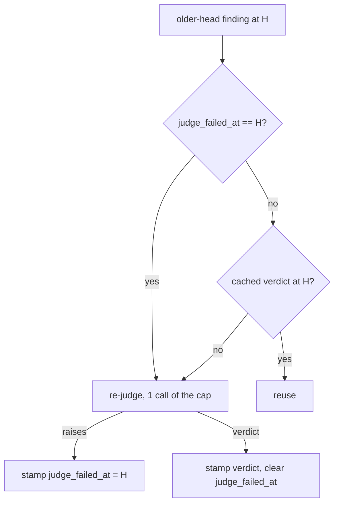

# A judge failure at a head is retried by the next gate or review at that head

## Intent

When the older-head re-check's judge call fails, the finding is
stamped exactly as a finding no check could settle, and every later
gate at the same head reuses that stamp: the gate exits 5 with 0 judge
calls until a new head is pushed. A failed call is not a judgement.
Stamp it apart (`judge_failed_at`) and let the next gate or `review pr`
at that head judge it again, within the cap.

## Context

Tech-debt row 86 (`docs/tech_debt.md`), verbatim: "A judge failure at
a head is never judged again there — When the older-head re-check's
judge call fails, the finding is stamped `needs judgement` with
`checked_at_sha` = the head (`_persist` / `record_verification_attempt`),
and `_cached` reuses that stamp for every later `review pr` or `review
gate` at the same head: the gate exits 5 with 0 judge calls, and only a
new head can judge it again. (verified 2026-10-22)"

Measured on `origin/develop` 2706bb6 (2026-10-25), in
`src/repoach/review/head_reverify.py` unless named:

- F1: `refute_finding` (`review/refuter.py:324`) returns
  `(PROPOSED, "judge call failed: <ExceptionType>")` when the judge
  raises (`JUDGE_CALL_FAILED`, `refuter.py:88`) and
  `(PROPOSED, "verdict unparseable")` when it answers without a
  `VERDICT:` line; `_judged` maps both to `needs_judgement`.
- F2: `_persist` returns without stamping when the reason starts with
  the `JUDGING_CAP_REACHED` prefix (a cap deferral is already retried),
  and otherwise records `verification_method =
  NEEDS_JUDGEMENT_METHOD` (`head_reverify_needs_judgement`) with
  `checked_at_sha = head` via `record_verification_attempt`.
- F3: `_cached` reuses any row whose `checked_at_sha` is the head and
  whose method is in `_CACHED_METHODS = {REVERIFY_METHOD,
  NEEDS_JUDGEMENT_METHOD}`, so a judge failure is cached exactly like a
  `still_open` verdict.
- F4: a deferral that made no call (`evidence outside the diff`,
  `evidence unreadable`, a cited file absent) is stamped the same way;
  at the same head and tree its outcome cannot change, so caching it is
  correct.
- F5: `LazyJudge` (`refuter.py:364`) counts a call before building the
  judge; a factory that raises raises again on every later call of
  that run, each counted.
- F6: `pr_findings` has no column for a failed judgement; the
  migration list `_migrate_missing_findings_columns`
  (`review/findings.py`) adds columns by single `ALTER TABLE`s.

## Goals

- G1: a judge failure at head H (judge raised, or answered without a
  parseable verdict) is stamped with `judge_failed_at = H`, distinct
  from a judged stamp; the row's status is unchanged and
  `verify_attempts` increments as today.
- G2: `_cached` never reuses a row whose `judge_failed_at` equals the
  head: the next gate, `review merge` or `review pr` at H re-judges it,
  spending one call of its own cap (`max_judged`), with the dedupe by
  `_claim_key` unchanged.
- G3: a later successful judgement at H clears `judge_failed_at` and
  stamps the verdict (`resolved` -> `RESOLVED_AT_HEAD`, `still_open`
  -> `REVERIFY_METHOD`), which `_cached` then reuses as today.
- G4: the outcome's reason names the failure:
  `unresolved: needs judgement (judge call failed: <ExceptionType>; retried by the next gate at <sha7>)`,
  or `(verdict unparseable; retried by the next gate at <sha7>)`.
- G5: a deferral that made no judge call (F4) is cached as today.

## Non-Goals

- NG1: no retry inside one run: a failed call is not repeated in the
  same gate (the provider failover already retried within the call).
- NG2: no change to the refuter pass `review pr` runs over its own
  head's findings, nor to the cap's resolution
  (SP-REFUTER-JUDGES-WHAT-IT-CAN).
- NG3: no exit-code change: a finding still `needs judgement` after the
  retry keeps the gate at exit 5.

## Assumptions

- A1: `src/repoach/review/head_reverify.py` stays owned by
  SP-GATE-REVERIFIES-AT-HEAD, `refuter.py` by
  SP-REFUTER-JUDGES-WHAT-IT-CAN, `findings.py` by
  SP-FINDINGS-INIT-RACE; this spec edits them under its `depends_on`
  edges and claims only its new test.
- A2: a failure is recognised by the reason prefix `refute_finding`
  already returns (`JUDGE_CALL_FAILED`, `VERDICT_UNPARSEABLE`), not by
  a new exception path.

## Interface

Inputs:
- `pr_findings.judge_failed_at TEXT NOT NULL DEFAULT ''` (new column,
  one entry in `_migrate_missing_findings_columns`, tagged
  `SP-JUDGE-FAILURE-IS-RETRIED`); `Finding.judge_failed_at: str = ""`.
- `record_verification_attempt(..., judge_failed_at: str | None = None)`:
  `None` leaves the column, `""` clears it, a SHA sets it.
- `update_finding_status(..., judge_failed_at: str | None = None)`: same
  contract, so a verdict clears it.
- `JUDGE_FAILED_METHOD = "head_reverify_judge_failed"` (new,
  `head_reverify.py`), not in `_CACHED_METHODS`.
- `JUDGE_FAILURE_REASONS: tuple[str, ...] = (JUDGE_CALL_FAILED,
  VERDICT_UNPARSEABLE)` (new, `refuter.py`).

Outputs: the reason of G4 in the gate's report and the `review pr`
JSON; `head_reverify.done` logs `judge_failures=<n>`.

Errors: none new.

## Behavior

### Nominal

```text
_persist(outcome = needs_judgement, reason):
    cap deferral          -> no stamp (as today)
    reason is a failure   -> record_verification_attempt(method=JUDGE_FAILED_METHOD,
                              checked_at_sha=head, judge_failed_at=head)
    otherwise (no call)   -> NEEDS_JUDGEMENT_METHOD stamp (as today)
_persist(resolved | still_open) -> as today, judge_failed_at=""
_cached(finding, head):
    finding.judge_failed_at == head -> None (re-judge)
    otherwise                       -> as today
```

Gate 1 at H: the judge raises -> `needs judgement (judge call failed:
RuntimeError; …)`, exit 5, 1 call. Gate 2 at H: the row is not cached,
the judge is called once and returns a verdict; the finding is resolved
or still open and stamped; the gate's exit follows the verdict.

### Edge cases

- The judge fails at every gate (no provider configured) -> each gate
  at H makes one call per distinct claim, bounded by its cap; the
  reason stays named.
- A failure at H, then a new head H' -> the row is an older-head
  finding at H' and is re-checked there as today; the stale
  `judge_failed_at = H` does not match H' and is cleared on the next
  stamp.
- Two findings with one `_claim_key` -> one call, both stamped from it
  (failure or verdict), as today.
- A database created before this spec -> the migration adds the column
  with `''`; an old `NEEDS_JUDGEMENT_METHOD` row written from a judge
  failure is recognised by its stored reason prefix and re-judged once.

### Failure scenarios

- The migration fails -> `init_findings_schema` raises as for any
  missing column (SP-FINDINGS-INIT-RACE); no partial behaviour.

## Architecture Impact

- Adds dependency: SP-JUDGE-FAILURE-IS-RETRIED -> SP-GATE-REVERIFIES-AT-HEAD
  (edits `_persist`, `_cached` and the method constants).
- Adds dependency: SP-JUDGE-FAILURE-IS-RETRIED -> SP-REFUTER-JUDGES-WHAT-IT-CAN
  (adds `JUDGE_FAILURE_REASONS` beside the deferral reasons).
- Adds dependency: SP-JUDGE-FAILURE-IS-RETRIED -> SP-FINDINGS-INIT-RACE
  (the new `pr_findings` column and its migration).
- Removes dependency: none.
- New / changed coupling: one column on the findings ledger's
  `pr_findings` table.

## Diagram



## Acceptance Criteria

- [ ] AC1: fixture with one blocking finding of an older head and a
  judge that raises on its first call and returns a refuting verdict
  on its second: gate 1 at H reports `needs judgement (judge call
  failed: RuntimeError; …)` with 1 call and the row has
  `judge_failed_at == H`; gate 2 at H makes exactly 1 call, reports
  the finding `resolved_at_head`, the row has status
  `RESOLVED_AT_HEAD` and `judge_failed_at == ''` —
  `tests/unit/test_judge_failure_is_retried.py`.
- [ ] AC2: the same with a second answer that does not refute the claim:
  gate 2 reports `still present`, 1 call; gate 3 at H makes 0 calls
  (the verdict is cached).
- [ ] AC3: a judge answering without a `VERDICT:` line on the first
  call is retried by the next gate at H (reason `verdict unparseable;
  retried …`).
- [ ] AC4: a finding deferred with `evidence outside the diff` (no
  call) at H is cached: gate 2 at H makes 0 calls.
- [ ] AC5: a judge that always raises, with cap 1 and two distinct
  failed findings: each gate at H makes exactly 1 call, the other
  finding is reported `judging cap 1 reached`.
- [ ] AC6: `review pr` at H after a failed gate at H re-judges the
  finding (1 call) and its `summarise_ledger_facts` counts the new
  verdict.
- [ ] AC7: a ledger created without `judge_failed_at` gains the column
  on `init_findings_schema`, and a pre-existing
  `head_reverify_needs_judgement` row whose result reads `judge call
  failed: …` is re-judged by the next gate at its head.

## Open Questions

- Q1: is `verdict unparseable` a failure to retry (this draft) or a
  judgement to keep, since the same model may answer the same way?
- Q2: should repeated failures at one head be bounded across runs
  (for example, stop retrying after N stamped failures) or only by
  each run's cap (this draft)?
- Q3: column `judge_failed_at` (this draft) or only a distinct
  `verification_method`, which needs no migration?
