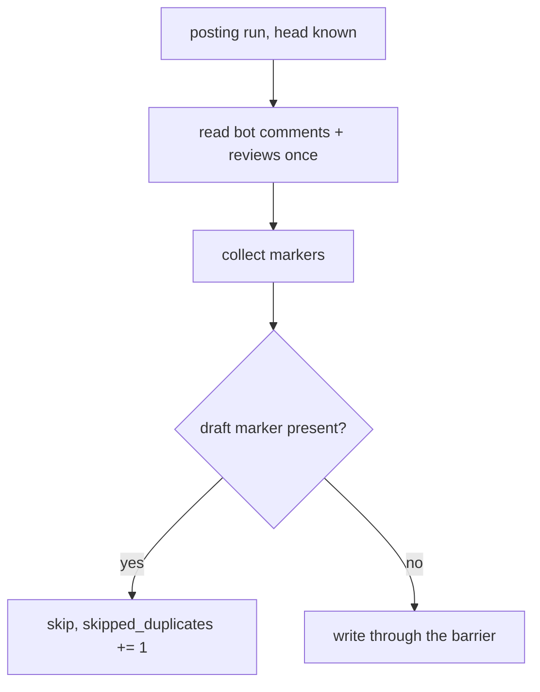

# A posting review at a head never re-posts what is already on the PR / MR

## Intent

Posting `review pr` twice at one head (a replayed run, or two fresh
runs) writes every review and inline comment twice. Each posted
comment carries a hidden marker naming the finding it states and the
head it was posted at; before writing, the orchestrator reads the
bot's existing comments and skips every draft whose marker is already
there.

## Context

Tech-debt row 85 (`docs/tech_debt.md`), verbatim: "A posting replay
re-posts the stored reviews — A posting `review pr` at a head with a
completed run posts the stored outcomes through `_publish_all`, as a
fresh posting run posts its own; nothing compares them with the
reviews and inline comments already on the PR / MR, so posting twice
at one head posts the same reviews twice. The duplicate posting
predates the run cache (two fresh posting runs at one head did the
same). (verified 2026-10-22)"

Measured on `origin/develop` 2706bb6 (2026-10-25):

- F1: `_publish_replayed` (`review/orchestrator.py:1171`) calls
  `_publish_all` with the stored outcomes; `_publish_all` (`:1307`)
  calls `_publish_outcome` per reviewer, then the auto-challenge pass,
  `_upsert_archive_comment`, `_fire_routine` and
  `remember_verified_findings`. No path reads the PR's existing
  comments before a write.
- F2: `_publish_batched_review` (`:1560`) writes one
  `forge.post_review(ReviewDraft(verdict, body, comments, commit_sha))`
  per reviewer (plus one COMMENT retry, then the per-comment fallback
  `_publish_per_comment`, one `post_comment` per inline comment).
- F3: the bodies carry no identity: `_render_comment_body` (`:158`) is
  `**[{role}/{severity}]** {body}` plus a footer; `_render_review_body`
  (`:172`) the verdict, the summary and a footer with tokens and
  seconds.
- F4: a stable identity already exists. `finding_fingerprint`
  (`review/findings_bridge.py:142`, SP-FINDINGS-BRIDGE-DOCFIX 0.2 G4,
  #240) hashes claim type, file, 5-line bucket and normalised claim
  into 16 hex digits; `comment_to_finding` (`:267`) builds the
  `Finding` a `ReviewComment` becomes. The fingerprint does not
  include the head.
- F5: the only marker in use today is whole-comment:
  `ARCHIVE_MARKER = "<!-- repoach-review-archive -->"`
  (`forge/protocol.py:44`), found with `find_marked_comment` and
  written with `upsert_marked_comment`, which PATCHes the existing
  comment on every call, identical body or not (`forge/github.py:1370`).
- F6: every write passes the forge's `ForgeWriteBarrier`
  (SP-DRY-RUN-NEVER-POSTS); reads (`comments`, `conversation_comments`,
  `reviews`) do not.
- F7: the auto-challenge pass replies only to comments posted in this
  run (`posted_ids`), so a run that posts no new comment posts no
  challenge.

## Decisions (0.2, 2026-10-25)

- D1 (Q1): a failed dedupe read posts nothing, with the named outcome
  `posting_outcome = "SKIP_DEDUPE_READ"`: fail closed, as the write
  barrier does.
- D2 (Q2): a forced re-review whose verdict for a reviewer changed at
  the same head posts a new verdict review (a changed verdict is
  news); an unchanged verdict posts only the new comments, as one
  `COMMENT` review. The review marker therefore carries the verdict.
- D3 (Q3): `_fire_routine` is skipped when the run posted nothing new,
  and the skip is logged.

## Goals

- G1: every posted inline comment ends with the hidden line
  `<!-- repoach-finding:<fingerprint> head:<sha12> -->`, the
  fingerprint being `finding_fingerprint(comment_to_finding(...))` of
  that comment.
- G2: every posted review body ends with
  `<!-- repoach-review:<role> head:<sha12> verdict:<VERDICT> -->`, the
  verdict the reviewer reached (not the downgraded `COMMENT` event a
  token may force, F2).
- G3: before the first write of a posting run with a known head, the
  orchestrator reads the PR / MR's inline comments, conversation
  comments and reviews once, keeps those whose author is the bot
  (`trusted(bot_username, author)`), and collects their markers.
- G4: per reviewer, at head H:
  - no review marker for its role at H -> posts as today, minus any
    comment whose marker is present;
  - a review marker at H with a different verdict -> posts a new
    review with the new verdict and the absent comments (D2);
  - a review marker at H with the same verdict and some comment markers
    absent -> posts only the absent comments, in one `COMMENT` review;
  - the same verdict and every comment marker present -> posts nothing.
- G5: the archive comment is not rewritten when its body is unchanged.
- G6: the run logs `review_team.posting_deduped` with
  `skipped_duplicates` (inline comments plus reviews skipped) and the
  same count on `TeamOutcome.skipped_duplicates`, reported in the
  `review pr` JSON.
- G7: when the run made no forge write (every draft skipped),
  `_fire_routine` is not called and `review_team.routine_skipped` is
  logged with `reason="nothing new posted"` (D3).

## Non-Goals

- NG1: no dedupe across heads: a finding still open at a new head is
  posted at that head (its marker names the new head).
- NG2: no editing or deleting of comments already posted, and no
  back-filling of markers on comments posted before this spec.
- NG3: no `posted` flag on `pr_review_runs` (the row's first fix
  option): the forge's own comments are the truth, which also covers
  two fresh runs and a run whose ledger was lost.
- NG4: no change to what a dry run does: its barrier refuses every
  write, and the dedupe read happens only when posting.

## Assumptions

- A1: both forges render an HTML comment invisibly and return comment
  bodies byte-for-byte (GitHub and GitLab markdown both do).
- A2: `bot_username` is set whenever posting is on (`ci review`
  refuses to post otherwise, SP-UNIVERSAL-CI-ENTRY).
- A3: `review/orchestrator.py` stays owned by SP-ORCH-DOCSTRING,
  `findings_bridge.py` by SP-FINDINGS-BRIDGE-DOCFIX, `forge/` by
  SP-UNIVERSAL-FORGE; this spec edits them under its `depends_on`
  edges and claims only its new test.

## Interface

Inputs:
- `finding_marker(fingerprint: str, head_sha: str) -> str` and
  `review_marker(role: BotRole, head_sha: str, verdict: str) -> str` (new, pure, in
  `review/orchestrator.py`); `parse_markers(body: str) -> Markers` (the finding markers as a set, the
  review markers as `{(role, head12): verdict}`).
- `_render_comment_body(outcome, comment, *, head_sha)` and
  `_render_review_body(outcome, *, head_sha)`: `head_sha` added; the
  marker is appended only when `head_sha` is known.

Outputs:
- `TeamOutcome.skipped_duplicates: int` (default 0), in the
  `review pr` JSON as `skipped_duplicates`.
- Log event `review_team.posting_deduped` with `pr_number`,
  `head_sha`, `skipped_duplicates`, `posted_reviews`,
  `posted_comments`.

Errors:
- A failed dedupe read (`ForgeError`) -> the run posts nothing: it
  logs `review_team.posting_dedupe_read_failed` and sets
  `posting_outcome = "SKIP_DEDUPE_READ"` (D1; posting twice is the
  defect this spec removes, posting nothing is recoverable by a retry).
  `ForgeStateRefusedError` keeps its current meaning.

## Behavior

### Nominal

```text
if posting and head_sha:
    present = markers of bot-authored comments + reviews  (one read pass)
for outcome in outcomes:
    new = [c for c in outcome.comments if finding_marker(fp(c), head) not in present]
    prior = present.reviews.get((outcome.role, head12))      # verdict or None
    if prior == verdict and not new:  skip (skipped += 1 + len(outcome.comments)); continue
    if prior == verdict:              post_review(COMMENT, body, new)
    else:                             post_review(verdict, body, new)   # none, or changed (D2)
    skipped += len(outcome.comments) - len(new)
archive: upsert only when the stored body differs
log review_team.posting_deduped(skipped_duplicates=skipped)
if no write was made: log review_team.routine_skipped; do not fire the routine (D3)
```

### Edge cases

- `head_sha` unknown (`_publish_per_comment` path, F2) -> no marker
  can name a head: no dedupe, behaviour unchanged, logged.
- Two comments of one reviewer with the same fingerprint (two lenses,
  or one reviewer twice) -> one is posted, the other counted in
  `skipped_duplicates`.
- A human comment that quotes a marker -> ignored (G3 keeps
  bot-authored comments only).
- A comment posted before this spec (no marker) -> not recognised; the
  first posting run after the change may post it once more (NG2).
- A per-comment fallback after a rejected batch posts each new comment
  with its marker, so a later run recognises them.

### Failure scenarios

- The dedupe read fails -> see Errors: nothing is posted, reason named.
- A write fails midway -> the comments already posted carry markers;
  a retry posts only the rest.

## Architecture Impact

- Adds dependency: SP-POSTING-REPLAY-DEDUPES -> SP-ORCH-DOCSTRING
  (edits `_publish_all`, `_publish_batched_review`,
  `_publish_per_comment`, the two render helpers).
- Adds dependency: SP-POSTING-REPLAY-DEDUPES -> SP-FINDINGS-BRIDGE-DOCFIX
  (uses `finding_fingerprint` and `comment_to_finding`).
- Adds dependency: SP-POSTING-REPLAY-DEDUPES -> SP-DRY-RUN-NEVER-POSTS
  (every write still goes through the barrier; the dedupe only removes
  writes before they reach it).
- Adds dependency: SP-POSTING-REPLAY-DEDUPES -> SP-UNIVERSAL-FORGE
  (reads `comments`, `conversation_comments`, `reviews`; the archive
  upsert skips an identical body).
- Removes dependency: none.
- New / changed coupling: a `format:` contract, the two hidden markers,
  read back from the forge by later runs.

## Diagram



## Acceptance Criteria

- [ ] AC1: a fixture forge holding, at head H, the bot's four inline
  comments of a stored run (each with its `repoach-finding` marker) and
  the bot's review for each reviewer (with its `repoach-review`
  marker): a posting `review pr` replay at H makes 0 forge writes
  (every write method counted), logs `review_team.posting_deduped` with
  `skipped_duplicates` equal to 4 plus the reviews skipped, and the
  JSON reports the same `skipped_duplicates` —
  `tests/unit/test_posting_replay_dedupes.py`.
- [ ] AC2: the same fixture plus one new finding in one reviewer's
  stored outcome: exactly 1 forge write, a `COMMENT` review carrying
  only the new comment, whose body ends with its `repoach-finding`
  marker at H.
- [ ] AC3: the fixture forge empty at H: the run posts as today and
  every inline comment and review body carries its marker; a second
  posting run at H then makes 0 writes.
- [ ] AC4: the four markers present at another head H0 only: a posting
  run at H posts all four comments (NG1).
- [ ] AC5: a marker present only in a comment authored by a non-bot
  user: the comment is posted.
- [ ] AC6: the archive comment body unchanged -> no
  `upsert_marked_comment` write; changed -> one.
- [ ] AC7: the dedupe read raising `ForgeError` -> 0 writes,
  `posting_outcome == "SKIP_DEDUPE_READ"`, the reason logged.
- [ ] AC8: a dry run makes no dedupe read and its barrier refuses as
  before (`tests/unit/test_dry_run_never_posts.py` still green).
- [ ] AC9 (D2): the AC1 fixture with one reviewer's stored verdict
  `REQUEST_CHANGES` against its marker `verdict:APPROVE` at H: exactly
  1 forge write, a review with event `REQUEST_CHANGES` and marker
  `verdict:REQUEST_CHANGES`, no inline comment re-posted.
- [ ] AC10 (D3): in AC1 (0 writes) `_fire_routine` is not called and
  `review_team.routine_skipped` is logged; in AC2 (1 write) it is
  called as today.

## Open Questions

(none)
