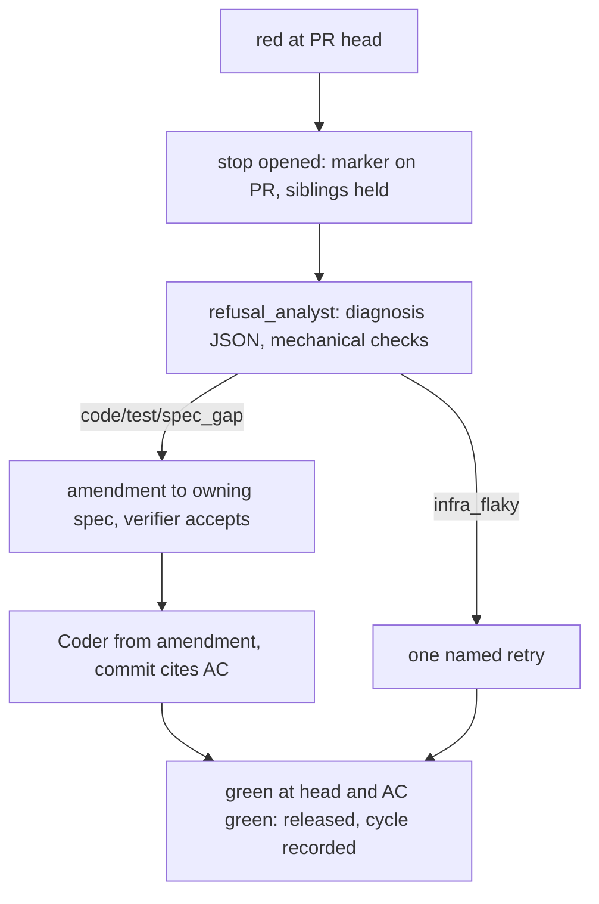

# A red stops the line until a refusal analysis and a corrective spec amendment exist, and the Coder works from the amendment

## Decisions (orchestrator 2026-10-25, within the owner's rule « un rouge arrête la ligne »)

The five open questions of version 0.1 are settled. The body below
already applies them.

- **D1 (Q1) → the hold reaches Yoob's pipelines.** `review pr` reads
  `line_state`. On every held sibling it exits non-zero
  (`EXIT_LINE_STOPPED`, 10) and prints `line stopped by <pr>#<head7>: <job>`.
  Yoob's `review:gate` job therefore goes red, and GitLab does not merge
  the MR. On release, repoach re-runs the held `review:gate` jobs through
  `rerun_check` behind the barrier. A held sibling's red gate is not a
  stop trigger (G1, G4).
- **D2 (Q2) → a red on the integration branch's own head stops the
  line.** The marker and the amendment live on the PR/MR that produced
  the merge commit, resolved from that commit. When no PR/MR produced
  it, they live on a pinned issue named `repoach line state` (G1).
- **D3 (Q3) → a required check `cancelled` on every attempt at the head
  is a stop.** This is aligned with SP-CI-RED-IS-EVIDENCE `ci_cancelled`
  (G1).
- **D4 (Q4) → a PR/MR comment `/repoach release-line <reason ≥ 20 chars>`
  by a user with write access releases the line.** The review job reads
  it. It is logged identically: the same `human_release` event, with
  `source: comment` (G4b).
- **D5 (Q5) → with `[review].bot_username` empty, the bot identity is
  read from the token** (`GET /user` on GitLab, `/user` on GitHub). It
  is read once per run and cached in the run. Yoob's `repoach.toml` does
  not need the key (G1, A3).

## Intent

Owner rule, 2026-10-25: « Dès qu'on a un rouge, les pipelines doivent
s'arrêter ; côté repoach on analyse le refus, on formule une spec
corrective pour le coder, et on reprend. » This spec makes that rule the
contract of the Coder loop. A red at the head of a PR stops the merge line
of the whole repository. A refusal-analysis agent diagnoses the red. For
a code, test or spec-gap cause, it writes an amendment to the owning spec.
The Coder receives that amendment as its brief and never the raw red. The
line resumes on its own when the head is green and the amendment's
acceptance criterion passes. Every step of the cycle is recorded with its
duration.

## Context

Measured on `origin/develop` at `2706bb6` (2026-10-25) in
`repoachhq/repoach`, and on Yoob `origin/develop` (`josephwfaye/yoob_2`).

| # | Fact | Where |
|---|------|-------|
| F1 | A red CI goes straight to a fix attempt. `run_coder_fix_from_findings` reads `fetch_ci_status`. On `CI_RED` it records the failed checks as findings, then fetches the open blocking findings and calls `coder.respond_to_findings` in the same run. No step between the red and the fix asks *why* it is red. | `src/repoach/review/coder_findings.py:512-524`, `:588` |
| F2 | The Coder gets the raw red. `record_ci_failures_as_findings` stores the matched log block as `verification_result` (`[:4000]`) of a `broken_behavior` / `blocking` finding. The Coder prompt renders every finding into `{FINDINGS_JSON}`. | `src/repoach/review/coder_findings.py:272-281`; `prompts/review/coder_findings_0.1.1.md:5`, `:68` |
| F3 | The bound is a count of attempts, not a diagnosis. `MAX_CODER_ROUNDS = 3` and `STALL_WINDOW = 2`. The fourth start-check, or two rounds without progress, drives the findings to `stuck` and fires a dossier. | `src/repoach/review/stuck.py:48`, `:54`; `src/repoach/review/coder_findings.py:534-560` |
| F4 | The merge path judges one PR at a time. `run_auto_merge(pr_number)` and `compute_merge_decision(facts)` see only facts about that PR. No fact says another PR of the same repository is red. `open_pull_requests` is implemented by every forge, but nothing in `src/` calls it. Its only caller is a conformance test. | `src/repoach/review/auto_merge.py:832`; `src/repoach/review/merge_gate.py:161-187`; `src/repoach/forge/protocol.py:688`, `github.py:1671`, `gitlab.py:920`; `tests/unit/test_forge_conformance.py:361` |
| F5 | **The ledger is per PR in CI.** On GitHub, the findings ledger travels as the artifact `findings-ledger-<n>`. On Yoob, it is the GitLab cache `repoach-ledger-mr-$CI_MERGE_REQUEST_IID`. A line state written only into the db of PR A's job is therefore invisible to PR B's job. | `.github/workflows/auto-review.yml:257`, `:357`, `:552`; Yoob `.gitlab-ci.yml:1512-1516` |
| F6 | A cross-job carrier already exists. `find_marked_comment` / `upsert_marked_comment` read and write a comment that carries a hidden marker. A marker is trusted only from `bot_username` (`is_trusted_author`). The write goes through the barrier. On GitLab, `[review].bot_username` defaults to *nobody*, so no marker is trusted until it is set. | `src/repoach/forge/protocol.py:591`, `:647-651`, `:702`; `src/repoach/project/repoach.toml.template:66-68` |
| F7 | **Yoob does not merge through `repoach review merge`.** `scripts/mr-create.sh` arms GitLab's `merge_when_pipeline_succeeds`, so GitLab merges when the pipeline is green. The `review:gate` job (`allow_failure: false`, `needs: []`) runs `ci/review-gate.sh`, which calls `repoach review pr`, not `review gate`. Its ledger cache is keyed per MR. | Yoob `scripts/mr-create.sh:229`, `.gitlab-ci.yml:1498-1523`, `ci/review-gate.sh:202` |
| F8 | SP-CI-RED-IS-EVIDENCE (PR #249, draft v0.4) gives the inputs this spec reads. Its NG1 forbids *any* automatic re-run. It defines: one classifier, `ci_verdict_at_head`, with `state ∈ {green, red, pending, missing, cancelled, unknown}` and a named reason; `ci-log:<check>@<attempt>` evidence rows written only when a non-empty log was read (G6); `deferred: logs_unavailable` findings; `ci_check_observations`; and `flaky_check` findings, which block when they recur (G5b). | that spec, G1, G5, G5b, G6, NG1 |
| F9 | SP-AGENT-CONTEXT-LOOP (PR #246, draft v0.5) gives every agent role an `AgentContext`, jailed read-only tools, a bounded inner loop whose last turn is the JSON contract (ERROR otherwise), and `agent_evidence_reads`. The `ci-log:` rows in that table are written by the CI evidence path only. | that spec, G1–G5, G9, G9b |
| F10 | A draft spec's absent selectors are *planned*, not refused (#250). The exemption is withheld when the PR touches owned code. | `src/repoach/review/spec_gate.py:86-100`; commit `2706bb6` |
| F11 | `[gates]` has no line setting. The template lists `docstring_exempt`, `advisory_verifiers`, `disabled_verifiers`, `verifier_commands` and `refuter_max_judged`. | `src/repoach/project/repoach.toml.template:72-84`; `src/repoach/gates/config.py:127` |
| F12 | `ReasonCode` has no value for "waiting for a diagnosis or an amendment". The Coder's outcomes are `none`, `spec_not_found`, `no_fixes`, `whitelist_rejected`, `self_verify`, `decompose_or_supersede`, `ruff_red`, `pytest_red` and `push_failed`. | `src/repoach/review/coder_findings.py:328-352` |

## Goals

- **G1 STOP: a red holds the whole line.**
  - **Trigger.** With `stop_the_line` on, a *stop* opens in each of these
    cases:
    - an open PR into the integration branch has
      `ci_verdict_at_head(...).state == "red"` at its head
      (SP-CI-RED-IS-EVIDENCE G1: a required check `failed` or `timeout`);
    - a required check is `cancelled` on **every** attempt at that head
      (SP-CI-RED-IS-EVIDENCE `ci_cancelled`; D3);
    - a *recurring* `flaky_check` blocks (its G5b);
    - the integration branch's own head is red, or cancelled on every
      attempt, after a merge (D2).
  - **What is not a trigger.** These hold only their own PR, as today:
    `pending`, `missing` and `unknown`; a check that was cancelled on some
    attempts but not on all; a refusal for review findings or spec
    coverage; and any refusal whose only reason is a line hold, including
    a held sibling's red `review:gate` (D1). Otherwise a stop would
    cascade.
  - **Identity.** A PR stop is `stop_id = "<pr>#<head7>:<job>"`, and its
    holder text is `line stopped by <pr>#<head7>: <job>`. An
    integration-branch stop is `stop_id = "<base>@<head7>:<job>"`, and
    its holder text is `line stopped by <base>@<head7>: <job>`.
  - **Hold.** While any stop of the same repository and the same base
    branch is not released, `review merge` refuses **every other** PR
    into that base. It exits `5` with the outcome `SKIP_LINE_STOPPED`
    (new, joins `NON_FATAL_SKIP_OUTCOMES`). `reasons` holds one
    `line stopped by <pr>#<head7>: <job>` line per open stop, oldest
    first. `review gate` reaches the same decision through
    `decide_at_head`, so `scripts/safe_merge.sh` is held too. A PR
    targeting another base is not held.
  - **`review pr` holds too (D1).** When the PR is held, `review pr`
    prints one `line stopped by …` line per stop on stderr and exits
    `10`, the new `EXIT_LINE_STOPPED`. The code is free in
    `cli/review_cmds.py`, where `review pr` uses 0, 2, 3 and 8. Its
    precedence is 8 > 3 > 10 > 2 > 0. Its JSON carries `line_state`. The
    review itself still runs and still posts its findings. Only the exit
    code changes, so Yoob's `review:gate` job (F7) is red on every held
    sibling MR, and GitLab's `merge_when_pipeline_succeeds` does not
    merge it. Yoob's `ci/review-gate.sh` already ends every exit it does
    not recognise with `exit "$EXIT_UNKNOWN"` (`:237`), so exit `10` is
    red with no change on the Yoob side. A dedicated
    `line stopped` message there is a Yoob follow-up and is not needed
    for the hold.
  - **Stopper PR.** The stopper itself is refused by its own red, as
    today. It is also held by any *other* open stop.
  - **Carrier (F5, F6).** The line state of each open stop is upserted
    as a marked comment whose marker is `<!-- repoach-line-state:v1 -->`.
    The comment carries a human-readable table plus the `line-state-json`
    object, and the write goes through the barrier. Where it goes:
    - a PR stop: on the stopper PR;
    - an integration-branch stop (D2): on the PR/MR that produced the
      merge commit at the red head, resolved from that commit by
      `forge.pull_request_for_commit(sha)`;
    - if no PR/MR produced it: on an open issue titled exactly
      `repoach line state`, pinned where the forge allows it. repoach
      creates the issue when it is absent and reuses it when present.

    The amendment of an integration-branch stop (G3) is committed on a
    new branch `fix/line-<head7>-<job-slug>` and opened as a PR into the
    base. It is posted on the same PR/MR or issue as the marker.
  - **How a hold is read.** A sibling PR's merge path calls
    `open_pull_requests(base)` (at most `line_scan_open_prs_max`) and
    `find_marked_comment` on each. It also reads the `repoach line state`
    issue when one exists, and the PR that produced the base head's merge
    commit. A marker is trusted only from the bot identity (D5). The
    local db `line_stops` is authoritative inside one job, but a hold is
    never decided from the local db alone.
  - **Bot identity (D5).** When `[review].bot_username` is empty, the
    bot identity is the token's own login: `GET /user` on GitLab, `GET
    /user` on GitHub. It is read once per run, cached for that run, and
    its source is named (`config` or `token`). Yoob's `repoach.toml`
    therefore does not need the key.
  - **Configurable.** `[gates].stop_the_line` (bool) sets it.
    - Default `true` when a `repoach.toml` exists at the project root
      (a repoach-governed repository), with source `default:governed`.
    - Default `false` otherwise, with source `default:ungoverned`.
    - `REPOACH_STOP_THE_LINE=0|1` outranks the toml. Order: env > toml >
      default.
  - **Visible: `doctor`** prints exactly one `line_state=` line (G1a).
  - **Visible: JSON.** The `review gate` and `review merge` JSON gain a
    `line_state` object (Interface).
- **G1a `doctor` line.** `repoach doctor` prints one of:
  - `line_state=off (gates.stop_the_line=false, <source>)`
  - `line_state=open (gates.stop_the_line=true, <source>; <n> open PRs scanned)`
  - `line_state=stopped by <pr>#<head7>: <job> (stage <stage>, since <iso8601>)`,
    one line per open stop, oldest first
  - `line_state=cannot say (<why>)`, for example
    `bot identity unreadable: GET /user refused (<status>)` or
    `forge unreadable: <message>`

  `doctor --ci` exits `2` on `cannot say` while `stop_the_line` is on:
  a gate that cannot see the line is a missing precondition, as for
  required checks in SP-CI-RED-IS-EVIDENCE Q2. Plain `doctor` exit codes
  are unchanged.
- **G2 ANALYSE: a refusal-analysis step, its own persona.** When a stop
  opens, the stage `refusal_analysis` runs before any Coder work for that
  PR.
  - **Role.** It runs SP-AGENT-CONTEXT-LOOP's inner loop as role
    `refusal_analyst`, with persona `prompts/review/refusal_analyst_0.1.0.md`.
  - **Seed, in priority order.** First the red job's log tail, read
    through the `ci-log:<job>@<attempt>` evidence row. Then the PR diff,
    then the owning spec(s), then the arch edges of the files the trace
    names.
  - **Tools.** The jailed read-only tools, on the pinned head tree.
  - **Output.** One `refusal-diagnosis-json` object (Interface):
    - `cause`: `file_line` (path and line at the head) or `infra` (a
      named infra cause);
    - `category` ∈ {`code`, `test`, `spec_gap`, `infra_flaky`, `dependency`};
    - `evidence`: at least one quote, each with its source (`trace`,
      `diff` or `spec`) and a ref;
    - `owning_spec`, with how it was resolved;
    - for `infra_flaky` only, `retry` with a named `justification` and
      the trace quote that supports it.
  - **Mechanical checks** run on the output before it is accepted:
    - every quote is a verbatim substring of its source at the head;
    - a `file_line` path exists at the head and its line is in range;
    - the category is in the closed set;
    - `retry` is present if and only if the category is `infra_flaky`.
  - **When a check fails.** The diagnosis is `rejected` with
    `diagnosis_rejected: <check>: <detail>`. The analysis runs again, up
    to `analysis_attempts_max` (2) attempts in all. After that the stop
    stays at stage `stopped` and a dossier fires (`stuck` routine),
    naming each rejection.
  - **No log.** When the red's log is `deferred: logs_unavailable`
    (SP-CI-RED-IS-EVIDENCE G6), no model is called. The diagnosis is
    recorded mechanically with `category: "undetermined"` and
    `undetermined_reason: "logs_unavailable: <why>"`. Only a human
    release (G4) or a green head ends that stop.
- **G2b RETRY only for infra/flaky.** A re-run of the red job is allowed
  only when an accepted diagnosis has category `infra_flaky` and a
  `retry.justification`.
  - **How many.** At most `retries_per_head_and_job_max` (1) per
    `(head_sha, job)`.
  - **How.** repoach requests it through the new forge method
    `rerun_check(attempt_id)` behind `ForgeWriteBarrier`: GitHub
    `POST repos/{o}/{r}/actions/jobs/{id}/rerun`, GitLab
    `POST projects/:id/jobs/:id/retry`.
  - **Ledger.** The request is recorded as a `retry_requested` event,
    with the justification and the quote.
  - **Exception to SP-CI-RED-IS-EVIDENCE NG1.** This is the only
    exception to that NG, and it is narrow: the flake is not hidden,
    because the red attempt stays in `ci_check_observations`, and a
    later green yields that spec's `flaky_check` finding.
  - **Second red.** A second red at the same `(head, job)` after the
    retry is never retried again. Its stop goes to analysis like any red,
    and the first diagnosis is in the seed.
- **G3 CORRECTIVE SPEC: the amendment.** For `code`, `test` and
  `spec_gap`, the step writes an amendment to the owning spec.
  - **Owning spec, in order.** The spec whose `owns.code` holds the
    cause path. Else the PR's declared spec (`resolve_spec`). Else
    nothing: the stop stays `analysed` with
    `no owning spec for <path>: a spec or a human release is required`.
    There is no fallback to an arbitrary spec.
  - **Content.** The amendment is a `spec-amendment-block` appended to
    that spec file (Interface). It holds:
    - a new fact `F<k>` with the cause `path:line` and the trace quote;
    - the cause, in one sentence;
    - a new acceptance criterion `AC<m> (amendment A<n>)`, which has a
      runnable command (a pytest selector, through the project's test
      runner) and a pass condition;
    - a measurement line.
  - **The AC also lands in the spec's AC list.** The same AC line is
    inserted at the end of `## Acceptance Criteria`, so the existing
    selector audit (SP-PLAN-SELECTOR-AUDIT-WIRE) sees it.
  - **Spec frontmatter.** `version` goes up by 0.1, `updated` becomes
    the date, and `status` does not change.
  - **Commit.** The amendment is committed to the PR head branch, as
    `docs(specs): amend <SP-ID> with AC<m> from the red at <head7>`,
    through the existing commit-and-push path. The file therefore
    appears in the PR diff.
  - **Post.** It is posted on the PR, through the barrier, as a marked
    comment `<!-- repoach-amendment:<stop_id> -->` that quotes the block.
  - **`dependency`.** No amendment is written. The diagnosis names the
    package and its version, and a dossier fires. The stop stays at
    stage `analysed` until a green head (G4) or a human release.
- **G3b The Coder works from the amendment.** While its PR has an open
  stop, the Coder is called only once an accepted amendment exists for
  that stop (stage `amended`).
  - **Brief.** The brief is the amendment block, through the new
    `{AMENDMENT}` placeholder of `prompts/review/coder_findings_0.2.0.md`.
  - **What the Coder never sees.** The raw red never reaches the
    prompt. Each `broken_behavior` finding of the stopped job is
    rendered in `{FINDINGS_JSON}` with `verification_result` replaced by
    `see amendment <SP-ID> A<n>`, and no log byte is rendered.
  - **Before an amendment exists.** The Coder returns a no-op with the
    new `ReasonCode.AWAITING_AMENDMENT` and the reason
    `line stopped by <stop_id>: stage <stage>, no amendment yet`. It
    makes no fix and no push, and records no round.
  - **Commit citation.** The Coder's commit message body carries the
    line `Satisfies: <SP-ID> AC<m> (amendment A<n>)`. The commit is
    refused before the push when that line is missing.
  - **Unchanged.** The local gate (ruff, verifiers, pytest matrix), the
    push path and `MAX_CODER_ROUNDS` (3) stay as they are (F3).
  - **Stuck.** A stop whose findings reach `stuck` is never auto-released.
- **G4 RESUME: automatic release on green, and the full cycle in the
  ledger.**
  - **Release conditions.** A stop is released, with `release_kind:
    green_at_head`, when the merge path or the Coder loop sees all of
    these at the PR's *current* head:
    1. `ci_verdict_at_head(...).state == "green"`;
    2. an accepted diagnosis exists for the stop;
    3. when an amendment exists, its AC selector is present at the head
       (never `planned`, F10) and its command exits `0`. The command runs
       in the pinned head tree (SP-REVIEW-PINS-HEAD), within
       `amendment_ac_timeout_s`.
  - **Other release kinds.**
    - `retry_green`: green after an `infra_flaky` retry; condition 3
      does not apply.
    - `stopper_closed`: the stopper PR is merged or closed.
    - `human`: G4b.
  - **On release.** The marked comment is updated to `released`, and
    siblings are no longer held.
  - **Held gates re-run (D1).** Each held sibling's latest `review:gate`
    attempt that ended red with exit `10` (`EXIT_LINE_STOPPED`) at its current
    head is re-run once, through `rerun_check(attempt_id)` behind the
    barrier. Each re-run is recorded as a `held_gate_rerun` event with the
    PR number and the attempt id. A held gate that was red for any other
    reason is not re-run, and neither is one at a superseded head. This
    is the second and last exception to SP-CI-RED-IS-EVIDENCE NG1. It
    hides no flake, because the red attempt was a hold, not a test.
  - **Events.** The ledger `line_cycle_events` holds one row per event,
    in order: `red`, `diagnosis` (or `diagnosis_rejected`), `amendment`,
    `amendment_verified` (or `amendment_rejected`), `fix_pushed`,
    `ac_green`, `retry_requested`, `green`, `released`, `human_release`.
  - **History command.** `repoach review line history <pr>` prints the
    cycle as JSON. Its `durations_s` hold `red_to_diagnosis`,
    `diagnosis_to_amendment`, `amendment_to_fix`, `fix_to_green` and
    `red_to_release`, and an interval that did not happen is `null`.
  - **Green before diagnosis.** A green that arrives before the
    diagnosis (for example a human push) does not release the stop.
    The analysis still runs on the recorded red, and the stop is
    released after it.
- **G4b A human release, always logged.** `repoach review line release
  <pr> --reason "<text>"` releases the stops of `<pr>`.
  - **Refusals.** It is refused in CI (`CI` set to a non-empty value),
    without a TTY, and with a reason shorter than
    `human_release_reason_min_chars` (20).
  - **What it writes.** A `human_release` event with `released_by` (the
    forge login of the authenticated user, or `git config user.email`
    when the forge cannot say, and the source of the value is named)
    and the reason verbatim. The marked comment is updated through the
    barrier.
  - **Dry-run.** Under dry-run it writes nothing and prints what it
    would write.
  - **Comment channel (D4).** A PR/MR comment whose first line is
    exactly `/repoach release-line <reason>` also releases the stops of
    that PR/MR (or, on the `repoach line state` issue, the
    integration-branch stops).
    - **Who may release.** The author must have write access: GitHub
      `permission ∈ {write, maintain, admin}` from
      `GET repos/{o}/{r}/collaborators/{login}/permission`; GitLab
      `access_level >= 30` (Developer) from `GET projects/:id/members/all/:user_id`.
    - **When it is read.** The review job reads it on its next run
      (`review pr`, `review fix` or `review merge`). It is honoured once
      per comment id.
    - **Logging.** It writes the same `human_release` event, with
      `released_by` = the comment author, `source: "comment"` and the
      comment id. The CLI writes `source: "cli"`.
    - **Refusals.** A reason under 20 characters, an author without
      write access, the bot itself, or an edited comment (only the
      original body counts) gives a `human_release_refused` event, and a
      reply naming the reason is posted through the barrier.
- **G5 The independent verifier stays.** An amendment is checked like
  any spec before the Coder may use it.
  - **Mechanical checks first.**
    - every fact cites a `path:line` that exists at the head;
    - the AC has a command of the allowed shape (Interface) and a pass
      condition;
    - the AC number is not already used in the spec;
    - the frontmatter still parses;
    - `repoach arch check --base <base>` stays green on the amended
      tree.
  - **Then a judge.** An `amendment_verifier` role runs with its own
    persona (`prompts/review/amendment_verifier_0.1.0.md`) and its own
    context, and never sees the analyst's history. It answers
    `VERDICT: accept|reject` with a reason.
  - **On reject.** The amendment is `amendment_rejected` and the
    analysis may write one new amendment
    (`amendment_verify_attempts_max` = 2 in all). After that the stop
    stays `analysed` and a dossier fires.

## Non-Goals

- NG1: No automatic fix without an accepted diagnosis. The Coder never
  works on a stopped PR before stage `amended` (G3b).
- NG2: No retry without a named infra cause. Only an accepted
  `infra_flaky` diagnosis may request one, at most once per
  `(head, job)`. A retry is never requested for `code`, `test`,
  `spec_gap`, `dependency` or `undetermined`. The re-run of a held
  sibling's `review:gate` on release (G4, D1) is not a retry of a red:
  it re-runs a job that was red only because the line was stopped.
- NG3: No silent release. Every release is a ledger event with a
  `release_kind`. A human release carries its actor and its reason.
- NG4: No change to the Coder's local gate, its push transport (still
  outside the barrier, as SP-CI-RED-IS-EVIDENCE NG4 states),
  `MAX_CODER_ROUNDS` or the `stuck` policy.
- NG5: No quarantine, skip or `xfail` of a test as a "fix". An amendment
  AC that marks a test skipped or xfail is rejected by the mechanical
  check.
- NG6: No hold across repositories or across base branches.
- NG7: No arbitrary command from a model-written spec is executed. The
  AC command is parsed into argv against an allow-list shape and never
  passed to a shell.

## Assumptions

- A1: SP-CI-RED-IS-EVIDENCE lands first. `ci_verdict_at_head`, the
  `ci-log:` evidence rows, `deferred` and `flaky_check` are its outputs
  (F8). Until then G1 and G2 cannot be implemented.
- A2: SP-AGENT-CONTEXT-LOOP lands first. The two new roles run its
  inner loop and obey its caps and its contract-turn rule (F9).
- A3: The bot that posts the line-state marker is `[review].bot_username`
  when it is set. Otherwise it is the token's own login, read with `GET
  /user` once per run (D5). When that call fails, the line state is
  `cannot say` (G1a) and the merge path fails closed (Edge cases).
- A4: Files owned by other specs are edited under the `depends_on`
  edges, as earlier specs did: `coder_findings.py`, `merge_gate.py`,
  `coder_loop.py`, `stuck.py`, `findings.py`, `reviewer.py`,
  `gates/config.py`, `forge/`, `spec_gate.py`, `head_reverify.py`, the
  toml template. `auto_merge.py`, `cli/review_cmds.py` and
  `cli/doctor_cmds.py` are frontier.

## Interface

```python
# src/repoach/review/line_stop.py
StopStage = Literal["stopped", "analysed", "amended", "fixing", "released"]
ReleaseKind = Literal["green_at_head", "retry_green", "stopper_closed", "human"]

@dataclass(frozen=True)
class LineStop:
    stop_id: str                     # "<pr>#<head7>:<job>"
    pr_number: int
    head_sha: str
    base_ref: str
    job: str
    attempt_id: str
    stage: StopStage
    opened_at: str
    released_at: str | None
    release_kind: ReleaseKind | None

@dataclass(frozen=True)
class LineState:
    enabled: bool
    source: str                      # env | repoach.toml | default:governed | default:ungoverned
    state: Literal["open", "stopped", "off", "cannot_say"]
    stops: tuple[LineStop, ...]      # open stops, oldest first
    scanned_prs: int
    why: str                         # "" unless state == "cannot_say"

def stop_the_line_setting(root: Path) -> tuple[bool, str]: ...
def open_stop_if_red(db_path: Path, forge: Forge, pr: PullRequest, verdict: CIVerdict) -> LineStop | None: ...
def read_line_state(forge: Forge, base: str, *, db_path: Path, root: Path) -> LineState: ...
def hold_reasons(state: LineState, *, pr_number: int) -> list[str]: ...
def try_release(db_path: Path, forge: Forge, stop: LineStop, *, head_tree: Path) -> ReleaseKind | None: ...
def human_release(db_path: Path, forge: Forge, pr_number: int, *, reason: str) -> list[LineStop]: ...
def cycle_history(db_path: Path, pr_number: int) -> dict: ...

# src/repoach/review/refusal_analysis.py
def analyse_refusal(stop: LineStop, *, forge: Forge, db_path: Path, head_tree: Path) -> Diagnosis: ...
def check_diagnosis(d: Diagnosis, *, head_tree: Path, trace: str, diff: str) -> list[str]: ...  # [] == accepted

# src/repoach/review/spec_amendment.py
def write_amendment(d: Diagnosis, *, head_tree: Path) -> Amendment: ...
def check_amendment(a: Amendment, *, head_tree: Path, base: str) -> list[str]: ...
def ac_argv(a: Amendment, config: GatesConfig) -> list[str]: ...  # raises AmendmentCommandError
```

Forge (SP-UNIVERSAL-FORGE), implemented on GitHub and GitLab:
- `rerun_check(attempt_id: str) -> None` is `@write_barrier` and raises
  `ForgeError` on refusal. `LocalDiffForge` refuses it, and the fixture
  forge records it.
- `token_login() -> str` makes one `GET /user` per forge instance and
  caches it (D5). `bot_username` returns `[review].bot_username` when set
  and `token_login()` otherwise. The trusted-author check uses that
  value.
- `pull_request_for_commit(sha: str) -> PullRequest | None` returns the
  merged PR/MR that produced a commit: GitHub `GET
  repos/{o}/{r}/commits/{sha}/pulls`, GitLab `GET
  projects/:id/repository/commits/:sha/merge_requests` (D2).
- `find_issue(title: str) -> int | None` and `create_issue(title, body)
  -> int` (`@write_barrier`) serve the `repoach line state` issue (D2).
- `author_can_write(login: str) -> bool` is the write-access check of
  the comment channel (D4).

Config (`repoach.toml`, `[gates]`):
```toml
# Hold every other PR's merge while one PR is red at its head, until the
# red is analysed and fixed or a human releases it. Default: true when
# this file exists. REPOACH_STOP_THE_LINE outranks it.
# stop_the_line = true
```

`line-state-json` (the `line_state` key of the `review gate` /
`review merge` JSON, and the payload of the marked comment):
```json
{"enabled": true, "source": "default:governed", "state": "stopped",
 "scanned_prs": 7,
 "stops": [{"stop_id": "245#abc1234:Test suite (Python 3.11)", "pr_number": 245,
            "head_sha": "abc1234…", "job": "Test suite (Python 3.11)",
            "stage": "amended", "since": "2026-10-25T18:00:00Z",
            "diagnosis": {"category": "code", "cause": "src/repoach/x.py:42"},
            "amendment": "SP-X A1 / AC23"}],
 "held": true, "why": ""}
```
`held` is true when at least one stop belongs to another PR.

`refusal-diagnosis-json`:
```json
{"schema": "refusal-diagnosis/1", "stop_id": "245#abc1234:Test suite (Python 3.11)",
 "pr_number": 245, "head_sha": "abc1234…", "job": "Test suite (Python 3.11)",
 "attempt_id": "123456",
 "category": "code",
 "cause": {"kind": "file_line", "path": "src/repoach/x.py", "line": 42},
 "summary": "one sentence",
 "evidence": [{"source": "trace", "ref": "ci-log:Test suite (Python 3.11)@123456:L118", "quote": "E   KeyError: 'head_sha'"},
              {"source": "diff", "ref": "src/repoach/x.py:42", "quote": "row['head_sha']"}],
 "owning_spec": "SP-X", "owning_spec_source": "owns.code",
 "retry": null,
 "status": "accepted", "rejections": [],
 "model": "…", "turns": 3, "duration_s": 41.2}
```
- `category` ∈ {`code`, `test`, `spec_gap`, `infra_flaky`, `dependency`,
  `undetermined`}. `undetermined` is written by repoach only (G2 "No
  log") and is refused when a model writes it.
- `cause.kind="infra"` carries `{"infra": "<name>"}`, where `<name>` is
  a GitLab `failure_reason` (for example `runner_system_failure`) or a
  free name backed by an evidence quote.
- `retry` is `{"justification": "...", "quote": "...", "ref": "..."}`
  when the category is `infra_flaky`, and `null` otherwise.
- `owning_spec_source` ∈ {`owns.code`, `pr_spec`, `none`}.

`spec-amendment-block` (appended to the owning spec file):
```markdown
## Amendment A1 (2026-10-25, PR #245 at abc1234, stop 245#abc1234:Test suite (Python 3.11))

- F13: `src/repoach/x.py:42` reads `row['head_sha']` from a row that has no such key. Trace: `E   KeyError: 'head_sha'` (`ci-log:Test suite (Python 3.11)@123456:L118`).
- Cause: the reader assumes a column the writer never adds.
- AC23 (amendment A1): `pytest -q tests/unit/test_x.py::test_row_without_head_sha` → green: a row without `head_sha` gives `""`, not `KeyError`.
- Measurement: `pytest -q tests/unit/test_x.py::test_row_without_head_sha` exits 0 at the fix head.
- Diagnosis: category `code`, accepted, 2026-10-25T18:01:12Z.
```
`F<k>` and `AC<m>` continue the highest numbers already in the spec.
Allowed AC command shape: `pytest -q <path>::<name>[::<name>]`,
optionally prefixed by the project's `[gates]` test runner argv. A
selector with `-k`, `--deselect`, `-p no:`, a skip or xfail marker, or a
shell metacharacter is refused (`ac_command_not_runnable: <why>`).

New values:
- `ReasonCode.AWAITING_AMENDMENT = "awaiting_amendment"`
- outcome `SKIP_LINE_STOPPED` (exit 5)
- `review pr` exit `10` = `EXIT_LINE_STOPPED` (D1)
- events `held_gate_rerun`, `human_release_refused`; `human_release`
  payload `source ∈ {cli, comment}`

Tables (owned here, additive, `[state] db_path`):
- `line_stops(stop_id PK, repo, base_ref, pr_number, head_sha, job,
  attempt_id, stage, opened_at, released_at, release_kind, released_by,
  release_reason)`
- `line_cycle_events(id, stop_id, event, at, head_sha, payload_json)`
- `refusal_diagnoses(id, stop_id, attempt, status, category, json, created_at)`

CLI: `repoach review line status [--base B]` prints `line-state-json`.
`repoach review line history <pr>` prints the cycle (G4).
`repoach review line release <pr> --reason R` is G4b.

Errors: none raised to the merge path. Every forge failure while reading
the line gives `state="cannot_say"` with `forge unreadable: <message>`.

## Behavior

### Nominal

1. **Red seen.** `review pr`, `review fix` or `review merge` computes
   `ci_verdict_at_head` for PR A. On `red`, `open_stop_if_red` inserts
   `line_stops` (stage `stopped`) and the event `red`, and upserts the
   marker on A. Re-entry is idempotent per `stop_id`.
2. **Sibling held.** `review merge B` (or `review gate B`) calls
   `read_line_state(base)` before the merge decision, and it sees A's
   marker. It refuses with
   `line stopped by A#<head7>: <job>` / `SKIP_LINE_STOPPED`.
3. **Analysis.** The next `review fix A` sees the open stop. It runs
   `analyse_refusal`, then `check_diagnosis`, and records the result as
   `refusal_diagnoses` and the `diagnosis` event (stage `analysed`).
4. **Category.**
   - `code` / `test` / `spec_gap` → `write_amendment`, then
     `check_amendment`, then the `amendment_verifier` judge (G5). On
     accept: commit and push the amendment, post the marker comment,
     record the `amendment` and `amendment_verified` events, stage
     `amended`.
   - `infra_flaky` → `rerun_check` once, `retry_requested`, stage
     `fixing`.
   - `dependency` / `undetermined` → dossier, stage `analysed`, nothing
     else.
5. **Fix.** At stage `amended`, the Coder runs with `{AMENDMENT}` (G3b).
   Its local gate passes, and the commit carries `Satisfies: …`. Push,
   then the `fix_pushed` event, stage `fixing`. The round is recorded.
6. **Resume.** At the next evaluation at the new head, `try_release`
   checks G4 conditions 1–3. When they hold, it records the `ac_green`,
   `green` and `released` events and updates the marker to `released`.
   B's next `review merge` is no longer held.

### Edge cases

- Two PRs red at once → two stops. Each sibling lists both, oldest
  first. Each stopper is held by the other's stop, and each releases
  independently. There is no deadlock: a stop releases on its own PR's
  green, on its closure, or by a human.
- The stopper is pushed again before the analysis → the stop stays bound
  to its `head_sha`. A red at the new head opens a second stop. A green
  at the new head releases the old stop only after its diagnosis
  exists (G4, "Green before diagnosis").
- The stopper is closed or merged → `stopper_closed` on the next
  `read_line_state`.
- The owning spec is a draft and the AC's test file is absent → the AC
  is never `planned` for release (F10). Release requires the selector
  present and green.
- The AC passes but CI is still red at the new head → not released. A
  new red at the new head opens a new stop, and the earlier diagnosis
  and amendment are in the analyst's seed.
- The Coder reaches `stuck` (3 rounds) → no auto-release. The dossier
  names the `stop_id`, and only a human release or a green head with a
  passing AC ends it.
- `stop_the_line` is off → no stop opens, `line_state.enabled == false`,
  and the Coder behaves as today, except that G3b does not apply.
- A sibling's `review gate` refusal whose only reason is a line hold →
  not a red trigger, so there is no cascade (G1).
- **Dry-run / closed barrier.** The marker, the amendment comment and
  `rerun_check` are refused and recorded by the barrier. The stop and
  the diagnosis still exist in the local db. `line_state` carries
  `"transport": "local_only (writes refused)"`. Under dry-run, the
  amendment is not committed: its block is in the JSON only.
- **The line cannot be read** (`GET /user` refused, a forge error) while `stop_the_line` is on → `review merge` refuses with
  `line state unreadable: <why>` (fail-closed, `SKIP_LINE_STOPPED`), and
  `doctor` says `cannot say`.
- A recurring blocking `flaky_check` (SP-CI-RED-IS-EVIDENCE G5b) → a
  stop with category forced to `infra_flaky`. It releases only when that
  spec's tech-debt row exists *and* the head is green (its G5b), and is
  never retried more than once.
- An `allow_failure` job is red → it is not a required check, so it is
  not `red` in the verdict and opens no stop.

### Failure scenarios

- The analyst ends `ERROR` (contract missing, caps) → `diagnosis_rejected:
  contract_missing`, counted against `analysis_attempts_max`.
- `rerun_check` is refused by the forge → the `retry_refused` event
  carries the status. The stop stays `analysed` and a dossier fires. No
  second attempt is made.
- The amendment commit or push fails → the `amendment_push_failed`
  event. The stop stays `analysed`, and the next run retries the write
  (not the analysis).
- The AC command times out → not green. The `ac_timeout` event, and no
  release.

## Architecture Impact

- Adds dependency: SP-RED-STOPS-THE-LINE -> SP-CI-RED-IS-EVIDENCE (the verdict, `ci-log:` evidence, `deferred`, `flaky_check`; amends its NG1 with the single G2b exception)
- Adds dependency: SP-RED-STOPS-THE-LINE -> SP-AGENT-CONTEXT-LOOP (the inner loop, caps and contract turn for `refusal_analyst` and `amendment_verifier`)
- Adds dependency: SP-RED-STOPS-THE-LINE -> SP-CI-STATUS-CLIENT-CLASSIFY (owner of `coder_loop.py`; the stop is opened where CI is read)
- Adds dependency: SP-RED-STOPS-THE-LINE -> SP-DEDUP-CLASSIFICATION-CONSTANTS (owner of `coder_findings.py` and `merge_gate.py`; `AWAITING_AMENDMENT`, the hold reason)
- Adds dependency: SP-RED-STOPS-THE-LINE -> SP-SCHEMA-INIT-RACE-GENERALIZE (owner of `stuck.py`; the dossier names the stop, and `stuck` never auto-releases)
- Adds dependency: SP-RED-STOPS-THE-LINE -> SP-FINDINGS-INIT-RACE (owner of `findings.py`; redacting `verification_result` for the Coder)
- Adds dependency: SP-RED-STOPS-THE-LINE -> SP-RETRY-BACKOFF-DEDUP (owner of `reviewer.py`; `Coder.respond_to_findings` gains `amendment`)
- Adds dependency: SP-RED-STOPS-THE-LINE -> SP-UNIVERSAL-FORGE (`rerun_check`, `token_login`, `pull_request_for_commit`, `find_issue`/`create_issue`, `author_can_write`; `open_pull_requests` gains its first caller)
- Adds dependency: SP-RED-STOPS-THE-LINE -> SP-UNIVERSAL-GATES (`[gates].stop_the_line` in `GatesConfig`)
- Adds dependency: SP-RED-STOPS-THE-LINE -> SP-UNIVERSAL-PROJECT-CONFIG (the template line)
- Adds dependency: SP-RED-STOPS-THE-LINE -> SP-DRY-RUN-NEVER-POSTS (marker, amendment comment and re-run behind the barrier)
- Adds dependency: SP-RED-STOPS-THE-LINE -> SP-REFUTER-JUDGES-WHAT-IT-CAN (the `amendment_verifier` judge reuses the refuter's verdict parse)
- Adds dependency: SP-RED-STOPS-THE-LINE -> SP-GATE-REVERIFIES-AT-HEAD (release is evaluated at the current head)
- Adds dependency: SP-RED-STOPS-THE-LINE -> SP-PLAN-SELECTOR-AUDIT-WIRE (amendment ACs are never `planned`)
- Adds dependency: SP-RED-STOPS-THE-LINE -> SP-REVIEW-PINS-HEAD (the AC command runs in the pinned head tree)
- Frontier files touched without an edge: `src/repoach/review/auto_merge.py`, `src/repoach/cli/review_cmds.py` (the `review line` sub-app), `src/repoach/cli/doctor_cmds.py`.
- New shared state: `db:table:line_stops`, `db:table:line_cycle_events`, `db:table:refusal_diagnoses` (owned here); forge marked comments `repoach-line-state:v1` and `repoach-amendment:<stop_id>`.
- No cycle: `line_stop.py` imports `forge`, `review.ci_evidence` and `review.findings`; `coder_findings.py` and `auto_merge.py` import `line_stop` lazily. Nothing `line_stop` imports imports it back.

## Diagram



## Acceptance Criteria

All forge fixtures use `tests/line_fakes.py::LineFixtureForge`. It is an
in-memory forge with several open PRs on one base, scripted check
attempts and logs per head, marked comments, a write barrier and a
`rerun_check` recorder.

- [ ] AC1: `pytest -q tests/unit/test_line_stop.py::test_red_stops_a_sibling` → green. PR 10 has `Test suite (Python 3.11)` failed at head `abc1234…`, and PR 11 is green with zero open findings.
  - `run_auto_merge(11, …)` returns `SKIP_LINE_STOPPED`, merges nothing (0 `merge` calls), and `notes`/`reasons` contains exactly `line stopped by 10#abc1234: Test suite (Python 3.11)`.
  - `review merge 11` exits `5`.
  - The same fixture with PR 11 targeting another base merges it.
- [ ] AC2: `pytest -q tests/unit/test_line_stop.py::test_hold_is_read_from_the_forge_not_the_db` → green. The stop is written by a job using db `a.sqlite`. A merge of PR 11 using an empty db `b.sqlite` (the per-PR ledger of F5) is still refused, because it read the `repoach-line-state:v1` marker. A marker authored by a non-bot login is ignored.
- [ ] AC3: `pytest -q tests/unit/test_line_stop.py::test_non_red_states_do_not_stop` → green. For each of these, no stop opens and a sibling merges: `pending`, `missing`, `unknown`, a check cancelled on one attempt of two (the other green), a findings-only refusal, and a sibling's red `review:gate` whose only reason is a line hold.
- [ ] AC4: `pytest -q tests/unit/test_line_stop.py::test_setting_resolution` → green.
  - With a `repoach.toml`, absent key → `(True, "default:governed")`; without one → `(False, "default:ungoverned")`.
  - `stop_the_line = false` → `(False, "repoach.toml")`.
  - `REPOACH_STOP_THE_LINE=1` over the toml `false` → `(True, "env")`.
  - With it off, AC1's fixture merges PR 11.
- [ ] AC5: `pytest -q tests/unit/test_line_doctor.py` → green. `repoach doctor` prints exactly one of the four G1a forms for each case: off, open, stopped, and cannot say (a GitLab fixture with an empty `bot_username` whose `GET /user` returns 401). `doctor --ci` exits `2` on `cannot say` while it is on, and `0` otherwise. `repoach review gate 11 --forge <fixture>` JSON has `line_state` with the keys `enabled, source, state, scanned_prs, stops, held, why`, and `state == "stopped"`.
- [ ] AC6: `pytest -q tests/unit/test_refusal_analysis.py::test_diagnosis_shape` → green. A scripted analyst returns a diagnosis for AC1's red.
  - The stored JSON validates against `refusal-diagnosis/1`.
  - It has `category == "code"`, `cause == {"kind": "file_line", "path": …, "line": …}`, at least one `evidence` item whose `quote` is a substring of the served log, `owning_spec_source == "owns.code"` and `retry is None`.
  - A `diagnosis` event exists.
- [ ] AC7: `pytest -q tests/unit/test_refusal_analysis.py::test_mechanical_rejections` → green. Each of these gives `status == "rejected"` and the named `diagnosis_rejected: <check>` prefix:
  - a quote absent from the trace;
  - a path absent at the head;
  - a line out of range;
  - category `undetermined` written by the model;
  - `retry` on a `code` category;
  - a missing `retry` on `infra_flaky`.

  A third attempt is never made (`analysis_attempts_max == 2`), and a dossier fires once.
- [ ] AC8: `pytest -q tests/unit/test_refusal_analysis.py::test_logs_unavailable_is_undetermined_without_a_model` → green. When the red finding is `deferred: logs_unavailable`, there are 0 model calls, the diagnosis has `category == "undetermined"` and `undetermined_reason` starting `logs_unavailable:`, and no amendment and no retry follow.
- [ ] AC9: `pytest -q tests/unit/test_spec_amendment.py::test_amendment_lands_in_the_pr_diff` → green. For an accepted `code` diagnosis on a fixture repo whose spec `SP-X` owns the cause path:
  - `SP-X`'s file gains one `## Amendment A1 (…)` block with `F<k>`, `Cause:`, `AC<m> (amendment A1):` and `Measurement:` lines, where `k` and `m` are each 1 greater than the highest already present;
  - the same AC line is appended to `## Acceptance Criteria`;
  - `version` goes up by 0.1, and `status` is unchanged;
  - `git diff base..head --name-only` lists the spec file;
  - one barrier-admitted `repoach-amendment:<stop_id>` comment exists;
  - the frontmatter parses.
- [ ] AC10: `pytest -q tests/unit/test_spec_amendment.py::test_amendment_checks` → green. Each of these is rejected by `check_amendment` with its named reason:
  - a fact with a non-existent `path:line`;
  - an AC with `-k`, `--deselect`, `;`, `$(`, `@pytest.mark.skip` or `xfail`;
  - an AC number already used;
  - an amended tree on which `arch check` fails.

  A verifier `VERDICT: reject` leads to at most one new amendment, then a dossier.
- [ ] AC11: `pytest -q tests/unit/test_coder_from_amendment.py::test_coder_brief_is_the_amendment` → green.
  - **Before an amendment exists:** `run_coder_fix_from_findings(10)` returns `reason_code == AWAITING_AMENDMENT`, with 0 Coder calls and 0 `git_commit_and_push` calls, and records no round.
  - **After it exists:** the captured Coder prompt contains the amendment block verbatim, contains no byte of the red log (asserted on a 40-character log sentinel), and renders the CI finding's `verification_result` as `see amendment SP-X A1`.
- [ ] AC12: `pytest -q tests/unit/test_coder_from_amendment.py::test_commit_cites_the_ac` → green.
  - The pushed commit message body contains `Satisfies: SP-X AC<m> (amendment A1)`.
  - A scripted plan whose `commit_message` lacks it gets the line appended. When the plan cannot be mapped to the amendment, the commit is refused before the push with a named reason.
  - `MAX_CODER_ROUNDS == 3`, unchanged.
- [ ] AC13: `pytest -q tests/unit/test_line_release.py::test_resume_on_green_with_ac` → green.
  - **Releases:** at the fix head, CI is green and the AC selector exists and passes. `try_release` returns `green_at_head`, the marker reads `released`, and AC1's `run_auto_merge(11, …)` now merges.
  - **No release:** the same fixture with the AC test file absent (spec in `draft`), or with the AC failing, or with CI still red, does not release.
- [ ] AC14: `pytest -q tests/unit/test_line_release.py::test_cycle_history_durations` → green. With injected clocks at t=0 (red), 60 (diagnosis), 90 (amendment), 300 (fix pushed) and 900 (green and released), `repoach review line history 10` prints the events in that order and `durations_s == {"red_to_diagnosis": 60, "diagnosis_to_amendment": 30, "amendment_to_fix": 210, "fix_to_green": 600, "red_to_release": 900}`.
- [ ] AC15: `pytest -q tests/unit/test_line_release.py::test_flaky_named_retry_recorded` → green.
  - **Retry:** an `infra_flaky` diagnosis whose `retry.quote` is the trace line `ERROR: Job failed (system failure): …` gives exactly one barrier-admitted `rerun_check(attempt_id)` and one `retry_requested` event carrying the justification and the quote. A green retry attempt gives `release_kind == "retry_green"`, and SP-CI-RED-IS-EVIDENCE's `flaky_check` finding exists for that check.
  - **No second retry:** a second red at the same `(head, job)` gives 0 further `rerun_check` calls.
  - **Never for other categories:** `code`, `test`, `spec_gap`, `dependency` and `undetermined` diagnoses give 0 `rerun_check` calls.
- [ ] AC16: `pytest -q tests/unit/test_line_release.py::test_human_release_is_logged` → green.
  - **Refusals:** `repoach review line release 10 --reason "short"` exits `2` (reason < 20 chars). With `CI=true` it exits `2` with `human release refused in CI`. Without a TTY it exits `2`.
  - **Accepted:** a valid call writes one `human_release` event with `released_by`, its source and the verbatim reason, updates the marker, and lets PR 11 merge.
  - **Dry-run:** under `--dry-run`, 0 writes are admitted.
- [ ] AC17: `pytest -q tests/integration/test_red_stops_the_line_cycle.py` → green. The end-to-end cycle runs on `LineFixtureForge` with scripted analyst, verifier and Coder: red on PR 10 → PR 11 held → diagnosis → amendment in PR 10's diff → Coder commit citing the AC → green at the new head → released → PR 11 merges. The ledger holds `red, diagnosis, amendment, amendment_verified, fix_pushed, ac_green, green, released`, in that order.
- [ ] AC18: `scripts/ci_local.sh --fast` green and `repoach arch check --base origin/develop` green on the implementation branch.
- [ ] AC19 (measurement, repoach): on a throwaway PR into `develop` with a deliberately failing test, quote in the delivery PR the output of `repoach review line status` (one stop), `review merge` on a second open PR (`SKIP_LINE_STOPPED` and the hold line), and `repoach review line history <n>` once the PR has been fixed through the cycle.

- [ ] AC20 (D1): `pytest -q tests/unit/test_line_stop.py::test_review_pr_exits_line_stopped` → green.
  - **Held:** with AC1's stop on PR 10, `repoach review pr 11` still posts its review (barrier-admitted writes > 0), exits `10`, prints `line stopped by 10#abc1234: Test suite (Python 3.11)` on stderr, and has `line_state.held == true` in its JSON.
  - **Precedence:** a refused write still exits `8`, and an `ERROR` verdict still exits `3`.
  - **Not a trigger:** PR 11's exit `10` opens no stop.
- [ ] AC21 (D1): `pytest -q tests/unit/test_line_release.py::test_release_reruns_held_gates` → green.
  - **Re-run:** PR 11's and PR 12's latest `review:gate` attempts ended exit `10` at their current heads. Releasing PR 10's stop gives exactly two barrier-admitted `rerun_check` calls (one per attempt id) and two `held_gate_rerun` events.
  - **No re-run:** a PR 13 gate red with exit `2`, and a PR 14 gate at a superseded head, are not re-run.
  - **Dry-run:** 0 calls are admitted, and the two refusals are recorded.
- [ ] AC22 (D2): `pytest -q tests/unit/test_line_stop.py::test_integration_branch_red_stops_the_line` → green.
  - **PR found:** `develop`'s head `def5678…` is red on `wheel-build`, and `pull_request_for_commit` returns merged PR 9. The result is one stop `develop@def5678:wheel-build`, with its marker on PR 9. Every open PR into `develop` is refused with `line stopped by develop@def5678: wheel-build`, and the amendment is opened as a PR from `fix/line-def5678-wheel-build`.
  - **No PR:** with `pull_request_for_commit` returning `None`, the marker is on an issue titled `repoach line state`. It is created once, and reused on the second stop.
- [ ] AC23 (D3): `pytest -q tests/unit/test_line_stop.py::test_cancelled_on_every_attempt_stops` → green. A required check whose two attempts at the head are both `cancelled` opens a stop, and a sibling is refused. One `cancelled` attempt followed by a green one opens none (AC3).
- [ ] AC24 (D4): `pytest -q tests/unit/test_line_release.py::test_comment_release` → green.
  - **Releases:** a comment `/repoach release-line flaky runner, re-run by hand on 10-25` on PR 10, by a login with `author_can_write == True`, releases on the next `review merge 11`. It gives one `human_release` event with `source == "comment"`, `released_by` = that login, the comment id, and the reason verbatim. PR 11 merges.
  - **Refused:** a reason of 19 characters, a reader-only author, the bot's own login, and an edited comment each give one `human_release_refused` event and one barrier-admitted reply naming the reason. They release nothing.
  - **Once per comment:** a second run on the same comment writes nothing new.
- [ ] AC25 (D5): `pytest -q tests/unit/test_line_stop.py::test_bot_identity_from_token` → green.
  - **From the token:** with `[review].bot_username` empty, the GitLab and GitHub fixtures answer `GET /user` with `{"username": "repoach-bot"}` / `{"login": "repoach-bot"}`. A marker authored by `repoach-bot` is trusted, `GET /user` is called exactly once across the whole run (three `read_line_state` calls), and `doctor` names the source `token`.
  - **Config wins:** with the key set, 0 `GET /user` calls are made.
  - **Unreadable:** `GET /user` returning 401 gives `cannot say` and a fail-closed `review merge`.

## Open Questions

None. The five questions of v0.1 were settled on 2026-10-25 (see Decisions D1–D5).
