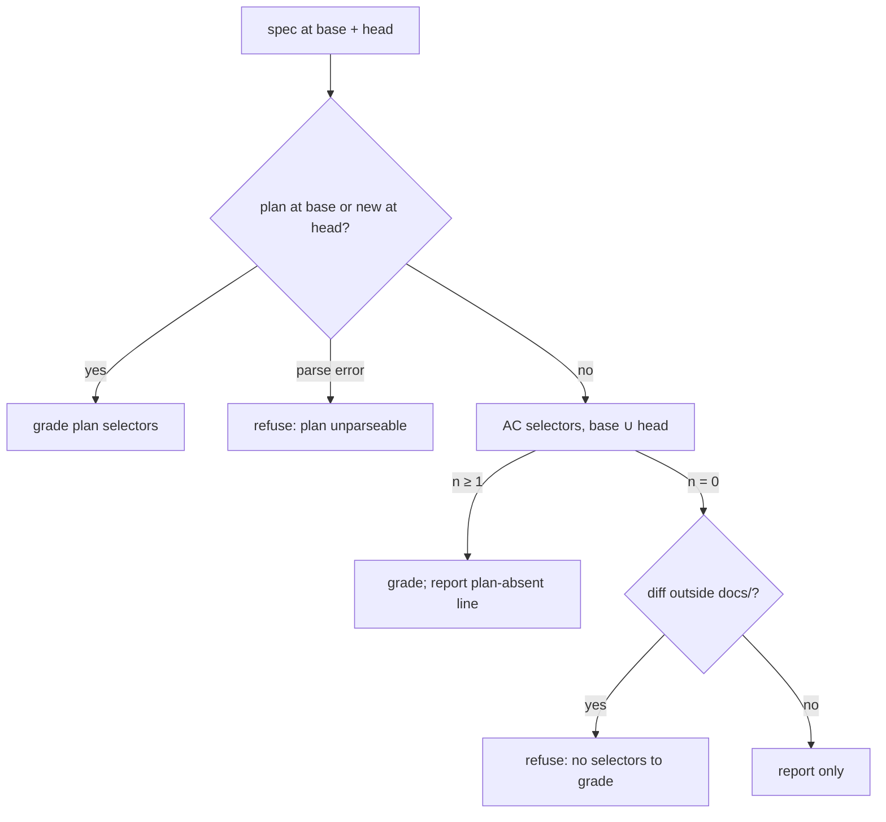

# An approved spec without a plan is graded on its acceptance criteria, and every refusal names what is missing

## Intent

Since SP-PLAN-SELECTOR-AUDIT-WIRE 0.2 (#250) and 0.3 (#253), the pure
merge gate grades a draft spec against the pytest selectors of its
Acceptance Criteria, but grades a spec past draft ONLY against
`docs/plans/<id>.md`. A spec past draft without a plan is refused with
the sentinel `plan-absent`, which the gate then hides behind the one
sentence `spec acceptance selectors not all present`. The gate is
therefore stricter on an approved spec than on a draft one, and the
refusal is about process history (no plan was ever committed), not about
the PR. This spec makes the Acceptance Criteria the contract whenever no
plan exists, whatever the status, and makes every coverage refusal name
what is missing, and stops a PR from escaping its specs by not
declaring one: an undeclared PR is graded against the specs that own the
code it touches.

## Decisions

Taken by the owner on 2026-10-26, on the 0.1 open questions and F7.

- D1 (Q1): A bare backticked node id containing `::`
  (`` `tests/x.py::test_y` ``) and a bare backticked test file path
  (`` `tests/x.py` ``) are selectors, as is a backticked `pytest …`
  invocation. Documented in SP-SPEC-TEMPLATE by its 0.2 amendment, in
  this PR. Measured effect on F2: 35 of the 51 zero-selector specs gain a
  contract (24 by node id, 11 by test file path only); 16 stay at zero.
- D2 (Q2): Moving a spec to `approved` will require at least one AC
  selector. That is a follow-up spec, named in tech_debt row 97, not
  specified here.
- D3 (F7): A PR that declares no spec is graded against every spec that
  owns a path of its diff (G7). Code owned by no spec is reported, never
  refused, in the frontier style of SP-ARCH-GRAPH / SP-SPEC-TEMPLATE
  ("reported, never enforced").

## Amendment (0.3, 2026-10-26): what the implementation added to the interface

- An example selector inside a criterion is quoted in a double-backtick
  span, as AC15 already did: under D1 a
  plain backticked node id in this section is a selector, so AC2, AC3
  and AC12 would have graded this spec's own PR against three test
  files that are fixtures of the tests, not deliverables.
- `pr_spec_coverage` gains three more additive columns than the two the
  Interface names: `report` (the lines reported and never refusing,
  `plan-absent: …` and the `no selectors to grade: …` of a
  documentation-only PR), `resolution` (`declared` / `ownership`, which
  prefixes a refusal with `<id>: `) and `batch` (the rows one grading
  recorded for one head; the gate folds the latest batch, so a PR whose
  declaration changes at the same head is not graded against the specs
  of an earlier resolution).
- `repoach spec audit --plans` also lists, per committed plan, the
  steps over `PLAN_STEP_MAX_FILES` / `PLAN_STEP_MAX_UNIT_SELECTORS`:
  `<id>\tstep <n>\t<files>/<cap> files\t<selectors>/<cap> selectors`,
  after the summary line, and `--json` carries them in
  `oversized_steps`. The gate does not enforce the caps (tech_debt row
  98).
- An undeclared PR whose base ref cannot be read: superseded by 0.4.

## Amendment (0.6, 2026-10-27): where the PR-level grading lives

From the review threads of #260:

- `src/repoach/review/spec_grading.py` (owned here) holds what grades a
  PR head against its specs: `SpecsByOwnership` and `specs_owning`,
  `readable_base` and `ownership_at_base` (the one base resolution the
  review and `review gate` share), `CoverageGrading` with its
  `resolution_payload`, `coverage_rows_at_head`, `failed_grading_row`,
  `redact_error`, and `refresh_stale_coverage`. `spec_gate` keeps the
  grading of one spec's contract and the coverage ledger. The Interface
  names below (`spec_gate.specs_owning`) read `spec_grading.specs_owning`.
- `project/spec_source.py` only types the `ownership` source
  (`OwnershipSource`); the review takes it from `CoverageGrading.source`.
  The helper the 0.2 Interface implied (`resolve_by_ownership`) had no
  caller that read anything but `.source`, and is gone.
- `governed_spec.ref_resolves` is the one `git rev-parse --verify` check
  of the spec readers.

## Amendment (0.5, 2026-10-26): an example is never a selector; a failed grading refuses

Measured on the gated merge of #260 (try 2): the gate refused
`spec acceptance selectors not all present: tests/x.py::test_y (AC2), tests/p.py::test_p (AC3), tests/a.py::test_a (AC12)`.
These are examples in prose, written with single backticks in the 0.2
text merged by #259; the contract is the union of base and head, so
quoting them at head (0.3) cannot remove them from the base half.

- D1 is amended: an example in an Acceptance Criterion is marked, and
  the extractor skips it. A backticked span prefixed `fixture:`
  (`fixture:tests/x.py::test_y`) and any target under `tests/fixtures/`
  (bare or in a `pytest …` invocation) are examples, never selectors. A
  span quoted inside a double-backtick span stays an example too.
  AC2, AC3 and AC12 name their examples with the prefix.
- The base half of the contract still holds the 0.2 examples until the
  base itself carries the prefixed text: a documentation-only PR
  carrying this text lands on develop first (graded by develop's rule,
  which does not read bare node ids), and this PR merges it.
- A grading that raises (a malformed spec at head, a git failure while
  resolving ownership) records a not-covered row
  `spec coverage not graded: <Type>: <message> (fail closed)` instead of
  recording nothing (F10, the Sentinel finding 41 of #260): no row reads
  as "coverage unknown", which the gate does not refuse. The message is
  published as a merge reason, so URL credentials and forge tokens in it
  are replaced by `***` (Sentinel finding 56 of #260: a failed fetch can
  echo a credentialed remote URL).

## Amendment (0.4, 2026-10-26): a prose plan is no plan; an unresolvable ownership fails closed

Measured on develop `51a4065`: 33 files under `docs/plans/` carry no
`<!-- repoach-action-plan -->` marker. G4 as written refused every PR
declaring (or, by G7, owning code of) one of these specs.

- G4 is narrowed. A `docs/plans/<id>.md` without the marker is not an
  action plan: the spec is graded exactly as if it had no plan (G1, or
  G3 when its Acceptance Criteria name no selector), and the report
  carries `plan file present but not an action plan: <path>` next to the
  `plan-absent:` line. `spec plan unparseable at <ref>: <error>` (fail
  closed) applies only to a file that carries the marker and does not
  parse.
- `repoach spec audit --plans` counts a spec whose plan file lacks the
  marker as a spec without a plan, and prints one
  `<id>\tnot an action plan: <path>` line per such file, distinct from
  `<id>\tplan does not parse: <error>` for a marked file that does not
  parse.
- G7 fails closed: an undeclared PR whose base ref cannot be read (so
  its specs cannot be resolved by ownership) is refused with
  `spec resolution by ownership not graded: base ref <ref> unavailable (fail closed)`,
  consistent with AC7; `spec_resolution.source` is `ownership`.
- AC7 is split into AC7a (unresolvable base ref, marked plan that does
  not parse) and AC7b (plan file without the marker); AC17 pins the
  fail-closed ownership refusal; AC9's fixture gains AC9b.

## Context

Measured 2026-10-26 on `origin/develop` `3412d55`, read-only
(`PATH=.venv/bin:$PATH PYTHONPATH=src`).

| # | Fact | Where |
|---|---|---|
| F1 | 211 specs carry `id` + `status`: 108 `draft`, 7 `proposed`, 93 `approved`, 3 `delivered`. **62 specs past draft have no `docs/plans/<id>.md`: 59 `approved` + 3 `delivered`** (`SP-PRECISION-MEASUREMENT`, `SP-PROVIDER-DIRECT-ANTHROPIC`, `SP-USAGE-LEDGER`). All 62 are governed (frontmatter loads through `load_governed_spec`), all 62 have an `## Acceptance Criteria` section, 44 declare `owns.code`. `docs/plans/` holds 49 `SP-*.md`. | `docs/specs/*.md`, `docs/plans/` |
| F2 | Of the 62, `spec_acceptance_selectors` finds ≥1 selector in **11** and **zero in 51**. Of the 51, 24 name a backticked node id without the `pytest` prefix (e.g. SP-FINDINGS-INIT-RACE: `` `tests/unit/test_findings_schema_race.py::test_concurrent_init_findings_schema_no_operational_error` ``), 11 name only a backticked test file path (e.g. SP-PROXY-STATE-PERSIST: `` `tests/unit/test_breaker_persist.py` ``), 16 name no test at all (e.g. SP-ARCH-GRAPH: its AC1–AC6 describe behaviours in prose), 13 of those 16 own code. | `spec_gate.py:698-740` (`_PYTEST_SPAN` requires `` `pytest …` ``) |
| F3 | `coverage_at_head` grades the AC section only when `draft is not None`, i.e. only when the head status is in `PRE_IMPLEMENTATION_STATUSES = {"draft","proposed"}`; `draft_scope_at_head` returns `(None, "")` for any other status, so the spec markdown is not even read. Otherwise, with no plan, it records `missing=["plan-absent"]` (base resolved) or `["base-ref-unavailable"]`, `n_promised=0`, `covered=False`. | `spec_gate.py:614`, `:977-1028`, `:1031-1089` |
| F4 | `compute_merge_decision` appends the fixed sentence `spec acceptance selectors not all present` whenever `spec_coverage_known and not spec_covered`, then the draft refusals. `MergeFacts.spec_missing` is filled from the row (`merge_gate.py:410`) and never read by the decision. | `merge_gate.py:195-197`, tech_debt row 95 (on #256's branch) |
| F5 | PR #256 at `103c333`, gate run 2026-10-26T01:11Z (spec SP-GATE-REVERIFIES-AT-HEAD, draft at base, set `approved` at head, no plan at base nor head). Review job log: `spec_gate.base_plan_absent_fallback_to_head … does not exist in 'origin/develop'`, `spec_gate.head_plan_also_unavailable`, `review_team.spec_coverage base_available=True covered=False … n_promised=0`. Auto-merge: `auto_merge.pure_gate merge=False … reasons=['spec acceptance selectors not all present']`, `notes: "pure gate refused: spec acceptance selectors not all present"`. The 11 selectors its AC section names were all present at that head. The branch then committed `docs/plans/SP-GATE-REVERIFIES-AT-HEAD.md` (`d61b620`) to get through. | Actions run 40251646529; PR #256 report comment |
| F6 | PR #254 at `a2d65eb`, review 2026-10-26T01:26Z and gate 01:30Z (spec SP-REFUTER-JUDGES-WHAT-IT-CAN set `approved` at head, no plan on the branch): the review recorded `"spec_coverage": "not_applicable"` because the PR declares no spec (no `Spec:` line, branch name does not resolve), and the pure gate logged `merge=True … spec_covered=False` (refused only for `mergeStateStatus=UNSTABLE`). Declared, it would hit F5: its AC section yields 3 selectors. #254 has since declared `Spec: SP-REFUTER-JUDGES-WHAT-IT-CAN` (head `f3050df`, pushed 2026-10-26T07:10Z); F6 describes `a2d65eb` only. | Actions jobs 121347641333, 121353306249 |
| F7 | F5 + F6: a PR that declares an approved-without-plan spec is always refused; the same PR declaring nothing is never refused on coverage (`spec_coverage_label` → `not_applicable`, "never refused for lacking one"). The gate rewards not declaring a spec. | `project/spec_source.py:133-153`, `cli/review_cmds.py:700-704` |
| F8 | SP-PLAN-SELECTOR-AUDIT-WIRE AC9 pins the current behaviour: "the same spec `approved` is refused with exactly `spec acceptance selectors not all present`". | `docs/specs/2026-07-24_SP-PLAN-SELECTOR-AUDIT-WIRE_…md:328-340` |
| F9 | `coverage_of_selectors` sets `covered = bool(selectors) and not missing and not refusals`: zero selectors is never covered, draft or not, so a docs-only draft spec PR whose AC names no pytest selector is refused with the same unnamed sentence. | `spec_gate.py:608` |
| F10 | `resolve_contract_plan` catches `BaseRefUnavailableError` and `FileNotFoundError` from `load_plan_from_ref`, not the `ValueError` of an unparseable base plan; the orchestrator's `_spec_coverage` catches every exception, logs `review_team.spec_coverage_skipped` and records no row, so the gate reads `spec_coverage_known=False` and does not refuse on coverage. By reading; not observed on a PR. | `spec_gate.py:826-882`, `orchestrator.py:1195-1215`, `merge_gate.py:195` |
| F11 | `SPEC_COVERAGE_RULE_VERSION = 1`; a row below the current version is recomputed at head before the decision (0.3), so bumping it re-grades every stored `plan-absent` row with the new rule. | `spec_gate.py:57`, `refresh_stale_coverage` |
| F13 | Open PRs read at 2026-10-26T07:07Z (7): 5 declared a spec (#259 and #256 by `Spec:` line; #249, #247, #246 by branch). **2 declared none and both touched owned code: #254 at `a2d65eb`** (17 code paths; owners SP-ORCH-DOCSTRING and SP-FINDINGS-BRIDGE-DOCFIX approved, SP-REFUTER-JUDGES-WHAT-IT-CAN, SP-UNIVERSAL-GATES, SP-UNIVERSAL-PROJECT-CONFIG draft; 10 code paths unowned) **and #255 at `755638f`** (15 code paths; owners SP-DEDUP-CLASSIFICATION-CONSTANTS and SP-ORCH-DOCSTRING approved, SP-REFUTER-JUDGES-WHAT-IT-CAN, SP-DRY-RUN-NEVER-POSTS, SP-UNIVERSAL-GATES draft; 10 unowned). Ownership read from the governed specs of develop `3412d55`. #254 has since declared its spec (`f3050df`, 07:10Z), so at that time #255 at `755638f` is the one open PR in this case. | `gh pr list --state open --json number,headRefName,body,files`, `resolve_spec`, `load_governed_spec` |
| F12 | No `repoach spec` command exists (`repoach --help`: develop, plan, chain-status, init, doctor, …, review). `cli/main.py` and `cli/review_cmds.py` are frontier (no owner); `spec_gate.py` is owned by SP-PLAN-SELECTOR-AUDIT-WIRE, `merge_gate.py` by SP-DEDUP-CLASSIFICATION-CONSTANTS, `governed_spec.py` by SP-ARCH-REVIEW-WIRE, `plan.py` by SP-PLAN-CONTRACT-LINTS. | `repoach --help`, governed-spec ownership scan |

## Goals

- G1: A spec whose status is not pre-implementation (`approved`,
  `delivered`, `reviewed`, any status outside
  `PRE_IMPLEMENTATION_STATUSES`) and that has no plan at base nor at head
  is graded against the selectors of its Acceptance Criteria exactly as
  a draft is, except that no selector is ever `planned` (a spec past
  draft has no exemption; an absent file is `missing`). The selectors
  are the union, base first, of the AC section at base (when the spec
  exists there) and at head, so a PR can neither drop a selector from its
  own contract nor escape one it adds. The report says, on the review's
  stderr, in the `review gate` JSON and in the PR report's facts table:
  `plan-absent: graded against the acceptance criteria of <id> (<n> selectors)`.
  The sentinel `plan-absent` is no longer a member of `missing`.
- G2: Every coverage refusal names its cause. `compute_merge_decision`
  emits `spec acceptance selectors not all present: <selector> (<origin>), …`
  where `<selector>` is `file::test` (or the file alone when the
  contract names only a file) and `<origin>` is the AC label (`AC3`) for
  an AC-sourced selector, `plan step <n>` or `plan integration` for a
  plan-sourced one, in contract order. `base-ref-unavailable` gets its
  own sentence: `spec coverage not graded: base ref <ref> unavailable, the contract cannot be read (fail closed)`.
  A sentinel never appears inside the selector list. Absorbs tech_debt
  row 95.
- G3: A contract with zero selectors (no plan, and the AC sections yield
  none, F2) is reported `no selectors to grade: <id> (<status>) has no docs/plans/<id>.md and its Acceptance Criteria name no pytest selector`.
  Decision (recommended and adopted): when the PR changes any path
  outside `docs/` other than the spec, that line is a refusal reason
  and the merge is refused; when the PR changes only `docs/`, the line
  is reported and does not refuse (there is no code to grade). The way
  out is to add a backticked `pytest <file>::<test>` line to the AC
  section, or to commit a plan; requiring a plan is not adopted because
  it makes the cheapest honest fix (one AC line) impossible and keeps
  two contracts where one suffices. This replaces F9 for drafts too.
- G4: A plan, when present at base (or, for a plan new on the PR, at
  head), stays the contract; the AC section is not read (unchanged,
  SP-SPEC-CONTRACT-BASE). A base plan that exists but does not parse is
  refused with `spec plan unparseable at <ref>: <error>` instead of
  recording nothing (F10, fail closed).
- G5: `repoach spec audit --plans` lists every spec past draft without a
  plan, so plans (or AC selector lines) are backfilled by area. One line
  per spec, sorted by first `owns.code` path then id:
  `<id>\t<status>\t<n> selectors\t<owns.code joined by ",", or "-">`,
  then a final line
  `<N> specs past draft without a plan (<M> with no selector to grade)`.
  `--json` prints one object `{"specs": [{"id", "status", "selectors", "owns_code"}], "total": N, "no_selectors": M}`.
  Exit code 0 always (a report, not a gate). A tech_debt row records
  the backfill (F1: 62 specs, 51 with no selector).
- G6: `SPEC_COVERAGE_RULE_VERSION` becomes `2`, so every stored
  `plan-absent` row is re-graded at head by the 0.3 mechanism before the
  next decision.

- G7: A PR that declares no spec (no `--spec`, no `Spec:` line, no
  branch match) is graded against every governed spec whose `owns.code`
  matches at least one path of its diff, ownership read at base (a PR
  cannot disown its code by editing a spec's `owns`), each spec graded
  exactly as if declared (G1–G4, draft scope included: a draft spec whose
  owned code the PR touches loses its exemption, as today). The merge
  needs every resolved spec covered; each coverage refusal line is
  prefixed with `<id>: `. One line per resolved spec is reported:
  `spec resolved by ownership: <id> (<n> paths)`. The changed paths
  outside `docs/` that no spec owns are reported in one line
  `ungoverned paths: <path>, …` and never refuse. A declared spec keeps
  today's behaviour (only that spec is graded); ownership resolution
  applies only when nothing is declared. The gate JSON gains
  `spec_resolution: {"source": "declared" | "ownership" | "none", "specs": [...], "ungoverned": [...]}`.

## Non-Goals

- NG1: Writing the 62 missing plans or rewriting the 51 zero-selector AC
  sections. G5 lists them; the backfill is the tech_debt row.
- NG2: Executing the selectors. Coverage stays a presence + non-trivial
  body fact (SP-SPEC-GATE); execution is CI's.
- NG3: Changing the declared-spec order (`--spec` > `Spec:` line >
  branch) or making declaration mandatory. G7 only fills the case where
  nothing is declared.
- NG4: Changing the draft exemption rules of SP-PLAN-SELECTOR-AUDIT-WIRE
  0.2 (planned selectors, docs-only scope, base status check), except
  the zero-selector outcome (G3).

## Assumptions

- A1: A spec's AC section lives under a level-2 heading
  `## Acceptance Criteria` and each criterion starts with
  `- [ ] AC<n>` or `- [x] AC<n>` (SP-SPEC-TEMPLATE); a selector found in
  a criterion's text (including its continuation lines) takes that
  label; a selector before the first label takes `AC`.
- A2: The base ref resolves in the review and gate jobs as it does today
  (`fetch_base`); when it does not, G2's sentence applies.

## Interface

`src/repoach/review/spec_gate.py`:

- `spec_acceptance_criteria(markdown: str) -> list[AcceptanceSelector]`
  where `AcceptanceSelector(selector: str, origin: str)` (frozen
  dataclass), first-occurrence order, de-duplicated by selector.
  `spec_acceptance_selectors` becomes its projection (unchanged
  output).
- `SpecCoverage` gains, additively: `contract: Literal["plan", "acceptance-criteria", "none", "unavailable"]`
  and `origins: dict[str, str]` (selector → origin, for `missing`
  rendering). `pr_spec_coverage` gains columns `contract TEXT NOT NULL DEFAULT ''`
  and `origins TEXT NOT NULL DEFAULT ''` (additive, `init_spec_coverage_schema`).
- `coverage_at_head` grades: plan (G4) → else AC union at base and head
  (G1; draft scope still applies to a pre-implementation spec) → else
  zero-selector outcome (G3) → `unavailable` only when the base ref does
  not resolve.
- `SPEC_COVERAGE_RULE_VERSION = 2`.

`src/repoach/review/merge_gate.py`:

- `MergeFacts` gains `spec_contract: str`, `spec_origins: dict[str, str]`,
  `spec_no_selectors_line: str`. `compute_merge_decision` renders G2/G3
  sentences from them; the bare sentence of F4 is never emitted without
  its list.

Ownership resolution (G7): `spec_gate.specs_owning(paths: list[str], *, root: Path, ref: str) -> SpecsByOwnership`
with `specs: dict[str, list[str]]` (spec id → owned changed paths, id
order) and `ungoverned: list[str]` (changed paths outside `docs/` owned
by none), built on the `owns.code` registry SP-ARCH-GRAPH derives, read
at the base ref. The orchestrator records one coverage row per resolved
spec at the head; `gather_merge_facts` folds them (covered iff every row
is covered). The resolution step in `project/spec_source.py` returns
`source="ownership"` when it applies.

`src/repoach/cli/spec_cmds.py` (new, owned here): typer group `spec`,
command `audit` with `--plans` (required for now; the only audit) and
`--json`; registered in `cli/main.py`.

## Behavior

### Nominal

- Approved spec, no plan, AC names 3 selectors, all present at head →
  `covered=True`, `contract="acceptance-criteria"`, merge (other facts
  green), stderr `plan-absent: graded against the acceptance criteria of SP-X (3 selectors)`.
- Same, AC3's selector absent → refused,
  `spec acceptance selectors not all present: tests/x.py::test_y (AC3)`.
- Approved spec with a plan → graded against the plan, AC ignored, no
  `plan-absent` line.

- No spec declared, diff touches `src/a.py` owned by approved SP-A
  (AC selector absent) and `src/z.py` owned by nobody → refused
  `SP-A: spec acceptance selectors not all present: tests/a.py::test_a (AC1)`;
  reported `spec resolved by ownership: SP-A (1 paths)` and
  `ungoverned paths: src/z.py`.

### Edge cases

- No spec declared, diff touches only unowned code → merges (other facts
  green), `ungoverned paths: …` reported, `spec_resolution.source == "none"`.
- No spec declared, diff touches only `docs/` paths no spec owns →
  nothing resolved, nothing reported as ungoverned.
- Selector forms (D1): `` `pytest -q tests/x.py::t` ``, `` `tests/x.py::t` ``
  and `` `tests/x.py` `` each yield a selector; a backticked `src/…py`
  path without `::` does not.

- Spec draft at base, approved at head (F5's shape) → union of base and
  head AC selectors, all graded as an approved spec (no planned).
- Spec new on the PR (absent at base) and approved → head AC only.
- Selector named in two criteria → one entry, origin of the first.
- AC section absent → zero selectors → G3.
- Spec not governed (no frontmatter) → today's behaviour, but the
  refusal names it: `spec coverage not graded: <id> has no frontmatter`.

### Failure scenarios

- Base ref unreadable → `contract="unavailable"`, G2's sentence, refused.
- Base plan unparseable → G4's sentence, refused, row recorded.
- Spec file unreadable at head → existing `spec_missing` path, unchanged.

## Architecture Impact

- Adds dependency: SP-APPROVED-SPEC-WITHOUT-PLAN-GRADES-ITS-ACS -> SP-PLAN-SELECTOR-AUDIT-WIRE (changes `spec_gate.py` grading; its 0.2 AC9 "approved is refused with exactly …" is superseded and its 0.4 amendment records it)
- Adds dependency: -> SP-DEDUP-CLASSIFICATION-CONSTANTS (changes `compute_merge_decision` reasons in `merge_gate.py`)
- Adds dependency: -> SP-SPEC-TEMPLATE (reads the `## Acceptance Criteria` / `AC<n>` format)
- Adds dependency: -> SP-ARCH-REVIEW-WIRE (`load_governed_spec`, `load_governed_spec_at_ref` for status and AC at base)
- Adds dependency: -> SP-PLAN-CONTRACT-LINTS (`plan_relpath`, plan parsing for G4 and G5)
- Adds dependency: -> SP-ARCH-GRAPH (the `owns.code` registry G7 resolves paths through)
- Adds dependency: -> SP-UNIVERSAL-PROJECT-CONFIG (`project/spec_source.py` gains the `ownership` source)
- Adds dependency: -> SP-ORCH-DOCSTRING (`orchestrator.py` records one coverage row per resolved spec)
- New coupling: `pr_spec_coverage` gains two additive columns and may hold several rows per head (one per resolved spec); no new table.

## Diagram

## Acceptance Criteria

- [ ] AC1: `pytest -q tests/unit/test_spec_gate_plan_absent.py::test_approved_spec_without_plan_merges_when_its_ac_selectors_are_present`
  → green: a git fixture with an `approved` spec at base and head, no
  `docs/plans/<id>.md`, an AC section naming two present selectors, a
  diff touching `src/`; `decide_at_head` merges, the row has
  `contract == "acceptance-criteria"` and `missing == []`.
- [ ] AC2: `pytest -q tests/unit/test_spec_gate_plan_absent.py::test_approved_spec_without_plan_names_the_absent_selector_and_its_ac`
  → green: same fixture, AC3's selector `fixture:tests/x.py::test_y` absent;
  `reasons` contains exactly
  `spec acceptance selectors not all present: tests/x.py::test_y (AC3)`,
  and no reason contains `plan-absent`.
- [ ] AC3: `pytest -q tests/unit/test_spec_gate_plan_absent.py::test_plan_wins_over_the_ac_section`
  → green: an approved spec whose base plan promises `fixture:tests/p.py::test_p`
  (present) while its AC names an absent selector → merges,
  `contract == "plan"`; the plan's selector absent instead → reason
  `… not all present: tests/p.py::test_p (plan step 1)`.
- [ ] AC4: `pytest -q tests/unit/test_spec_gate_plan_absent.py::test_zero_selector_contract_is_named_and_refuses_only_code_prs`
  → green: an approved spec, no plan, AC with no pytest selector; a diff
  touching `src/` is refused with
  `no selectors to grade: <id> (approved) has no docs/plans/<id>.md and its Acceptance Criteria name no pytest selector`;
  a diff touching only `docs/` merges and the line is reported in the
  JSON; the same holds for a `draft` spec.
- [ ] AC5: `pytest -q tests/unit/test_spec_gate_plan_absent.py::test_plan_absent_report_line_shape`
  → green: `review gate` stderr and the review's stderr each carry
  exactly one line
  `plan-absent: graded against the acceptance criteria of <id> (2 selectors)`,
  and the gate JSON `spec_acceptance` carries `contract` and the line.
- [ ] AC6: `pytest -q tests/unit/test_spec_gate_plan_absent.py::test_draft_to_approved_on_the_pr_grades_the_union_of_base_and_head_acs`
  → green: draft at base with AC selectors {a}, approved at head with
  {a, b}; both are graded, neither is `planned`; removing `a` from the
  head AC does not remove it from the contract.
- [ ] AC7a (0.4): `pytest -q tests/unit/test_spec_gate_plan_absent.py::test_base_ref_unavailable_and_unparseable_plan_have_their_own_sentences`
  → green: an unresolvable base ref yields
  `spec coverage not graded: base ref <ref> unavailable, the contract cannot be read (fail closed)`;
  a base plan that carries the marker and does not parse yields
  `spec plan unparseable at <ref>: …` and a recorded not-covered row;
  neither sentence lists a selector.
- [ ] AC7b (0.4): `pytest -q tests/unit/test_spec_gate_plan_absent.py::test_plan_file_without_the_marker_is_not_an_action_plan`
  → green: a base plan file without the marker is graded on the AC
  section (`contract == "acceptance-criteria"`), the report carries
  `plan file present but not an action plan: docs/plans/<id>.md`, and
  the refusal names the absent AC selector, never `unparseable`.
- [ ] AC8: `pytest -q tests/unit/test_spec_gate_plan_absent.py::test_stored_plan_absent_row_is_regraded_by_the_new_rule`
  → green: a `rule_version 1` row `missing == ["plan-absent"]` at head
  is recomputed (rule 2) and the decision merges when the AC selectors
  are present.
- [ ] AC9: `pytest -q tests/unit/test_spec_audit_cmd.py::test_audit_plans_lists_specs_past_draft_without_a_plan`
  → green: a fixture with one approved spec with plan, one approved
  without (owns `src/a.py`, 2 selectors), one delivered without (no
  owns, 0 selectors), one draft without; stdout is exactly
  `SP-B\tapproved\t2 selectors\tsrc/a.py`, `SP-C\tdelivered\t0 selectors\t-`,
  `2 specs past draft without a plan (1 with no selector to grade)`;
  `--json` parses to the G5 shape; exit code 0.
- [ ] AC10: `pytest -q tests/unit/test_spec_gate_draft.py` stays green
  with its "approved is refused with exactly `spec acceptance selectors not all present`"
  case rewritten to G1/G2 (SP-PLAN-SELECTOR-AUDIT-WIRE 0.4 amendment
  committed in the same PR), and
  `pytest -q tests/unit/test_replay_recomputes_spec_coverage.py` stays green.
- [ ] AC11: `docs/tech_debt.md` row 95 is removed and the backfill row
  stays until `repoach spec audit --plans` reports
  `0 specs past draft without a plan`.

- [ ] AC12: `pytest -q tests/unit/test_spec_resolved_by_ownership.py::test_undeclared_pr_touching_owned_code_is_refused_naming_the_selector`
  → green: `src/a.py` owned by an `approved` spec SP-A whose AC names
  one absent selector `fixture:tests/a.py::test_a`; a PR with no `Spec:` line and
  a non-matching branch touching `src/a.py`; `decide_at_head` refuses
  with `SP-A: spec acceptance selectors not all present: tests/a.py::test_a (AC1)`
  and reports `spec resolved by ownership: SP-A (1 paths)`.
- [ ] AC13: `pytest -q tests/unit/test_spec_resolved_by_ownership.py::test_undeclared_pr_touching_only_unowned_code_merges_with_the_ungoverned_line`
  → green: the same PR touching only `src/z.py` (owned by no spec)
  merges, the JSON carries `spec_resolution.source == "none"` and the
  report carries `ungoverned paths: src/z.py`.
- [ ] AC14: `pytest -q tests/unit/test_spec_resolved_by_ownership.py::test_ownership_is_read_at_base`
  → green: a PR that removes `src/a.py` from SP-A's head `owns.code`
  while touching it is still graded against SP-A.
- [ ] AC15: `pytest -q tests/unit/test_spec_gate_plan_absent.py::test_bare_node_id_and_test_file_path_are_selectors`
  → green: an AC section with `` `tests/x.py::test_y` `` (AC1),
  `` `tests/z.py` `` (AC2) and `` `src/repoach/a.py` `` (AC3) yields
  exactly `[("tests/x.py::test_y", "AC1"), ("tests/z.py", "AC2")]`.
- [ ] AC16: SP-SPEC-TEMPLATE is at version 0.2 with an amendment naming
  the three selector forms, and `docs/specs/_TEMPLATE.md`'s Acceptance
  Criteria guidance names them (this PR).

- [ ] AC9b (0.4): `pytest -q tests/unit/test_spec_audit_cmd.py::test_audit_plans_tells_a_prose_plan_from_a_corrupt_action_plan`
  → green: a plan file without the marker counts as no plan and prints
  `<id>\tnot an action plan: <path>`; a marked plan that does not parse
  prints `<id>\tplan does not parse: …`.
- [ ] AC17 (0.4): `pytest -q tests/unit/test_spec_resolved_by_ownership.py::test_undeclared_pr_with_an_unreadable_base_is_refused`
  → green: an undeclared PR whose base ref does not resolve is refused
  with exactly
  `spec resolution by ownership not graded: base ref <ref> unavailable (fail closed)`.

- [ ] AC18 (0.5): `pytest -q tests/unit/test_spec_resolved_by_ownership.py::test_a_grading_failure_records_a_refusing_row`
  → green: a grading that raises records a not-covered row and the gate
  refuses with exactly
  `spec coverage not graded: RuntimeError: <message> (fail closed)`.
- [ ] AC19 (0.5): `pytest -q tests/unit/test_spec_gate_plan_absent.py::test_fixture_prefix_and_fixtures_tree_are_examples_not_selectors`
  → green: an AC naming `fixture:tests/x.py::test_y`, or a target
  under the fixtures tree, yields no selector.

## Open Questions

(none — the 0.1 questions are decided by D1 and D2)
